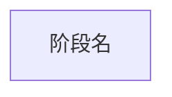

# 应用执行流程重建

这是 focused task，不进入热点优化或真机流程。历史样本只定义字段格式，不能提供当前业务事实。

## 发现

1. 使用 `repository-context.json.source_scope` 和 Kimi 原生 `Glob/Grep/Read/Bash` 探索源码；平台 MCP 只负责工件和校验。
2. 先调用一次 `application_flow_inspect_repository`。必要时补一次聚焦批量搜索，不展开完整调用链或全仓 HiTrace。
3. 默认整理 3 个候选，每个只需入口、完成语义、参与者及可复核路径/行号/符号。调用 `application_flow_publish_candidates` 后停止，等待用户选择。

## 生成

1. 用 `application_flow_read_asset` 读取选中的 artifact/flow_id，只深入该流程；将新增调用链和 HiTrace 锚点保存为聚焦 discovery。
2. 只生成一份 Mermaid，不手写场景 JSON、`stage_evidence` 或 `unknowns`。最小元数据格式：

3. 每个 `@stage` 紧跟 `start`+`end` 或 `matcher: unavailable`，二者不能并存。只有 discovery 中的源码插桩字面量才能写入 trace_point；缺失边界时使用 matcher，不用函数名冒充 event。多进程流程显式声明多个 `@process_group`。
4. 调用 `application_flow_compile_mermaid`。工具负责生成标准 v2 JSON、补齐固定字段、匹配 discovery anchor、形成 stage evidence、执行 Schema/快照校验并保存工件。

源码插桩只证明声明存在，不证明运行发生、时序、关键路径或耗时。需要 relation、复杂 matcher 或元数据转义时读取 `references/application-flow-scenario-contract.md`。
