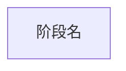

# 应用执行流程重建

这是 focused task。历史样本只定义格式，不提供当前代码事实。源码导航优先使用 `repository-context.json.source_scope` 与 Kimi 原生 `Glob/Grep/Read/Bash`；平台 MCP 负责工件、确定性转换和校验。

## 发现候选

1. 调用一次 `application_flow_inspect_repository`，结合其候选与必要的聚焦源码窗口识别业务入口、完成边界和参与者，不在本阶段展开完整调用链或搜索全仓 HiTrace。
2. 默认整理 3 个可复核候选，调用 `application_flow_publish_candidates` 后停止，等待用户选择。不要读取 discovery Schema 或手写完整 discovery JSON。

## 快速生成

1. 调用 `application_flow_read_asset` 读取用户选中的 artifact/flow，只围绕选中的流程深入调用链主干。提取足以表达业务拓扑的主要 stage，不为穷举旁支延迟首份结果。
2. 第一份结果直接生成一份带 `%% @` 元数据的 Mermaid，并对原 discovery 调用 `application_flow_compile_mermaid`；**本阶段不调用 `application_flow_save_discovery`**，不手写场景 JSON、`stage_evidence` 或 `unknowns`。
3. 只有原 discovery 已含精确源码插桩字面量时才写 `trace_point`。其余阶段统一写 `matcher: unavailable`；这表示流程拓扑已交付、Trace 边界待补证，不是失败。
4. 编译成功后停止。HiTrace start/end 搜索、聚焦 discovery 保存与带锚点重编译属于独立的后续证据增强任务，不得阻塞首份 Mermaid/JSON。

最小格式：

源码只证明静态流程与插桩声明存在，不证明运行发生、时序、关键路径或耗时。需要高级 locator、relation 或元数据转义时再读取 `references/application-flow-scenario-contract.md`。
