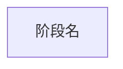

# 应用执行流程重建

这是 focused task。源码导航使用 `repository-context.json.source_scope` 与 Kimi 原生代码工具；平台 MCP 只负责工件和确定性校验。

## 阶段一：自适应发现

1. 先调用一次 `application_flow_inspect_repository`，按业务入口、完成边界、参与者和用户可观察结果归纳独立流程。
2. 候选数量由当前源码中的真实流程决定，不固定为 3。合并重载、别名、同步/异步包装和同一流程内部步骤，不为凑数拆分；入口覆盖不足或语义含糊时渐进补充聚焦源码证据，直到不再出现新的高价值流程类别。
3. 调用 `application_flow_publish_candidates` 一次发布 1 到 32 个有入口/出口行级证据的候选，然后停止等待用户选择。若真实候选更多，按业务子模块拆分任务并明确当前覆盖范围。不要搜索全仓 HiTrace，不手写 discovery JSON。

## 阶段二：快速生成

读取选中的 discovery/flow，只深入主调用链并提取主要 stage。生成带 `%% @` 元数据的 Mermaid，未知边界写 `matcher: unavailable`，调用 `application_flow_compile_mermaid`。不调用 `application_flow_save_discovery`，不手写场景 JSON；编译成功即交付首版。

## 阶段三：HiTrace 锚点

1. 读取页面指定的 discovery 与 scenario，只针对已有 stage，从实现符号、主调用链和邻近模块有界搜索真实 HiTrace 宏或包装接口。
2. 找到边界时记录 event 原文、相对路径、精确行号、宏、所在函数/作用域及匹配类型；函数名、注释、日志或推断文本不能充当 event。找不到的一侧留空并简述原因。
3. 对全部 stage 一次调用 `application_flow_enrich_trace_anchors`。平台逐行校验、生成稳定 ID、保存增强 discovery 并重编译 Mermaid/JSON；不要手写完整 discovery。
4. 成功后报告完整、部分和未找到的 stage。源码插桩只证明声明存在，不证明运行发生、时序、关键路径或耗时。
