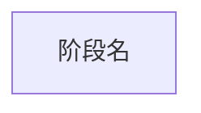

# 应用执行流程重建

这是 focused task。源码导航使用 `repository-context.json.source_scope` 与 Agent 原生代码工具；平台 MCP 只负责工件和确定性校验。

## 阶段一：自适应发现

1. 先调用一次 `application_flow_inspect_repository`，按业务入口、完成边界、参与者和用户可观察结果归纳独立流程。
2. 候选数量由当前源码中的真实流程决定，不固定为 3。合并重载、别名、同步/异步包装和同一流程内部步骤，不为凑数拆分；入口覆盖不足或语义含糊时渐进补充聚焦源码证据，直到不再出现新的高价值流程类别。
3. 调用 `application_flow_publish_candidates` 一次发布 1 到 32 个有入口/出口行级证据的候选，然后停止等待用户选择。若真实候选更多，按业务子模块拆分任务并明确当前覆盖范围。不要搜索全仓 HiTrace，不要手写完整 discovery JSON。

## 阶段二：快速生成

读取选中的 discovery/flow，只深入主调用链并提取主要 stage。生成带 `%% @` 元数据的 Mermaid，未知边界写 `matcher: unavailable`，调用 `application_flow_compile_mermaid`。不调用 `application_flow_save_discovery`，不手写场景 JSON；编译成功即交付首版。

## 阶段三：HiTrace 锚点

1. 读取页面指定的 discovery 与 scenario，只针对已有 stage，从实现符号、主调用链和邻近模块有界搜索真实 HiTrace 宏或包装接口。
2. 追到最终 label 表达式后分类提交：字符串字面量提交不含 `H:` 与 `|Ixx/|Mxx` 外壳的真实 label；格式化/拼接表达式提交源码可证明的静态前缀；`__func__`/`__PRETTY_FUNCTION__` 提交稳定 selector（例如 `HCameraService::CreateCaptureSession`）并标记 `function_derived`。完整 pretty-function label 由编译器生成，禁止复制源码声明并标成 exact。
3. 每个边界同时提交相对路径、精确行号、宏、所在函数/作用域及匹配类型；找不到的一侧留空。对全部 stage 一次调用 `application_flow_enrich_trace_anchors`，由平台展开包装宏、逐行校验并重编译 Mermaid/JSON。
4. 成功后报告完整、部分和未找到的 stage。场景 `trace_point.name` 是规范化 label 或 selector，`which` 才区分同步 slice 的 start/end；源码插桩不证明运行发生、时序、关键路径或耗时。
