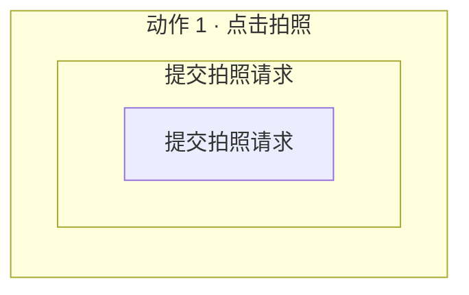

# 应用执行流程重建

加载 `code-context-retrieval`。语义图用于缩小范围，真实源码用于确认；平台工具负责工件、投影和校验。

## 一、完整操作候选

1. 先把用户目标整理为：初始状态、1～N 个有序用户动作、用户可观察的最终结果、包含与排除边界。候选必须覆盖这段完整旅程；单个函数、接口、回调或内部处理步骤不是候选流程。
2. 用 `code_graph_get` 确认 ready 底图，以 `code_graph_query_knowledge` 做有界查询，再回读入口、跨模块转发和完成边界附近的源码。静态调用候选只作导航，不冒充运行事实。
3. 候选数量不固定为 3；只有当入口、操作模式、完成语义或范围解释确实不同时才拆成多个候选。每个候选提交：
   - `operation_scope="complete_user_operation"` 与 `boundary_rationale`；
   - 有序 `user_actions`，每项含 `order/name/description/observable_outcome`；
   - 1～24 条 `semantic_outline`，概括从触发到完成的高层系统阶段；
   - 已核对的 entry/exit 源码位置、参与者和待确认问题。
4. 调用 `application_flow_publish_candidates` 后停止。用户要求调整时读取旧 discovery，按反馈重新组织完整候选，并传 `parent_discovery_artifact_id` 与 `refinement_request`；不要只修改显示文案。不要在本阶段闭合每条完整调用链或搜索全仓 HiTrace；不要手写完整 discovery。

## 二、分层阶段图

读取用户确认的 flow，再做一次有界语义查询并回读主调用链。按四层建模：用户动作 → 业务大阶段 → 可定位子阶段 → 函数级实现。`@stage` 表示可单独寻找 HiTrace start/end 的子阶段；不要用一个含糊大阶段覆盖多个实现边界，也不要把每个包装函数机械拆成 stage。

模型只生成 Mermaid。除现有 `@scenario/@stage` 外，加入以下 JSON 注释；每个 stage 必须有一个 hierarchy 绑定和至少一个已核对的 implementation：

`application_flow_compile_mermaid` 会把可定位子阶段按 order 投影到现有 `application-flow-scenario/v2`，同时保存分层结构；不要手写 JSON。未知 Trace 边界写 `matcher: unavailable`，编译成功即交付首版。

## 三、HiTrace 锚点

按分层工件中的 stage 和 implementation 函数链做有界搜索。字符串字面量提交真实 label，格式化事件提交静态前缀，`__func__/__PRETTY_FUNCTION__` 提交稳定 selector 并标记 `function_derived`。每个命中提交相对路径、精确行号、宏和所在函数；找不到的一侧留空。一次调用 `application_flow_enrich_trace_anchors` 提交全部结果，成功后报告完整、部分和未找到阶段。源码插桩不证明运行发生、关键路径或耗时。
