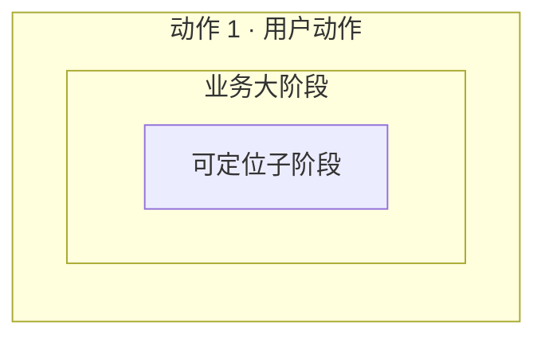

# 应用执行流程重建

加载 `code-context-retrieval`，用 `code_graph_query_knowledge` 对平台静态底图做有界查询。底图用于缩小范围，真实源码用于确认；平台工具负责版本工件、投影和校验。

## 一、完整操作候选

1. 把用户目标整理为初始状态、1～N 个有序用户动作、用户可观察的最终结果、包含与排除边界。候选必须覆盖完整旅程；单个函数、接口、回调或内部步骤不是候选流程。
2. 用页面给出的 ready `graph_id` 做有界知识查询，再回读入口、跨模块转发和完成边界源码。静态调用候选只作导航，不冒充运行事实。
3. 候选数量由不同入口、操作模式、完成语义和范围解释决定，不固定为 3。每个候选提交 `operation_scope="complete_user_operation"`、边界理由、有序 `user_actions`、高层 `semantic_outline`、参与者及已核对 entry/exit。
4. 调用 `application_flow_publish_candidates` 后停止。修订候选时读取父 discovery，并传 `parent_discovery_artifact_id` 与 `refinement_request`；不要覆盖父工件，也不要手写完整 discovery。

## 二、分层阶段图与版本修订

读取用户确认的 flow，再查询并回读主调用链。按“用户动作 → 业务大阶段 → 可定位子阶段 → 函数实现”建模。`@stage` 是后续可单独寻找 HiTrace 边界的子阶段；不要用一个大阶段吞并多个实现边界，也不要机械拆开无业务语义的包装函数。

只生成 Mermaid。每个 stage 必须有一个 `@stage_hierarchy` 和至少一个已核对的 `@implementation`，再调用 `application_flow_compile_mermaid`。工具把子阶段投影到现有 `application-flow-scenario/v2`，分层结构保存在场景工件外；缺少 Trace 时使用 `matcher: unavailable`。

用户修改已有场景时先读取 `focused_task.scenario_artifact_id` 或页面给出的父场景，只重查受修改要求影响的内容并保留仍成立的证据。发布时必须传 `parent_scenario_artifact_id` 与原始 `revision_request`，形成新版本；不得覆盖或删除父版本。

## 三、HiTrace 锚点

按 stage 及 implementation 函数链有界搜索真实 HiTrace。字面量提交真实 label，格式化事件提交静态前缀，`__func__/__PRETTY_FUNCTION__` 提交稳定 selector 并标记 `function_derived`。携带相对路径、行号、宏和所在函数；找不到的一侧留空。一次调用 `application_flow_enrich_trace_anchors` 提交全部阶段。源码插桩不证明真实运行、关键路径或耗时。
