# 应用流程场景 v2 通用契约

## 来源样本边界

该契约从一份历史负载文件中抽取字段结构。来源样本的场景、Trace 锚点、进程、阶段、常量、定位规则和事件名称都不是契约默认值。生成新场景时只能复用字段格式，所有字段值必须由当前代码仓、用户输入或真实 Trace 独立支持。

## 两类信息

代码仓重建先回答“完整用户操作从哪里进入、经过哪些动作与业务阶段、在哪里完成”。模型只创作一份带元数据的 Mermaid；`application_flow_compile_mermaid` 保存分层作者结构，再确定性生成场景 JSON，用于回答“在 Trace 中如何定位每个可锚定子阶段”。场景 JSON 以兼容 `stages` 和层级 `nodes` 表达结构，代码事实与证据保存在工件外层。

## 兼容基础属性

`version`、`scenario`、`description`、`source_mermaid`、`constants`、`process_groups`、`stage_search_window`、`stages`、`relations`、`relation_defaults`。

Stage 属性沿用：`id`、`name`、`process_name`、`order`、`optional`、可选 `time_window`，以及 `start` + `end` 或 `matcher`。属性名不能翻译、缩写或换成另一套命名。

`nodes` 与 `node_relations` 是增量层级投影。`nodes` 中每个节点使用 `type` 区分 `action`、`phase`、`stage`、`activity`，使用 `parent_id` 形成层级；每个节点都带 `start`、`end` 与 `boundary_source`。兼容读取方可继续使用 `stages`，层级读取方使用 `nodes`。

## 定位表达式

### trace_point

```json
{
  "type": "trace_point",
  "name": "ObservedTraceName",
  "name_match": "substring_case_insensitive",
  "which": "start",
  "process": { "process_group": "application" }
}
```

只有源码插桩字面量、真实 Trace 或用户证据确认过的名称才能写入 `name`。

`name` 匹配的是规范化的 HiTrace event label，不是 C/C++ 函数声明，也通常不包含原始 marker 的 `H:` 前缀及 `|Ixx`/`|Mxx` 等等级和模块后缀。同步 RAII 插桩在底层写入一个带名称的 begin marker 和一个不带名称的 end marker；Trace 解析器将它们还原为同名 slice，因此场景通过同一 `name` 配合 `which: start|end` 定位两侧。

- `HITRACE_METER_NAME(..., "text_classifier")`：`name` 为 `text_classifier`，可使用 `exact` 或按数据源能力使用 substring。
- 格式化或拼接表达式：只保存源码可证明的静态前缀，使用 substring/regex，并保留动态部分缺失证据。
- `__func__`/`__PRETTY_FUNCTION__`：完整 label 由编译器、命名空间、类型别名和限定符共同决定。源码模式只保存稳定 selector，例如 `HCameraService::CreateCaptureSession`，使用 `substring_case_insensitive`；只有真实 Trace 才能把它升级为完整 label 的 exact 匹配。

当前平台流程只执行源码校准。发现工件中的 `observed_in_source` anchor 必须记录精确 `source_location`，以及包含 `macro`、`event_label_match`、`build_condition` 的 `instrumentation`。编译器按 event name 与 process 唯一匹配 discovery anchor，自动生成 `stage_evidence.boundary_anchors`；标准场景 JSON 本身不增加证据字段。

### relation

```json
{
  "type": "relation",
  "relation": "wakeup",
  "direction": "incoming",
  "from_process": "upstream_process",
  "selection": "first"
}
```

支持 `wakeup`、`binder_sync`、`binder_async`，可选 `reference` 和 `pass_through`。

### matcher

`detailed_rule` 只引用平台已有规则。没有现成规则时，用 `composition.steps` 表达 `filter`、`aggregate`、`select`、`split`、`expand`、`pick` 等原子操作，并保留所需参数。

## Mermaid 元数据

```mermaid
%% @scenario scenario_id version=2.0
%% @description 场景说明
%% @constant RELATION_RANGE_NS=5000000000
%% @process_group application=app_process
%% @action {"id":"action_open","order":1,"name":"用户动作","description":"用户可理解的动作"}
%% @phase {"id":"phase_prepare","action_id":"action_open","order":1,"name":"业务大阶段","description":"阶段目标"}
%% @stage first_stage order=1 process=app_process required name="第一阶段"
%%   start: trace_point "ObservedStart" exact in application
%%   end: trace_point "ObservedEnd" exact in application
%% @stage_hierarchy {"stage_id":"first_stage","action_id":"action_open","phase_id":"phase_prepare"}
%% @activity {"id":"prepare_input","stage_id":"first_stage","order":1,"name":"准备输入","description":"取得并校验本轮输入"}
%% @activity {"id":"submit_work","stage_id":"first_stage","order":2,"name":"提交任务","description":"把已准备数据提交给执行单元"}
%% @activity_relation {"from":"prepare_input","to":"submit_work","type":"sequence","description":"输入就绪后串行提交"}
%% @implementation {"stage_id":"first_stage","activity_id":"prepare_input","order":1,"symbol":"StartOperation","path":"src/operation.cpp","line":42,"relation":"entry"}

graph LR
    A[第一阶段] --> B[第二阶段]
```



Mermaid 是模型生成的唯一场景源。`@action` 表示用户动作，`@phase` 表示业务大阶段，`@stage` 表示可独立定位 HiTrace 的子阶段。需要把子阶段继续拆细时，`@activity` 描述活动节点，`@activity_relation` 描述节点间执行关系，`@implementation.activity_id` 把源码实现绑定到活动；未拆细的旧写法仍可把 implementation 直接绑定 stage。每条 `%% @stage` 还需一对 `start`/`end`，或一条 `%%   matcher: unavailable`。`trace_point` 的 event 含空格时必须加引号；匹配方式可为 `exact`、`substring_case_insensitive` 或 `regex`。

活动关系支持 `sequence`、`data_dependency`、`control_dependency`、`async_dispatch`、`parallel`、`parallel_candidate`、`join_all`、`join_any`、`fallback`。这些关系进入 `application_flow_stage_hierarchy/v1` 侧车，并确定性投影到场景 JSON 的 `node_relations`；既有 stage 字段和 relation 枚举保持兼容。

复杂 locator 或 matcher 可直接写 JSON 对象，例如 `%%   start: {"type":"relation",...}`；Trace 关系可写 `%% @relation {"from":"a","to":"b","type":"binder","binder_type":"sync"}`。这只是高级转义口，仍由 v2 Schema 校验。图中禁止链接、点击脚本和自定义初始化指令。

编译器把分层信息保存为 `application_flow_stage_hierarchy/v1`，再生成 `type + parent_id` 节点与兼容 stage 投影。编译器同时补齐 `source_mermaid`、`stage_search_window`、`relation_defaults`，并从聚焦 discovery 生成 stage evidence 和 unknowns。模型只需维护 Mermaid 作者源。

## 可执行状态

- `ready`：所有 required stage 的 Trace 锚点由源码插桩、真实 Trace 或用户证据确认。
- `draft_needs_trace_evidence`：代码流程成立，但至少一个 required stage 只有静态推断。该状态仍可用于评审和后续采集设计，不能宣称 Trace 定位器已能稳定命中。

## 运行时分析侧车

真实 Trace 校准通过后，平台依据 `application-flow-stage-analysis-v1.schema.json` 生成 `application_flow_stage_analysis/v1`。它在兼容 `stages` 之外提供层级 `nodes`，保存各层节点的 start/end 墙钟包络、事件计数、累计事件时长、估算 Self/Inclusive 指标和 Top-N 事件，供“分析预览”与 JSON 下载使用。细粒度直接证据优先落到 activity，phase 与 action 由子节点包络聚合。同步 Scope Trace 可让 start/end 引用同一 event_id，两侧通过 `start_edge` 与 `end_edge` 表达各自边缘。
