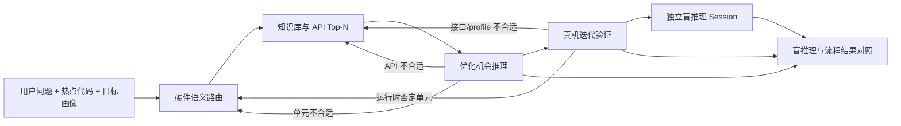

# 自适应推理与 Skill 版本库 Spec

> 状态：`Phase B 已实现（含 Agent-Centric 精简版本库）`
> 适用范围：热点代码形成后的独立盲推理、正式流程推理、结果对照、重新路由、API 重选和运行时 Skill 版本选择。  
> 依赖：[multi_strategy_hotspot_opportunity_reasoning_spec.md](multi_strategy_hotspot_opportunity_reasoning_spec.md)、[skill_evolution_and_evaluation_spec.md](skill_evolution_and_evaluation_spec.md)、[real_device_validation_spec.md](real_device_validation_spec.md)。

## 1. 目标

本设计同时解决四个问题：

1. 长 Skill 在连续修改后可能退化，但用户无法快速回到已知可用版本。
2. 单向的“路由 -> 推理 -> 真机”流程会把早期判断固化，后续证据难以纠错。
3. 过早门禁会把局部明确的优化候选连同尚未获得的端到端证据一起删除。
4. 仅观察流程推理结果，无法直观看出知识库、API 检索、Skill 和证据约束究竟带来了增益还是干扰。

因此，平台增加可回滚的 Skill 版本配置、独立盲推理基线和可逆流程。知识库、模板、Harness、评测和证据体系继续作为正式流程资产；盲推理只是一条诊断旁路，不替代这些资产。

## 2. 总体架构



主流程 Session 只接收正式流程事实。盲推理在流程推理和真机验证之后启动，但其新 Session 仍只接收最初的用户问题、热点代码、目标画像和自身历史，不接收前序结果。盲推完成后，平台再把冻结的盲推理结果、流程结果与设备证据发送到同一个盲推理 Session 做对照；盲推结论不会反向注入主流程 Session。

## 3. Skill 版本库

### 3.1 版本对象

运行时版本库以 `skill_version_library/v1` 发布。一个 profile 是一组协同 Skill 的冻结选择，而不是单个 prompt 的别名：

```json
{
  "profile_id": "adaptive-post-validation-2026-08-14",
  "parent_profile_id": "adaptive-2026-08-14",
  "profile_sha256": "...",
  "skills": {
    "page-agent-control": {
      "version": "3.2.0",
      "prompt_slot": "page_agent",
      "content_sha256": "..."
    }
  }
}
```

每个 Skill 保存 `skill_id`、语义版本、prompt slot、`prompt_mode`、来源文件和版本材料 SHA；profile 保存父版本、创建时间、说明、推荐状态和整体 SHA。`prompt_mode=append` 用于历史兼容 overlay，`prompt_mode=replace` 用于完整且不可变的新版 Skill。后者必须真正替换旧长 Prompt，不能以“精简版”名义继续叠加旧内容。

版本化源码位于 `agent-resources/skill-library/`：`profiles/*.json` 冻结一组协同 Skill，`skills/<skill-id>/<version>.md` 保存具体材料。被已发布 profile 引用的文件不得原地改写；修订必须创建新版本文件和新 profile。每次模型调用保存的完整有效 Prompt transcript 仍是最终审计依据。

确定性 Skill 的 action schema、输入输出合同、资源限制、错误码和证据门禁继续由 backend registry 管理，不进入模型 Prompt。所谓“全部 Skill 瘦身”指全部模型侧材料，不删除确定性执行合同。

### 3.2 选择与回滚

- 页面“技能列表”显示可选 profile、每个 Skill 的版本和内容 SHA。
- 选择按当前分析记录和 Agent Run 固化；运行中的请求不能被全局选择变化偷换 Skill。
- 切换 profile 只影响后续新推理，不改写历史 artifact、transcript 或结果。
- profile 变化会使当前未执行的路由/context 失效，必须重新准备，防止跨版本复用旧上下文。
- 回滚是选择已有 profile，不是回退代码、在线改 prompt 或覆盖历史版本。
- 已发布 profile 不原地修改。需要修订时创建新 profile，并保留父版本关系。

当前内置版本：

| Profile | 用途 |
| --- | --- |
| `stable-2026-08-13` | 保留引入盲推理、软门禁和可逆路由之前的流程行为。 |
| `adaptive-2026-08-14` | 保留前置盲推行为的可回退版本；增加结果对照、分级门禁、重新路由和 API 重选。 |
| `adaptive-post-validation-2026-08-14` | 历史自适应版本；先完成流程推理与真机验证，再运行隔离盲推并对照完整流程。 |
| `native-backend-2026-08-19` | Kimi 使用后端原生代码、文件、Shell、编译器和同机 HDC。 |
| `agent-centric-2026-08-19` | Agent-Centric 单 Session 完整版，保留较详细的流程说明用于行为对照与回滚。 |
| `agent-centric-lean-2026-08-19` | 首个精简版，保留用于回滚及对照。 |
| `agent-centric-lean-mermaid-2026-08-19` | Mermaid 单源精简版，保留用于回滚及对照。 |
| `agent-centric-fast-2026-08-20` | 快速契约回滚版；按分析记录隔离持久 Session，已知 action 直接执行，并用明确 JSON Schema、精简 RAG 和供应商等价字段适配减少目录加载、上下文压缩与结构修复。 |
| `agent-centric-page-2026-08-20` | 当前推荐版；每个浏览器页面绑定一个持久 Session，分析记录作为同一 Session 内可切换的审计上下文，并继承快速契约版的上下文与结构优化。 |

精简版覆盖 Agent runtime、页面 action、页面工件、真机验证、应用流程、自建 API 库、硬件路由、机会总约束、三种策略以及盲推/对照。Schema、context pack 和工具描述按需另行提供，避免在每个 Skill 中重复。推荐版以页面/标签页作为主会话边界：页面中的新建、装载、切换或重置分析记录只更新 `analysis_record_id` 和任务投影，不更换 Run 或 Kimi Session；新页面建立新的 `page_session_id`。应用流程 `2.0.0` 仍可回滚，新版 `2.1.0` 不再要求模型同步维护 Mermaid、JSON 与证据三份等价结构。

### 3.3 发布规则

新 profile 发布前必须通过 registry/来源文件校验、后端单元与运行时工作区测试、前端 lint/build、相关模型回归和至少一组失败样本。还要确认 replacement 版本中不含旧 base、模型侧总材料不突破评审预算、历史 profile 仍可解析。离线评测、消融、用户偏好和同模型自评均是诊断信号，任何单项都不能自动晋升版本。出现证据越界、action 越权、状态污染或明显成本回归时，可以立即切回完整 Agent-Centric 或稳定 profile，再单独修订新版本。

## 4. 独立盲推理

### 4.1 输入隔离合同

盲推理只允许接收：

- 当前热点代码全文；
- 用户的原始问题或简短优化目标；
- 用户选择的芯片、平台和操作系统画像，且明确标记为非设备探测；
- 输出 JSON 契约和盲推理 Skill。

禁止输入 KB 记录、API Top-N、规则或模型路由、Trace 指标、源码路径、正式流程结果、evidence ID 及主 Session 历史。这样得到的是模型先验基线，而不是被正式流程提示后的复述。

### 4.2 会话隔离

平台按 `project + code SHA + target profile` 生成稳定的盲推理分析 ID，并通过该 ID 创建独立持久 Session。主流程分析 ID 与盲推理分析 ID 永不相同。重试盲推理可沿用其自身 Session，但不得加入主 Session 的消息。

盲推理返回 `blind_opportunity_reasoning/v1`，至少包含：负载摘要、候选方向、候选 API/API family、CPU 并行判断、适用条件、风险、缺失证据和验证建议。具体硬件/API 仅是模型假设，不能产生 `context_supported` 或设备事实。

### 4.3 后置、隔离与非阻塞语义

盲推理推荐在正式机会推理与可执行的真机验证闭环之后运行。这个顺序让盲推结果成为对完整流程的事后基线，而不是路由前置条件；隔离输入合同保证它不会因为时间上后置而看到流程结果。若没有可用设备，主流程应先记录明确的环境终止证据，再允许用户手动运行盲推。盲推超时、429、JSON 失败或用户跳过都不改变正式结果；它不得控制硬件路由、预选 API 或成为设备执行门禁。

## 5. 流程结果对照

盲推基线保存后，平台把以下内容发回原盲推理 Session：

- 冻结的盲推理结构化结果；
- 对同一代码 SHA 生成的正式流程结果；
- 同一流程的真机执行结果或明确环境终止证据；
- 对照 Skill 和严格 JSON 契约。

对照结果 `blind_flow_reasoning_comparison/v1` 分别记录共识、分歧、流程新增的可审计证据、盲推理有价值但无来源的常识、双方遗漏、各自优缺点和合并后的下一步建议。`verdict` 只能是：

- `blind_better`
- `flow_better`
- `complementary`
- `inconclusive`

该 verdict 是同模型自评，可能有锚定、迎合和表达偏好，不是真值标签。它适合发现“长 Skill 压掉了明显候选”“KB 提供了盲推理不知道的真实 API”“流程只是变长但没有增加证据”等问题；正式版本发布仍须依赖独立 oracle、冻结测试集和真机证据。

## 6. 可逆流程

路由结果是当前最佳假设，不是永久绑定。流程允许以下回边：

| 发现 | 动作 | 保留内容 |
| --- | --- | --- |
| 策略发现该硬件单元与代码语义不相容 | 带原因重新运行硬件路由 | 旧路由和旧策略作为历史 artifact 保留 |
| 单元合理，但 API 语义/输入输出合同不匹配 | 在同一单元内重选 API 或重新检索 Top-N | 单元判断和失败 API 证据保留 |
| 真机 profile、capability 或运行时事实否定 API | 重选 API/template/profile | 构建、设备输出和失败原因保留 |
| 真机事实否定整个单元可达性或负载适配 | 重新路由并重新运行策略 | 原实验完整保留，不覆盖结果 |

新路由 artifact 会使其之前的策略结果在当前工作区失效，但不会删除历史记录。重新执行必须携带 `reason`；需要强制产生新 action 时携带新的 `retry_nonce`，避免幂等缓存错误复用旧结果。

## 7. 分级门禁

门禁分为三层，避免“证据还没收齐”被解释成“没有优化机会”：

| 层级 | 例子 | 行为 |
| --- | --- | --- |
| 硬门禁 | JSON/字段契约失败、伪造 evidence、工作站安全越界、action 依赖不存在、代码与结果 SHA 不同 | 停止当前动作，不能生成或执行下游操作 |
| 语义否决 | 数据依赖与目标并行模型冲突、API 输入输出合同不兼容、目标单元不能表达该计算 | 拒绝该候选；允许重选 API 或重新路由 |
| 成熟度门禁 | 设备 capability、搬运/同步、功耗、小批量成本、端到端 benchmark 未知 | 保留有源码支持的最小候选，降级为 `evidence_required` 并生成验证任务 |

分析范围必须先定位最小计算核心，再分别评价局部可映射性和端到端收益。用户粘贴较大函数时，未知外围调用不能自动抹去其中可见、可证伪的循环或子图候选；同样，局部候选也不能被包装成整条热点已获益。

## 8. API 与审计

| API / Action | 作用 |
| --- | --- |
| `GET /v1/skill-version-library` | 返回可选 profile、Skill 版本和 SHA。 |
| `POST /v1/projects/{id}/blind-reasoning/prepare` | 生成隔离的盲推理请求和 blind analysis ID。 |
| `POST /v1/projects/{id}/blind-reasoning/results` | 保存结构化盲推理结果。 |
| `POST /v1/projects/{id}/blind-reasoning/comparisons/prepare` | 校验同一代码并生成对照请求。 |
| `POST /v1/projects/{id}/blind-reasoning/comparisons/results` | 保存结构化对照结果。 |
| `reasoning.run_blind_analysis` | 页面 Agent 启动非阻塞盲推理。 |
| `reasoning.compare_blind_flow` | 页面 Agent 在正式结果后启动对照。 |
| `reasoning.run_hardware_semantic_route` | 初次路由或带原因重新路由。 |

每次 Agent Run、正式 context、路由和 transcript 都保存紧凑的 profile ID、profile SHA 和 Skill 版本映射。盲推理、正式推理和对照分别保存完整脱敏 transcript、token 用量、模型标识、Session/analysis ID、输入/结果 artifact 和状态；任何密钥不得进入 artifact。

## 9. 验收标准

1. 用户可以在页面选择稳定版或自适应版，并看到每个 Skill 的版本与内容 SHA。
2. 历史记录装载后仍使用当时冻结的 profile；切换版本不改写历史结果。
3. 盲推理请求中不存在 KB、API、路由、Trace、源码路径、evidence ID 或主 Session 消息。
4. 正式流程可以在盲推理失败或跳过时继续。
5. 对照必须复用原盲推理 Session，并校验盲结果与流程结果使用相同代码 SHA。
6. 盲推理结论不进入主流程 context；主流程最多看到盲推理的状态和 artifact ID。
7. 策略或真机阶段可带原因重新路由；新路由后不得继续复用旧策略作为当前结果。
8. API 不匹配可以在同一单元内重选，不强制把整个单元否定。
9. 缺少端到端证据会降低成熟度，但不会删除可见代码支持的最小候选。
10. 所有版本选择、重试、回边、模型调用、契约校验和结果 artifact 都可在分析记录中审计。
11. 精简 profile 的每个模型侧 slot 都使用 `replace`，有效 Prompt 中不再包含对应旧 base；确定性 Skill manifest 不受影响。
12. Skill 页面在窄宽度下不发生选择框与说明文字重叠，并显示版本、替换/追加模式、内容规模和内容 SHA。
