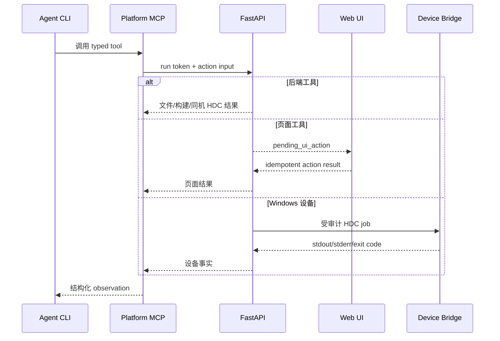

# Agent 框架接入指南

> 状态：Implemented v1.3
> 适用对象：平台开发者、Agent 框架维护者、部署管理员  
> 目标：在不削弱 Coding Agent 原生文件、Shell、Session 与工具能力的前提下，把 Kimi CLI、OpenCode 或团队自研 Agent 稳定接入同一页面助手。

## 1. 结论先行

平台把 Agent 集成拆成两个相互独立的 SPI：

| SPI | 解决的问题 | 最小接入成本 |
|---|---|---|
| `AgentCliAdapter` | 把真实交互式 CLI 挂到页面 WebShell；复用页面 Run、Skill、MCP、PTY 和分析状态 | 一份 JSON manifest；无须修改 Python/React |
| `AgentEngine` | 为结构化推理、独立 completion、健康检查、取消和原生事件流提供无终端后端 | 实现 Python Protocol，并在启动时注册 |

多数团队框架应先接 `AgentCliAdapter`。只有在需要取代 Kimi 的独立结构化推理通道时，才实现 `AgentEngine`。

### Windows 桌面 App 的接入边界

2026-10-27 开始验证本机 Code Agent + SSH 工作台，设计见 [desktop_workbench_design.md](desktop_workbench_design.md)。它复用“可执行程序、参数、工作目录、环境和工具说明”的厂商中立接入思想，以 `node-pty` / Windows ConPTY 承载交互式进程，通过本机 helper / MCP 复用桌面的 SSH 连接。这里的 POSIX 后端 manifest、PTY 行为和工作区路径不能直接作为 Windows 兼容证明；`.exe` / `.cmd` 启动、自动提交、工具发现、取消以及内部 Agent 实测需单独验收。0.1.26 的 Windows 内部 Agent、SSH、HDC 已由用户确认成功。0.1.27 桌面工具新增计划目录/保存/执行/取消与 Trace 查询，详见桌面设计 §9；它们执行本机采集，现有 `AgentEngine` 和 Web Platform Run 继续负责服务器任务与工件。

### 页面任务提交合同（v1.4）

场景采集、并行建模、负载特征和寻优校准的任务按钮统一进入当前页面 Agent 的 `sendCommand → /v1/agent-cli/sessions/{id}/commands`，不走只粘贴的 `/input`。`required_skill_id` 是统一字段；接收端兼容旧 `skill_id`，空串表示不指定 Skill。负载特征与寻优校准默认不关联新 Skill，使用当前投影的 MCP。点击时的任务参数快照进入 `focused_task.request_context`，终端等待期间切页不改变本次任务输入。

页面目录仍在初始化时，任务等待可用目标，最长90秒；明确不可用或未配置模型时拒绝。待发任务绑定 Adapter 与会话代际，在等待、队列出队、Session 就绪和上下文同步后检查：切换 Adapter、重启/恢复另一 Session 或卸载整个助手面板会拒绝尚未发送的旧任务；普通业务标签切换保持请求参数快照，已发送的任务继续执行。首次初始化允许绑定此前尚不存在的 Adapter / Session。WebShell 将上下文刷新和命令发送放在同一输入队列，与原始终端输入有序执行。页面按钮同步返回 `request_id` 后才派发事件，接收方的即时拒绝也能关联回对应按钮。

30秒尚未收到提交回执时，负载特征与真机验证页面显示继续等待，保持原 `request_id` 与提交锁；仅明确的 `accepted` / `rejected` 回执推进提交状态，不能由页面计时器解锁并诱发重复发送。Session 创建可使用其独立的90秒请求超时。提交进入命令 API 后不再因会话切换撤销成功回执，也不自动重试；此时请求可能已到达 PTY。

`accepted` 和 `onCommandSubmitted` 只在后端完成文本和 Adapter 声明的提交键写入后返回；不能把排队、显示文本或 HTTP 请求开始写成已提交。后端同一个 `command_id` 的并发重试等待首个发送完成，再复用成功结果；原发送失败时允许重试。此回执证明 PTY 投递，不证明 Agent 已开始推理、Skill 已实际装载或任务已完成，后续进展仍以 Agent 输出和真实工件为准。

多行文本由 `submit_mode` 的 bracketed-paste 帧传输，CR/LF 提交键遵循 Adapter 配置。PTY 是字节流，两次写入仍可能合并成同一编辑器输入批次；提前回显也不代表编辑器已准备好接收 Enter。`pty_output_settle/v1` 在正文完整写入后保守等待至少 1000 毫秒，并要求已观测输出静默 150 毫秒；无新输出时等待 1000 毫秒，持续输出时最多等 3000 毫秒再按协议提交。较大的 Adapter `submit_delay_ms` 始终作为等待下限，最多 5000 毫秒；plain 模式保持其声明延迟。输出只用于延长等待，不把普通回显当作 ready/accepted 握手。

Windows Desktop 的本地 Code Agent 使用 `pty_output_settle_v2`，配置和实际运行时共用 `100-5000 ms` 合同，未显式配置时保持 1000 ms 默认值。短文本且无终端输出时，100 ms 配置会在 100 ms 后实际写入提交键；超过 1 KiB 的文本按字节数增加最多 2000 ms 的有界余量。观测到终端输出时，还要求 80 ms 静默窗口，持续输出最多将本次等待延长 1500 ms。Web/POSIX Session 的 v1 合同保持上述保守时序，两端的回执都会记录实际等待。

配置值 `submit_delay_ms` 与有效下限 `effective_submit_delay_ms` 同时返回。终端 `last_submission`（`agent_cli_submission_transport/v1`）记录 `command_id`、策略版本、实际等待时间、等待结束原因、是否观察到输出、CR/LF、提交键次数与 `delivery_state`，不包含正文。Run 的 `terminal.command_submitted` / `terminal.command_reused` 事件仅在命令 ID 匹配时附加 `submission_transport`，避免并发命令错配证据。`delivered` 仍只证明文本和提交键已写入 PTY，这套有界等待不是 Agent 执行确认；团队内部 CLI 仍需实际回归。仅粘贴文本的用户操作不自动提交。

新接入的自定义 Adapter 默认 `submit_fallback_ms=0`，一次正文对应一次主提交键。历史 manifest 显式配置的非零 fallback 保留兼容，可能额外发送一次相同键，建议迁移为 `0` 并按实际编辑器调整提交等待。发送失败且尚未写出主提交键时，相同 ID 可重试；主键已经写出、仅后续显式 fallback 失败时，保留该 ID 防止整段正文重放。

回归入口：`node --test tools/tests/agent-task-submission.test.mjs tools/tests/agent-pending-lifecycle.test.mjs` 验证初始化等待、顺序、会话代际失效、页面等待提示与回执；`python3 -m unittest backend.tests.test_agent_cli_page_submission backend.tests.test_kimi_cli_terminal backend.tests.test_agent_cli_adapters` 通过真实本机 PTY 中的假 CLI 核对完整中文多行内容 SHA-256、CR/LF 与并发去重。从“让助手生成计划”的实际处理函数提取负载，对比旧 35 毫秒策略在慢读取中的失败，覆盖提前回显后延迟渲染、无回显、持续输出、会话退出和显式 fallback 失败。`tools/tests/scenario-capture-agent-browser.mjs` 在隔离 HTTP 响应下实际点击页面按钮，验证初始化等待、上下文快照和复用会话。测试不启动用户 Agent，也不调用模型服务。

2026-10-22 验证：18 项真实 PTY 模拟编辑器测试、45 项 API/Adapter 测试、13 项前端任务生命周期测试通过；全量后端运行 852 项，850 项通过、2 项跳过。lint、TypeScript 和生产构建通过。浏览器实际点击验证首次初始化与刷新复用会话，两次各发送一条完整中文多行命令，无额外 `/input` 回车、无页面脚本错误。测试未连接用户内部 Agent，远端 CLI 的实际执行仍以升级后的输出与计划工件为准。

## 2. 总体架构

```mermaid
flowchart LR
  UI[页面工作台与 WebShell] --> API[/v1/agent-cli]
  API --> RUN[持久 Platform Run]
  API --> REG[AgentCliAdapter Registry]
  REG --> K[Kimi Adapter]
  REG --> O[OpenCode Adapter]
  REG --> C[自定义 Manifest Adapter]
  K --> PTY[统一 PTY Runtime]
  O --> PTY
  C --> PTY
  RUN --> WS[独立 Run Workspace]
  WS --> TASK[task.json / AGENTS.md]
  WS --> SKILL[.agents/skills]
  WS --> MCP[.agent-platform/mcp.json]
  PTY --> WS
  MCP --> TOOLS[平台 MCP：页面、工件、构建、设备桥]
```

核心原则：

1. **页面 Session 是所有权边界**：一个页面只保留一个持久 Run；页面按钮和终端输入进入同一个 Agent Session。
2. **Agent 原生能力优先**：源码搜索、文件编辑、Shell 和本地编译由 Agent 框架原生工具完成；页面操作和 Windows HDC 通过平台 MCP。
3. **工作区合同中立**：平台先生成 `.agents/skills` 和 `.agent-platform/mcp.json`，Adapter 再投影为框架原生配置。
4. **命令不经过 shell**：manifest 只能给出 argv 数组；后端使用 `subprocess.Popen(argv, shell=False)`。
5. **密钥不落盘**：浏览器模型密钥只进入 Agent 子进程环境，不进入 manifest、Run event、artifact、终端日志或工作区配置。

## 3. 已内置框架

### 3.1 Kimi CLI

- Adapter ID：`kimi`
- Session：复用 Kimi Server 已创建的原生 `session_id`
- Skill：`.kimi-code/skills`，同时发布可移植副本到 `.agents/skills`
- MCP：`.kimi-code/mcp.json`
- Token：从 Kimi Session `wire.jsonl` 的 `usage.record` 增量汇总
- 浏览器模型覆盖：复用托管 Kimi Engine 的短期内存租约

### 3.2 OpenCode

- Adapter ID：`opencode`
- 启动：`opencode <run-workspace>`；重挂载使用 `--continue`
- Skill：使用 OpenCode 官方支持的 `.agents/skills`，并投影到 `.opencode/skills`
- MCP：从中立描述生成项目级 `opencode.json`
- 模型：浏览器提供 OpenAI-compatible URL、key 和 model 时，通过 `OPENCODE_CONFIG_CONTENT` 与临时环境变量注入；key 不写进 JSON
- 权限：工作区原生代码工具和平台 MCP 允许；`webfetch`、`websearch` 显式禁用
- Token：当前返回 `source=unavailable`，不会用估算值伪装成 provider 计量

OpenCode 的 TUI Session 参数、项目 Skill 目录和项目配置来自其官方文档：[CLI](https://opencode.ai/docs/cli/)、[Agent Skills](https://opencode.ai/docs/skills)、[Configuration](https://opencode.ai/docs/config)、[Providers](https://opencode.ai/docs/providers/)。

## 4. 接入自定义 Agent CLI

### 4.1 前置要求

自定义框架应满足：

- 后端 Linux/macOS 上存在可执行 CLI；Windows 仅作为浏览器或 Device Bridge 客户端时不受影响。
- CLI 能在指定工作目录启动交互式 TUI/REPL。
- 多行 prompt 至少支持 bracketed paste、CR 或 LF 中一种提交方式。
- 推荐支持持久 Session、`.agents/skills` 和 stdio MCP；不支持的能力必须在 manifest 中声明为 `false`。
- CLI 不能要求平台打开任意登录 Shell；它自己的原生 Shell 工具仍可在 Agent 内部使用。

### 4.2 编写 manifest

复制 [`agent-resources/agent-cli-adapters.example.json`](../agent-resources/agent-cli-adapters.example.json)，然后设置：

```bash
export HETERO_AGENT_CLI_CONFIG=/absolute/path/agent-cli-adapters.json
export HETERO_AGENT_CLI_ADAPTER=team-codeagent
./deploy/linux/heteroctl agent-check
```

`HETERO_AGENT_CLI_CONFIG` 登记 Adapter 清单，`HETERO_AGENT_CLI_ADAPTER` 选择后端默认项；前者本身不会改变默认 Agent。也可使用 `heteroctl start|restart --agent-adapter team-codeagent`。`agent-check` 在启动服务前验证 JSON、默认 ID 和 CLI 可执行文件。

关键字段：

| 字段 | 含义 |
|---|---|
| `adapter_id` | 稳定 ID，匹配 `^[a-z][a-z0-9-]{1,63}$`；不能覆盖 `kimi`、`opencode` |
| `executable` | 绝对路径或可由后端 `PATH` 找到的命令名 |
| `args` | 首次启动 argv；不接受单条 shell command |
| `resume_args` | 已有页面 Run 重挂载时追加的 argv |
| `session_strategy` | `native_session`、`workspace_continue` 或 `stateless` |
| `submit_mode` | `bracketed_paste_cr`、`bracketed_paste_lf`、`plain_text_cr` 或 `plain_text_lf` |
| `startup_input_delay_ms` | 首条页面命令等待 TUI 输入区初始化的最短时间；自定义 Adapter 默认 `600` 毫秒，允许 `0-5000` 毫秒 |
| `submit_delay_ms` | 内容写入与主提交键之间的配置延迟，默认配置值 `35`，允许 `0-5000` 毫秒；bracketed-paste 有效等待下限至少 `1000` 毫秒，结合有界输出静默策略；实际等待见 `last_submission` |
| `submit_fallback_ms` | 默认 `0`，关闭重复提交键。兼容旧清单显式配置的 `1-1000` 毫秒延迟，随后额外发送同一个 CR/LF；新接入优先调整 `submit_delay_ms` |
| `environment` | 固定环境或 `{env:NAME}` 引用；不会执行 `$()`、反引号或 shell 展开 |
| `model_config` | 浏览器模型配置注入方式 |
| `workspace.skill_roots` | Run 内接收可移植 Skill 投影的框架目录，必须是相对路径 |
| `workspace.skill_source_roots` | Agent 已安装 Skill 的附加来源目录；平台把缺失 Skill 导入当前 Run，可用绝对路径、manifest 相对路径、`~`、`$VAR` 或 `{env:VAR}`。后端运行账号的 `~/.agents/skills` 已作为最后一级默认来源，无需重复配置 |
| `workspace.mcp_format` | `kimi`、`opencode`、`neutral` 或 `none` |
| `workspace.mcp_path` | 框架的项目级 MCP 配置路径 |
| `capabilities` | 前端和诊断使用的能力声明；不能把未实现能力标成 true |
| `usage_kind` | Token 统计来源：`unavailable` 或自定义框架通用的 `standard_jsonl` |

允许的 argv 占位符只有：

- `{workspace}`：当前持久 Run 工作区绝对路径
- `{run_id}`：Platform Run ID
- `{agent_session_id}`：该 Adapter 在此 Run 中的稳定 Session ID
- `{mcp_config}`：按 `workspace.mcp_format` 生成的原生 MCP 配置绝对路径
- `{mcp_descriptor}`：厂商中立 `.agent-platform/mcp.json` 绝对路径
- `{skill_root}`：可移植 `.agents/skills` 绝对路径

页面命令把“内容”和“提交键”分开投递，行为更接近人工粘贴后按 Enter。首条命令等待 `startup_input_delay_ms`，随后按 v1.4 合同等待正文处理；新接入默认不重发 Enter。若人工按一次 Enter 即可执行，应选择对应的 `bracketed_paste_cr` 或 `bracketed_paste_lf`，保持 `submit_fallback_ms=0`。对于特别慢的内部终端，可以提高 `submit_delay_ms`；终端回执同时保留实际等待，而不是只显示配置值。

自定义框架需要统计 Token 时，把 `usage_kind` 设为 `standard_jsonl`，并声明 `capabilities.token_usage=true`。平台会向 Agent 进程注入 `HETERO_AGENT_USAGE_JSONL`；Agent 每完成一次模型调用，就向该文件追加一行（每行是增量，不是累计值）：

```json
{"schema_version":"agent_cli_usage_event/v1","usage":{"input_tokens":1200,"output_tokens":180,"cached_input_tokens":640,"cache_creation_input_tokens":0}}
```

也兼容 OpenAI 风格的 `prompt_tokens`、`completion_tokens` 与 `prompt_tokens_details.cached_tokens`，以及对应 camelCase 字段。平台只汇总 Agent 明确写出的 provider 用量，不从终端文本猜测 Token；未接入该协议时保留 `usage_kind=unavailable`，页面会明确显示“Agent 未提供”。

对于支持显式 MCP 配置参数的 CLI，推荐直接把配置路径写进启动 argv：

```json
{
  "args": [
    "--workspace", "{workspace}",
    "--mcp-config", "{mcp_config}",
    "--session", "{agent_session_id}"
  ],
  "workspace": {
    "mcp_format": "kimi",
    "mcp_path": ".team-agent/mcp.json"
  }
}
```

`--mcp-config` 只是示例名称，必须替换成目标 CLI 真实支持的参数。若框架通过环境变量读取配置，则使用平台自动注入的 `HETERO_AGENT_MCP_CONFIG`；不要只把文件生成到工作区却不让 CLI 消费它。

Skill 目录同理：`workspace.skill_roots` 负责把文件投影到 Run，并不等于目标框架已经把目录登记进原生 Skill listing。框架支持显式 Skill 参数时，应在 `args` 中使用 `{skill_root}`；否则必须支持读取 `HETERO_AGENT_SKILL_ROOT`，或自动发现配置的项目级投影目录。`.agent-platform/skill-bootstrap.json` 只记录投影清单、版本与哈希，不是业务 MCP 的前置门禁；未确认或未发现可产生诊断，但不能让流程、代码图和推理工具统一返回 HTTP 409。

Agent 框架在用户 Shell 中能发现全局 Skill，不代表从平台隔离 Run 启动时也能发现。平台会自动把**后端进程运行账号**的 `~/.agents/skills` 作为最后一级来源导入；若 Skill 安装在其他位置，再把真实目录登记为来源，而不是把来源误写进只接收工作区投影的 `skill_roots`：

```json
{
  "workspace": {
    "skill_roots": [".agents/skills", ".team-agent/skills"],
    "skill_source_roots": [
      "/home/user/.team-agent/skills",
      "$TEAM_AGENT_HOME/skills"
    ]
  }
}
```

每个来源既可以直接指向一个包含 `SKILL.md` 的 Skill 目录，也可以指向其父目录。平台只扫描一层直接子目录；优先级依次为当前 Profile/用户激活版本、显式 `skill_source_roots`、`~/.agents/skills`，多个外部来源同名时采用靠前来源。导入内容及哈希记录在 `.agent-platform/external-skill-imports.json`，最终投影结果记录在 `.agent-platform/adapter.json`。例如把 `team-code-analysis/SKILL.md` 放入后端运行账号的 `~/.agents/skills` 后，下一次工作区刷新会把它投影到中立目录和当前 Agent 的原生 Skill 目录。

### 4.3 Session 策略

| 策略 | 适用框架 | 行为 |
|---|---|---|
| `native_session` | CLI 接受显式 Session ID | 首次和恢复都传稳定 `{agent_session_id}`，恢复时追加 `resume_args` |
| `workspace_continue` | Session 由 CLI 自己存储并按项目恢复 | 首次只传 workspace；后端重启或 PTY 重建时追加 `resume_args`，OpenCode 使用此模式 |
| `stateless` | 无持久会话能力的简单 Agent | 每次 PTY 重建都视为新 Agent；Platform Run 和工件仍保留，但模型对话上下文不保证恢复 |

`terminal_session_id` 不能作为会话主键，它只属于当前 FastAPI 进程。浏览器以独立、稳定的 `page_session_id -> run_id` 绑定恢复业务状态；后端在客户端绑定缺失时按页面所有权查找原 Run，并把 Adapter 原生 Session ID 或 workspace continuation 信息从 Run 的 `engine` 字段重新投影到新 PTY。框架升级导致原生 Session 真正不可恢复时，必须显式记录重绑；不得把新 PTY 或新原生 Session 伪装成原对话仍完整存在。

### 4.4 模型配置模式

`model_config.mode` 有三种：

1. `inherit`：CLI 读取管理员或用户已有的自身配置；浏览器配置不注入。
2. `openai_compatible`：平台按 OpenCode 的 OpenAI-compatible provider 合同生成进程内配置；仅内置 OpenCode 使用。
3. `environment`：把浏览器字段映射到框架指定环境变量：

```json
{
  "mode": "environment",
  "base_url_env": "TEAM_MODEL_BASE_URL",
  "api_key_env": "TEAM_MODEL_API_KEY",
  "model_env": "TEAM_MODEL_NAME",
  "context_window_env": "TEAM_MODEL_CONTEXT_TOKENS"
}
```

注意：环境变量对同一后端 Unix 用户可见。平台保证不持久化，但不能替代多用户环境下的进程隔离和企业密钥服务。

## 5. 工作区合同

每个 Run 的生成目录包含：

```text
<runtime>/state/kimi-engine/workspaces/<run_id>/
├── .agent-platform/
│   ├── workspace.json       # 厂商中立入口
│   ├── integrations/        # 可选代码知识引擎的发现与投影状态
│   └── mcp.json             # stdio MCP 中立描述
├── .agents/skills/          # 可移植 Skill 仓
├── .agents/agents/          # 可选阶段 Agent 定义
├── .kimi-code/              # Kimi 原生投影
├── AGENTS.md                # 当前任务的运行时约束
├── repository-context.json  # 已授权源码范围；按任务存在
└── task.json                # 页面目标、模式、上下文和 Skill 版本
```

Adapter 只能向此工作区写框架配置，不能修改用户原始代码仓。源码仓通过 `repository-context.json.source_scope` 暴露；Agent 使用自己的代码导航和 Shell 读取它。

代码知识任务加载平台的 `code-knowledge-analysis` 与 `code-context-retrieval`，通过平台 MCP 查询快照绑定的静态底图，并使用 Agent 原生源码工具复核关键关系。Adapter 负责把同一 Skill、MCP 和源码范围合同投影给不同 Agent 框架；报告发布继续使用统一平台 MCP。

每次启动还会注入以下厂商中立环境变量：

| 环境变量 | 内容 |
|---|---|
| `HETERO_AGENT_WORKSPACE` | 当前 Run 工作区 |
| `HETERO_AGENT_RUN_ID` / `HETERO_AGENT_SESSION_ID` | 当前平台 Run 与 Agent Session |
| `HETERO_AGENT_SKILL_ROOT` | 可移植 Skill 根目录 |
| `HETERO_AGENT_MCP_DESCRIPTOR` | 中立 MCP 描述文件 |
| `HETERO_AGENT_MCP_CONFIG` | Adapter 原生 MCP 配置；`mcp_format=none` 时不设置 |
| `HETERO_AGENT_MCP_FORMAT` | 当前投影格式 |

Skill 的正常发现仍由各 Agent 框架负责。平台会先把 `workspace.skill_source_roots` 中发现的外部 Skill 补充到可移植仓，再按以下顺序回退：读取 `$HETERO_AGENT_SKILL_ROOT/<skill-id>/SKILL.md`；变量不可用时读取当前工作区 `.agents/skills/<skill-id>/SKILL.md`；仍不存在时遵循当前目录层级的 `AGENTS.md` 和框架自身约定。不要绕过投影仓直接读取平台安装目录，因为 `.agents/skills` 还包含当前 Profile、用户激活版本和本 Run 已审计的外部 Skill 快照。

`.agent-platform/adapter.json` 记录本轮 Adapter、Skill 和 MCP 投影路径，但不包含模型密钥或额外工具令牌，可用于部署诊断。

## 6. MCP 与页面操作

Agent 不直接调用 React 函数。平台为每个 Run 启动 run-scoped stdio MCP，工具调用路径是：



### 6.1 工具所有权合同

平台 MCP 一旦出现在当前框架的工具列表中，就直接属于当前页面 Agent Session。Agent 应自行调用并等待结构化 observation，不得回复“请在页面侧通过 Kimi Session 触发”。其中只有 `ui_execute_registered_action` 的执行端位于浏览器：Agent 仍负责发起调用，平台负责把 pending action 投递给活动页面并把结果返回原 Session。

共用的 `AGENTS.md`、`.agents/skills`、页面按钮命令和 MCP tool description 必须使用“当前页面 Agent Session”这一厂商中立身份。`Kimi`、`OpenCode` 或团队框架名称只允许出现在 Adapter 专属启动、配置和诊断中，不能用来描述共用工具的所有者。

硬件路由与机会推理已经暴露为框架无关的高频 typed MCP 工具：

- `reasoning_prepare_hardware_semantic_route`
- `reasoning_run_hardware_semantic_route`
- `reasoning_prepare_context`
- `reasoning_run_strategy`

页面按钮会直接把这些真实工具名发送给当前 Agent。Agent 应从工具列表直接调用，不得在平台源码中 `ls`、`grep` 同名 Action ID，也不需要先读取全量 `task.json` 或动作目录。底层 `reasoning.prepare_*`、`reasoning.run_*` 仍是平台注册 Action ID，仅作为页面执行与审计实现细节；`ui_execute_registered_action` 保留给尚未提供专用 MCP 包装的低频动作。

要让自定义 Agent 操作页面，必须满足其一：

- 原生支持 stdio MCP，并在启动时真实读取 `{mcp_config}` / `HETERO_AGENT_MCP_CONFIG` 指向的配置；或
- 开发一个新的 MCP 配置投影器，再扩展 `MCP_FORMATS`，不要让 Agent 解析页面 DOM。

`capabilities.mcp=true` 只影响能力声明和页面诊断，不会把工具凭空注入模型。若 Agent 回复“没有 `reasoning_prepare_hardware_semantic_route` 调用入口”，依次检查：页面 Adapter 说明是否显示“MCP 已投影”；工作区 `.agent-platform/adapter.json` 的 `native_config` 是否正确；CLI 启动 argv 或进程环境是否拿到该路径；框架自己的工具列表是否实际出现上述四个 typed tool。前三项正常而第四项为空，说明目标框架没有加载该 MCP 配置，需要修正 Adapter 启动参数或框架 MCP loader，而不是让模型去 `ls/grep` 平台源码。

每个 Run 还会生成 `.agent-platform/mcp-tools.json`，其中保存真实 facade SHA、工具目录 SHA、工具数量、完整工具名和本轮 Server ID。Server ID 绑定 facade SHA；新增、删除或修改工具后，平台会替换原生配置中的旧 `heterogeneous_platform_*` Server，并在投影合同变化时重建 PTY 连接，防止持久 Agent Session 沿用旧工具目录。若平台清单含有某工具而 Agent 原生列表仍缺失，问题位于该框架的 MCP loader、工具数量限制或 Session 缓存，不是业务 Skill，也不应通过修改 Skill 绕开。

平台在 MCP `tools/list` 出口还会把 Pydantic 生成的本地 `$defs/$ref` 确定性内联，并把可省略的 `anyOf(value, null)` 投影为非空参数；因此自定义 Agent 只需支持基础的 object、array、string、number、boolean、enum 和约束字段。该投影只用于工具发现，FastMCP 执行时仍使用原始 Pydantic argument model 做嵌套类型、必填字段和数值范围校验。若 Agent 只能看到扁平工具、看不到带嵌套参数的工具，应先对比它收到的 `inputSchema`，不要把问题误判成 Skill 未加载。

## 7. 可选：实现完整 AgentEngine

CLI Adapter 不负责独立结构化推理。若自定义框架还要取代 Kimi Server completion，实现 [`backend/agent_engine.py`](../backend/agent_engine.py) 的 `AgentEngine` Protocol：

```python
class AgentEngine(Protocol):
    engine_id: str

    def health(self) -> dict: ...
    def ensure_session(self, *, run_id, workspace_path, title, metadata, existing=None): ...
    def run_prompt(self, *, binding, prompt, on_event, cancel_requested): ...
    def cancel(self, binding, *, prompt_id=None) -> None: ...
```

实现要求：

- `ensure_session` 幂等；相同 Run 恢复相同原生 Session。
- `run_prompt` 将 reasoning、assistant text、tool call、usage 和错误转为统一事件，不只返回最终文本。
- `cancel` 必须终止当前模型/工具工作，但不能删除 Run 历史。
- provider key 只通过短期租约或子进程环境传递。
- 健康检查要区分“服务不可用”和“服务已启动但模型未配置”。

完成后在 `backend/app.py` 的运行时工厂注册新的 `HETERO_AGENT_ENGINE` 值。CLI 与 Engine 可以来自同一框架，也可以组合，例如 Kimi structured completion + OpenCode 页面 TUI。

## 8. API 合同

新客户端使用：

| API | 用途 |
|---|---|
| `GET /v1/agent-cli/adapters` | 查询可用 Adapter、默认项和能力 |
| `POST /v1/agent-cli/sessions` | 创建/重挂载当前页面 Agent；请求含 `adapter_id` |
| `GET /v1/agent-cli/sessions/{id}` | 恢复 Session 与 Run |
| `POST .../commands` | 以 adapter submit mode 提交完整多行 prompt |
| `POST .../input` | 传递原始 PTY 字节，如方向键和 Ctrl+C |
| `POST .../context` | 刷新 task、Skill、MCP 与当前分析绑定，不发模型请求 |
| `GET .../output` | 可恢复的有序 PTY cursor poll；浏览器使用立即返回的短请求，避免占满同源连接槽 |
| `GET .../usage` | provider usage projection；不可得时明确返回 unavailable |

`/v1/kimi-cli/*` 在兼容期内仍映射到同一实现，但新代码不得继续依赖该命名。

## 9. 接入验收

每个 Adapter 至少通过以下检查：

1. `GET /v1/agent-cli/adapters` 显示 `available=true`，错误路径不会被静默忽略。
2. 新页面创建一个 Run；刷新页面后恢复同一 PTY 或同一原生 Agent Session。
3. 切换 Adapter 时保留同一 Run、左侧工作台和 artifact，只重建 PTY。
4. 粘贴多行 C/C++ 代码只提交一次，不在第一行提前发送。
5. Agent 能发现 `.agents/skills`，并能按需读取而非把全部 Skill 注入每轮上下文。
6. Agent 能列出并调用平台 MCP，页面 action 结果保持幂等。
7. API key 不出现在 `terminal.ansi`、`task.json`、`opencode.json`、Run export 和进程启动 argv。
8. 后端重启后，浏览器收到 `AGENT_CLI_SESSION_NOT_FOUND` 时保留稳定 Run 绑定并自动退避重挂载；客户端 Run 缓存缺失时，后端仍按 `page_session_id` 恢复同一 Run。
9. 不支持 Token 统计时返回 `source=unavailable`，UI 不伪造缓存命中率。
10. 禁用 WebSearch/Fetch 的部署策略在目标框架中有可执行验证，而不只是文档声明。

自动回归入口：

```bash
python3 -m unittest backend.tests.test_agent_cli_adapters backend.tests.test_kimi_cli_terminal
npm run lint
npx tsc --noEmit
```

## 10. 常见故障

| 现象 | 原因与处理 |
|---|---|
| Adapter 显示不可用 | 后端找不到 executable；检查服务进程的 `PATH` 或配置绝对路径 |
| 页面切换后立即退出 | `args`/`resume_args` 与实际 CLI 版本不一致；先在后端同一用户下手工执行 argv |
| Skill not found | 先查看 `.agent-platform/external-skill-imports.json`：外部 Skill 应登记在 `workspace.skill_source_roots`，框架接收投影的项目目录才登记在 `workspace.skill_roots`；随后确认 `HETERO_AGENT_SKILL_ROOT` 指向当前 Run 的 `.agents/skills`，以及目标 CLI 是否真的消费了该目录 |
| 多个 MCP 工具统一返回 HTTP 409 | 先读取结构化 `error.code`。新版 Skill Bootstrap 是非阻断诊断；若仍为 `SKILL_BOOTSTRAP_REQUIRED`，说明后端仍是旧版本，应停止旧 API 进程后重新部署 |
| Agent 看不到页面工具 | MCP 格式不匹配或框架未启用 stdio MCP；查看工作区原生配置和 Agent 启动输出 |
| 只有部分 MCP 工具不可用 | 对比 `.agent-platform/mcp-tools.json` 与 Agent 原生工具列表；确认原生配置只保留一个当前哈希的 `heterogeneous_platform_*` Server。若目录哈希不一致，重新挂载页面 Agent；若一致但仍缺项，检查目标框架的工具上限、目录缓存，以及它是否错误过滤含嵌套 object/array 的基础 JSON Schema |
| Agent 要求“Kimi/页面代为调用” | 共用 Skill、按钮 prompt 或 MCP 描述泄漏了厂商身份；确认默认 runtime Skill 为 `agent-runtime-orchestrator >= 1.4.0`，并检查当前工作区 `.agents/skills` 已刷新 |
| 浏览器模型配置无效 | Adapter 为 `inherit`，或自定义环境变量名不正确；检查能力目录与 manifest |
| Token 显示 Agent 未提供 | 框架尚未输出用量；实现 `HETERO_AGENT_USAGE_JSONL` 协议，并把 manifest 的 `usage_kind` 设为 `standard_jsonl`、`capabilities.token_usage` 设为 `true` |
| 切换框架后旧上下文消失 | 目标框架不支持 Session 恢复；改用 `native_session`/`workspace_continue`，或接受 stateless 降级 |

## 11. 演进边界

当前版本刻意不做“万能 CLI 自动猜测”。不同 Agent 的 Session、模型、MCP、usage 和权限语义必须由 Adapter 显式声明。后续可以增加 ACP 或框架原生 HTTP Adapter，但应继续复用相同的 Platform Run、工作区合同、事件审计和页面 MCP，而不是在前端再实现一套 Agent loop。
