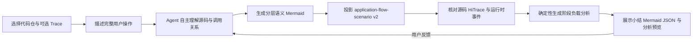
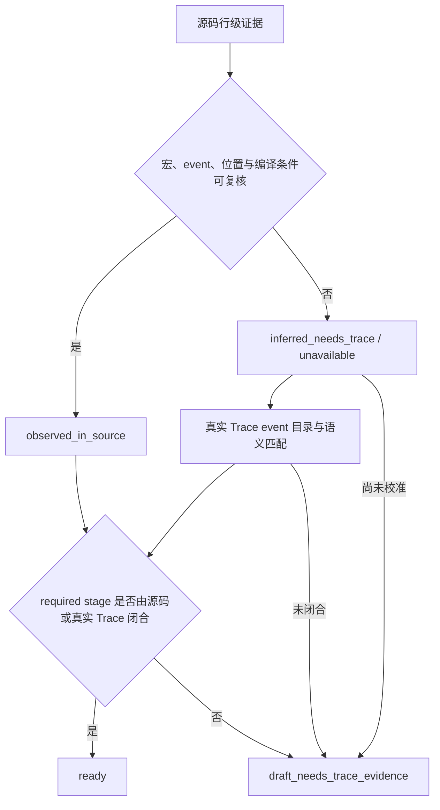

# 应用执行流程重建技术规范

状态：Implemented v2.5
适用范围：单用户、1～12 个已登记 Source Connector、代码仓内只读分析、任意业务域的应用流程场景 v2 产物

## 1. 目标与边界

本能力根据用户描述直接从一个或多个代码仓重建“用户可理解的应用流程”，并转换为：

1. 可视化 Mermaid 流程图；
2. 保持既有字段名、层级与取值形状的应用流程场景 v2 JSON；
3. `用户动作 → 业务大阶段 → 可锚定子阶段 → 细粒度活动关系 → 函数实现` 的分层作者模型；
4. 每个阶段对应的源码证据、源码声明的 HiTrace start/end 及闭合状态；
5. 可下载、可审计、绑定源码快照的不可变工件。
6. 可重复分析、续改和逻辑删除的 discovery/scenario 版本资产。
7. 每个用户动作的源码覆盖状态、关联代码仓和疑似缺失模块。
8. 真实 Trace event name 与阶段的匹配侧车，以及由运行时证据驱动的阶段图修订版本。
9. 采用独立 Schema 的阶段负载分析侧车、时间轴预览与可下载 JSON。

它解决的是跨函数、线程、进程和模块的应用执行流程。源码插桩用于发现候选边界，用户导入的真实 Trace 用于确认事件是否出现、运行顺序和时间范围；静态可达不等于运行时必经，Trace event name 也不自动等于 CPU 热点函数。

## 2. 输入基线与泛化结论

Schema 从以下两类既有资产抽取：

- `agent_flow_runv3_v2.json` 与 `agent_flow_runv3_v2.mermaid`：只提供字段名、对象层级、值类型、阶段定位表达式和 Mermaid 对齐格式。文件名中的 `runv3` 是先前一次负载分析的 Trace 锚点，不是通用场景类型。
- 相机配置源码流程图 `camera_config_flow_from_code.mmd`：只提供跨参与者、IPC、状态转换和阶段拆解的方法参考；它是架构 `sequenceDiagram`，不能直接充当动态 Trace 定位契约。

来源样本中的场景 ID、进程名、stage、常量、matcher 规则、事件名和业务顺序均不得成为默认值。新产物的每一个业务值都必须由当前代码仓、用户描述或当前 Trace 独立支持。泛化后形成三份独立契约：

- `application_flow_discovery/v1`：作为内部来源血缘，保存本轮选定完整操作、动作覆盖及行级源码证据。
- `application-flow-scenario-v2.schema.json`：约束本轮完整操作的阶段、Trace 定位草案、关系和 Mermaid 可视化；产物继续使用既有 `version: "2.0"` 字段。
- `application-flow-stage-analysis-v1.schema.json`：约束真实 Trace 校准后派生的阶段时间包络、事件计数、阶段内 Top-N 事件及其测量语义；它是场景侧车，不进入场景 v2 JSON。

| 可以继承 | 不可继承 |
|---|---|
| 属性名、对象层级、字段必选性、值类型、枚举集合、跨字段约束 | 场景 ID、业务名称、进程和线程名称、阶段划分、常量值、matcher 参数、Trace 锚点 |
| Mermaid 元数据到 JSON 的确定性映射方式 | 参考样本的执行顺序、动态必经性、关键路径结论 |

## 3. 两步交互工作流



### 3.1 第一步：构建模块代码知识底图

用户可选择一个主代码仓及多个关联代码仓，并针对每个模块范围显式构建 `module_code_graph/v1`。后端使用 Tree-sitter 提取文件、函数/类型声明、调用点、include 和 HiTrace 插桩候选，写入独立 SQLite 导航索引；Artifact Store 只保存源码快照、scope、提取器版本、数据库哈希和统计摘要。每份底图独立绑定 `source_connector_id + source_snapshot_id + scope`，流程工件通过 `source_scopes` 固化整组绑定，任一快照变化都不能静默复用。

底图是可复用的高召回静态导航层：唯一名称解析出来的调用边保持 `static_syntax_candidate`。流程任务通过 `code_graph_query_knowledge` 取得与用户目标相关的符号、调用和 HiTrace 候选，再读取关键源码确认虚调用目标、跨模块关系、入口和完成边界。编译绑定可由 Clang/LSP 增强，运行时发生由 Trace 或采样证据确认。

### 3.2 第二步：直接重建阶段图与证据

页面要求用户描述一段完整操作。Agent 自主确定合理的初始状态、有序用户动作、完成边界和阶段粒度，并按当前线索组合代码底图、原生源码搜索、LSP、调用关系分析和 Trace 证据。底图是可选导航能力；已有强入口、Trace 或符号线索时可以直接阅读真实源码。

首次分析直接产出一个最符合用户目标的完整操作及其分层阶段图，不再设置独立候选确认步骤。为兼容既有场景 Schema，Agent 用 `application_flow.publish_candidates` 将这个选定操作登记为内部 discovery，并提交 `action_coverage`：`mapped` 保存关联仓和源码摘要，`partial/unmapped` 保存缺口和疑似缺失模块。该调用只建立来源血缘，不触发第二轮候选选择。

### 3.3 第二步内部：生成分层语义阶段图并投影

Agent 在同一次分析中理解主调用链、状态转换、IPC/回调两端。中间模型包含五类信息：用户动作描述用户实际做了什么；业务大阶段聚合一个可解释目标；可锚定子阶段定义后续能够独立寻找 HiTrace 边界的执行单元；细粒度活动继续拆解子阶段内部的提交、计算、等待、回调、汇合或回退；函数实现层保存活动或子阶段的源码调用关系。暂时无法落到当前源码范围的阶段可以保留，其缺口进入 `unknowns` 和页面小结。

Agent 只生成一份带分层元数据的 Mermaid。`application_flow.compile_mermaid` 逐行复核函数位置和层级引用；关联仓实现用 `source_connector_id` 标识，工件内部的稳定 `path` 字段编码为 `@source/<connector-id>/<relative-path>`。分层模型作为 `application_flow_stage_hierarchy/v1` 保存到场景工件根部，再把可锚定子阶段按稳定 order 投影为既有 `application-flow-scenario/v2` JSON、`stage_evidence` 和 `unknowns`。因此最终下载 JSON 的 `id`、`name`、`order` 等字段保持不变；旧工件则显示为 `legacy_flat_projection`。

当一个子阶段还需要拆解时，作者层可增加 `@activity` 和 `@activity_relation`。活动至少包含 `id`、所属 `stage_id`、展示 `order`、名称和说明；关系可表达 `sequence`、`data_dependency`、`control_dependency`、`async_dispatch`、`parallel`、`parallel_candidate`、`join_all`、`join_any` 与 `fallback`。`@implementation.activity_id` 可把已核对函数绑定到具体活动。它们只进入分层侧车，不增加或修改场景 v2 字段；没有这些元数据的历史工件继续按原路径加载。

用户修改已生成的阶段图时，页面把当前 `scenario_artifact_id`、discovery、flow 和修改要求交给同一页面 Agent Session。Agent 读取父场景，只重查受影响的阶段，并在调用 `application_flow.compile_mermaid` 时提交 `parent_scenario_artifact_id + revision_request`。后端生成单调版本号和父子血缘，旧版本不被覆盖。

### 3.4 第二步内部：HiTrace 锚点增强

首份阶段图不因缺少插桩而阻塞。用户按需启动锚点增强后，Agent 对每个 implementation 先调用 `application_flow.inspect_trace_instrumentation`，由确定性检查器识别直接 HiTrace API、C/C++ 模块宏、包装函数、RAII scope、ArkTS `Trace.*` 和 `hiTraceMeter.*`，并返回字面量、静态前缀、函数派生信息及可解析的宏定义链。Agent 再沿相邻调用链确认阶段边界与 start/end 配对。`application_flow.enrich_trace_anchors` 逐行校验并重编译 Mermaid/JSON；无法闭合的边界保持 `draft_needs_trace_evidence`。

### 3.5 第二步内部：真实 Trace 校准与阶段图优化

用户可选择已有 Trace 或导入原始 `.htrace`、阶段分析 JSON。原始 Trace 经 TraceStreamer 转为只读 SQLite 后，`application_flow.inspect_runtime_trace` 从 callstack 表按“真实 event name + 执行上下文”提取出现次数、首末时间、进程线程上下文及 inclusive span 摘要；同名事件位于不同进程或线程时保留为不同 event ID。阶段 JSON 则只读取报告实际携带的 start/end 和事件列表。事件目录不依赖 self-time 排名，因此低自耗时的边界事件仍可参与匹配。

确定性工具使用源码候选名称和 implementation 符号提供有界检索提示，但不做最终归属。Agent 综合用户动作、阶段语义、源码调用关系、真实事件名和时序，判断每个 stage 的 start/end、scope 或 supporting event。提交时必须引用目录中的真实 `event_id`，后端再校验 Mermaid 边界是否使用对应的精确 event name；未匹配阶段必须显式保留。

当 Trace 暴露出阶段遗漏、错误合并、过度拆分或顺序偏差时，Agent 可修订完整分层 Mermaid。`application_flow.apply_runtime_trace_alignment` 通过现有编译器产生新的场景版本，并把匹配详情保存为 `application_flow_runtime_trace_alignment/v1` 侧车。下载的 Mermaid 继续使用既有元数据，下载 JSON 继续严格通过 `application-flow-scenario-v2.schema.json`，不会增加运行时专用字段。

运行时匹配通过后，平台生成 `application_flow_stage_analysis/v1`。阶段 `duration_ms` 是墙钟包络：原始 `.htrace` 使用已确认的 stage start/end，外部阶段 JSON 优先保留报告明确提供的 `time_range_ns`。原始 `.htrace` 会在包络内统计 TraceStreamer span，并以“父跨度减直接子跨度”的估算值排序 Top-N；外部报告保留其 `event_count`、`total_event_duration_ms` 与 `top_events`。两种路径都显式声明事件累计时长可能重叠，且该估算不等同于采样证明的 CPU self-time。模型负责边界语义，确定性代码负责换算、聚合、排序和 Schema 校验。

### 3.6 分析资产管理

页面按代码仓列出每次完整分析及其全部场景版本，并显式标记分析 scope 与当前/历史源码快照。点击记录会同时装载输入范围、最新阶段图和页面 Agent 上下文；用户可针对当前场景生成新版本。删除采用逻辑删除：资产从用户目录与读取 API 隐藏，删除内部 discovery 时显式级联其场景；底层不可变 JSON 和审计事件继续保留。

## 4. 不可改名的场景字段

### 4.1 顶层

| 字段 | 含义 |
|---|---|
| `version` | 固定为 `2.0` |
| `scenario` | 稳定场景 ID |
| `description` | 场景说明 |
| `source_mermaid` | 同场景 Mermaid 相对文件名 |
| `constants` | 时间窗、跳数等命名常量 |
| `process_groups` | 进程逻辑分组 |
| `stage_search_window` | 全局阶段检索窗口 |
| `stages` | 有序阶段列表 |
| `relations` | 进程或线程间关系 |
| `relation_defaults` | 关系解析默认参数 |

### 4.2 Stage

Stage 的字段名保持为 `id`、`name`、`process_name`、`order`、`optional`、`time_window`、`start`、`end`、`matcher`。`order` 必须从 1 连续递增；一个 stage 只能采用以下一种模式：

- `start` + `end`：由 `trace_point` 或 `relation` 定位边界；
- `matcher`：使用已有 `detailed_rule` 或通用 `composition` 描述复杂匹配。

定位及关系内部继续保留既有字段：`type`、`name`、`name_match`、`which`、`process`、`relation`、`direction`、`reference`、`from_process`、`to_process`、`pass_through`、`selection`、`rule`、`params`、`steps`、`from`、`to`、`binder_type`。完整约束以 `application-flow-scenario-v2.schema.json` 为准。

## 5. Mermaid 单一源契约

Mermaid 必须包含以下机器可读注释：

```text
%% @scenario <scenario> version=2.0
%% @description <description>
%% @process_group <group>=<process_name>
%% @action {"id":"action_id","order":1,"name":"用户动作","description":"动作语义"}
%% @phase {"id":"phase_id","action_id":"action_id","order":1,"name":"业务阶段","description":"阶段语义"}
%% @stage <id> order=<order> process=<process_name> required|optional name="<name>"
%%   start: trace_point "<observed_event>" exact in <group>
%%   end: trace_point "<observed_event>" exact in <group>
%% @stage_hierarchy {"stage_id":"<id>","action_id":"action_id","phase_id":"phase_id"}
%% @activity {"id":"activity_id","stage_id":"<id>","order":1,"name":"细粒度活动","description":"活动语义"}
%% @activity_relation {"from":"activity_id","to":"next_activity_id","type":"sequence","description":"关系依据"}
%% @implementation {"stage_id":"<id>","activity_id":"activity_id","order":1,"symbol":"Function","path":"src/file.cpp","line":42,"relation":"call"}
```

每个 stage 声明 `start`+`end` 或 `matcher: unavailable`，并绑定一个 action/phase。`@activity`、`@activity_relation` 和 `@implementation.activity_id` 是可选的分层侧车元数据；未继续拆解的 stage 仍可直接绑定 implementation。已经核对的源码实现通过 `@implementation` 保存；当前范围无法解析的阶段不伪造实现，其 stage ID 会进入分层侧车的 `unresolved_stage_ids` 和场景 `unknowns`。高级 locator/matcher 可使用 JSON 对象转义；多进程流程显式声明多个 process group。工具生成固定 JSON 字段并校验层级引用。页面以 `securityLevel: strict` 渲染，并提供自适应、25%～300% 缩放和拖拽浏览。

## 6. 证据与状态



`ready` 表示 required stage 的 start/end 已由当前源码快照中的 HiTrace 插桩、真实 Trace 匹配，或两者共同闭合。质量字段以 `source_declared_only`、`runtime_observed`、`mixed_source_runtime` 区分证据范围；即使运行时已闭合，也不自动表示该阶段属于关键路径、CPU 自耗时高或值得优化。

源码锚点匹配级别为 `exact_literal`、`wrapper_literal`、`function_derived` 或 `static_prefix`。作用域型事件可让 start/end 引用同一 anchor；显式 Start/Finish 必须证明配对并覆盖主要控制流。callee 内事件不能自动升级为调用者 stage 边界。

### 6.1 Trace 名称语义

场景中的 `trace_point.name` 是规范化 HiTrace event label 或其稳定 selector，不是源码函数声明。原始同步 marker 通常形如 `B|pid|H:<label>|I38`；作用域结束写入不带 label 的 `E|...`，Trace 解析后才形成具有同一 label 的 duration slice。因此 `which: start|end` 表示该 slice 的两侧，不要求源码存在两个同名字符串。

| 源码表达式 | 场景 `name` | `name_match` | 证据要求 |
|---|---|---|---|
| `HITRACE_METER_NAME(..., "text_classifier")` | `text_classifier` | `exact` 或兼容数据源的 substring | 字符串字面量及插桩行 |
| `HITRACE_METER_FMT(..., "RenderFrame[%d]", id)` | 可证明的静态前缀，如 `RenderFrame[` | substring/regex | 格式串、动态参数边界 |
| 包装宏最终使用 `__func__`/`__PRETTY_FUNCTION__` | `HCameraService::CreateCaptureSession` 等稳定 selector | `substring_case_insensitive` | 调用点、包装宏定义、所在函数 |

`__PRETTY_FUNCTION__` 的完整值受编译器、命名空间、类型别名、参数名消除和限定符影响。例如源码声明中的 `int32_t`、参数名和省略的命名空间未必出现在运行时 label 中。因此只有真实 Trace 可以提供完整 exact label；源码分析不能把声明行复制到 `name`。平台后端会展开包装宏、自动将函数派生事件归一为稳定 selector，并拒绝未出现在字符串字面量中的 `exact_literal`/`wrapper_literal`。

每份 discovery 和 scenario 均绑定主 `source_connector_id`、完整 `source_scopes`、Schema 哈希及输入工件。任一关联代码仓快照变化后，旧 discovery 不能继续生成新 scenario，必须重新发现，防止旧行号污染新代码。

## 7. Agent Skill 与工具面

Skill：`application-execution-flow-reconstruction`

页面 Agent 的主源码工具面与平台契约工具面分开：

| 工具面 | 用途 |
|---|---|
| 原生 `Glob/Grep/Read/Bash` | 后端源码清点、正则与批量检索、调用链跟踪、局部分析和诊断 |
| Source Connector binding | 把页面选择解析为规范 `source_root/source_scope/snapshot`，写入 `task.json` 与 `repository-context.json`；原生工具直接使用规范 `source_scope`，`repository` 链接仅作兼容别名 |
| MCP/Runtime Actions | 按需快速侦察、读取平台工件、登记完整操作血缘、发布 scenario，并执行证据校验 |

平台提供以下 MCP/Runtime Actions：

| Action | 用途 |
|---|---|
| `code_graph.list` / `code_graph.get` | 查看模块底图、源码绑定、构建状态和统计摘要 |
| `code_graph.build` | 对选定代码仓相对目录后台构建 Tree-sitter/SQLite 底图 |
| `code_graph.search` | 按用户目标或符号检索相关实体、一跳调用与插桩候选 |
| `code_graph.query_knowledge` | 查询与当前目标相关的限幅静态符号、调用和 HiTrace 候选 |
| `application_flow.list_assets` | 查看代码仓、Schema 和已有工件 |
| `application_flow.inspect_repository` | 底图检索不足时补充快速侦察：返回多文件分散的公开 action 符号、声明文本和行号 |
| `application_flow.read_source` | 可移植回退/复核：读取不超过 400 行的源码窗口 |
| `application_flow.inspect_trace_instrumentation` | 围绕 implementation 识别直接调用、模块包装宏、RAII 和 ArkTS Trace，并解析可见包装链 |
| `application_flow.inspect_runtime_trace` | 从真实 Trace 提取 event name 目录，并针对既有 stage 返回有界检索提示 |
| `application_flow.read_asset` | 读取精确 discovery/scenario 工件 |
| `application_flow.publish_candidates` | 将 Agent 已选定的完整操作登记为 discovery 血缘，保存动作覆盖与源码缺口；不对应独立页面步骤 |
| `application_flow.save_discovery` | 兼容路径：保存模型已按严格 Schema 组装的 discovery |
| `application_flow.compile_mermaid` | 从唯一分层 Mermaid 生成 hierarchy、现有 JSON 投影、stage evidence 与 unknowns |
| `application_flow.enrich_trace_anchors` | 对既有有序 Stage 逐阶段校验源码 HiTrace start/end 并重编译工件 |
| `application_flow.apply_runtime_trace_alignment` | 校验 Agent 引用的真实 event ID，保存运行时侧车、生成阶段负载分析并编译新的同 Schema 场景版本 |
| `application_flow.save_scenario` | 兼容旧记录：校验模型分别提交的 JSON、Mermaid 与 stage evidence |

仓库检查限制为 20,000 个源码文件或 12 秒；模型可见结果最多返回 16 个构建描述、24 个入口文件和 24 个按公开接口、动作价值及文件多样性排序的 action 符号，并附带总数与截断标记。单文件读取和证据校验限制为 4 MiB。源码搜索限制结果数、单文件大小、累计扫描量和执行时间，并跳过构建、缓存和生成目录。

## 8. 页面设计

左侧导航增加“应用流程”。工作区包含：

1. 主代码仓及关联代码仓、各自源码快照和仓内相对目录选择；
2. 逐仓代码知识底图构建/重建、后台进度、文件/符号/调用/插桩统计；
3. 完整用户操作和流程边界描述，以及一次性的“分析并生成阶段图”；
4. 用户动作/业务阶段/可锚定子阶段/函数实现的分层浏览、可缩放 Mermaid、现有 Stage JSON，以及逐 stage 的源码 HiTrace 证据；
5. 当前分析小结，展示动作/阶段/子阶段数量、源码已关联比例、运行时闭合情况和必要源码缺口；
6. 已导入 Trace 选择、`.htrace/.json` 上传、真实事件校准、匹配统计和源码/运行时证据对照；
7. “分析预览”以全流程相对时间轴展示每个阶段的墙钟跨度和可展开热点，“分析预览 JSON”展示并下载原始侧车；
8. 基于当前版本继续修改，新结果保留父子血缘，不覆盖旧版本。

交互阶段复用唯一页面 Agent Session，因此源码探索、边界判断、阶段生成和后续修订保持连续上下文。底图构建是可选的后端确定性导航能力；页面动作只提交用户目标和可用输入，业务语义、分析路径和工具组合由 Agent 自主判断，结构与证据由后端校验。

## 9. REST 接口

- `GET /v1/code-graphs`
- `POST /v1/code-graphs/builds`
- `GET /v1/code-graphs/{graph_id}`
- `GET /v1/code-graphs/{graph_id}/search`
- `GET /v1/application-flows`
- `GET /v1/application-flows/runtime-traces`
- `POST /v1/application-flows/repositories/inspect`
- `POST /v1/application-flows/repositories/search`
- `POST /v1/application-flows/repositories/read`
- `POST /v1/application-flows/discoveries`
- `GET /v1/application-flows/discoveries/{artifact_id}`
- `POST /v1/application-flows/scenarios/compile-mermaid`
- `POST /v1/application-flows/scenarios`
- `GET /v1/application-flows/scenarios/{artifact_id}`
- `GET /v1/application-flows/scenarios/{artifact_id}/json`
- `GET /v1/application-flows/scenarios/{artifact_id}/mermaid`

## 10. 验收门禁

当前回归覆盖：

- 底图绑定代码仓、源码快照和模块 scope，并以不可变 artifact 固化 SQLite 哈希；
- Tree-sitter 可提取 C/C++ 函数、调用点与 HiTrace 插桩，查询只返回有界符号和一跳邻域；
- 底图 scope 不匹配时不能用于当前流程发现；
- discovery 保存原始用户目标和代码底图血缘；
- 多代码仓范围分别绑定 connector、snapshot、scope 和底图，跨仓边界与 implementation 可逐行复核；
- 每个用户动作具有 mapped/partial/unmapped 覆盖记录，缺失代码范围会显示疑似模块；
- 每个新候选必须声明完整操作范围、有序用户动作、边界理由和语义轮廓，内部步骤不能满足候选契约；
- 候选修订保留父工件、反馈和交互轮次，不覆盖历史发现；
- 历史参考 JSON 的字段结构与值形状兼容；
- 至少两个无关业务域可复用同一 Schema，且不会继承参考样本的场景、阶段或 Trace 锚点；
- discovery 源码路径和行号真实存在；
- 紧凑候选中的符号必须出现在声明行附近，模型不能只提交看似合理的路径和行号；
- `observed_in_source` event、宏与源码位置可逐行复核，并记录编译条件；
- 插桩导航与检查覆盖 C/C++ 模块宏、包装函数、RAII scope、ArkTS `Trace.*` 和 `hiTraceMeter.*`；
- stage start/end 必须分别引用 discovery anchor，且名称与 JSON 完全一致；
- 作用域型同名 event 可以同时作为 start/end；
- event 不在源码窗口、错误 anchor ID、忽略一侧边界或函数名冒充 event 均被拒绝；
- 包装宏中的 `__func__`/`__PRETTY_FUNCTION__` 被归一为稳定 selector，完整源码声明不能作为 exact label；
- 原始 Trace 事件目录不依赖 self-time 热点排名，并保留精确 event name、次数与时间范围；
- Agent 只能引用所选 Trace 事件目录中的真实 event ID，伪造事件或血缘错配会被拒绝；
- 真实 Trace 可产生带父版本血缘的阶段图修订和匹配侧车，但下载 JSON Schema 保持不变；
- 运行时校准可确定性生成通过独立 Schema 的阶段负载侧车，阶段包络、事件累计时长和估算 self-time 的语义不得混同；
- 任意字段改名、额外字段和不连续 `order` 被拒绝；
- Mermaid 单一输入可确定性生成完整 v2 JSON 与 stage evidence；
- 分层 Mermaid 的 action、phase、stage 和 implementation 引用必须闭合，函数位置必须属于当前源码 scope；
- 分层结构保存于场景工件外层，投影后的场景 v2 JSON 不增加或改名任何字段；
- 重复、缺失或格式错误的 Mermaid 元数据被拒绝；
- 旧双输入接口中的 Mermaid 与 JSON stage 元数据不一致仍被拒绝；
- required stage 缺少任一源码 HiTrace 边界时只能保存为草稿；
- Source Connector 快照变化后旧发现工件失效；
- 源码读取不能越过已登记代码仓；
- focused task 能把页面选择绑定为 Agent 原生代码工具可访问的规范后端源码工作区；
- Agent 配置仅禁用 `WebSearch` 与 `FetchURL`，不禁用本地 `Bash/Read/Edit/Glob/Grep`；
- 文件级源码检索可用，Doxygen/生成目录不会进入流程候选；
- Skill、Runtime Action、MCP、REST、页面和下载链路保持同一字段契约；
- 当前生成结果保持 `application-flow-scenario/v2` 有序 Stage，不混入研究设计中的分层 DAG 字段。

未来用 Clang 增强调用绑定、CFG、类型和数据流，或增加分层 DAG 时，新信息应进入底图增强层、discovery 证据或独立派生工件，不能修改应用流程场景 v2 的既有属性名。
