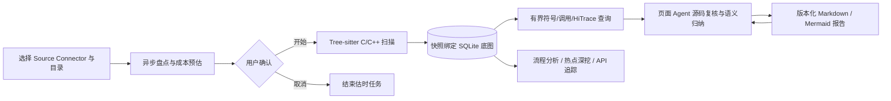

# 模块代码知识库构建 Spec

> 文档状态：Implemented v1.6
> 基线日期：2026-08-31
> 适用范围：单用户、已登记服务端代码仓、C/C++ 模块级分析

## 1. 目标

代码知识库把大型代码仓中的一个可控目录转换为两类共享资产：快照绑定、可重复检索的 Tree-sitter/SQLite 静态代码底图，以及页面 Agent 基于有界检索和源码复核生成的版本化 Markdown 知识报告。流程分析、Trace 热点深挖、API 实现追踪和代码问答通过同一 `graph_id` 复用这些资产。

核心体验为：用户选择代码仓与目录，平台快速预估扫描时间和磁盘占用；用户确认后观察可中止的后台构建；完成后，当前页面的持久 Agent Session 查询底图、读取关键源码并发布报告。同一范围可多次构建，每轮拥有独立 `graph_id`、源码快照和父构建血缘；每次追问形成可追溯的报告子版本。

证据等级保持清晰：底图提供静态语法候选，源码读取支持接口与控制/数据语义，Trace 或采样数据确认真实运行路径与耗时。

## 2. 总体架构



| 组件 | 核心职责 | 证据产物 |
|---|---|---|
| Source Connector | 登记服务端源码根、快照和工作树状态 | `source_connector_id`、`source_snapshot_id` |
| Tree-sitter 构建器 | 提取文件、符号、调用文本、include 和 HiTrace 插桩候选 | `module_code_graph/v1` |
| SQLite 检索层 | 按目标返回限幅符号、相邻调用和插桩候选 | `code_knowledge_query/v1` |
| 页面 Agent | 规划查询、读取关键源码、解释模块职责与流程 | 源码引用、语义归纳、待验证项 |
| 报告发布工具 | 保存报告版本、父子关系、问题、Agent Run 与源码绑定 | `code_knowledge_report/v1` |
| Web 工作台 | 估时确认、进度、ETA、中止、构建/报告目录和装载 | 可恢复页面状态 |

## 3. 正式分析机制

### 3.1 静态代码底图

底图身份由 `source_connector_id + source_snapshot_id + scope + builder_version + max_files` 构成，存储为 SQLite 索引与不可变 artifact 元数据。

提取内容包括：

- C/C++ 文件、函数定义与声明、类型、命名空间等语法符号；
- 调用表达式及唯一限定名/简单名解析候选；
- include 文本及路径解析候选；
- HiTrace/Trace 宏、静态 label、所属函数与源码行；
- 文件指纹、解析覆盖率、失败样本和构建统计。

底图证据范围为 `static_syntax_candidate`。它用于导航和设计分析；编译绑定可由 Clang/LSP 增强，真实执行关系由 Trace、采样或设备实验确认。

### 3.2 有界代码检索

`code_graph_query_knowledge` 是跨页面公共入口。它接收 `graph_id`、问题和限额，返回与目标相关的静态符号、调用候选和 HiTrace 候选，并携带 Connector、快照、scope 与证据等级。

Agent 先用用户目标生成少量检索种子，再根据首轮结果补充类型名、接口名、调用方向或状态对象，使范围逐步收敛。决定结论的定义和调用点通过 Agent 原生 `rg`、文件读取、LSP 或同类源码工具复核。

不同任务采用不同种子：

- 应用流程：完整用户操作、入口、跨模块转发和完成边界；
- Trace 热点：event、桩点包围函数、caller/callee 和同步边界；
- API 追踪：接口族、声明、实现、能力查询与 fallback；
- 模块问答：模块职责、关键对象、状态转换、数据所有权和依赖。

### 3.3 Agent 语义报告

`code-knowledge-analysis` Skill 指导 Agent 执行以下工作：

1. 使用 `code_graph_get` 确认底图状态、源码范围和快照；
2. 围绕模块职责、入口、关键流程、数据与状态、调用关系和 HiTrace 候选做有界查询；
3. 读取关键源码，核对接口契约、控制分支、数据所有权、调用方向、异步边界和完成信号；
4. 分别表达底图候选、源码事实、Agent 归纳和运行时待验证项；
5. 调用 `code_graph_publish_report` 发布首份报告或带父报告血缘的新版本。

报告通常覆盖：分析范围与绑定、模块职责、关键接口、控制流与数据流、重要调用关系、HiTrace 候选、Mermaid 图、证据边界和开放问题。Agent 优先交付覆盖用户目标的最小完整结果，再按追问扩展。

## 4. 长任务状态机

```text
estimating -> awaiting_confirmation -> queued -> running -> ready
     |                 |                 |        |
     +---------------> cancelling ------+--------+
                           |
                        cancelled

后台异常 -> failed
服务重启恢复非终态任务 -> interrupted
```

1. `estimating` 异步统计源码文件、字节数和磁盘需求，立即返回任务 ID。
2. `awaiting_confirmation` 提供预计时长、空间、估时依据和置信度。
3. 用户确认后进入单 worker 构建队列，使大型扫描获得稳定的 CPU 与磁盘带宽。
4. `running` 持续报告阶段、已处理文件、当前文件、观测吞吐、预计剩余时间和完成时间。
5. ETA 根据当前任务的实测吞吐持续校准；前端使用后端校准点更新倒计时。
6. 中止操作经过二次确认，在文件发现或解析边界协作停止，并清理临时 SQLite 文件。
7. 页面刷新通过后端 registry 恢复状态；服务重启会把遗留非终态任务标记为 `interrupted`。

## 5. 数据与版本合同

### 5.1 底图

- 合同：`module_code_graph/v1`
- 存储：SQLite 查询索引 + 不可变 artifact 元数据
- 证据：`static_syntax_candidate`
- 复用：相同身份字段可幂等命中
- 重建：显式新建分析生成独立 `graph_id`，通过 `build_series_id` 和 `parent_graph_id` 保存血缘

### 5.2 报告

- 合同：`code_knowledge_report/v1`
- 格式：UTF-8 Markdown，单份上限 512 KiB
- 血缘：底图 artifact、父报告、用户问题、Agent Run 与源码绑定
- 版本：同一底图内单调递增，续改保留父版本
- 证据：`agent_semantic_analysis_over_static_code_graph`
- 展示：Markdown、代码块、表格和 Mermaid

删除报告会从用户目录隐藏该版本；删除底图会移除可重建的 SQLite 索引并隐藏关联报告。不可变 artifact 和审计事件继续支持历史分析记录的证据血缘。

## 6. Agent 与页面协作

页面提交任务意图与精确字段，Agent 负责规划检索和源码分析。首份报告请求包含 `graph_id`、Connector、快照和 scope；续改请求额外包含父报告 ID 与用户修改要求。

代码知识页、应用流程页、热点分析与 API 追踪共享当前页面 Agent Session。`code-context-retrieval` 提供统一检索方法，平台 MCP 提供底图查询、报告发布和页面回填，Agent 原生工具提供后端源码读取能力。

页面刷新后重新装载构建、报告和当前选择；Agent Session 由页面级持久会话恢复机制维护。

## 7. API 与 MCP

| 接口 | 用途 |
|---|---|
| `POST /v1/code-graphs/estimates` | 创建异步估时任务 |
| `POST /v1/code-graphs/{id}/confirm` | 确认并启动构建 |
| `POST /v1/code-graphs/{id}/cancel` | 请求协作式中止 |
| `GET /v1/code-graphs` / `GET /v1/code-graphs/{id}` | 恢复目录和任务状态 |
| `GET /v1/code-graphs/{id}/search` | 查询静态底图 |
| `GET /v1/code-knowledge/integration` | 查看内置代码知识引擎状态与能力 |
| `POST /v1/code-graphs/{id}/semantic-analysis` | 领取或重试 Agent 报告任务 |
| `GET /v1/code-knowledge-reports` | 列出报告版本 |
| `GET /v1/code-knowledge-reports/{id}` | 读取结构化报告 |
| `GET /v1/code-knowledge-reports/{id}/markdown` | 获取 Markdown 文件 |
| MCP `code_graph_get` | 读取底图状态与绑定 |
| MCP `code_graph_query_knowledge` | 查询有界静态代码上下文 |
| MCP `code_graph_publish_report` | 发布版本化 Agent 报告 |

## 8. 失败与恢复

- Connector、目录和 scope 在估时前完成边界校验。
- 磁盘余量与预计需求一并展示，确认按钮依据资源状态开放。
- 文件读取或解析失败进入覆盖率和失败样本，其余文件继续构建。
- Agent 接单、查询和发布状态独立于底图状态；底图完成后始终可继续检索或重新提交报告。
- 页面刷新从 registry 与 artifact 恢复构建目录、当前选择和报告版本。
- SQLite 索引可由源码快照重建，不可变 artifact 保存审计血缘。

## 9. 验收标准

1. 分析请求快速返回估时任务并显示可观察状态。
2. 正式扫描由用户确认启动。
3. 构建过程显示阶段、文件进度、动态 ETA 和当前文件，并支持二次确认中止。
4. 构建结果包含文件、符号、调用候选、HiTrace 和覆盖率统计。
5. 首份 Agent 报告通过静态底图有界查询与真实源码复核生成。
6. 用户追问复用页面 Agent Session，并发布带父报告血缘的新版本。
7. 流程分析、热点深挖和 API 追踪可复用同一 `graph_id`。
8. 页面刷新可恢复构建、报告、选择状态和 Agent 工作上下文。
9. 测试覆盖估时确认、构建完成、中止清理、有界检索、报告版本、外部 Agent Adapter 和恢复行为。
