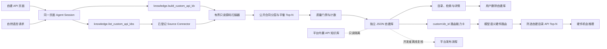

# 自建异构单元 API 知识库 Spec

> 状态：`Implemented v2.1`，当前构建器 `custom-api-kb-builder/1.1.0`，动态路由投影 `custom-api-routing/v1`
> 范围：从用户已登记的服务端代码仓中，为指定异构单元构建一份可追溯、可删除、与平台发布资产隔离的 API 候选知识库。  
> 关联规范：[Web 平台 Spec](heterogeneous_enablement_web_platform_spec.md)、[总体技术文档](heterogeneous_optimization_enablement_platform_technical_overview.md)、[Skill 演进规范](skill_evolution_and_evaluation_spec.md)。

## 1. 背景与目标

平台内置 NPU、GPU、DSP 和媒体 API 知识库属于随版本发布、由开发者审查的只读资产。实际项目还会遇到 AAE、ISP、厂商内部加速器或新版本 API。若每次都修改平台源码和发布包，扩展周期长，也无法覆盖用户私有代码仓。

本能力提供两条等价入口：

1. 在“代码仓”页面登记服务端源码目录，在“优化知识库 > 自建 API”中选择代码仓、输入异构单元名称，并交给页面助手构建。
2. 在页面助手中直接提出“针对 `/path/to/repo` 建立 XYZ 异构单元 API 知识库”，由同一个 Agent Session 核对 Connector 并调用类型化工具。

每次构建都产生新的独立资产。即使平台已有 NPU API，用户再次构建 NPU 时仍生成 `NPU API（自建）`，不覆盖、补丁修改或混入平台内置 NPU 知识库。

## 2. 核心原则

1. **先授权后扫描**：只接受精确匹配已登记 Source Connector 的目录；对话中出现的任意宿主路径不能直接读取。
2. **只读且有界**：不运行仓内脚本，不执行构建，不跟随符号链接；文件数、字节数、单文件大小、记录数和时长均有上限。
3. **用户资产与发布资产隔离**：自建库位于运行时状态目录，平台库位于版本化发布目录；两者没有共享写路径。
4. **同名单元不覆盖**：每次构建获得新的随机 `kb_id`，便于比较不同目录、快照和扫描结果。
5. **证据不过级**：源码声明只证明“API 候选存在”。它不自动证明公开 SDK 可用、目标设备支持、热点可迁移或存在性能收益。
6. **用户可删，发布受控**：用户只能删除 `custom_api_kb_*` 自建资产；合并平台库没有用户 API，必须由开发者离线复核、评测和发布。
7. **合同优先于实现**：知识库主体是消费方可调用或配置的公开 API、算子/能力枚举和 HDI/VDI/IDL 合同。内部 `Service`、`Manager`、`Builder`、示例和调用点只能作为补充证据，不能在公开合同存在时占据主体。
8. **持久化不等于质量通过**：扫描完成并写入 JSON 只表示资产可审计；只有 `quality.status=pass` 才能由 Agent 报告“知识库构建完成”。`warning` 资产保留用于诊断，但必须明确要求复核或收窄目录。
9. **建库后可参与推理**：每份自建库以 `custom:<kb_id>` 投影为独立路由目录。模型选中后只在该库内检索 API Top-N；同名自建库、平台库互不合并。

## 3. 总体架构



运行时组件如下：

| 组件 | 职责 |
|---|---|
| `SourceConnectorManager` | 登记代码仓、保存只读根目录和源码快照身份 |
| `custom-accelerator-api-kb-builder` Skill | 约束 Agent 的仓选择、合同优先级、结果质量检查、证据措辞和失败处理 |
| Kimi 原生后端工具 + Per-Run MCP | 原生工具用于源码导航和语义审查；MCP 用于列举、确定性构建、发布与页面消费，不代理常规宿主 Shell |
| `PlatformRuntimeActionRouter` | 校验 action 输入并记录真实工具调用结果 |
| `CustomApiKnowledgeBaseManager` | 执行有界合同扫描、类别平衡、质量统计，并原子写入 Registry 和 JSON |
| 动态路由/API 投影 | 为每份库生成稳定 `custom:<kb_id>` 能力卡；选中后只注入该库的 `custom_api_record:*` 候选 |
| Web UI | 创建、浏览、检索、显示公开/契约、算子、内部实现计数和质量状态，并删除自建库 |

## 4. 用户流程

### 4.1 页面流程

1. 用户进入“代码仓”，登记本地服务端绝对路径，或使用受控 Git clone 形成 Connector。
2. 用户进入“优化知识库 > 自建 API”。
3. 用户选择 Connector，并输入异构单元名称，如 `AAE`、`ISP` 或 `NPU`。
4. 页面向同一个页面助手发送聚焦任务，而不是由浏览器直接伪造扫描结果。
5. Agent 调用 `knowledge.list_custom_api_kbs` 核对 Connector，再调用 `knowledge.build_custom_api_kb`。
6. Agent 检查 `quality`、公开/契约、算子和内部实现计数。`pass` 才报告完成；`warning` 报告资产已生成但质量待复核。
7. 工具返回后发送 `custom-api-kb-updated` 页面事件，UI 刷新并打开新建知识库。
8. 用户可检索 API、查看声明和源码位置，或删除整份自建库。

### 4.2 对话流程

```text
用户：针对 /srv/source/audio 建立 AAE 异构单元 API 知识库
Agent：列出自建库和已登记代码仓
  -> 路径已登记：使用精确 connector_id
  -> 路径未登记：调用 repository.register_local 页面动作
Agent：调用 knowledge.build_custom_api_kb
Agent：检查 quality 和分类计数，报告新 kb_id、候选数、扫描范围、截断状态与证据边界
页面：自动刷新“自建 API”目录并打开结果
```

该任务属于 `focused_execution`，不会错误进入热点粘贴、硬件路由、机会推理或真机验证流水线。

### 4.3 推理流程

1. 准备硬件路由时，后端读取当前 Registry，为每份可读自建库生成简短能力卡，包含语义族、数据形态、少量代表 API 摘要和证据边界。
2. 能力卡的 `unit_id=custom:<kb_id>`，证据锚点为 `custom_api_kb:<kb_id>`。校验器从本轮能力卡动态派生允许目录，不再固定为四个平台单元。
3. 若自建目录是主路由，下一阶段仅对该 JSON 中的记录做 API Top-N，证据 ID 为 `custom_api_record:<record_id>`，并写入机会推理 context。
4. 路由工件绑定自建库 `content_sha256`。建库被删除或内容改变后，旧路由在机会推理前以 `409` 失效，必须重新路由。
5. 真机验证仍需明确的构建 profile/模板绑定。未绑定的自建目录不会被默认替换为 GPU、NPU 或其他平台单元。

## 5. 扫描与记录生成

### 5.1 当前 v2 方法

当前实现采用 `bounded_api_contract_discovery/v2`：

- 扫描 C/C++ 头文件与实现文件；
- 先按源码暴露面分层：公开 SDK/NDK 接口、算子/能力枚举、HDI/VDI/IDL 合同、导出头文件、实现头文件、实现与示例；公开合同的排序优先级不依赖某个硬件单元的固定文件名；
- 提取函数声明、函数式宏、枚举成员和本仓未声明的外部 API 调用点；函数、算子/操作类型、其他数据/能力合同和实现证据分型保存；
- 采用平衡 Top-N：分别为可调用合同与算子合同保留容量，再按全局相关性补齐，避免大型枚举吞掉设备、建模、编译和执行入口；
- 在存在公开接口时对 `Service`、`Manager`、`Builder` 等内部实现和示例降权，调用点不能伪装成接口定义；
- 从符号和声明推断资源创建、配置、执行、编解码、数据传输、能力查询等通用语义角色；
- 提取 tensor、image、PCM、bitstream、buffer、device/context 等数据形态线索；
- 对符号和规范化声明去重，并按相关性保留 Top 记录；
- 为每条记录保存源码文件 SHA-256，使后续精确复核可以检测源码变化。
- 对本次实际读取的 `path + SHA-256` 列表计算 `scanned_source_sha256`，即使 Connector 的展示快照尚未手动刷新，也能复现本轮扫描输入。
- 输出 `quality` 与公开/契约、算子、内部实现计数；内部实现占主导时资产可以保留供诊断，但 Agent 必须报告“质量待复核”，不能仅因 JSON 已落盘就宣称构建成功。

词法扫描是低成本发现阶段，不声称已经获得函数体 AST、调用图、参数生命周期或跨过程语义。后续版本可在相同记录契约上增加 Tree-sitter/Clang AST、调用点和 Agent 语义复核，但不得静默改变旧资产的分析方法。

当前源码暴露层级按下表解释。层级是通用目录与声明证据，不绑定 NNRT、GPU 或任一厂商文件名。

| 层级 | 典型来源 | 记录用途 |
|---|---|---|
| `public_api` | `interfaces/kits`、NDK/SDK、public API 目录 | 知识库首要主体 |
| `interface_contract` | innerkits、HDI、VDI、IDL、driver interface | 系统或驱动合同主体，必须保留调用层级 |
| `exported_header` | 模块 `include/`、`inc/` 和导出宏声明 | 未采用标准目录布局时的消费方合同候选 |
| `implementation_header` / `implementation` | frameworks、services、src 或普通实现文件 | 解释实现，不得压过已有合同 |
| `example_or_test` | example、demo、test、mock、fuzz | 使用证据或测试证据，不作为公开 API 定义 |

当前 `MAX_RECORDS=300` 时，构建器分别为可调用合同和算子合同保留最多 40% 容量，再按全局相关性补齐。配额用于避免大型枚举吞掉设备、模型、编译和执行 API；它不是硬件单元专属规则。改变配额、层级或排序属于行为变更，必须提高构建器版本并执行第 10 节回归。

### 5.2 质量合同

`summary` 至少提供以下可机器校验计数：

| 字段 | 含义 |
|---|---|
| `public_contract_record_count` | `public_api`、`interface_contract`、`exported_header` 合同记录总数 |
| `operator_record_count` | 被识别为算子或操作类型的记录数 |
| `internal_implementation_record_count` | 实现、实现头文件和示例/测试记录总数 |
| `api_element_kind_counts` | 函数声明、枚举值、宏、定义和调用点分布 |
| `source_surface_counts` | 各源码暴露层分布 |

`quality` 契约如下：

```json
{
  "status": "pass | warning",
  "public_contract_primary": true,
  "warnings": [],
  "acceptance_note_zh": "知识库主体应为消费方可见 API、接口合同和算子/能力常量；内部服务方法只能作为补充候选。"
}
```

以下任一条件产生 `warning`：没有发现公开/接口/导出合同；或者内部实现记录多于公开合同记录。`result_truncated=true` 只说明命中输出上限，不自动等于质量失败；仍必须通过类别计数证明关键 API 没有被单一类别挤出。

### 5.3 资源上限

| 资源 | v2 上限 |
|---|---:|
| 考虑的源码文件 | 50,000 |
| 实际读取文件 | 4,000 |
| 总读取量 | 64 MiB |
| 单文件大小 | 2 MiB |
| 输出记录 | 300 |
| 扫描时长 | 75 秒 |

扫描达到上限时仍可生成知识库，但必须保存 `enumeration_truncated`、`timed_out` 或 `result_truncated`，页面显示“达到上限”或“超时截断”。无候选时返回可操作错误，不生成空的成功资产。

### 5.4 单条记录

每条记录至少包含：

- `record_id`、`accelerator_unit`、`symbol`；
- `api_element_kind`、枚举所属 `container_name` 和源码暴露层；
- 一句话摘要和详细说明；
- `semantic_family`、`exposure`、数据形态和符号别名；
- 源码相对路径、起止行、声明或调用片段、前置注释和文件 SHA-256；
- `analysis_method` 和 `evidence_status`；
- 设备可用性、功能等价和性能验证要求。

`exposure` 只是基于源码目录的候选分层，例如公开 SDK/NDK、HDI/VDI、系统内部或第三方接口；它不是发布审核结论。

## 6. 数据与隔离契约

### 6.1 存储

```text
.local-artifacts/
  custom-api-kbs/
    registry.json
    custom_api_kb_<24 hex>.json

data/knowledge-bases/
  hardware/                 # 平台发布资产，只读
```

自建库根目录来自 `STATE_ROOT`，不会写入 Git 跟踪的 `data/knowledge-bases`。每份资产包含：

```json
{
  "schema_version": "custom_accelerator_api_knowledge_base/v1",
  "kb_id": "custom_api_kb_<random>",
  "display_name": "AAE API（自建）",
  "origin": "user_built",
  "deletable": true,
  "merge_policy": "developer_only",
  "source": {},
  "scan": {},
  "summary": {},
  "quality": {},
  "records": []
}
```

### 6.2 生命周期

```text
requested -> scanning -> persisted
                         |-> pass -> browse/search -> deleted
                         |          \-> developer review -> future platform release
                         \-> warning -> diagnose/narrow/rebuild
```

当前 Registry 只保存已完成资产；扫描失败不会登记半成品。JSON 和 Registry 使用原子写入。删除先校验 ID 命名空间，只允许删除已登记自建资产。

## 7. API 与 Agent 工具

### 7.1 HTTP API

| 方法 | 路径 | 作用 |
|---|---|---|
| `GET` | `/v1/custom-api-kbs` | 列出全部自建库 |
| `POST` | `/v1/custom-api-kbs/build` | 从已登记 Connector 构建新库；返回分类计数和独立质量状态 |
| `GET` | `/v1/custom-api-kbs/{kb_id}` | 读取或按 `query` 检索一份库 |
| `GET` | `/v1/custom-api-kbs/{kb_id}/records/{record_id}` | 读取单条详情 |
| `DELETE` | `/v1/custom-api-kbs/{kb_id}` | 删除一份自建库 |

### 7.2 Agent Action 与 MCP

| Action | MCP 工具 | 说明 |
|---|---|---|
| `knowledge.list_custom_api_kbs` | `knowledge_list_custom_api_kbs` | 同时返回自建库和已登记 Connector 的精确映射 |
| `knowledge.build_custom_api_kb` | `knowledge_build_custom_api_kb` | 创建一份新资产，不支持覆盖或合并；Agent 必须检查质量字段后再表述结果 |

所有调用属于当前 Platform Run，输入、结果和失败由既有 Agent Trace 记录。删除保留为明确的用户 UI 操作，Agent v1 不自动删除，也不自动发布。

## 8. 失败与恢复

| 错误 | 含义 | 恢复方式 |
|---|---|---|
| `CUSTOM_API_KB_SOURCE_REQUIRED` | 未提供 Connector 或路径 | 先选择或登记代码仓 |
| `CUSTOM_API_KB_SOURCE_NOT_REGISTERED` | 路径未获授权 | 调用代码仓登记页面动作 |
| `CUSTOM_API_KB_SOURCE_MISMATCH` | ID 与路径不一致 | 使用列举工具返回的精确值 |
| `CUSTOM_API_KB_SOURCE_UNAVAILABLE` | 已登记目录当前不可读 | 恢复挂载或刷新 Connector |
| `CUSTOM_API_KB_NO_API_CANDIDATES` | 有界范围内无声明 | 缩小到真实模块或修正单元名称 |
| `CUSTOM_API_KB_DELETE_FORBIDDEN` | 尝试删除非自建资产 | 拒绝操作；平台库由开发者维护 |

`quality.status=warning` 不是 HTTP 错误。资产仍然可浏览和删除，但页面和 Agent 必须显示质量待复核，不能把它改写为成功结论。典型恢复方式是登记更聚焦的接口模块，而不是继续扩大别名或向 Skill 增加单个仓库的函数名。

手动重试会生成新的 `kb_id`，不会覆盖旧结果。对于大型代码仓，推荐登记到具体模块目录，以提高召回、降低扫描时间并减少无关候选。

## 9. 平台合并治理

自建库不能一键转为平台库。开发者合并至少需要：

1. 固定并复核源码版本、许可证和接口暴露层级；
2. 用 AST/调用点或官方文档确认 API 语义、生命周期和数据合同；
3. 去重、补充稳定摘要、约束和 runtime verification；
4. 在目标设备验证 capability/provider/link surface；
5. 增加正例、负例和变形评测；
6. 更新平台 KB 版本、manifest、内容哈希和发布说明。

因此 `merge_policy=developer_only` 是数据合同，不只是页面文案。

## 10. 变更与回归门禁

### 10.1 不允许的修复方式

- 不能只修改 Agent 提示词来掩盖扫描器已经返回的错误候选；候选生成、Skill 和 UI 质量状态必须分别在其责任层修复。
- 不能因为某个失败样本而把 `OH_NN`、`PreparedModelService` 或其他单仓符号写成通用筛选特例。允许使用它们做回归 oracle，不允许用作生产分支条件。
- 不能仅检查总记录数。300 条内部方法不优于 80 条真实 API 合同。
- 不能原地改变 `analysis_method`、排序、配额、记录字段或质量语义而保持构建器与 Skill 版本不变。

### 10.2 必跑测试

修改单元别名、目录分层、声明/枚举/宏提取、排序、配额、上限、Skill、MCP 描述、Action 摘要或 UI 状态时，至少执行：

```bash
python3 -m unittest backend.tests.test_custom_api_kb backend.tests.test_runtime_action_router
python3 -m unittest discover -s backend/tests -p 'test_*.py'
npm run lint
npx tsc --noEmit
npm run build
```

自包含回归必须同时覆盖：公开函数合同、算子枚举、外部调用点、内部 service 干扰、同名新建、未登记路径和删除隔离。拥有代表性源码仓的开发环境还必须执行真实仓 shadow scan，对比分类计数、关键 API 族、内部实现占比和 Top-N；真实仓缺失不能阻止部署包单测，但发布说明必须标明未执行该项。

### 10.3 当前真实仓审计基线

以下数字是构建器 v1.1.0 对 OpenHarmony NNRT 快照 `ce0d73ad1fc7e7fc8e24f37e6a7d34cc823a0d71` 的回归观察，用于发现大幅退化，不是对未来源码版本的永久精确计数：

| 指标 | 观察值 |
|---|---:|
| 扫描 C/C++ 文件 | 625 |
| 输出记录 | 300，达到上限 |
| 函数声明 | 83 |
| 算子或操作类型 | 113 |
| `OH_NN_OPS_*` | 108 |
| `OH_NN*` 函数 | 82 |
| `PreparedModelService` 主记录 | 0 |
| 质量状态 | `pass` |

源码升级后允许数字变化，但必须解释差异。最低语义断言是：设备、模型、编译、执行 API 族仍可检索；算子枚举仍是一等记录；内部 CPU 示例 service 不得取代公开 NNRT 合同。

## 11. 验收标准

- 同名单元连续构建两次得到两个不同 `kb_id`，显示名均带 `（自建）`。
- 只接受已登记 Connector；符号链接不能逃逸扫描根目录。
- 每条候选可回溯到文件、行号、声明和文件 SHA-256。
- 页面能列举、检索、查看详情并删除自建库；平台库无删除入口。
- 页面按钮和自然语言请求都通过同一个 Agent Runtime 和类型化 Action。
- 工具结果可触发页面刷新，不要求用户离开页面或重建 Agent Session。
- 达到资源上限时明确显示截断状态，不伪装成全量扫描。
- 页面和 Agent 同时展示合同、算子、内部实现计数以及 `pass`/`warning`，不会把落盘状态当成质量状态。
- 测试覆盖隔离构建、同名新建、未登记路径拒绝、删除保护、Agent Action、公开合同优先、算子提取与内部 service 干扰。
