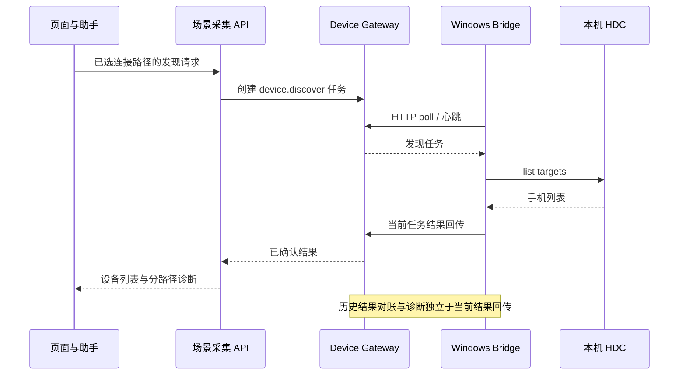
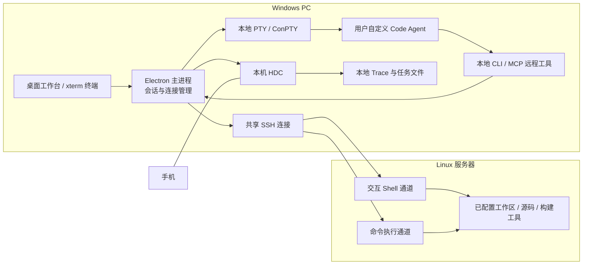

# 桌面工作台设计与平台架构复核

> 状态：Desktop-first 工作台 0.1.93，2026-10-31；Bridge 兼容版本仍为 1.4.9。用户已确认 Windows 桌面版的 SSH、自定义 Code Agent、HDC 发现及本机直连采样成功；采样覆盖度继续按目标设备验收。0.1.41 至 0.1.92 的迁移、持久通道、校准恢复、动态拓扑、Classic Roofline、工作区、活动栏、Agent 启动零输入、显式初始化、无缝侧栏、原生 MCP 自配置、采样计划差量合同、渐进式工具合同、Session 证据可视化、初始化快路径、分层计时、统一错误诊断、私有设备 Trace 预检、负载模板渐进展开、有界 Agent 自动恢复、离线 HTML 建模报告、100 ms Agent 提交下限及设备采集器有界收尾继续有效；0.1.93 增加私有直连设备的 HiTrace 服务态复位、按缓冲区分级的 Trace 冲刷等待和准确的 PMU 未启动诊断。
> 职责：明确现有平台资产、设备链路问题、桌面执行边界和分阶段迁移。采集、建模、Agent 与工件的详细合同继续由各专项 Spec 定义。
> 入口：[总体技术文档](heterogeneous_optimization_enablement_platform_technical_overview.md)、[工程复盘](heterogeneous_enablement_platform_engineering_retrospective.md)、[Spec 索引](spec_index.md)。

## 1. 结论与架构选择

正式产品方向为 **Desktop-first，并按 local-first 逐步收回状态与领域能力**。连接手机的 Windows PC 负责工作台 UI、本地 Code Agent、HDC、负载采样、Trace 原件、真机执行和本机 Agent 运行证据；Linux 服务器收敛为大仓源码访问、代码索引、SDK/工具链编译与其他必须依赖 Linux 资源的 Worker。0.1.63 已消除服务器 Platform RPC 每次调用重启 Python 的开销，但迁移页面的分析状态仍主要位于远端 `HETERO_STATE_ROOT`，因此“持久远端通道”不等于 local-first 已全部完成。后续按第 38 节把本地状态、共享工件和远端能力拆开，不再用是否连上 SSH 决定所有页面能否工作。

已通过用户现场验证的桌面宿主采用 Electron、真实本地 PTY 和共享 SSH 连接。本机采集和 Trace 管理使用共享计划校验与固定 Runner，独立子进程完成完整任务，并按结构化进度更新界面。0.1.41 把现有 Web 的负载特征、寻优校准和并行建模组件按相同信息架构迁入桌面，通过 SSH 受限 transport 读取服务器托管状态并执行白名单分析；当前已交付本机标准 `capture.zip` 到负载特征数据集的专用 SFTP 闭环，以及最大 20 MiB 校准实测 JSON 的预约式 typed SFTP 闭环。通用长任务恢复和任意工件传输仍等待 typed job/Artifact，不把两个受限输入通道描述成通用工件能力。

当前采集执行基线为 Runner 1.2.15 / screen_preparation v7，通用线程 PMU sampler 1.2.0；其发布资产与协议版本分别记录，不能用页面版本代替。

桌面与服务器采用明确的资源合同：用户只提供源码/仓库、工具链、SDK 头文件面、TraceStreamer 和目标运行库等外部资源；平台在服务器当前用户目录下创建状态、缓存、运行资产、临时文件、日志和任务目录。SSH 连接只是控制与传输通道，不默认意味着服务器已安装完整 Web 平台、已同步源码或拥有 HDC 设备。

## 2. 当前平台的职责与实现

| 子系统 | 当前职责与主要实现 | 桌面化时的处理 |
|---|---|---|
| 页面工作台 | Next.js 页面、任务组装、结果展示；`app/components/` | 先提供独立桌面验证界面，后续复用交互与视图模型 |
| Agent 接入 | CLI manifest、PTY、Skill/MCP 工作区；`backend/agent_cli_adapters.py`、`kimi_cli_terminal.py` | 保留厂商中立配置思想；Windows 用本机 PTY，适配启动、提交和退出语义 |
| 执行与工件 | Platform Run、幂等 Action、持久化任务；`agent_runtime.py`、`parallel_workbench.py` | 复用任务/工件合同；桌面进程与服务器任务区分所有权 |
| 负载采样 | 计划、屏幕准备、选中步骤 Trace/HiLog/PMU；`scenario_capture.py`、`tools/scenario_capture/runner.py` | 计划可由 Agent 生成，设备动作在 Windows 本地 Runner 执行 |
| 设备连接 | Local HDC、Device Gateway、Windows Bridge | 桌面默认本机 HDC；Web 远程用户继续使用现有 Bridge |
| 本地采集包 | Windows PowerShell + 自包含 Python Runner；`scenario_capture_local_package.py`、`run_local_package.py` | 已有本地执行和归档导入基础，可作为桌面采集接入起点 |
| Trace 管理 | 原始文件与平台副本身份、校验和删除；`trace_library.py`、`local_capture_package.py` | 本地文件为独立副本，按需上传分析；路径带主机归属 |
| 负载特征 | BuildItem 阶段、调度时间、PMU 估计/覆盖与候选分型；`parallel_modeling/workload_features.py` | 保持数据指纹、阶段边界和测量来源，避免 UI 迁移改变数值口径 |
| 校准与寻优 | 单任务核频成本、双任务干扰、条件并行仿真；`parallel_modeling/calibration.py`、`interference.py`、`manager.py` | 保留模型包与硬件适用域；结果仍区分预测和真机收益 |
| 代码、流程与知识 | Code graph、源码锚点、流程重建、异构 KB 与 Skill | 原始大仓可留 Linux；Agent 通过远程工具访问已选工作区 |

代码路径省略的 `backend/` 前缀均指仓库后端目录。完整执行图和证据语义分别见 [Runtime Spec](platform_agent_runtime_build_device_bridge_spec.md)、[采集 Spec](scenario_capture_parallel_modeling_spec.md)、[负载特征](workload_features_model.md)、[校准](parallel_pairwise_interference_v1.md)。

## 3. 本次设备问题为何排查过久

### 3.1 一次“设备发现”跨越了多个独立状态



“Bridge 在线”“Windows 已发现 target”“本次发现任务结果已被服务器确认”“页面选中了设备”是四种事实。前两项成功，不能证明后两项完成。最初用“离线/未发现设备”概括这些状态，使问题容易被误判为驱动、旧版本或手机故障。

### 3.2 已核实的失效机制与修复

| 失效机制 | 实际影响 | 已交付修复与代码证据 |
|---|---|---|
| 页面与助手持有不同设备目标，只传 serial 不传路径 | 选中一台设备，任务可能走另一台 Bridge | 平台 0.1.21 起绑定 `{connection_mode, bridge_id, device_serial}`；0.1.23 共用 `CaptureDevicePicker` 和选择状态，提交时冻结目标 |
| 没有发现手机时，连接路径入口也不可用 | 用户无法选正确 Bridge 重试，形成恢复死路 | 0.1.23 独立路径选择、分路径诊断和待确认状态；采集页与助手双向同步 |
| HDC 诊断或串行事件发送阻塞 poll | Bridge 进程仍运行但心跳过期，被标离线 | Bridge 1.4.8 分离 poll、诊断和事件工作任务 |
| 重连对账按历史 job 重复读写整个 registry | 历史越多，首次 poll 越慢，可能超过请求期限 | 平台 0.1.24 批量记录 receipt，同一请求复用已认证记录；`device_gateway.py` |
| 历史 spool 结果与实时结果共用 FIFO | Bridge 在线，手机列表已获取，结果仍排在旧 ACK 后面 | Bridge 1.4.9 将实时事件与历史回放独立发送，保留单任务事件顺序、精确 ACK、去重和持久恢复；`hdc_device_bridge.py` |
| 超时被当作确定无设备 | UI 引导用户重复插拔、重启或更换设备 | 0.1.25 区分 Bridge 在线、列表读取超时、读取失败和成功返回空列表 |

这不是单纯把一个 timeout 调大的问题。设备执行时长、网络往返、任务排队、历史对账和结果确认分别占用时间；增加设备命令期限不能修复结果队列被历史流量阻塞。

### 3.3 必须保留的工程经验

- **健康分层**：连接活性、设备事实、作业进度和结果交付分别观测。超时是状态不确定，只有成功返回空列表才能证明当次无 target。
- **工作流隔离**：设备命令、控制心跳、实时结果、历史回放与诊断分开调度；后台工作有界，不抢占当前交互。
- **单一目标**：UI、Agent、Runner 与日志引用同一执行目标；恢复选择不等于确认设备在线，不能静默切换设备。
- **保持证据**：超时后先对账，不盲目重放设备操作；历史 spool 不靠删除来恢复当前任务。
- **按部署拓扑回归**：除了无历史低延迟测试，还需有真实 HTTP、历史结果积压、慢 ACK、重连、多设备和取消测试。
- **减少状态迁移**：对本机 USB 设备，优先本地执行完整采集流程，远端按需接收结果；不要为每条 HDC 命令增加跨主机往返。

### 3.4 后续可观测性补强

当前已有 job、执行耗时、发现诊断和回传事实；尚需统一汇总端到端时间线。建议分别记录 `submitted → offered → accepted → device_started → device_finished → result_sent → result_acked → ui_observed`，用同一 job/request ID 关联。诊断面板显示本轮结果年龄、实时/历史队列深度、最近 poll 与最后错误阶段。上述统一汇总是后续建设项，不宣称现有 UI 已全部具备。

## 4. 桌面目标架构



### 4.1 三种执行位置

| 执行位置 | 适合的操作 | 状态归属 |
|---|---|---|
| PC 本地 | HDC、手机采集、查看 Trace、自定义 Code Agent | 桌面应用管理本机进程、所选设备与本地文件 |
| SSH 远端 | 大仓检索、远程命令、构建、后续分析任务 | 连接绑定主机/用户/工作区；执行结果带远端身份和退出状态 |
| 平台服务 | 已有 Web 工件、知识库、建模与协作接口 | 保留现有项目、任务、模型与 artifact 合同，后续显式连接 |

原型先验证前两者。完整 Web 后端不随首个 EXE 原型迁入，也不把服务器路径当作 PC 文件路径。

### 4.2 自定义 Agent：真实本地终端优先

配置以可执行程序、参数、工作目录和环境变量为主体，可接已有内部 Agent，不嵌入某家模型的工具循环。Windows 通过 `node-pty` 的 ConPTY 运行原生 CLI，保留终端键盘输入、ANSI 输出、窗口大小和进程退出信息。Electron Renderer 通过窄接口与主进程通信，进程创建与 SSH 凭证由主进程承载。

集成区分三个层次：

1. **终端兼容**：Agent 可启动、显示、输入、调整尺寸和结束；`.exe`、PowerShell 与 `.cmd` 启动形式分别验证。
2. **任务提交**：按钮任务进入真实 PTY，粘贴、换行和 Enter 按 Agent 配置适配；写入 stdin 只证明输入已送达，不证明模型已经接收或完成。
3. **远程工具**：支持 Shell 的 Agent 使用本地 CLI helper，支持 MCP 的 Agent 使用工具配置；两个入口调用同一桌面 SSH 服务，不让 Agent 自行拼接第二套 SSH 登录命令。

Linux Web 的 [Agent Adapter](agent_framework_adapter_guide.md) 提供配置与任务语义参考，但其 POSIX PTY 和后端路径不能直接视为 Windows 已兼容。

### 4.3 SSH：共享连接，独立通道

用户给出的命令形态可拆为主机、端口、用户名、认证、远端工作目录和交互 Shell：

```text
ssh -p <port> -t <user>@<host> "cd /srv/workspace/<project>; bash"
```

桌面使用 `ssh2` 管理同一认证连接，给交互终端打开 shell channel，给 Remote Workspace Worker、Platform RPC、批量 SFTP 分别打开独立 channel。**同一 SSH 连接不等于同一个 Shell 状态**：用户在终端执行 `cd`、`export` 或激活虚拟环境，不会自动改变 Worker 中的命令。Agent 命令显式携带工作目录，必要环境写在任务命令或配置中，回显有效路径。

远程执行返回 stdout、stderr、退出码、信号/中断和耗时。网络断开时，不能仅凭本地通道关闭就宣称远程操作从未执行；原型返回中断事实，重新连接后由用户或 Agent 核对结果。SSH 断开不自动重放命令。

原命令中的 `UserKnowHostsFile` 拼写应为 `UserKnownHostsFile`，而 `/dev/null` 是 POSIX 路径；原型的结构化连接配置不依赖这些 shell 参数。原型采用首次使用信任（TOFU）：首次记录 `host:port` 的 SHA-256 指纹，后续变化返回错误。首次记录本身不是外部身份核验。支持密码、私钥/口令与本机 SSH Agent 认证；`settings.json` 只保存非秘密连接配置和私钥路径。SSH 密码按服务器、端口和用户名索引，经 Electron `safeStorage` 绑定当前系统账户加密后写入独立文件，Renderer 只接收可用、已保存和错误状态；私钥口令不落盘。

### 4.4 Agent 到远端的调用链

```text
用户提交远程任务
  → 本机 Code Agent 读取桌面生成的工具说明
  → 本地 CLI helper / MCP tool
  → 桌面进程复用当前 SSH 连接
  → Linux 指定工作区执行
  → stdout / stderr / exit code 返回 Agent 与界面
```

工具入口使用本机专用连接凭证；SSH 密码或私钥不写入 Agent Prompt。原型工具与现有服务器 `platform.* / device.* / ui.*` Action 不混用：前者是桌面连接能力，后者仍归 Web Runtime 管理。用户自定义 Agent 是否能发现 MCP、能否正确使用工具，需要以其实际版本验证。

### 4.5 原型已经实现的接口

| 入口 | 实际合同 |
|---|---|
| `remote_status` | 返回当前 SSH 状态、主机、端口、用户和配置的工作目录；不创建新连接 |
| `workspace_stat/list/read/search/write` | 在 Agent 绑定的远程工作根内取得元数据、目录、文本、搜索结果和 revision 保护的写入；统一走 `agent` lane |
| `remote_exec` | 输入 `command`、可选 `timeoutMs`；在配置目录复用 `agent` lane，返回 `stdout`、`stderr`、`exitCode`、`signal`、`durationMs`、`cwd` |
| `HETERO_DESKTOP_TOOLS` | 桌面启动 Agent 时注入的 CLI wrapper 路径；Windows 为 `desktop-remote.cmd`，可执行上述 `remote_*` 与 `workspace_*` 工具 |
| `HETERO_DESKTOP_MCP_CONFIG` | 指向用户数据目录 `integration/mcp.json`；`{mcp_config}` / `{mcp_descriptor}` 参数占位符也解析为该路径 |
| `HETERO_DESKTOP_BROKER_URL/TOKEN` | 主进程启动本机 loopback 工具服务，连接地址与本轮 token 通过 Agent 环境继承；token 不写入 MCP 配置文件 |
| Agent manifest | `executable`、`args`、`cwd`、`environment`、`submitMode`、启动/粘贴等待；导入兼容现有 `adapters` / `default_adapter` 结构中的选定条目 |
| `discoverDevices` | 本机直接执行固定 argv `hdc list targets`，返回 target 列表、原始 stdout/stderr 与耗时；当前不执行完整采集 |

`integration/mcp.json` 中 MCP server 为 `desktop-ssh`，使用随应用分发的 Electron Node 模式运行 `runtime/agent-tools.cjs --mcp`；配置中环境仅包含 `ELECTRON_RUN_AS_NODE=1`，连接 token 由父 Agent 继承。若内部 Agent 的 MCP 启动器会清空父环境，需要在它的接入配置中保留这些桌面环境变量，不能仅把 MCP JSON 复制到另一台机器使用。

每次 Agent 启动、停止或自然退出都轮换工具 token。工具会话绑定主机、端口、用户和工作目录：启动时 SSH 已连接则立即绑定，否则首次工具调用时绑定。同一目标重连可继续使用；切换目标后 `remote_status` 返回 `currentTarget`、`boundTarget` 与 `targetMismatch`，全部 `workspace_*` 和 `remote_exec` 拒绝执行并提示重启 Agent。停止 Agent 会按请求 ID 取消该会话尚在运行的 Workspace、命令与 Platform RPC；同一 SSH 目标上的健康 `agent` lane 可供下一会话复用，目标改变或 SSH 断开时整条 lane 才关闭。该合同防止旧任务跟随新服务器执行，桌面手动终端与工具会话保持独立。

SSH 连接状态与 shell 状态分开记录。退出交互 Shell 后，SSH 工具通道可继续在线；SSH 已断开时，用户点击“+”新建终端会先按已保存配置恢复连接，再创建或选中主终端。自动恢复由明确的新建终端意图触发，不在后台重放远程命令。

应用启动完成后，Renderer 按 SSH 与 Code Agent 两条独立链路恢复工作区。SSH 主机、用户及认证材料完整时自动连接；Agent 启动命令完整时自动启动。任一链路缺少必要配置时，另一条已配置链路仍可恢复，同时连接抽屉定位到缺项对应的 SSH 或 Agent 页。密码认证以系统安全存储返回的“已保存”状态作为自动连接门禁，Renderer 不接收密码明文。Renderer 自身重载若发现连接或进程仍在线或正在建立，只重建界面绑定，不主动重连或重启。

独立“资源管理器”把配置的远端工作目录作为固定根目录。0.1.48–0.1.61 先以长驻 SFTP 实现列表、读取、保存和后台预取；0.1.71 把正常路径迁到 `interactive` / `prefetch` Worker lane并保留缓存与 revision 语义；0.1.72 将页面收敛为文件树、可调分隔条和多标签 Monaco 编辑器。Worker 在请求发送前无法建立时，SFTP 只兼容目录与读取；保存要求 Worker 的跨进程 revision 锁与原子提交，不回退到 SFTP。列表、读取和保存只接受根目录内的相对路径；规范化路径、真实路径与符号链接目标均须留在根目录内。连接后先读取根目录，再有界预取子目录；重目录和符号链接只显示入口而不递归，未命中缓存的目录继续按需读取。每 10 分钟在上一轮结束后重新扫描，刷新期间保留上一次成功树和 UI 展开/焦点状态；连接代际或目标四元组变化时丢弃迟到结果。编辑器只处理不超过 1 MiB 的 UTF-8 普通文本，并保留 BOM 与统一换行格式。0.1.60 以文件身份建立多标签；0.1.72 让每个标签对应独立 Monaco model，分别保存内容、pristine、revision、重连校验、dirty、撤销栈、光标和视图位置。保存只作用于活动标签，关闭 dirty 标签必须确认。同目标重连会重读干净标签并让 dirty 标签等待 revision 校验；切换 SSH 目标时清理干净标签，把未保存标签保留为只读以便复制，切回原目标后才能重新挂接。保存先写同目录临时文件，完成后核对 revision，最后以 rename 原子替换；服务器文件已变化则报告冲突并保留原文件，保存成功后立即刷新父目录。

`remote_exec` 默认 30 秒、上限 120 秒，stdout/stderr 合计上限 1 MiB。0.1.71 复用长驻 `agent` lane，不再为每个命令建立新的 SSH exec；超限、取消或断线按请求与 lane 合同回收，命令一旦可能已经执行就不自动重放。这仍是短命令能力，还未建设长时构建后台任务、输出工件流式落盘和断点恢复。后续接入构建/分析时应增加明确的任务协议，不把超时改大后当作持久任务系统。

Agent 可用 `bracketed_paste_cr`、`bracketed_paste_lf`、`plain_text_cr`、`plain_text_lf` 提交模式。提交队列绑定当前 PTY 代际，换会话后旧输入不会落入新进程。内置 `demo-agent.cjs` 明确标识“连接测试客户端（不是 AI Agent）”，仅执行 `remote_status` 与 `pwd && uname -a && ls -la`，用于验证连接和工具链；用户内部 Agent 仍通过自定义配置接入。

自定义 Code Agent 启动和重启时，工作台只创建 PTY、注入 MCP/CLI 所需进程环境并展示 Agent 自身输出，不向交互输入写入准备 Prompt。Code Agent 配置页提供一条版本化长期记忆系统提示，用户可预览和复制，再由目标 Agent 的持久规则机制保存。提示只描述 `remote_status`、`workspace_*`、`remote_exec` 等稳定工具选择规则；当前服务器、工作目录、设备、会话和凭据始终在运行时从工具返回值获取。旧配置中的 `bootstrapContext` 字段可兼容读取但会在规范化时丢弃，不再触发输入；首个用户任务按原文经过既有提交 Adapter 发送。

## 5. 原型范围与后续迁移

| 阶段 | 交付 | 验收对象 |
|---|---|---|
| D0 已验证原型 | Windows EXE 构建入口、本地自定义 Agent PTY、SSH 终端、Agent 远程执行工具、本地 HDC 发现 | 证明本机 Agent 和远程通道协作可行；真实 Windows 与内部 Agent 验收单列 |
| D1 已接入本地采集 | 将现有采集包 Runner 接入桌面：计划、选设备、采集、取消、原始文件管理 | PC 本地 HDC 完成整个任务；服务器暂不可用时仍能产出标准采集包 |
| D2 正在接入分析 | 服务器 Worker profile、资源预检及负载特征、寻优校准、并行建模共享页已经接入；继续建设 typed job/artifact | 工件与模型版本一致；支持本地原始文件、远程分析副本分别管理 |
| D3 产品交付 | 安装/升级、签名、依赖闭包、诊断导出、会话恢复 | 在目标 Windows 版本、公司网络和内部 Agent 上完成发布矩阵 |

D1 提供完整本地采集和 Trace 登记；HDC 驱动、Agent 软件由用户已有环境提供。0.1.41 已进入 D2，并以共享 React 组件和受限 SSH transport 交付负载特征、寻优校准和并行建模页；标准 `capture.zip` 的专用上传与分析交接已经闭环，其余分析页面、整仓同步、通用工件传输和远端长任务恢复继续按 D2/D3 推进。各阶段以现有可复用代码为起点，避免维护第二套业务算法。

## 6. 验收矩阵与证据口径

| 验收 | 成功标准 | 需要的环境 |
|---|---|---|
| 本地 Agent PTY | 可执行程序/带空格路径/参数正确；ANSI、尺寸、输入和退出状态正常 | macOS 开发验证 + Windows ConPTY 实机验证分别记录 |
| 通用 Agent 接入 | 用户内部 Agent 能启动并消费远程工具说明，完成一次真实命令 | 用户的 Windows 与已配置内部 Agent |
| SSH 交互 | 指定端口、用户和目录登录，输入/窗口变化/退出可见 | 测试 SSH 服务；目标 Linux 另验 |
| Agent 远程执行 | helper/MCP 使用同一 SSH 连接，远端 cwd、stdout/stderr/退出码准确 | 回环集成测试 + 目标服务器验证 |
| 失联和并发 | 终端可交互时 exec 可运行；断开有明确错误；不会自动重复命令 | 可控 SSH 测试服务 |
| HDC 发现 | 本机 `list targets` 输出转换为设备列表，异常单独展示 | 本机 HDC；Windows HDC 驱动/手机另验 |
| Windows 分发 | 解压/安装后可启动，原生 PTY 模块匹配 Electron ABI | Windows EXE 构建与真实运行分别记录 |

测试桩只能证明接口和错误处理；内置演示 Agent 只能证明 PTY/工具链，不代表用户内部 Agent 已集成。macOS 可以验证 Electron、SSH 与本机 HDC 主链路，Windows EXE 是否可用必须以目标系统启动和 ConPTY 实测证明。

## 7. 发布与设计文档维护

桌面程序与 Web 平台有各自的构建产物和依赖闭包。每轮交付明确平台版本、Bridge 版本、桌面版本，以及需要更新的执行端。仅服务器更新不会更新 Windows Bridge；仅桌面 UI 更新也不能替代本地运行组件的版本核对。

现有 Web 的复盘和架构文档同时保留。桌面设计作为新执行拓扑的专项入口，后续接入采集、工件或 Agent manifest 时同步更新对应 Spec、测试与使用说明。外部 `platform_design/` 保留建模研究设计，以本仓库专项 Spec 作为现行工程合同入口。

## 8. 实现索引与验证入口

| 文件 | 职责 |
|---|---|
| [`desktop/main.cjs`](../desktop/main.cjs)、[`preload.cjs`](../desktop/preload.cjs) | Electron 生命周期、窗口隔离、原生路径选择和有界 IPC |
| [`desktop/runtime/index.cjs`](../desktop/runtime/index.cjs) | 本机 PTY、共享 SSH、TOFU、临时工具服务、HDC 发现和会话销毁 |
| [`desktop/runtime/remote-files.cjs`](../desktop/runtime/remote-files.cjs)、[`renderer/remote-files.js`](../desktop/renderer/remote-files.js)、[`renderer/remote-editor-tabs.cjs`](../desktop/renderer/remote-editor-tabs.cjs) | SFTP 文件合同、有界目录树预取、SWR 缓存和远端多文件编辑状态 |
| [`desktop/build/prepare-analysis-worker.cjs`](../desktop/build/prepare-analysis-worker.cjs)、[`runtime/analysis-worker.cjs`](../desktop/runtime/analysis-worker.cjs) | 最小分析 Worker manifest、发布资源核验及 target/profile 原子部署 |
| [`desktop/runtime/code-analysis-runtime.cjs`](../desktop/runtime/code-analysis-runtime.cjs) | 当前 target/profile 的 Tree-sitter C/C++ 隔离运行环境、锁、原子安装与解析自检 |
| [`desktop/runtime/agent-tools.cjs`](../desktop/runtime/agent-tools.cjs) | 同一远程接口的 CLI 与 stdio MCP 适配 |
| [`desktop/runtime-manifest.cjs`](../desktop/runtime-manifest.cjs) | 现有 Agent 配置导入与字段归一化 |
| [`desktop/examples/team-agent.windows.json`](../desktop/examples/team-agent.windows.json) | 内部 Agent 接入模板；可执行路径与 Agent 参数由实际工具确定 |
| [`desktop/renderer/`](../desktop/renderer/) | Agent PTY、SSH 多终端标签、远端文件树与文本编辑、本地设备发现与运行反馈 |
| [`desktop/tests/`](../desktop/tests/) | manifest、进程、SSH 与工具合同测试 |
| [`.github/workflows/desktop-preview.yml`](../.github/workflows/desktop-preview.yml) | Windows 构建与原生环境验证入口；工作流存在不等于已在目标机器通过 |

桌面依赖在 `desktop/` 独立安装。`npm test` 执行原型测试，`npm run dist:win` 构建 x64 portable EXE，`npm run dist:mac` 构建 macOS arm64 ZIP。原型未签名；macOS 交叉打包只证明产物生成，Windows ConPTY、用户内部 Agent、实际 SSH 服务和 HDC 驱动仍要在其目标环境分别验收。版本、产物路径和本轮实际测试结果以交付说明为准。

### 2026-10-27 D0 发布时验证记录

以下记录为 0.1.26 发布时的环境边界；随后用户已确认 Windows 原型的 SSH、内部 Code Agent 与 HDC 发现成功。

- `npm test`：24 项通过，包括真实 SSH 协议、共享认证连接、PTY 自动提交、MCP/CLI 工具执行、错误目录、主机指纹变化、目标切换、凭据撤销、中文 UTF-8 分包解码与退出清理。依赖 POSIX Shell 的 SSH 执行测试在 Windows 明确跳过，平台中立的原生 PTY 测试仍在 Windows 工作流运行。
- `tests/electron-smoke.cjs`：实际 Electron 窗口点击配置、连接、演示与自定义 CLI 提交，真实本地 SSH 服务执行命令并返回文件证据；交互终端键盘往返通过。整个过程只认证一条 SSH 连接，Renderer 错误数为 0。测试 CLI 用于合同验证，不是用户内部 AI Agent。
- 本机真实 HDC `list targets` 经桌面 IPC 调用成功，本轮返回空列表；没有把无手机连接写成真机采集成功。
- Windows x64 portable EXE 与 macOS arm64 ZIP 已生成；Windows 包内入口、源码一致性和 ConPTY 二进制已核对，macOS 打包应用也通过实际窗口的 SSH/PTY 端到端验证。发布文件及 SHA-256 清单在 `desktop/release/`，二进制不进入 Git 源码历史。
- UI 在 1500×990 和 1020×720 检查布局，覆盖认证失败、失败重试、JSON 配置错误、终端退出、真实 Agent 运行时演示保护和页面切换。
- Windows 目标机器、自研 Code Agent 的原生 MCP/模型调用、实际内网 SSH 服务及手机驱动仍需用户环境联调。原型成功不代表完整 Web 功能已完成桌面迁移。

实现依据：[Electron 进程隔离建议](https://www.electronjs.org/docs/latest/tutorial/security)、[node-pty 原生终端接口](https://github.com/microsoft/node-pty)、[ssh2 连接及多通道接口](https://github.com/mscdex/ssh2)。


## 9. D1 本地采集合同（0.1.27）


### 9.1 状态与执行所有权

- `CaptureManager` 持有设备选择、计划索引、当前任务和 Trace 库；磁盘状态在固定用户数据目录下，更新通过临时文件与重命名提交。
- 成功发现只更新设备列表；用户显式选择设备，重启保留选择但不据此宣称在线。开始任务将 PATH 中的 HDC 解析为实际可执行文件，并冻结 `{planId, deviceSerial, hdcPath}`；Agent 提供的序列号必须与页面一致。
- 每个 App 同时执行一个采集任务，计划包独立且不可变。采集过程无需 SSH 或 Agent 在线，也不经过 Device Gateway、HTTP poll 和租约。
- 子进程通过一行一个 JSON 的 `progress/result/error` 事件报告状态；UI 不把进程退出码 0 等同全部 PMU 事件可用，仍保留 `partial`、步骤错误与质量信息。
- 取消通过控制文件和 `threading.Event` 进入 Runner 正常清理路径；父进程消失时亦触发取消。普通取消等待 Runner 收尾；退出 App 等待 15 秒后可强制结束本机采集进程并标记中断，此时不宣称手机采集器已全部清理。单条 HDC 调用仍有自己的超时，采集任务不引入固定 45 秒总预算。
- 应用意外退出后，未完成任务标记中断并保留文件，重新执行由用户发起；不会后台重放手机操作。新窗口不自动展示历史失败为当前执行错误。

### 9.2 共享规则与发布闭包

`tools/scenario_capture/plan_contract.py` 为 Web 与桌面的纯计划验证入口，`backend/scenario_capture.py` 只追加 Web 工件持久化。桌面新计划默认 10 μs，原 Web 默认与已保存计划保持原值。`desktop_entry.py` 提供 `catalog`、`save-plan`、`run`、`inspect-trace`，复用固定 Runner、屏幕准备、PMU 部署和结果归档。

Windows 内置 [CPython embeddable 3.13.17](https://www.python.org/downloads/release/python-31317/)，下载包 SHA-256 固定为 `9e35319bffedab8b36ad44d8f377cb4f1733bcec257a0b6d04d94f01486ddb38`，`_pth` 只包含自带标准库与采集代码。构建复制共享后端最小闭包、采集 Python 文件、profile、PowerShell 包入口及版本化 PMU 二进制/收据，输出文件清单；发布不依赖仓库外路径。macOS 开发验证暂使用 Python 3.11+。

### 9.3 Trace 身份与文件管理

自有采集产出 `scenario_capture_run/v1` 运行目录和 `scenario_capture_local_result/v1` 结果归档。登记已有目录或 ZIP 时校验 schema、相对路径、文件大小和 SHA-256；ZIP 不通过任意解压后执行，目录也不允许符号链接绕出声明的文件集合。相同证据采用稳定指纹识别，保留来源位置。移除登记不删除原始采集文件。

Trace 记录的目录和归档可以在资源管理器打开；原生 `openPath` 仅允许用户选择的位置、管理目录和已验证记录路径，文件用 reveal 而非执行。导入 Web 继续使用既有标准包校验，不能把 Windows 路径当作 Linux 本地路径。

### 9.4 Agent 工具与桌面 IPC

| 工具 | 输入与结果 |
|---|---|
| `device_discover` | 本机发现，不更改选择 |
| `capture_catalog` | 模板、操作、profile、采集默认值与 PMU 能力目录 |
| `capture_save_plan` | `{plan}`；同一验证器生成计划 ID 与不可变执行包 |
| `capture_status` | 所选设备、最多 30 个计划/20 个任务/30 条 Trace 摘要及总数；可选 `{planId}` 读取单个完整计划 |
| `capture_start` | `{planId, deviceSerial}`；创建任务后立即返回，采集后台执行 |
| `capture_cancel` | `{runId}`；请求取消并清理采集器 |
| `trace_list` / `trace_detail` | 记录摘要 / `{id}` 对应清单、步骤与文件 |
| `remote_status` / `remote_exec` | 保留 D0 SSH 合同 |

IPC 对应 `captureCatalog`、`saveCapturePlan`、`selectCaptureDevice`、`startCapture`、`cancelCapture`、`listTraces`、`registerTrace`、`getTrace`、`removeTrace`。MCP 与 CLI 使用同一授权入口；CLI 支持 `@JSON文件`，避免 Windows Shell 复杂转义。计划生成按钮保存当前上下文并真正发送到 PTY；Agent 保存新计划时以事件刷新页面。

### 9.5 发布与验收状态

D0 Windows 实机验证来自用户反馈：SSH、Code Agent 和 HDC 发现均可工作。D1 的自动化验证覆盖共享计划合同、标准包互通、本地任务状态、目标冻结、取消、恢复和桌面交互；目标 Windows 手机的完整 Trace/HiLog/PMU 采集仍需用新版本实际验收。安装版与便携版共用数据目录，卸载安装版默认保留用户数据。


0.1.27 验证记录：

- 桌面 Node 测试 37 项通过，覆盖原 SSH/PTY 合同、本地 Python/CLI 集成、PATH 命令解析、设备冻结、取消恢复和 Trace 文件校验。
- Python 采集定向测试 67 项通过，含三种早期失败/取消时目录与 ZIP 使用同一诊断证据的回归。
- 实际 Electron 窗口测试通过：原 SSH/Code Agent 自动提交链路；新的 17 步计划编辑、双设备显式选择、实际 Python 失败归档、Trace 移除不删文件及 ZIP 再登记。后者使用可控 HDC 测试程序，不操作手机；Renderer 错误为 0。
- 1330 项后端回归通过（2 项跳过）；前端 lint、TypeScript 和生产构建通过。
- Windows 分发闭包经仓库外中文与空格路径的 `Python -I -S` 检查，证明运行时不依赖完整后端或第三方 Python 包；Windows 内置解释器原生运行与新采集真机验收待目标环境验证。

## 10. Windows 持久化与源码更新（0.1.28）

### 10.1 计划保存错误与平台差异

现场报错路径为 `capture/packages/plan-store/artifacts/scenario_capture_plan`。共享 `atomic_write_json()` 在文件写入、fsync、`os.replace()` 后，再 `os.open(parent, O_RDONLY)` 同步父目录；Windows CRT 对目录返回 EACCES，因此文件可能已存在，计划事件与生成包却未完成。回归模拟 Windows CRT 拒绝目录打开可稳定复现该路径。

`fsync_directory()` 在 POSIX 保持目录同步，在 Windows 跳过不支持的目录句柄操作；文件 fsync、原子替换、权限与占用错误仍保留。结果导入的 staging 和 runs_root 使用同一入口，生成的独立采集包同步携带修复。该改动不清理用户目录，也不要求提高进程权限。

### 10.2 源码运行合同

`desktop/run-desktop.ps1` 为 Windows x64 入口；Node.js 24+、npm 为先决条件，`-Update` 另需 Git。默认构建当前工作区并启动；`-Update` 先 `git pull --ff-only`，失败即停止；`-BuildOnly` 构建自检，`-Package` 生成便携/安装 EXE。准备步骤均检查退出码，旧 App 需先正常退出。脚本自身更新后重新执行新脚本，保留构建/打包选项。

缓存分两层：

- npm 依赖依据锁文件的实际依赖、平台、架构、Node 版本/ABI 和关键文件判定；忽略应用自身 name/version 的变化。只有依赖或运行环境变化、安装不完整时 `npm ci`，日常代码更新只重新构建。
- Python 官方下载包校验固定 SHA-256；展开运行时记录全文件哈希，验证成功直接复用。损坏时从已验证 ZIP 重建，ZIP 缺失或损坏时下载。生成缓存位于仓库忽略目录，用户 AppData 和采集文件不参与缓存清理。

源码版沿用 `%APPDATA%/HeterogeneousWorkbench` 和单实例锁，继承 Agent、SSH、HDC 配置与采集库。启动时清除调用环境可能遗留的 `ELECTRON_RUN_AS_NODE`。脚本更新不修改旧安装版 EXE；用户继续通过脚本进入新版，需独立安装时本地 `-Package`。目前未引入安装版在线热更新或增量 ASAR 补丁分发。

### 10.3 验证边界

`build/check-capture.cjs` 在构建后使用实际所选 Python，以临时中文/空格目录执行 catalog、重复/修改保存计划，加载三个生成包并校验目标和哈希；不访问手机，不写 AppData，失败返回非零。Windows CI 用 PowerShell 5.1 首次构建、PowerShell 7 缓存构建，随后执行桌面回归和 EXE 打包。

本地回归覆盖 Windows 目录拒绝、文件权限错误保留、保存完整性和包导入；这些跨平台模拟与 macOS 实际运行不替代 Windows 原生或手机采集验收。用户现场确认的新版本结果另行记录。

0.1.28 开发机验证：桌面 Node 44 项、Python 采集定向 50 项通过；实际 Electron 计划重复保存、失败归档及 Trace 登记检查通过（隔离 HDC，无真机操作）。官方 Python 缓存首次建立与再次复用通过；PowerShell 7 在 macOS 完成语法解析及中文/空格路径下首次安装、缓存、更新重入、失败传播的外部命令替身测试。Windows 安装版与便携版已交叉构建，Windows 原生执行仍以 CI/用户环境为准。

## 11. 可调整工作区（0.1.29 起，0.1.39 更新）

桌面宿主采用四区布局：左侧 50px 活动栏、中央当前页面、中央底部 SSH Terminal、右侧全高 Code Agent。Agent/SSH 的 DOM 和 xterm 实例位于页面之外，切页不重新挂载、不清屏、不停止进程。Electron 原生单行菜单、深色编辑器表面、Segoe UI 与 Cascadia Code 字体共同形成桌面视觉合同；活动栏只显示图标，悬停或键盘聚焦时以浮层展示页面名称，不改变工作区宽度。“资源管理器”是独立服务器工作区，只保留远端文件树、可调分隔条和多标签编辑器；连接演示位于“连接配置 → 工具集成”，远程执行记录投影到固定的“Agent 执行”终端。采集页提交计划仅展开助手，继续显示原计划和采集上下文。

`renderer/layout.js` 管理 Agent 宽度和中央底部终端高度，活动栏宽度固定。Agent 默认约占窗口宽度 40%，上限为 900px；Terminal 默认约占工作区高度三分之一。最小尺寸与窗口尺寸共同限制范围，保证中央内容可操作。分隔条提供拖拽、键盘操作、焦点和可访问性数值，双击恢复对应默认尺寸；Electron 原生“布局”菜单支持面板显示切换和全部布局重置，终端标题栏也可直接折叠。关闭面板仅影响显示；Agent/SSH 生命周期由保存配置、新建终端和应用退出管理，面板不提供常驻启停或重连按钮。

布局状态按版本化格式存入 Electron 用户数据的 localStorage，读取时校验并限制数值。0.1.35 将格式升级为 v2，让旧版 360px/25% 默认值在升级后切换到新布局；之后的用户拖拽偏好继续持久化。尺寸按当前窗口重新约束，重置仅恢复布局，不清除连接、计划和 Trace。`ResizeObserver` 与布局事件驱动 xterm fit；隐藏面板跳过 fit，重新显示时恢复。尺寸同步限频且相同 rows/cols 不重复发送，连接重建后重新同步。

xterm 的剪贴板合同与常用 Windows 终端一致：有选区时 `Ctrl+C` 交给浏览器原生复制，无选区时继续向 PTY 发送 ETX；`Ctrl+V` 交给 xterm 原生 paste 事件，并保留 bracketed-paste 行为。macOS 使用 `⌘C/⌘V`。Renderer 不申请全局剪贴板读取权限，普通键和 Alt 组合继续进入终端。

验收覆盖实际 Electron 的跨页可见性、拖拽与键盘调整、折叠/恢复、刷新与重启持久化、紧凑窗口无整体横向溢出；同时复核真实测试 SSH、定制 CLI 自动提交、采集页留驻与标准采集归档。上述 UI 变更不修改 HDC/Bridge/PMU 执行协议。

0.1.29 开发机结果：48 项桌面 Node 测试通过；实际 Electron 布局 9 组、SSH/Agent 7 组、采集/Trace 6 组检查通过，Renderer 错误为 0。SSH 使用隔离测试服务器，采集使用真实 Python 和可控 HDC 替身，不操作手机。前端 lint、TypeScript 检查通过；Windows 原生布局体验与设备采集另由目标环境验收。

## 12. Electron 首次安装与独立恢复（0.1.30）

在独立空依赖目录执行真实 `npm ci` 后，Electron 45 npm 包存在，但 `dist` 和 `path.txt` 均不存在。该版本没有下载二进制的 postinstall，旧脚本在 `--record-deps` 阶段直接读取 `path.txt`，稳定复现 ENOENT。开发机已有运行时掩盖了首次启动路径，不能以已有安装的构建成功替代干净安装验证。

准备顺序为：npm 包检查 → 必要时 `npm ci` 并记录 `source-packages.json` → `prepare-electron.cjs` → native helper → 完整运行时验证并记录 `source-dependencies.json` → Python/构建/采集自检 → 启动。两个 stamp 使用相同依赖指纹，但职责分开：npm 包安装成功即可复用；只有运行时实际可执行才记录完整就绪。旧完整 stamp 兼容为包缓存来源。下载失败不清理 npm 包，重试仅继续运行时准备。

Electron 准备使用锁定包自带的官方 `install.js` 与校验清单，保留网络代理、镜像和下载缓存，将目标固定为当前宿主平台/架构。有效安装直接复用；缺失标记、缺失程序、错误版本或不可执行时让安装器恢复。以 Node 模式实际执行并核验 Electron 版本、平台和架构，随后才进入 UI 启动。脚本不伪造 `path.txt`，不删除用户数据；网络或解压失败保留安装器原始输出并标明失败阶段。

0.1.30 验证：独立目录真实首次 npm 安装复现旧错；新增准备、二次复用、删除标记后恢复、版本递增不重装依赖、完整桌面构建、真实 Python 采集自检和 56 项 Node 测试通过。Windows CI 增加删除标记后恢复并确认 npm 包 stamp 未变的回归。上述开发机验证平台为 macOS arm64，Windows 原生结果另行记录；已安装 EXE 的 Electron 不依赖源码 node_modules，不受该问题影响。

## 13. Electron 网络受限环境恢复（0.1.31）

0.1.30 解决的是 npm 包存在但本体尚未安装。用户继续报告 `TypeError: fetch failed`，表明已走到本体准备阶段，但未完成下载。锁定的 `@electron/get 5.1.0` 使用 Node fetch；只继承 `HTTPS_PROXY` 不保证启用其代理，官方安装脚本只打印错误 stack，未呈现嵌套 cause。开发机使用真实 HTTP CONNECT 代理验证：不启用代理时对不可解析测试域名报 `ENOTFOUND`；启用后代理收到请求且下载通过校验。该复现证明一个代码缺口，不代表已知道用户网络失败的唯一原因。

准备入口保留有效运行时的复用与实际可执行验证；首次下载改由独立 `electron-download.cjs` 调用官方 downloader 与 extractor。下载工作进程使用锁定包内版本和 SHA-256，清除改变目标版本的环境覆盖，镜像和代理设置只影响获取位置。协议为：

1. 存在 `HETERO_ELECTRON_ARCHIVE` 时直接核对本地 ZIP，不建立网络请求；错误版本、损坏文件停止在校验阶段，保留原 ZIP。
2. 网络下载按 `@electron/get` 的镜像变量优先级解析配置，并保留其缓存。显式镜像只访问该源；默认使用 GitHub，网络失败时有限重试，再尝试 npmmirror。每次下载设 10 分钟上限，成功后校验 ZIP。
3. `HTTP_PROXY`、`HTTPS_PROXY` 及对应小写变量存在时启用代理，遵守 `NO_PROXY`；保留企业 CA 配置，不关闭 TLS 验证。启动脚本不读取系统/PAC 代理，直接运行 Node 时也不隐式读取 `.npmrc`，使用说明给出进程环境变量入口。
4. 下载、校验、解压和本体执行验证分别报告；下载错误展开嵌套原因与状态码，遮蔽 URL 凭据和查询参数。校验、权限和解压错误不会被当作临时网络错误反复重试。成功解压后才发布 `path.txt`，父进程再次执行本体核对版本、平台和架构。

该修改仅影响桌面源码的准备流程，不改变 Web/API、Bridge、Agent 或采集协议，不触碰用户 AppData。首次 npm/Python 准备仍使用各自安装路径；Electron 离线 ZIP 不等于整个构建完全离线。Windows CI 增加从含中文/空格路径的 ZIP 恢复本体、代理不可用时仍不联网、npm 包缓存不重建的验证。

0.1.31 开发机验收：69 项桌面 Node 测试通过；真实 CONNECT 代理下，工作进程仅接收代理地址就能自动启用，带认证及 `DEBUG=*` 的请求完成且诊断不含凭据。真实 Windows ZIP 下载 158,223,852 字节，SHA-256 为 `ae53887a23bb640369c93dbd38c408a2af5c0deb86f2fa76c6c244cb444b7f47`，与锁定清单一致；缓存解压、无网络离线导入、损坏包拒绝通过。隔离 macOS 目录实际执行本体，首次安装、复用及删除标记后的恢复通过。PowerShell 启动入口及 CI 内联脚本语法、桌面构建、Web lint/类型检查/生产构建通过。Windows EXE 此轮只做下载与解压检查，Windows 原生启动及用户网络仍需目标环境验证；不以 macOS 的通过结果代替 Windows 验收。

## 14. npm 配置与 Electron 企业下载边界（0.1.32）

用户在 npm 中配置内部 registry 后，npm 依赖安装成功，但 Electron 本体仍下载失败。两条链路必须分开处理：`electron@45.0.0` 的 npm tarball 约 1.2 MB，只包含安装入口、类型定义和校验清单；Windows x64 运行时 ZIP 约 158 MB，由 `@electron/get` 从发行附件或 Electron 专用镜像取得。registry 的包元数据、路径及认证合同不能推导出二进制镜像地址，即使两个服务由同一主机托管，也必须由管理员给出明确的 Electron mirror 根目录。

Windows 启动器将 `prepare-electron.cjs` 改为 npm lifecycle，以消费 npm 计算后的有效环境。下载桥只复制 `proxy`、`https-proxy`、`noproxy`、`cafile` 和 Electron mirror/custom/cache 字段；直接环境变量优先。复制完成后删除全部 `npm_config_*`、`npm_package_config_*`、`NPM_TOKEN` 与 `NODE_AUTH_TOKEN`，下载子进程不需要接触 registry 认证。`strict-ssl=false` 不转译，企业 TLS 使用 `cafile` 或 `NODE_EXTRA_CA_CERTS`。npm 11 仍会导出历史 `.npmrc` 的 `electron_mirror`，但已警告未知配置未来将停止支持，因此新增稳定入口 `HETERO_ELECTRON_MIRROR`，优先级高于通用 Electron/npm 镜像别名。离线 ZIP 优先级最高，并完全跳过 npm 网络配置。

企业镜像需提供标准相对路径 `v<version>/electron-v<version>-<platform>-<arch>.zip`；显式镜像只访问企业源，不回退公网。默认链路仍按 GitHub、npmmirror 依次尝试。两个站点均可能重定向 CDN，代理和白名单需覆盖最终主机。内部 HTTP 镜像允许接入，内容可信性仍由 npm 包内固定 SHA-256 建立；外部源保持 HTTPS。该变更只修改桌面源码准备，不影响 Web/API、设备、采集和 AppData。

0.1.32 开发机验收：79 项桌面 Node 测试通过，其中包含真实 npm 11 lifecycle 对带认证代理、`noproxy` 数组及历史下划线 Electron 配置的导出验证；显式环境优先、代理关闭、专用镜像优先且不回退、离线模式跳过配置解析、npm 凭据清理均有回归。PowerShell 语法、实际 npm 准备入口、桌面构建、Web lint、类型检查与生产构建通过。企业内网镜像可达性和 Windows 原生下载仍需在用户目标网络验证。

## 15. Python 运行时离线输入与企业网络（0.1.33）

Electron 本体准备成功后，源码启动还会构建内置采集环境。Windows 包锁定 CPython 3.13.17 embeddable x64，规范文件名为 `python-3.13.17-embed-amd64.zip`，固定 SHA-256 为 `9e35319bffedab8b36ad44d8f377cb4f1733bcec257a0b6d04d94f01486ddb38`。此前该步骤直接使用 curl 访问 `www.python.org`，没有正式的外部 archive 或 mirror 合同，也没有经过 npm lifecycle，因此用户即使成功提供 Electron ZIP，仍会在下一阶段因企业网络阻断而失败。

0.1.33 的选择优先级为：已验证的展开运行时、显式 `HETERO_PYTHON_ARCHIVE`、已验证的生成缓存、网络下载。显式 archive 可以位于仓库外且路径可含中文或空格；系统只读校验并直接解压，不复制、移动或删除原文件，不解析网络配置，也不在失败时回退公网。错误哈希在解压前终止，解压失败继续保留原 ZIP 和既有运行时。运行时收据仍记录规范官方 distribution URL、版本与哈希，来源 mirror 的变化不使相同内容失效。

企业镜像通过 `HETERO_PYTHON_MIRROR` 显式接入，标准相对路径为 `<version>/python-<version>-embed-amd64.zip`。网络准备通过 npm lifecycle 获取有效的 `proxy`、`https-proxy`、`noproxy` 与 `cafile`，分别转译为 curl 可用的代理、排除列表和 CA bundle；显式环境优先。随后删除全部 `npm_config_*`、`npm_package_config_*`、`NPM_TOKEN` 与 `NODE_AUTH_TOKEN`。自定义 npm registry 只产生不含地址和凭据的边界提示，不会被合成为 Python mirror。

回归覆盖中文和空格路径、离线时零网络解析、缺失及错误哈希不回退、原 ZIP 保留、有效 cache/runtime 短路网络、镜像路径合成、规范收据、下载凭据脱敏，以及提取失败不替换已有资源。0.1.33 开发机验收：90 项桌面 Node 测试通过；真实官方 ZIP 的哈希与锁定值一致，在隔离目录完成零网络解压并生成 34 个带收据的运行时文件；npm lifecycle、桌面构建、Web lint、TypeScript 与生产构建通过。Windows PowerShell 5.1/7 的新增离线恢复步骤已进入 CI，但本机没有 PowerShell；目标网络原生执行与企业镜像可达性仍由 Windows CI 和用户环境验收。

## 16. 系统 Python 源码运行合同（0.1.34）

0.1.33 解决了固定 Python ZIP 在企业网络中的获取问题，但用户电脑已经安装可用 Python 时，源码启动仍会无条件准备内置运行时。0.1.34 为**桌面采集源码运行**增加显式系统解释器入口 `HETERO_DESKTOP_PYTHON`。入口不做隐式 PATH 猜测：只有用户设置该变量时才选择外部解释器；未设置时继续沿用第 15 节的固定内置运行时链路。

Windows Python 3.15.2 的选择方式为：

```powershell
$env:HETERO_DESKTOP_PYTHON = ((& py -3.15 -B -I -S -c "import json, sys; print(json.dumps(sys.executable, ensure_ascii=True))") | ConvertFrom-Json)
powershell -NoProfile -ExecutionPolicy Bypass -File .\desktop\run-desktop.ps1 -Update
```

源码启动按以下门禁执行：

1. 探针以 `-B -I -S -X utf8` 启动，禁止生成 `.pyc`，隔离用户 site、`PYTHONPATH` 和启动定制，读取并规范化 `sys.executable`；最终路径必须是存在的绝对文件。探针向 PowerShell 5.1 返回 ASCII-only JSON，以 `\uXXXX` 传输非 ASCII 路径，避免中文用户名受本机代码页破坏。
2. 解释器必须是 CPython 3.11–3.15，并能导入桌面采集使用的标准库。接受范围是桌面采集闭包的版本合同，不外推到仓库其他 Python 子系统。
3. 构建后继续使用同一规范路径和相同隔离参数执行真实采集闭包自检：加载 catalog、重复及变更保存计划，并生成、加载和校验标准采集包。该检查不连接手机，但执行的是发布给采集任务的实际 Python 代码与资源闭包，而不是只运行 `python --version`。
4. 全部门禁通过才跳过内置 Python 准备。显式路径不存在、版本越界、实现不匹配、标准库缺失或闭包自检失败时，启动立即返回非零；不改选缓存解释器，也不静默访问 Python 下载地址。

发布路径保持另一套确定性合同。`-Package` 忽略并临时清除外部解释器选择，始终准备、校验和打包固定 CPython 3.13.17 embeddable；安装版和便携版只从应用资源读取该运行时。因此开发者选择 Python 3.15.2 不会让 EXE 依赖本机 Python，也不会改变发布包的版本、哈希或 `_pth` 隔离边界。

Web/FastAPI 后端仍通过根目录部署流程创建独立 `.venv`，并安装 `backend/requirements.txt` 中的第三方依赖。桌面标准库闭包在 Python 3.15 启动时须逐次通过完整门禁，不等于这些 Web 依赖、编译扩展或后端测试已获得 Python 3.15 支持声明。

回归门禁覆盖：含空格的 Windows 绝对路径、PATH 命令规范化、3.11–3.15 接受边界、3.10 与 3.16 拒绝边界、无效显式配置失败、畸形探针结果、运行时隔离参数，以及源码/打包两条选择策略。Windows CI 还会让 `HETERO_PYTHON_ARCHIVE` 指向不存在的文件，在显式系统 Python 下运行 `-BuildOnly` 并确认没有重建内置运行时；随后恢复固定内置 Python，继续完成离线自检和 EXE 打包。

## 17. Web 视觉对齐与桌面终端交互（0.1.35）

本轮只统一 Web 与 Desktop 已共有页面的视觉和交互合同，不在桌面导航中增加尚未迁移的分析页面。桌面保留本机 HDC、原始文件、PTY 与 SSH 的本地执行拓扑；顶栏、侧栏、页面标题、按钮、卡片、状态徽标和提示色改用 Web 工作台的中性设计变量。独立 `workbench-theme.css` 在 xterm 与页面 bundle 之后加载，避免终端库样式和业务组件覆盖外壳合同；构建过程显式复制该文件，安装包和源码启动使用同一资产。

0.1.35 建立了三列三行网格、Web 视觉变量及 xterm 剪贴板合同；0.1.36 在同一网格中把 Code Agent 限定在上方右列，将 SSH Terminal 调整为末行通栏。布局尺寸继续受最小值约束，紧凑窗口不得产生页面级横向溢出；Windows 原生 `Ctrl+C/Ctrl+V` 仍由目标 Windows 版本做最终手感确认。

## 18. 通栏终端、远端文件工作区与采集页对齐（0.1.36）

底部 SSH Terminal 跨越功能页面与 Agent 两列，横向空间用于长命令、构建输出和日志；高度、上方 Agent 宽度与导航宽度继续独立调整。折叠终端只改变布局，不断开 SSH；重新显示后根据通栏尺寸重新同步 xterm 的 rows/cols。

“连接工作台”在连接概览下增加两栏式远端文件工作区。左侧资源管理器从 SSH 配置的 `cwd` 开始按需展开目录，右侧打开、编辑和保存 UTF-8 文本。运行时通过独立 SFTP 通道执行文件操作，不解析 Shell 输出，也不继承交互终端中的临时 `cd`。边界合同如下：

- 文件路径必须是 `cwd` 内的相对路径；路径规范化和 SFTP `realpath` 同时校验，越级路径及越界符号链接拒绝访问。
- 单个文本读取和保存上限为 1 MiB；NUL、无效 UTF-8 及明显二进制控制字符拒绝进入编辑器。
- 读取结果携带内容哈希、BOM 与换行格式；保存在临时文件写完后再次核对哈希，再以原子 rename 替换。远端文件已修改或删除时停止提交；混合换行文件只读打开。
- SSH 断开时禁用编辑与保存；重连同一目标后仍由内容版本核对变化。切换目标会使原文件身份失效，未保存内容仅供复制，不会自动发送到新目标。

场景采集页按 Web 平台的任务顺序重新组织：场景与采集步骤、采集器与设备、计划动作、已保存计划、采集结果。桌面沿用已有计划验证、明确设备选择、本机 Runner、结构化进度及标准归档；本轮对齐的是信息架构和交互层次，不改变 HDC、PMU、Trace 或归档协议。验收应同时覆盖通栏布局、目录展开、文本读写、版本冲突、路径越界、SSH 切换，以及采集页保存和执行主链路。

SSH 密码持久化由 Main Process 创建 `SafeStorageCredentialStore` 并注入纯 Node Runtime，Runtime 本身不依赖 Electron，测试可注入隔离凭据存储。安全存储把整个凭据映射加密为 `ssh-credentials.bin`，以临时文件和原子改名更新；普通设置文件、IPC 返回值和输入框都不包含密码或密文。密码框留空时按当前 `host + port + username` 读取，输入新密码时在认证成功后更新；设置页主动保存也会立即更新，“忘记当前密码”只删除同一身份键。系统密钥环不可用及文件读写失败继续失败关闭；仅当用户显式给出替代密码，且旧文件可确定为内容无效或无法解密时，才把旧文件原子隔离为唯一 `.corrupt-*` 备份并重建存储，不会覆盖取证备份，也不会降级为明文保存。

## 19. Agent 主导的深色工作台（0.1.37）

Code Agent 固定在最右侧并跨越页面与终端两行，使任务输入、执行输出和状态在切换页面、浏览文件及操作 SSH 时始终可见。中央区域保留页面与可折叠终端：拖动水平分隔条只改变页面和 Terminal 的空间分配，不影响 Agent 高度；终端折叠后 SSH 会话继续存在，恢复时重新同步 PTY 行列数。

左侧活动栏采用固定宽度图标导航。标签以 hover/focus 浮层出现，既节省水平空间，也保留键盘可发现性。0.1.37 曾让资源管理器图标同时承担页面入口和文件侧栏开关；0.1.72 取消这个双重语义，图标只负责进入独立服务器工作区，重复点击活动项不会折叠文件树。目录展开、UTF-8 文本读取、版本冲突检测、越界保护和原子保存继续沿用既有合同，传输实现以第 46 节为准，编辑器与布局实现以第 47 节为准。

密码凭据按 `host + port + username` 建立身份键，由 Electron `safeStorage` 使用当前操作系统账户保护后写入独立文件。Renderer 只能读取 `available/saved/error` 状态；密码输入在保存或连接成功后清空，后续连接留空调用安全存储。“忘记当前密码”只删除当前身份键，不影响其他服务器账户。损坏或无法由当前账户解密的旧文件在用户显式提供替代密码后隔离备份并重建；密钥环不可用和文件权限错误继续失败关闭。Windows 上该能力绑定当前登录用户，不把密码写入 `settings.json`、页面 DOM 状态、日志或 Agent 工具配置。

## 20. 工作台级缩放（0.1.38）

缩放由 Main Process 在 `webContents` 输入层统一处理，因此页面表单、远程文件编辑器、Code Agent xterm 与 SSH xterm 拥有相同快捷键语义。`Ctrl++` 与无需 Shift 的 `Ctrl+=` 放大，`Ctrl+-` 缩小，`Ctrl+0` 恢复 100%；macOS 同时接受 Command 组合键，数字键盘 Add、Subtract 和 0 也纳入同一映射。命中的事件在进入 Renderer 或 PTY 前终止，避免缩放字符被写进 Agent 提示或远端终端。

缩放调整整个 BrowserWindow 内容比例，xterm 沿用现有 ResizeObserver 重新计算行列数，不建立另一套终端字号。比例限制在 70%–200%，以 10% 为步长；`ui-preferences.json` 只保存数值并以原子替换写入当前用户数据目录。菜单点击与键盘快捷键经过同一控制器，启动时先恢复比例，退出时等待最后一次持久化完成。

## 21. SFTP 文件句柄生命周期与 Agent 宽度（0.1.39）

远程文本读取使用显式 `open → read → close` 生命周期，以 64 KiB 分块并在累计超过 1 MiB 时终止。读取成功、失败或超限都会等待文件句柄的远端 `CLOSE` 回包，随后才关闭本次操作的 SFTP channel，避免 `ssh2` 在清理未决请求时抛出 `No response from server`。SFTP channel 从创建起保留协议错误监听，协议异常通过远程文件错误返回页面，不进入 Main Process 未捕获异常。保存仍保留版本栅栏、临时文件和原子替换，不对写操作做透明重试。

Code Agent 默认宽度由窗口的约三分之一提高到 40%，桌面上限由 680px 提高到 900px。中央功能区继续保留至少 430px；紧凑窗口按可用空间收缩，已有用户拖拽偏好继续有效，无需重置布局存储版本。

## 22. 三态工作台主题（0.1.40）

Electron 原生“主题”菜单提供 `dark`、`light` 和 `hybrid` 三种稳定标识。深色保持 0.1.37 的 VS Code 风格；浅色统一切换活动栏、页面、资源管理器、Code Agent 和 SSH Terminal；混合主题以浅色工作台为基线，仅让右侧全高 Code Agent 保持深色，使任务执行区与本地分析区形成稳定的视觉分区。

主题只改变颜色，不改变网格、分隔条、面板尺寸和折叠状态。Renderer 在现有 xterm 实例上更新 palette：深色两端均暗，浅色两端均亮，混合主题为 Agent 暗、SSH 亮，因此切换不会停止进程、重建终端或丢失滚动内容。偏好使用独立 localStorage key 持久化，与 Main Process 的缩放文件互不覆盖；head bootstrap 在样式绘制前恢复标识，降低启动闪色。Electron 回归逐一验证三种主题的区域亮度、终端文字对比度、DOM 身份、几何稳定性、reload 和完整重启恢复，并保留各主题截图。

## 23. Desktop-first 服务器 Worker 合同（0.1.41）

### 23.1 职责边界

Desktop 是面向用户的正式入口。0.1.41 已由 Windows 本地持有的状态包括：

- 页面、Code Agent 会话、SSH Terminal 和所选服务器配置；
- HDC 可见设备、明确选择的设备序列号、采集计划及本地 Runner；
- 原始 Trace、HiLog、PMU、失败现场和导入记录；

真机部署也归 Windows 执行域：后续 typed job/artifact 协议完成后，由 Desktop 接收构建产物、核验 SHA-256，再执行 `hdc file send`、启动、等待和回收设备输出。0.1.41 尚未把这条跨机传输链路作为已交付能力。

Linux 是按需连接的 Worker，不再承担设备发现、手机租约或逐条 HDC 代理。它保留两类能力：一是大仓检索、源码语义分析与代码生成所需的代码环境；二是使用固定工具链、头文件面和目标运行库编译异构使能实验。现有 Web/API/Device Bridge 仍作为兼容入口保留，适合尚未迁移的分析页和浏览器用户；Desktop 本机已经直连的手机不再绕行 Bridge。两种入口继续使用相同的采集归档和构建工件语义，但不会把同一次设备执行隐式复制到两条链路。

0.1.41 的“服务器环境”页提供连接级配置、只读预检、平台托管目录初始化和“交给 Agent 补齐”动作。长时远程作业与自动工件传输仍是后续能力，详见 23.7；当前实现不能把短命令 `remote_exec` 宣称为构建任务系统。

### 23.2 用户提供的远端资源

每个 SSH 目标使用独立服务器 profile。用户提供的是已有、可审计的远端定位路径：统一以 `/` 或 `~/` 开头，允许空格和中文；只有 Python 可以使用 `python3` 这类简单 PATH 命令。相对路径在保存或预检前被拒绝。平台不把几十 GB 源码或工具链复制进自身状态目录。

远程分析 Worker 接受 CPython 3.10+。负载特征、校准和并行建模的 Desktop RPC 源码以 Python 3.10 语法与标准库为最低合同，UTC 使用 `datetime.timezone.utc`，服务器 Profile 的流式 SHA-256 校验也不依赖 3.11 才提供的 `hashlib.file_digest`。该合同与 Windows 本机采集运行时分离：本机源码运行仍接受 CPython 3.11–3.15，发布包固定内置 CPython 3.13.17。

Desktop 以规范化的 `host + port + username + cwd` 四元组作为本地非秘密配置作用域。`settings.json` 中的 `serverProfiles` 是按该四元组编码的映射，`serverProfile` 只作为当前目标的兼容视图。Renderer 在 SSH 目标切换后重新加载对应 profile；预检和初始化同时携带目标身份，Main Process 核对当前连接后才执行，并在两次远程操作之间再次核对，防止 A 目标的路径被用于 B。旧版单一 `serverProfile` 仅迁移给其同文件中的 SSH 目标；若旧文件尚未配置 SSH，则只迁移给后续首个配置的目标。新目标始终从默认空 profile 开始。

| 用户配置 | 环境变量/入口 | 直接用途与门禁 |
|---|---|---|
| 环境名称 | Desktop `profileId` | 只含字母、数字、点、下划线和连字符；隔离托管目录，不导出为环境变量 |
| 异构使能工作仓 | `HETERO_REPO_ROOT` | 本平台脚本、Build Worker 和版本化模板所在 Git 根目录；必须是可读目录，不等同于待分析产品源码 |
| 代码分析源码根 `sourceRoots[]`（可多项） | 无单一环境变量 | 供 Code Agent 检索与流程分析；当前保存在 Desktop profile，后续登记到 Source Connector registry 并由任务显式选择 |
| OpenHarmony 头文件能力面 | `HETERO_OPENHARMONY_SDK_ROOT` | 编译直接使用的资源根；必须同时覆盖 `interface/sdk_c` 与 `third_party` 的固定清单 |
| LLVM 工具目录 | `HETERO_LLVM_BIN_ROOT` | 宿主 Linux 上可执行的 `clang`、`clang++`、`ld.lld` 所在目录；相邻 `lib/clang/<version>/include` 提供固定 profile 使用的 Clang 内建头文件 |
| glslang 可执行文件 | `HETERO_GLSLANG_BIN` | Vulkan profile 将 GLSL compute shader 编译为 SPIR-V；配置指向文件而不是目录 |
| TraceStreamer 可执行文件 | `HETERO_TRACE_STREAMER` | Linux 上解析上传的原始 `.htrace`；必须是与 Linux 匹配且可执行的二进制 |
| 目标运行库共享目录 | `HETERO_RUNTIME_LIBRARY_ROOT` | OpenHarmony AArch64 动态库的只读共享根；按 profile 白名单选择，不按 profile 复制目录 |
| Python 可执行文件（可选） | `HETERO_PYTHON_BIN` | 服务器分析与构建脚本解释器；未配置时使用 `python3`，可填写 PATH 名称或明确路径 |

`HETERO_OPENHARMONY_NATIVE_SDK_ROOT` 只用于维护者显式重编 PMU sampler；正常 Desktop 采集使用仓库随附并核验的 AArch64 sampler，不把完整 Native SDK 作为用户日常配置。`HETERO_HDC_BIN` 也不属于 Linux Worker 的必需资源，因为 HDC 在 Windows 本机执行。

用户口语中的“third party 目录”需要收敛成一个可验证能力面：EGL、OpenGLES、Vulkan 和 musl 头文件只覆盖一部分能力，AI、Graphic 和 Multimedia 位于 `interface/sdk_c` 下，musl 还需要源码侧架构模板。因此 0.1.41 只保存 `openHarmonySdkRoot`，对应页面中的“OpenHarmony 头文件资源根（含 interface/sdk_c 与 third_party）”和环境变量 `HETERO_OPENHARMONY_SDK_ROOT`。如果用户只有完整 OpenHarmony checkout 或分散的 third-party 来源，可先让 Agent 协助整理紧凑 bundle；当前版本不把该来源另存成第二个服务器环境字段。

### 23.3 平台托管目录

每个服务器 profile 的默认托管根为：

```text
$HOME/.local/share/heterogeneous-workbench/server-profiles/targets/<target-scope>/<profile-id>
```

`<target-scope>` 是规范化 SSH 四元组 `host + port + username + cwd` 的 SHA-256 前 16 个十六进制字符，由 Main Process 派生并回传给 Renderer，用户不填写。`<profile-id>` 来自当前 SSH 目标配置的“环境名称”，并经过安全格式校验。两级目录共同决定远程托管根：同一远程账户下的两个工作目录即使都使用 `default`，也不会共享或覆盖 `platform.env`、状态和缓存；改变 `profileId` 则在同一目标作用域内切换环境。平台初始化以下目录，用户不逐项填写：

```text
<profile-root>/
├── state/       # registry、作业状态、工件索引
├── cache/       # 可重建缓存
├── assets/      # 平台生成或登记的紧凑运行资产
├── tmp/         # 单任务临时文件
├── logs/        # Worker/任务日志
└── run/         # 进程级短期状态
```

`HETERO_USER_HOME` 与 `HETERO_ROOTLESS_RUNTIME_ROOT` 指向 profile 根；其余值由平台确定性派生。后续 typed Worker 在每次远程作业中显式加载这份合同，不依赖用户交互 Shell 中临时执行的 `export`。0.1.41 的通用 Terminal 和 `remote_exec` 不会自动 source `platform.env`；当前手工构建需要显式加载该文件。

| 平台变量 | 派生值 |
|---|---|
| `HETERO_USER_HOME` | `<profile-root>` |
| `HETERO_ROOTLESS_RUNTIME_ROOT` | `<profile-root>` |
| `HETERO_STATE_ROOT` | `<profile-root>/state` |
| `HETERO_CACHE_ROOT` | `<profile-root>/cache` |
| `HETERO_RUNTIME_ASSET_ROOT` | `<profile-root>/assets` |
| `TMPDIR` | `<profile-root>/tmp` |

`logs/` 与 `run/` 是 Desktop Worker 的托管目录，没有必要为了路径统一伪造额外 `HETERO_*` 变量。初始化只创建当前用户可写目录，并以权限 `0600` 原子写入 `<profile-root>/platform.env`；不会自动下载 SDK、覆盖用户工具链或修改系统目录。只读预检可以在初始化前运行，并把“路径不存在”“类型错误”“不可执行”“头文件面不完整”“运行库 profile 缺项”作为不同事实展示。

### 23.4 OpenHarmony 头文件能力面

Build Worker 不需要完整 OpenHarmony checkout，但紧凑 SDK 必须保持以下相对路径。`backend/tools/provision_openharmony_sdk_bundle.py` 从源码根提取固定集合并生成带逐文件哈希的 manifest：

| 能力 | `HETERO_OPENHARMONY_SDK_ROOT` 下的相对路径 |
|---|---|
| AI / NNRT | `interface/sdk_c/ai` |
| Graphic 2D / Native Buffer | `interface/sdk_c/graphic/graphic_2d` |
| AVCodec | `interface/sdk_c/multimedia/av_codec` |
| Media Foundation | `interface/sdk_c/multimedia/media_foundation` |
| EGL | `interface/sdk_c/third_party/egl` |
| OpenGLES | `interface/sdk_c/third_party/openGLES` |
| Vulkan Headers | `interface/sdk_c/third_party/vulkan-headers` |
| musl NDK include | `interface/sdk_c/third_party/musl/ndk_musl_include` |
| musl AArch64/generic | `third_party/musl/arch/aarch64`、`third_party/musl/arch/generic` |
| musl 类型模板 | `third_party/musl/include/alltypes.h.in` |

用户可以直接指定已经满足清单的紧凑目录。若只有完整 OpenHarmony checkout，可让 Agent 调用 provisioner 生成到 profile 的 `assets/openharmony-sdk`，再把结果登记为 `openHarmonySdkRoot`。生成后实际编译只读该紧凑目录；预检缺项时停止编译，不用手写系统头或删除 include 绕过门禁。

### 23.5 TraceStreamer 的执行位置

Desktop 负责采集并保存原始 `.htrace`，这一步不依赖 Linux TraceStreamer。当前需要 Trace 解析、既有负载特征或建模能力时，原始文件的远端副本交给 Linux Worker，Worker 使用 `HETERO_TRACE_STREAMER` 指定的 Linux 可执行文件产出解析结果。由此可得三个明确边界：

1. Windows 采集成功不能证明服务器 TraceStreamer 可用，服务器环境预检必须单独检查；
2. Linux 路径不能当作 Windows 本地路径，原始文件需通过显式工件传输进入远端任务目录；
3. 将来若增加 Windows 本地 TraceStreamer，应建立独立的本机二进制配置和版本身份，不能复用同一个路径字段。

### 23.6 目标运行库登记

`HETERO_RUNTIME_LIBRARY_ROOT` 指向一个共享、可读的 AArch64 OpenHarmony `.so` 目录。0.1.41 服务器环境页按 profile 固定文件名检查目录完整性；只读预检不写远端状态，托管目录初始化会调用现有 Build Worker 登记工具，但不会复制或改写用户提供的库。登记过程进一步验证 ELF64、`e_machine=AArch64`、文件大小与 SHA-256，并把收据写入：

```text
<profile-root>/state/build-worker/runtime-library-source.json
```

动态 GPU、NPU 和 Media profile 共用物理目录，但 Build Worker 仍按 profile 固定白名单选库，例如 EGL/GLES、Vulkan、NNRT、AVCodec 与 `libc.so`。预检对每个 profile 分别核对“物理文件存在”和“registry 含有该库且哈希仍匹配”：GLES 的完整登记不会使缺少 NNRT 库的 NPU profile 变为就绪。登记不复制库；后续构建再次计算所需文件哈希，与 registry 不一致时停止并要求确认来源后重新登记。这样既避免为每个 profile 复制一套运行库，也不会因为共享目录内容被替换而静默改变实验。`HETERO_BUILD_RUNTIME_LIBRARY_ROOT` 只保留给不可变部署的高级兼容入口，新 Desktop profile 统一使用 `HETERO_RUNTIME_LIBRARY_ROOT`。

### 23.7 远程作业与工件传输演进

Agent 暴露的 `remote_exec` 默认 30 秒、最长 120 秒，stdout/stderr 合计最多 1 MiB，适合 `pwd`、资源预检和短命令。Desktop 白名单分析 transport 另有受控例外：普通 RPC 仍为 120 秒，并行搜索以一条命令执行、最长 10 分钟；页面请求最多同时占用两条 SSH exec 通道，其余排队。该例外解决当前同步搜索，仍不具备断线恢复、远端状态对账或流式工件能力。编译、索引、Trace 解析和更长模型任务后续使用 typed remote job：

```text
Desktop submit(job_type, inputs, resource_profile, idempotency_key)
  → remote state: accepted → queued → running → completed | failed | cancelled
  → local observation: connected | reconnecting | unknown
  → reconnect 后按 job_id 对账，不以观察状态改写远端状态
  → manifest 列出日志、结果与构建产物
```

任务至少记录 `job_id`、`execution_id`、`attempt_id`、服务器 profile、仓库 revision、环境资源身份、启动/结束时间、退出码和 artifact manifest。相同 `idempotency_key` 与相同规范化输入返回原 `job_id`；键相同但输入不同必须报冲突。显式重试创建新的 `attempt_id`，并保留与原 execution 的关系。输出先写远端任务目录，日志可增量读取；SSH 断开只把 Desktop 的观察状态标为 `unknown`，不能自动重放可能已经执行的构建，重连后只能按原 `job_id` 对账。

工件通过同一 SSH 连接的 SFTP 通道传输：发送方生成 `relative_path / bytes / sha256 / media_type / producer_job_id` 清单；`relative_path` 必须相对于该 job 的工件根目录规范化，拒绝绝对路径、`..` 和越界符号链接。接收方写 `.part` 临时文件，校验长度和 SHA-256 后原子改名。Windows 原始 Trace 以本地归档为事实源，上传 Linux 的分析副本可独立清理；Linux 构建产物以远端 job manifest 为事实源，拉取 Windows 后再次核验；Desktop 已校验的本地包由本机索引和清理策略负责。断点恢复、限速、保留期、引用计数和大文件分块在 typed job/artifact 协议中实现，不能用终端输出、剪贴板路径或一次 `remote_exec` 冒充工件交付。

### 23.8 Web 页面迁移顺序与复用边界

Desktop 与 Web 应共用业务页面、类型、数据变换和状态机，不长期维护两套视觉相似但行为分叉的页面。迁移时把现有 React 组件从 Web 壳层中抽出，通过 `PlatformClient` 注入执行通道：Web transport 使用 HTTP/SSE，Desktop transport 使用本机 IPC、远端 typed job 和 SFTP artifact。右侧 Code Agent、底部 SSH Terminal、活动栏与可拖拽布局仍由 Electron 壳持有，切换业务页面时不重建终端。

迁移按数据依赖而不是按页面复杂度排序：

1. 负载采样与 Trace 管理已经由 Desktop 本机实现，继续作为本地事实源；
2. 负载特征已作为首个共享页接入：Web 保持 HTTP，Desktop 使用当前 SSH profile 下的白名单短 RPC，复用相同 React 组件、特征语义与 CSV；
3. 寻优校准与并行建模已成组接入，复用同一数据集、硬件 profile、特征版本与 Web 业务组件；大文件输入、长任务和完整结果继续等待 Artifact/job；
4. 应用流程、机会推理、代码仓和代码知识库在 Source Connector 与远程代码分析 job 稳定后迁移；
5. 优化知识库、机会报告、技能列表和经验演进最后接入共享 registry。

页面名称、顺序和主要信息结构与 Web 保持一致：负载采样、负载特征、寻优校准、并行建模、应用流程、机会推理、代码仓、代码知识库、优化知识库、机会报告、技能列表、Trace 管理、经验演进。“追踪场景”和两个 Playground 继续隐藏。迁移完成的判据是同一工件 ID、相同模型/数据版本和相同状态机在 Web 与 Desktop transport 下得到等价结果，不能只以静态页面或占位入口作为已迁移。

当前 Desktop transport 由 `app/lib/api.ts` 注入：Web 未注入时继续请求同源 HTTP；Electron 挂载同一组 React 工作页，请求经现有 SSH client 进入 `backend.tools.desktop_platform_rpc --stdio-server`。Main Process 按 SSH target、profile、Worker identity 与 generation 维护持久 `PlatformRpcChannel`，一个 Python Worker 在通道存续期内处理多次带 `request_id` 的白名单逻辑请求，避免每次请求重新建立 SSH exec channel、启动 shell、解释器和导入模块。服务器不启动第二套 HTTP/FastAPI 服务，也不开放设备操作。

通道建立时仍从 `targets/<scope>/<profile>/platform.env` 读取受管环境，并把规范化 SSH 四元组作为 `expectedTarget`；切换 host、port、username、cwd、profile、Worker root 或 SSH generation 会关闭旧通道，迟到结果不得进入新目标。页面请求继续经过两路有界队列。当前 Python dispatcher 为同步执行，单个逻辑请求取消或超时会关闭整条 Platform RPC 通道，使同通道待处理请求一起失败；下一次请求重新建通道。该行为换取明确的取消边界，不能描述为可断线恢复的后台任务系统。

0.1.50 把 `GET /v1/parallel-modeling/datasets` 明确作为建模“负载归档”的权威目录：设备采集、Trace 文本、解析结果和已物化历史样例形成的数据集直接列出，尚未物化的随版本样例附在同一列表并按 `provenance.builtin_id` 去重。选择已有负载只读取 dataset，不重复执行导入。Desktop 的分析页长期挂载，因此负载特征到并行建模的交接不能只依赖 dataset/profile ID 是否改变；壳层为每次交接递增 `handoffRevision`，建模页以该 revision 原子重放 dataset 与 feature profile 选择，确保用户在建模页临时切换后仍可再次带入同一负载。

分析页第一次访问当前 SSH 目标时，如果该目标的 `platform.env` 尚未创建或缺少 Worker 根目录 / Python 变量，Desktop 会使用已保存的服务器资源配置幂等初始化托管目录，并自动重试原请求。RPC 启动前还会比较受管环境中的 Worker 根目录和 Python 与当前 Profile；配置变化时把环境视为过期，重建 `platform.env` 后重试同一请求。Worker 发现优先使用当前 Desktop 的 target/profile 托管版本，再覆盖 Profile 路径、SSH 起始工作目录及其 Git 根目录；解释器在显式配置之外复用仓库已有 `.venv/bin/python` 或 `venv/bin/python`。每个候选必须在对应根通过 Python 3.10+ 和 RPC schema 导入校验，运行时显式设置 `PYTHONPATH`，不依赖交互 Shell 的偶然环境。现有候选均不兼容时，Desktop 自动部署随当前版本携带并通过 manifest 校验的 Worker，成功后只重试原请求。并发加载目录、数据集和特征版本时，仅在 host、port、username、cwd 与完整 Profile 资源指纹一致时复用同一个初始化或部署任务；其中任一配置变化都会取消旧页面上下文，避免继续接受旧环境结果。若用户尚未配置异构工作仓目录，页面直接指向“连接配置 → 服务器环境”，不再把受管环境文件的内部路径作为用户需要手工处理的错误。

自动恢复遵循最小变更边界：发现服务器上已经存在的 Worker/解释器，部署 Desktop 自带且逐文件验证的 Worker，重建平台自己管理的 `platform.env`，并重放一次原 RPC。它不会根据 `ModuleNotFoundError` 等字符串推断并执行 `pip install`，也不会自动 `git pull`、`sudo`、改动系统 Python 或覆盖用户仓库。Worker 探测和部署握手使用的内部 repair/root/ready marker 只由 transport 解析，不直接进入用户错误正文。安全自动恢复仍失败且错误属于模块、依赖、命令或 Worker 环境问题时，页面显示“使用 Code Agent 修复”。该动作将当前页面、RPC 方法/路径、SSH 目标、Profile 资源和脱敏错误提交给右侧真实 Code Agent，由它使用当前 SSH 工具诊断、修改并验证；密码、私钥、Authorization、token 等凭据必须在提交前移除。超时、用户取消、连接切换和普通业务 4xx 不进入该修复入口。

短命令输入限制为 32 KiB，页面文件输入先限制为 16 KiB。RPC 对 512 KiB 以上的 JSON 使用 gzip+base64，原文上限 8 MiB、wire 上限 768 KiB，在 `remote_exec` 1 MiB stdout 边界内保留真实全 PMU profile；压缩后仍过大则返回结构化错误。并行分析和搜索在远端同步执行并保存完整结果；一次搜索只创建一条 SSH 命令通道。最短时延目标默认使用各核组最高 OPP，避免枚举不会成为最低时延解的低频组合；预算内最低频点目标默认恢复全部 OPP。Desktop 保留实测/候选依赖图及最优配置的预测 DAG、时序和关键路径，省略非最优配置的图形与原始调度账目，并把候选比较限制在前 100 条。它可以支撑当前真实搜索，但仍不等于可恢复长任务或工件传输。

本机采集归档使用独立的受限工件通道，不经过 32 KiB 短命令正文。Desktop 先计算已登记 `capture.zip` 的大小与 SHA-256；服务器 RPC 在当前 `HETERO_STATE_ROOT/desktop-capture-uploads` 下创建一次性预约，并返回随机 token 与唯一目标路径。Main Process 只允许向当前 target scope 和 profile 的 `state/desktop-capture-uploads` 中与 token 严格匹配的 `.capture.zip` 写入，通过同一 SSH 会话的 SFTP 上传，并在传输前后核对 SSH 四元组、本机文件身份和远端大小。服务端再按预约值校验归档，复用 `LocalCapturePackageImporter` 安全解包，把便携包的来源标识 `desktop-local` 记录到 provenance 并规范化为可信的目标项目，随后逐步骤创建建模数据集。正常完成后清理上传文件与预约；每次新建预约前也会清除超过 24 小时的 token 形态暂存文件。上传或请求失败使用独立且幂等的 `discard-staging` 合同清理 token 对应的暂存文件，绝不通过重试导入来清理，避免响应中断后重复创建数据集。页面只传 token，不接受任意服务端文件路径；连接切换、文件变化、哈希不一致或不完整传输均不能进入建模状态。

Desktop 负载特征页已交付统一数据集选择器，分组展示服务器既有数据集、尚未物化的内置历史归档和本机 `capture.zip` 可分析步骤，并通过单一“提取负载特征”操作完成按需导入、物化与分析；页面同时提供版本详情与 JSON/CSV 导出；Trace 管理的“负载特征分析”会完成整包上传、数据集创建和特征提取，再导航到负载特征页并直接显示新生成的 feature profile。寻优校准页已交付模型解释、方案创建/读取/包下载、实测 JSON 导入与拟合、历史拟合查看和模型版本发布；最大 20 MiB 的实测内容经 target/profile 绑定的 typed SFTP 暂存合同传输，不进入 SSH 命令正文。并行建模页已交付统一负载归档、真实分析和搜索、历史与推荐查看、依赖图与最优配置时序，以及三个页面之间可重复触发的数据集/特征/模型交接；非最优配置图形、完整结果下载及通用可恢复 typed job 仍待建设。Web 专用 Agent action 和 SSE job 没有在 Desktop 假装可用，右侧全局 Code Agent 和底部 SSH Terminal 在共享页切换时保持原实例。

## 24. 单层菜单与多终端工作区（0.1.42）

### 24.1 桌面命令面与面板简化

0.1.42 删除 Renderer 页面内的第二顶栏，不再重复展示产品名、工作空间、当前页面和“本机直连”等静态信息。主题、布局和连接配置进入 Electron 原生应用菜单，与“编辑”“视图”位于同一菜单行；“主题”使用下拉子菜单选择深色、浅色或“白 + 黑”，“布局”集中提供打开/关闭助手、打开/关闭终端和重置布局。Main Process 发送菜单命令，Preload 只暴露受限事件入口，Renderer 再调用主题、布局或设置状态机，页面不接触 Electron 对象。

右侧 Code Agent 只保留本机 CLI 的真实 PTY。重复的 Agent composer、输入框和“发送并执行”按钮已经移除；业务页需要携带结构化上下文时仍可通过已有 Agent action 提交，用户的一般对话直接在 CLI 终端内完成。SSH 面板同时去掉“SSH 已连接… Ctrl+V 粘贴”页脚和单独的“断开”按钮。0.1.42 曾在标题栏保留“连接 / 重新连接 / 切换连接”操作；0.1.70 取消该入口，连接恢复和目标切换统一由第 45 节的配置保存与新建终端状态机承载。

### 24.2 同一 SSH 连接上的多 Shell

SSH 面板采用标签工作区，并在一条已经认证的 SSH Client 连接上最多创建 8 个交互 Shell。每个 Shell 分配不复用的 `terminalId`，Renderer 的输入和尺寸调整、Main Process 的 IPC 校验、Runtime 的数据与关闭事件均携带该标识；因此一个标签中的 `cd`、前台进程、终端尺寸和输入流不会串入另一个标签。创建、切换和关闭标签不重复认证，关闭单个标签只结束对应 Shell；SSH 连接关闭或目标切换时，Runtime 统一回收该连接下的全部标签。

标签状态与连接状态分开表达：连接可以仍为 `connected`，同时某个 Shell 已关闭；Renderer 只将输入发送给当前活动且可写的 `terminalId`。标签达到 8 个时拒绝继续创建并保留已有终端。动态创建的 xterm 实例独立绑定剪贴板和 fit 行为，主题切换逐一更新现有实例，不通过销毁终端来换色。

### 24.3 “Agent 执行”只读标签

终端工作区固定保留“Agent 执行”标签，用于展示 Agent `remote_exec` 的命令、stdout、stderr、退出码和耗时。它是操作事件的只读投影，不是交互 Shell，也不接收键盘输入。0.1.71 起，Agent 远程工具使用独立的长驻 `agent` Worker lane，以获得可靠的退出码、超时、取消、目标围栏和并发边界；只有 Worker 在命令发送前无法建立时才使用一次普通 SSH exec。工作台只把同一条操作的开始与完成事件镜像到该标签，不把命令字符注入用户正在输入的 Shell，也不自动抢占当前活动标签。

### 24.4 主题色板合同

浅色主题为 Code Agent、交互 SSH 标签和“Agent 执行”视图提供完整 xterm palette，标准色与 bright 色都使用浅色背景上可辨识的深色前景，默认前景、ANSI white 和 bright white 不再保留深色主题的白色值。“白 + 黑”仍只让 Code Agent 使用深色 palette，中央页面和 SSH 工作区使用浅色 palette。终端主题由当前工作台主题和终端角色共同决定，切换时更新已存在及以后新建的所有实例。

验收边界如下：

| 能力 | 0.1.42 验收条件 |
|---|---|
| 单层菜单 | 页面内无第二顶栏；原生菜单可切换主题、助手、终端、复位布局并打开连接配置 |
| Agent 面板 | 只有 CLI PTY，无额外 composer；业务页 Agent action 仍能提交任务 |
| 多终端 | 同一认证连接最多 8 个 Shell；输入、resize、输出和关闭均按 `terminalId` 隔离 |
| Agent 执行视图 | 固定、只读、展示 `remote_exec` 命令与结果；不向交互 Shell 注入字符 |
| SSH 面板 | 无连接提示页脚和单独“断开”按钮；0.1.70 起也不再显示连接按钮，由保存配置或新建终端驱动连接 |
| 浅色主题 | 默认文本和完整 ANSI 色板在浅色背景可读，切换不重建 Agent 或 SSH 会话 |

## 25. 目录树预热与托管分析 Worker（0.1.48）

### 25.1 Remote Explorer 的两阶段读取

远端文件树采用“根目录先到、子树后台预热”的两阶段模型。SSH 报告连接成功后，Renderer 立即读取根目录并显示；随后把根目录中的真实目录交给 `prefetchRemoteFiles`，Runtime 在一个 SFTP channel 内分层读取，避免旧实现为每个目录重复建立 SFTP channel。预取结果是目录到完整 entries 的缓存，不包含文件正文；打开文件仍走独立的有大小限制和 revision fencing 的读取合同。

预取必须有确定成本上限：默认最大深度 5、最多 192 个目录、5000 个条目、4 路并发和 15 秒调度预算，服务端同时施加更高的硬上限，Renderer 不能通过 IPC 创建无界扫描。调度预算到期后不再派发新目录；已经派发的单次后台 SFTP 操作使用更短的 5 秒超时，并运行在独立 SFTP 通道，不占用交互式目录读取和文件编辑通道。`.git`、`node_modules`、`.next`、`out`、`build`、`dist`、`.venv`、`venv`、`__pycache__`、用户/平台缓存等重目录不进入后台队列，但其目录项仍保留，用户展开时按需读取。符号链接目录同样只显示入口：seed 在远端以 `lstat` 复核，后续 entries 也按 `symlink` 标记排除，不能以链接形成循环或越过工作目录。单个目录不可访问不会使整轮预热失败，成功目录仍可发布；超出条目预算的目录不作为“完整缓存”发布。

目录缓存使用 stale-while-revalidate。自动或手动刷新开始时不清空可见树，失败时保留 last-known-good；成功目录原位替换，并清理已经从其父目录消失的缓存子树。每个成功目录记录 `refreshedAt`；周期和手动刷新强制读取当前 `expanded` 路径，预算外或长期折叠的缓存目录在再次展开时若超过 10 分钟则先显示旧 entries、再独立请求更新。`expanded`、键盘 roving focus、活动文件和编辑缓冲区是独立 UI 状态，不因后台刷新重置。

前台按需读取与文件保存后的父目录刷新会提高该路径的单调版本戳，较早启动的后台结果不能覆盖较新的直接读取。删除缓存子树时不回收版本戳，而是在被删根路径写入单调 tombstone；该 tombstone 对未知后代也生效，避免正在飞行的预取以默认版本 `0 == 0` 复活已删除目录。连接 identity 使用 `[username, host, port, remoteRootPath/cwd]` 的 JSON tuple，避免分隔符碰撞；Renderer request generation 与 Main Process SSH client generation 双重围栏，断连、重连到其他目标或切换工作目录会使旧结果失效。

周期刷新使用递归 `setTimeout`，每 10 分钟触发，且只在上一轮 Promise 完成后安排下一轮；它不会用固定 `setInterval` 叠加慢 SFTP 扫描。断连和窗口销毁停止 timer，新的连接代际可以立即开始自己的根目录读取，不等待旧目标的迟到操作。用户手动刷新若遇到正在进行的同代刷新，只合并一次后续请求，但按钮 Promise 绑定后续轮次，直到这次 required 刷新真正完成才恢复；保存文件仍独立、即时刷新其父目录。

### 25.2 随 Desktop 发布的最小分析 Worker

Desktop 构建把负载特征、校准和并行建模白名单 RPC 所需的 `backend/`、`data/parallel-modeling/` 与 `tools/parallel_calibration/` 最小闭包复制到 `analysis-worker` 资源，不打包测试、`__pycache__` 或 `.pyc`。`analysis-worker-manifest.json` 为每个允许的相对路径记录字节数与 SHA-256，并以 `version + files` 的规范 JSON 再计算 64 字符十六进制（256-bit）identity。Runtime 在建立远端部署前先校验本地 manifest schema、必要文件、文件类型、大小、逐文件哈希、总大小和整体 identity；安装资源被篡改时在本机失败，不打开部署通道。

当普通 Worker 探针返回稳定的 `REMOTE_WORKER_MISSING` 或 `REMOTE_WORKER_PYTHON_UNAVAILABLE` 分类时，transport 调用 `ensureRemoteAnalysisWorker`。目标目录固定为：

```text
$HOME/.local/share/heterogeneous-workbench/server-profiles/
  targets/<target-scope>/<profile-id>/assets/analysis-worker/<identity>
```

部署先把文件完整性和运行就绪性分开检查。远端逐文件 SHA-256、无符号链接、无额外文件、manifest identity 与 64 MiB 上限用于判断版本目录是否完整；只有目录缺失或完整性失败时，Runtime 才在同一 profile 下创建随机 `.partial-*`，使用目标围栏保护的 SFTP 上传 manifest 和声明文件。暂存目录完整验证后，通过 identity 级远端原子 `mkdir` 锁进入激活区，在锁内复验已有 final：另一个 Desktop 已安装相同内容时删除本轮 staging 并复用，否则以同根 `mv` 原子发布；超过 10 分钟的遗留空锁可通过同根 rename 安全恢复。上传、验证或激活失败会清理本轮 partial；替换异常目录时使用同根 quarantine，不能发布半套 Worker。相同 target/profile/identity 的并发调用在单个 Desktop 内还会合并为一个部署 Promise。

文件发布完成后再用所选 Python 检查 3.10+ 和 `desktop_platform_rpc/v2` 实际导入。Python 不可执行、版本过低、依赖缺失或 schema 不匹配属于 readiness 故障：完整的 final 继续保留并返回稳定状态码，后续请求只复检环境，不再重复上传约 10 MiB 的相同 Worker；只有 readiness 通过才返回 ready root 并重试原 RPC。

这个 Worker 属于 profile 的平台托管 `assets`，不属于用户 Git checkout。自动恢复不会修改、拉取或清理 `HETERO_REPO_ROOT`、SSH cwd 或产品源码，不运行 `git pull`、`pip install`、`sudo`，也不修改系统 Python。0.1.49 将 FastAPI、Starlette 和 Pydantic 等 HTTP 栈依赖排除在 Worker 运行闭包之外：领域模块只在 Web 进程调用 `create_*_router` 时按需导入 FastAPI，Desktop RPC 的负载特征、并行建模和寻优校准可在 `python -S` 下执行真实 catalog 请求。Worker 本身仍不携带 Python 和第三方二进制；未来若分析域引入新的第三方运行依赖，readiness 会给出可执行诊断，再进入脱敏的 Code Agent 修复入口。

Shell 协议中的 `HETERO_DESKTOP_REPAIRABLE`、`HETERO_ANALYSIS_WORKER_ROOT` 与 `HETERO_ANALYSIS_WORKER_READY` 是稳定的内部控制 marker。Renderer 解析 code、校验精确托管路径并缓存成功 root，只把正常状态或清理后的诊断呈现给用户，不能把 marker、候选路径矩阵或内部恢复协议直接显示在报错框。连接、Profile 或资源指纹变化会建立新的 worker cache key，旧目标部署结果不能被新页面请求接受。

### 25.3 验收条件

| 能力 | 0.1.48 验收条件 |
|---|---|
| 首次目录体验 | 根目录先显示；后台预取后展开目录不再发起第二次远端 list |
| 扫描边界 | 深度、目录、条目、并发和时间均有上限；重目录及符号链接不递归 |
| 刷新与失败 | 10 分钟刷新不重入；展开路径强刷、折叠旧缓存 SWR；失败保留 last-known-good 与展开/选中状态 |
| 目标隔离 | host、port、username、cwd 或 SSH generation 变化后丢弃旧结果 |
| Worker 供应 | 发布包带可复现 manifest；本机与远端均核对逐文件 SHA-256 和整体 identity |
| 原子部署 | 仅写 target/profile 的 assets；partial 验证后 rename；同版本可复用且并发去重 |
| 变更边界 | 不改用户仓、不执行 Git/pip/sudo、不修改系统 Python；内部 marker 不进入用户错误正文 |

## 26. 本地硬件模型与负载绑定（0.1.51）

### 26.1 配置事实与性能模型分层

硬件模型域明确拆成两类对象。`parallel_hardware_profile/v1` 保存设备事实，包括任意非零数量的 CPU 频率域、物理核心数量、逻辑 CPU ID、cpufreq policy 和可用 OPP；并行代价模型保存不同核组与频点下的性能比例、调度开销和共跑干扰参数。设备发现能够可靠读取前者，不能凭一次 sysfs 查询得到后者。界面、API 和结果因此分别显示“硬件配置”和“代价模型状态”，不把自动提取描述成性能校准。

Windows Desktop 对用户明确选择的本地设备执行一次固定只读 HDC 探测。脚本只依赖 POSIX shell 内建能力，不假设设备具备 `tr`、`grep` 或 `sed`；先读取标准 `/sys/devices/system/cpu/cpufreq/policy*`，没有策略候选时再回退到 `cpuN/cpufreq`。每个策略读取 CPU 列表、最小/最大频点、可用频点，并在缺少 `scaling_available_frequencies` 时回退到 `stats/time_in_state`。物理核优先由完整、双向一致的 `core_cpus_list` 或 `thread_siblings_list` 识别，仅在兄弟关系不可用时回退 `physical_package_id + core_id`；这是因为部分 Kirin 内核会为同一物理核的 SMT 逻辑线程返回不同 `core_id`。画像同时保存每个频率域的物理核数、全部逻辑 CPU 调度 ID，以及 `physical_core_topology` 中“一个物理核—一个或多个逻辑 CPU”的映射，代表 CPU 只用于绑核执行。硬件模型页和校准页分别展示物理核与逻辑 CPU，不把 SMT 线程计为额外并行物理资源。零可用域会报告 cpufreq 根、候选策略和缺失字段；一个及以上不重叠域均按真实拓扑保留，不再要求固定频率域、物理核或逻辑 CPU 数量。原始设备序列号只用于 HDC 目标选择，持久化证据仅保留 SHA-256。

用户也可在 Web 或 Desktop 手动添加同一 schema 的配置。配置经规范化和结构校验后按内容建立不可变 ID 与 SHA-256，保存在并行建模 state root 的独立硬件目录。平台内置配置只读；尚未被数据集引用的用户配置可归档并恢复，已引用配置受保护，以保证负载、分析与搜索中的历史引用始终可解析。配置新增、归档或恢复会广播工作区更新，已经打开的并行建模页立即刷新目录，不要求用户手工重载。

### 26.2 待校准的拓扑迁移模型

每个新硬件配置会得到确定性的 `tm_*` 兼容模型，以便完整验证“采集—分析—寻优”链路。真实核组 ID、核心数和 OPP 原样进入搜索空间；每个核组另带一个显式 `proxy_kind`，只用于在完成设备实测校准前选择小/中/大三类参考系数。对于 1、2、3 或更多频率域，平台按最高频率排序给出默认代理映射，用户可在保存前核对、增删核组或调整映射。catalog、分析假设、搜索 provenance 和页面统一标记 `topology_proxy_uncalibrated`。它可以输出条件预测，不属于该设备的测量模型，也不能升级为“已校准”状态。后续寻优校准页发布真实拟合版本时，应生成新的代价模型 ID，并保持旧搜索可复现。

搜索空间从当前解析到的动态核组读取核心数与 OPP，不再使用进程级固定核组数量或核心数量。主线程核组、Worker 核组、频率向量、核心组合标签和容量检查均使用画像中的真实 group ID；分析和搜索只接受 `model_package.hardware_profile_id` 与解析硬件 ID 一致的组合。不匹配时返回硬件未绑定、模型缺失或模型不匹配的稳定错误，而不是静默回退到 catalog 第一项。

### 26.3 不可变负载绑定

数据集的硬件身份参与特征与预测适用范围，不能在原记录上覆盖。`POST /v1/parallel-modeling/datasets/{id}/hardware-binding` 接受硬件配置 ID，复制规范化输入并创建确定性的派生数据集；provenance 记录源数据集、绑定配置与配置摘要，原数据集、既有负载特征、分析和搜索保持不变。页面收到新数据集后清空旧分析选择，要求重新拆解账目，再根据解析硬件自动选择兼容模型。

硬件模型页通过 Web API 和 Desktop 远程分析 RPC 使用相同的列表、创建、读取与归档合同。Desktop 的“本地设备”行可以直接发起提取并把草稿带到硬件模型页；硬件模型页也可自行读取本地设备。HDC 始终在 Windows 本地执行，配置通过当前 SSH Profile 的受管分析通道保存到目标服务器，不恢复 Device Bridge。

### 26.4 负载采样布局

负载步骤可能达到十几项，但页面必须让用户先确定设备，再配置负载和采样。Web 与 Desktop 统一为“设备连接—负载与步骤—采样配置”三段等宽流程；采集模式使用无卡片的横向选择，PMU 模式、目标间隔和采样窗口在常规宽度下同排，高级项折叠。已保存计划使用单一下拉框，执行按钮紧邻其右侧；选择历史计划可直接执行，修改历史计划后保存会形成新版本，不覆盖原计划，也不再重复显示历史卡片或单独提供“新建计划”。窄窗口按响应式规则折行，数据合同和采集执行逻辑不变。

### 26.5 验收条件

| 能力 | 0.1.51 验收条件 |
|---|---|
| 本地提取 | 只查询用户选中的 HDC 设备；无外部文本工具依赖；保留 1 至 64 个非重叠频率域及真实核心数；不持久化原始序列号 |
| 模型管理 | 内置与用户配置统一列出；动态增删核组、调整代理核型、确认归档和恢复可用；配置带内容摘要与兼容模型状态 |
| 预测诚实性 | 自动派生模型始终标为待校准；结果与 provenance 明示继承参考性能系数 |
| 负载绑定 | 创建派生数据集，不修改原数据；重新分析后只选择与硬件 ID 相符的模型 |
| 搜索空间 | 动态核组、核心数量与 OPP 来自所选配置，未知或不匹配硬件给出稳定可行动错误 |
| 页面布局 | 设备为第一步；三段等宽；采集模式无外框；PMU 主参数同排；历史下拉与执行同排且不重复列卡片 |

## 27. 连续任务工作流与用户术语（0.1.52）

### 27.1 页面只回答“当前要做什么”

工作台页面标题收敛为“负载采样”“负载特征”“硬件模型”“寻优校准”“并行建模”“Trace 管理”等任务名称。原先标题上方的分类词和下方的解释句不再占用首屏；解释保存在标题的可访问提示中，鼠标悬停或键盘聚焦标题时可以查看。页面仍可包含完整配置，但首屏层次由“短标题—当前步骤—主操作”建立，用户不需要先阅读产品架构或部署历史才能开始。

“连接配置”是跨任务的必要入口，同时保留在标题栏菜单并固定到 50 px 活动栏底部。齿轮只显示图标，悬停或键盘聚焦时显示“连接配置”，点击打开既有 Code Agent、SSH、服务器环境和工具集成抽屉。它不参与业务页选中状态，也不挤占上方任务导航。

用户术语与实现术语分开维护：

| 用户界面 | 实现与兼容边界 |
|---|---|
| 负载采样 | 内部 `capture` page ID、`scenario-capture` API 和既有归档 schema 保持不变 |
| 远程采集端 / Windows 采集端 | 兼容协议、代码目录和运维诊断仍可使用 Device Bridge / Windows Bridge |
| 采样计划、采样设备、采样结果 | 既有字段名、工具名与 artifact ID 不做破坏性迁移 |

历史协议名只在运维、故障定位和兼容接口文档中出现。普通页面不再展示“无需 Device Bridge”等迁移过程说明，也不让用户根据内部拓扑决定常规操作。

### 27.2 每个步骤只有一个主操作

每个步骤可以包含下拉框、复选框、展开详情和次要按钮，但只能有一个表示“完成本步骤”的高强调操作。主操作位于步骤内容底部，使用统一主色、整宽布局、相同高度和加载反馈；刷新、下载、查看详情、取消和跳转等操作保持低强调。主操作文案描述结果，例如“让助手生成计划”“保存并执行采样”“提取负载特征”“保存硬件配置”“拟合并检查质量”“搜索并行配置”，不使用模糊的“下一步”代替真实动作。

默认值应使常见路径可以连续执行，同时不能掩盖身份选择：采样器、准备方式和数值参数采用经过验证的工作默认值；设备、硬件配置或代价模型只有一个兼容候选时可以自动采用，多候选时保持未选择并禁用主操作。已经提交的任务冻结设备和配置快照，后续发现刷新不能改变其目标。危险、不可逆或会改变证据归属的选项不作为隐式默认值。

### 27.3 原位进度、完成推进与 Enter

主操作启动长任务后，页面停留在当前步骤，并在主操作附近显示运行状态、进度、阶段消息、连接重试和取消入口。进度区使用 `aria-live` 或等价状态语义；任务执行期间主操作进入忙碌状态，不能重复提交。失败或需要用户补充信息时保持当前步骤和错误上下文，不自动跳过，也不把焦点移到不可执行的后续操作。

同步操作完成，或异步任务进入成功/可继续的终态后，页面以两帧渲染等待保证下一操作已经存在，再将它平滑滚动到视口中央并赋予键盘焦点。目标禁用时不强制聚焦。聚焦使用原生按钮语义，因此用户可以直接按 Enter 执行；工作台不注册会误触文本框、下拉框或终端的全局 Enter 快捷键。这个合同用于计划生成到设备采样、采样完成到导入建模、数据选择到特征提取、特征完成到并行建模、校准方案到拟合/发布，以及并行账目分析到配置搜索。

Desktop 的原生负载采样页遵循相同节奏：助手更新计划后聚焦“在设备执行采样”，启动后保留并聚焦运行进度，成功并登记 Trace 后聚焦结果详情。Web 和 Desktop 可以使用不同 transport，但主操作层级、进度位置、失败停留和焦点推进必须一致。

### 27.4 验收条件

| 能力 | 0.1.52 验收条件 |
|---|---|
| 页面标题 | 只显示任务名称；说明可通过标题悬停和键盘聚焦获得，首屏无重复眉题和长副标题 |
| 活动栏配置 | 底部齿轮可悬停/聚焦显示“连接配置”，点击打开既有抽屉；不改变当前业务页 |
| 单一主操作 | 每个步骤最多一个整宽高强调按钮；配置和次要动作不与主操作争抢视觉焦点 |
| 安全默认值 | 常见参数可直接使用；设备、硬件和模型多候选时必须明确选择，任务目标提交后冻结 |
| 长任务 | 不跳页；原位显示状态、进度、重试与取消；重复提交被阻止，失败保留现场 |
| 焦点推进 | 成功后只聚焦下一个已启用主操作并滚动到可见区域；Enter 触发原生按钮，不劫持输入控件 |
| 术语边界 | 用户界面使用“负载采样/远程采集端”；旧 Bridge 与 capture 名称仅保留在兼容实现和运维诊断 |

## 28. 动态硬件拓扑与计划复用（0.1.53）

0.1.53 修复本机硬件提取在精简鸿蒙 shell 上返回零频率域的问题。探测不再调用设备缺失的 `tr`，并把物理核身份、频率策略候选与字段可用性作为独立证据解析。该版本曾依据 `core_id` 把 VYG-AL00 的 12 个逻辑 CPU 误计为 12 个物理核；0.1.75 改为优先读取完整、互证的 `core_cpus_list` / `thread_siblings_list`，真机结果修正为 8 个物理核 / 12 个逻辑 CPU。三个频率域仍为 CPU 0–3、4–9、10–11，分别包含 12、15、12 档 OPP。

硬件画像和拓扑迁移模型不再把“三频率域”作为 schema 条件。真实 group ID 一直保留到并行搜索，`proxy_kind` 只说明未校准系数的来源。硬件模型页可以呈现、增加和删除任意合法核组，设备下拉、读取设备和提取操作在同一行完成。零频率域仍然是提取失败，但错误会区分 cpufreq 根不存在、没有策略候选、CPU 列表缺失和频率信息缺失。

负载采样把设备连接提升为第一步。用户可以生成并保存新计划，也可以从单一下拉框选择已有计划直接执行；修改历史计划后保存形成新版本，旧计划继续可复现。Web 与 Desktop 使用相同的三段顺序、采集模式和 PMU 主参数布局，长任务状态仍紧邻执行入口。

## 29. 统一负载入口与页面定位（0.1.54）

负载特征页只保留一个“选择负载数据集”。数据源按本机采样结果、内置历史归档和已归档负载分组，选择器本身不触发上传或物化；用户点击唯一主操作“提取负载特征”后，平台再根据来源执行本机归档导入、内置归档物化或既有数据集分析。这样本机采样与历史负载使用同一条分析路径，同时保留来源、内容摘要和特征版本的可追溯性。

本机步骤的可见名称由计划与步骤共同组成，格式为“`[计划名称] Step N: 步骤名称`”。计划名不可用时仅退化为“`Step N: 步骤名称`”，不把 run ID、文件名或技术标识伪装成业务计划名称。数据集身份仍由不可变内容和 provenance 决定，显示名称不参与去重。

页面先展示逐阶段负载特征表，再展示“BuildItem 在 UI 回调中的位置”。用户点击时间条中的 BuildItem 后，对应的阶段名称、调度时间拆解、Running 期 PMU 和证据质量立即显示在时间条下方；时间位置与细节共享同一选中状态，减少在图表和远端详情区之间来回查找。

Desktop 活动栏的当前业务页使用主题主色图标、加粗左侧指示条和与页面一致的 surface 底色。悬停与键盘聚焦仍保持独立反馈；深色、浅色和“白 + 黑”主题使用同一选择语义，使用户在只显示图标的窄活动栏中仍能明确判断当前位置。


## 30. 计划动作行与原位取消（0.1.55）

Web 与 Desktop 的计划操作使用同一行布局，从左到右依次为保持固有宽度的“保存计划”、约占三分之一可用宽度的历史计划选择器，以及填满剩余空间的执行操作。页面不再单独显示“已保存计划”标题，选择器本身承担计划来源语义；窄窗口可以按响应式规则换行，但操作顺序保持不变。

执行采样后，右侧执行按钮在原位置切换为“取消采集”，取消请求处理中继续在同一位置显示取消中的状态。界面不在“保存计划”旁新增第二个取消按钮，避免动作顺序和按钮宽度在运行期间跳变；任务完成、失败或取消后，该位置恢复为“在设备执行采样”。

## 31. 主操作与硬件模型等高布局（0.1.56）

“让助手生成计划”与“在设备执行采样”使用同一套主操作样式、交互状态和文字对比度规则。深色、浅色及“白 + 黑”主题分别为默认、hover、focus 和 disabled 状态提供明确的前景色与背景色，hover 不得以深色背景覆盖同色文字；键盘焦点继续保留可见轮廓。

硬件模型设备提取行采用单一 38 px 控件高度，本机 HDC 设备选择器、“读取设备”和“提取硬件配置”在同一基线上排列。CPU 核组编辑区的卡片由所在网格行统一拉伸，小核组、中核组和大核组即使内容长度不同也保持等高；已登记硬件模型列表采用同样的行内拉伸规则，同行两个设备模型卡片的边界和操作区对齐。窄窗口仍可按响应式规则换行，换行后的控件保持 38 px 高度，卡片等高约束只在同一视觉行内生效。

## 32. 并行搜索通道与连续硬件分析（0.1.57）

Desktop 共享分析页可能长期挂载。工作区更新触发多个页面刷新时，所有服务器 RPC 进入最多两路并发的本地队列，排队任务不会提前创建 SSH channel；切换服务器、Profile 或关闭页面会同时取消排队项和已执行项。并行搜索仍由单个 `desktop_platform_rpc` Python 进程接收一次完整搜索输入，不按候选配置拆分为远程命令。普通 RPC 保持 120 秒，搜索专用窗口为 10 分钟；Agent 工具的 `remote_exec` 继续保持 120 秒上限。

一次搜索内部把独立配置仿真批量分发给受 CPU affinity 约束、最多 8 个的 `spawn` 子进程；少于 64 项时保持串行，也可用 `HETERO_PARALLEL_SEARCH_WORKERS` 收紧进程数。静态依赖图、硬件 profile 和模型参数只在进程初始化时传入，worker 只返回轻量指标。主进程按 `configuration_index` 恢复确定顺序，再执行目标排序、敏感性分析和最终记录写入。进程基础设施不可用时回退串行；取消通过父进程轮询和跨进程事件停止未完成批次，不写入部分搜索记录。3360 个配置加 144 个敏感性场景的本机对照为 39.930 秒降至 7.647 秒，串并行结果 ID、候选、Pareto、核心组合推荐和 provenance 一致。

最短时延目标初始采用 `max_opps`，只比较核心组合和并行策略；切换到预算内最低频点目标时自动采用 `all_opps`，继续逐核心组合给出满足预算的最低频点。用户仍可在目标确定后修改频点范围。该默认值减少常用途径的候选量，不改变后端对显式搜索空间的验证和结果排序。

并行建模把硬件选择并入“拆解账目与回放基线”主操作。所选硬件与当前数据集不同时，页面先调用不可变硬件绑定合同，原子切换到派生数据集，清除只属于旧数据集的特征、分析和搜索状态，按新硬件选择兼容代价模型，再继续分析；绑定失败时不提交分析，绑定成功但分析失败时保留派生版本供重试。独立的“生成新硬件版本”按钮不再存在。

连接配置抽屉和背景层以自定义标题栏高度为共同上边界。标题、关闭按钮和内容在默认缩放及工作台缩放后都位于 Window Controls Overlay 下方，抽屉保持贴合视口底部且不覆盖 Windows 原生窗口控制区。

## 33. 设备自动发现与计划默认选择（0.1.58）

Web 与 Desktop 在负载采样页建立相同的默认入口：页面首次可用时主动发现设备，重新进入时再次刷新。Web 首轮使用全连接发现，之后只健康检查当前选择的连接路径；Desktop 对同一 HDC 路径的并发发现去重，HDC 路径变化时仅允许新请求更新设备列表。后台结果不会把用户明确选择的手机替换成另一台；暂时未发现所选设备时仍保留为“待确认”，供连接恢复后继续使用。

计划列表按持久化顺序加载，尚未选择计划时自动载入首个已有计划。手动选择后，普通刷新不以外部新增计划覆盖当前选择；保存编辑后的新版本或 Agent 回填新计划时，新计划立即成为当前计划。Web 与 Desktop 都保留脏草稿保护，不以后台更新覆盖用户正在编辑的内容。

采样配置在正常工作宽度下使用一条主配置带：左侧为 HiTrace、HiLog 与 PMU 计数，右侧为 PMU 模式、目标采样间隔和采样窗口；高级参数保持独立折叠区。0.1.59 将计划动作调整为 `0.5:1.5:2` 列宽，依次放置收窄后的“保存计划”、扩展后的历史计划选择器和执行/取消主操作；窄容器再按响应式规则纵向排列。

## 34. Desktop 工作区页面与服务端合同（0.1.59）

工作流在“并行建模”后依次进入“应用流程—机会推理—代码仓—代码知识库—优化知识库—技能列表—Trace 管理—经验演进”。`ApplicationFlowStudio`、`CodeKnowledgeStudio`、`SkillLibraryManager` 和 `ExperienceEvolutionStudio` 直接复用 Web 组件；代码仓、优化知识库与机会推理提供 Desktop 容器，但仍读写后端同一份 Connector、KB 和 Artifact 状态。0.1.59 的机会推理容器先交付了确定性知识检索和右侧 Code Agent 复核入口；0.1.61 已用第 36 节的四步真实证据链替换该初始入口。

Desktop transport 在同一个已认证 SSH client 上使用两条独立持久连接承载白名单逻辑 RPC：页面请求使用 `page` channel，Code Agent 的应用流程工具使用 `agent` channel，彼此不共享同步队列或单请求取消边界；服务器无需启动 HTTP 服务。路由由 [`backend/desktop_workspace_rpc.py`](../backend/desktop_workspace_rpc.py) 承载，并在当前过渡阶段沿用 Web 合同的远端 `HETERO_STATE_ROOT`：代码仓使用 `connectors.json` 和不可变源码快照；代码底图/报告使用 `code-graphs` 与 `code_knowledge_report` Artifact；应用流程使用 `application-flows` registry、preferences 和 runtime-trace binding；Skill 版本使用 `user-skill-library`；既有经验演进使用 `experience-evolution/library.json` 并读取历史 Agent Run/分析 Trace。0.1.63 同时在 Desktop 用户数据目录记录本机 Code Agent 的有界真实执行证据；两类来源目前并列展示，后续由本地 Experience Store 统一索引。Worker manifest 仍包含结构化优化/硬件 KB 和源码管理的 Skill 资产，远端继续逐文件校验 SHA-256 并拒绝清单外文件。

| 页面能力 | Desktop RPC 与 Web 合同 | `HETERO_STATE_ROOT` / Worker 资产 |
|---|---|---|
| 代码仓 | `GET /v1/overview`、`POST /v1/source-connectors/local`、`POST /v1/source-connectors/{id}/refresh` | `connectors.json`；源码快照继续写入 `artifacts/source_snapshot/` |
| 代码知识 | `/v1/code-graphs*`、`/v1/code-knowledge-reports*` | `code-graphs/{graph_id}/`；索引工件与报告分别进入 `artifacts/module_code_graph/`、`artifacts/code_knowledge_report/` |
| 应用流程 | `/v1/application-flows*`；删除同时接受 UI 实际发送的 `application_flow_discovery`、`application_flow_scenario` | `artifacts/application_flow_discovery/`、`artifacts/application_flow_scenario/`；`application-flows/preferences.json`、`registry.json`、`runtime-traces.json` 与 Web 共用同一 schema |
| 优化知识与硬件 API | `/v1/optimization-kb/search`、`/v1/hardware-kb/search`、`/v1/hardware-kb/npu-api*`、`/v1/hardware-kb/accelerator-api*`、`/v1/custom-api-kbs*` | Worker 内只读发布版优化、硬件、NPU/GPU/DSP/媒体 API 目录；自建 API 继续写入 `custom-api-kbs/`，与发布资产物理隔离 |
| Skill | `/v1/page-actions`、`/v1/skill-version-library`、`/v1/user-skill-library*` | Worker 内 `agent-resources/skill-library/`；用户版本和激活状态写入 `user-skill-library/library.json` |
| 经验演进 | `/v1/experience-evolution*` | `experience-evolution/library.json`；只读 `agent-runs/`、`analysis-traces/` 和既有实验学习工件 |

代码仓登记或刷新后，Desktop 广播工作区 catalog 更新，已经挂载的应用流程、代码知识和机会推理页会重新读取 Connector，而不会继续使用进入页面时的旧列表。Code Graph 估时、确认和构建在一次逻辑 RPC 内等待请求作用域内的线程落盘后再返回最终状态；这些请求使用 30 分钟专用窗口。由于当前 dispatcher 同步执行，取消会关闭并在后续请求时重建 Platform RPC 通道。

页面中的 `page-agent-autonomous-task` 和通用 Agent 命令事件统一转为 Desktop `submitTask`，提交成功或失败后把同一 `request_id` 状态返回原组件。当前 Code Graph 估时与构建仍受单次 SSH 命令生命周期约束，大仓应先选择子目录；真正可断线续跑的底图构建需后续 typed job 通道。Desktop 暂不通过 Web `apiBase` 下载报告/流程文件，也不使用 XHR 上传原始 Trace；已登记 Trace 的选择、绑定、分析和删除仍通过 RPC 合同可用。

优化知识库页面同时提供 NPU API、GPU API 和自建 API 入口。内置目录直接读取与 Web 相同的不可变 JSON artifact；自建入口接受服务器绝对路径和异构单元名称，未登记的目录先建立只读 Source Connector，再调用 `CustomApiKnowledgeBaseManager` 执行 `custom-accelerator-api-kb-builder` Skill 定义的合同优先扫描。构建结果展示公开/契约、算子和内部实现计数及质量状态，支持目录内检索、记录详情和删除，不复制另一套 API 数据模型。

## 35. 拆分终端、多文件编辑与代码分析运行环境（0.1.60）

SSH Terminal 标签的右键菜单提供“拆分终端/取消拆分”。拆分只选择同一认证 SSH 连接中的两个既有 Shell；只有一个 Shell 时可新建伴随终端。两个 pane 保留各自的 `terminalId`、xterm、scrollback、输入和远端 resize，活动标签只决定键盘焦点，不隐藏另一个 pane。中间 separator 将比例限制在 20%–80%，支持拖拽、方向键微调和恢复 50%；关闭任一拆分终端后，存活终端恢复为完整面板。Agent 执行视图仍是单 pane，进入该视图会结束当前拆分展示。

远端编辑器使用独立的标签状态仓。打开第二个文件不再替换第一个文件，每个标签分别维护内容、pristine、revision、busy、dirty、重连复核、只读原因、选区和滚动位置。保存与 `Ctrl/Cmd+S` 仅作用于当前标签；关闭 dirty 标签必须确认，窗口退出检查覆盖所有标签。同一 SSH 目标重连时，干净标签逐一重读，dirty 标签保留缓冲区并等待 revision 校验。目标切换时，干净标签被清理，dirty 标签以只读形式保留，避免旧目标内容误写到新目标。

优化知识库将优化案例、硬件能力、NPU API、GPU API 和自建 API 置于同一检索入口。发布版 NPU/GPU 目录来自 Worker 内不可变 artifact；自建 API 接受服务器绝对目录与单元名，自动复用或登记 Source Connector，再调用现有 `CustomApiKnowledgeBaseManager` 和 `custom-accelerator-api-kb-builder` Skill 合同。自建资产继续位于 `HETERO_STATE_ROOT/custom-api-kbs/`，与发布目录物理隔离，可检索、查看记录或整库删除。

代码底图或应用流程请求只有在服务端明确返回 `CODE_GRAPH_EXTRACTOR_UNAVAILABLE` 或 `DESKTOP_ANALYSIS_RUNTIME_UNAVAILABLE` 时才触发分析环境准备。Desktop 在当前 target/profile 的 `assets/code-analysis-runtime/tree-sitter-c-cpp-jsonschema-v2/` 创建 staging 虚拟环境，使用服务器现有 pip 源、代理与 CA 安装锁定的 `tree-sitter`、`tree-sitter-c`、`tree-sitter-cpp` 和 `jsonschema`，对 C/C++ 源码执行实际 parse 自检后原子激活。进程内同目标请求合并，跨客户端以远端安装锁串行；失败详情写入 profile 私有日志，错误正文清除凭据 URL。成功后 RPC 优先使用该托管 Python 重试同一请求。该流程不写系统 site-packages，不执行 `sudo`，不修改或清理用户仓库，也不会因其他 Python 导入错误触发包安装。

## 36. 真实证据工作流与长驻文件通道（0.1.61）

### 36.1 机会推理的四步证据链

Desktop 机会推理不另起一套只做知识库检索的简化流程，而是恢复 Web 平台形成的“目标画像—运行热点—源码定位—硬件路由”方法。四步之间以真实工件 ID、所选设备和 Source Connector 显式传递证据，页面允许用户逐步核对，不让 Code Agent 在缺少 Trace 或源码绑定时直接生成优化结论。

第一步自动复用负载采样页当前选择的本机 HDC 设备，并读取厂商、型号、操作系统构建版本、芯片和 CPU 核组。设备发现和系统画像发生在 Windows 本机，不绕行 Linux 或远程采集端。没有设备、设备暂时离线或字段无法读取时，真实 Trace 分析仍可继续；缺失字段以证据缺口进入路由边界，不能由产品型号猜测补齐。

第二步从服务器 Profile 的完整 `trace_analysis_result` 工件目录选择真实 Trace。目录覆盖 `raw_htrace`、外部分析报告和兼容的系统 Trace 分析工件，不按当前代码仓提前过滤。`raw_htrace` 直接复用 Web 的父子调用栈事件提取、HiTrace Tag 解码和模块分类：页面按模块摘要展示热点，并把“直接子区间扣减”明确标为插桩 Span 排他时间估计，而不是采样 CPU self-time。转换数据库或父子关系不可用时，页面显式降级为原 Trace Span 指标，不能沿用自耗时名称。其他 Trace 仍从规范化热点候选恢复总时长、最大单次时长、调用次数、阶段上下文和既有函数引用；所有类型都保留工件质量与未解析原因，不把普通文件名或数据集名称当作热点分析结果。

第三步把用户选中的热点关联到明确的 Source Connector。平台先核验 Trace 声明的源文件和行号；声明不可用时，只在所选源码根内对函数、事件名及去限定符号执行有界字面检索，返回快照 ID、路径、行号、代码片段和匹配层级。只有声明位置与已知源码关系同时成立时页面提示已核验；`bounded_literal_search` 或 `unknown` 绑定只显示为候选源码，不能提示“已关联”。没有代码命中时结果保持 `unavailable`，用户可更换代码仓后重试。

第四步要求存在与当前 Trace 热点绑定的持久化源码匹配工件，且其中包含非空源码；只有 Trace 标签时不能启动“代码驱动”的模型路由。平台复用 Web 的 `build_hardware_semantic_routing_context`，只准备可见源码、硬件中立静态画像、目标画像和本轮全部能力卡，不按关键词生成分数、命中术语或候选单元。右侧 Code Agent 第一阶段只能读取隔离的 `model_input_context` 完成 NPU、GPU、DSP、媒体路由；Trace 名称、事件名、源码路径、API 目录和软件方向卡留在下游上下文，不能反向影响单元选择。形成主路由后，Agent 才沿该目录核验具体 API，并独立评估 CPU 并行、SIMD 和算法/数据流方向，给出所需条件、风险与真机验证方案。路由与目录匹配都不等价于目标设备支持，也不构成收益结论。

源码匹配请求绑定 Trace、热点、Connector 与源码快照身份；模型路由请求在此基础上继续绑定源码匹配工件和设备画像。请求执行期间锁定上游选择，任何外部目录刷新或输入身份变化都会丢弃迟到结果，因此旧热点、旧快照或旧设备的结果不能进入当前 Code Agent 上下文。

### 36.2 应用流程与机会推理的统一 Trace 目录

应用流程页和机会推理页都在各自的“真实 Trace”选择器中合并两类来源：服务器已经物化的运行 Trace，以及 Windows 本机 Trace 管理中的可分析采集步骤。服务器目录最多读取 500 份真实分析工件，并按上传/创建时间倒序展示；本机目录来自 Desktop Trace registry，显示计划名、步骤序号、步骤名与可分析状态。当前代码仓不再作为目录过滤条件，避免已有真实 Trace 因 Source Connector 不同而从页面消失。再次进入页面时，两类目录都会重新读取，新增记录无需重启 Desktop 或手工刷新才能出现。

选择服务器 Trace 只更新当前绑定。选择 `capture:<traceId>:<stepId>` 本机来源时，Desktop 才执行延迟物化：冻结当前 SSH target/profile 和代码仓身份，核对本机归档大小与 SHA-256，上传到 profile 的一次性托管暂存路径，服务端验证 ZIP 清单和逐文件哈希后提取事件、阶段与热点，生成 `trace_analysis_result` 并绑定当前 Source Connector。物化成功后刷新服务器目录并选中新工件；失败时清理本轮暂存，不在选择器中制造半成品记录。本机原始归档继续由 Trace 管理持有，服务器工件作为后续流程校准和热点分析的可复现证据。

### 36.3 标题栏悬停合同

“编辑、视图、主题、布局、连接配置”继续调用 Electron 原生菜单。除点击外，鼠标进入按钮并停留 140 ms 后打开同一个菜单；离开按钮会取消尚未触发的定时器，以降低横向经过标题栏时的误开。菜单锚点继续使用经工作台缩放换算后的内容区坐标，并接受窗口边缘与多屏可见区域约束。键盘激活仍走原生按钮 click 语义，悬停能力不替换键盘或点击入口。

### 36.4 双长驻 SFTP 通道与故障隔离

本节保留 0.1.61 已交付实现及其故障隔离语义；0.1.71 的正常传输实现由第 46 节 Remote Workspace Worker lane 取代。SFTP 保留为只读请求发送前的兼容降级和批量工件通道，不再承载兼容写入。

资源管理器在一个已认证 SSH client 内按角色维护两条长驻 SFTP 通道。`interactive` 通道服务根目录读取、目录展开、文件打开与原子保存；`prefetch` 通道服务有界目录预热和后台刷新。两条通道分别缓存 `RemoteFileService`，在 SSH target 与 generation 不变时持续复用，避免每次读写重新创建 SFTP channel；后台扫描即使较慢，也不会占用交互式文件打开的通道。

每条记录绑定 client、SSH generation、远程工作根和角色。SFTP `error`、`close`、`end`、操作超时或连接级协议错误只会淘汰对应记录；下一次该角色操作重新创建通道。故障恢复不复用状态不确定的 wrapper，也不关闭另一条健康通道。断开 SSH、切换 host/port/username/cwd 或 generation 变化时，两条通道全部关闭，迟到结果不能写入新目标。目录树继续使用 last-known-good 与 stale-while-revalidate，交互通道失败不清空树或多标签编辑缓冲区；预取通道部分失败可以发布已成功目录，下一轮再恢复失败分支。

### 36.5 验收边界

| 能力 | 0.1.61 验收条件 | 明确边界 |
|---|---|---|
| 设备与 OS 画像 | 进入机会推理后自动读取当前本机 HDC 选择，展示设备、系统、芯片和连接身份；刷新可重新发现 | 无设备时允许继续 Trace 分析，但不能伪造设备字段或把语义候选标为设备支持 |
| 真实 Trace 与热点 | Trace 目录不按当前代码仓隐藏记录；`raw_htrace` 展示 Web 同源的插桩 Span 自耗时估计、质量状态与模块摘要；选择工件后默认选中首项 | 降级热点只显示 Trace Span 指标，不能称为 CPU self-time；没有热点时显示空目录，不从文件大小或名称臆造热点 |
| 热点源码匹配 | 声明位置优先；回退检索限制在明确选择的源码根，输出快照、位置、片段和匹配层级 | 未命中保持不可用；跨代码仓或旧快照关系必须显式呈现 |
| 模型硬件路由 | 平台持久化中立画像、全部能力卡与目录摘要；Code Agent 在隔离上下文内选择单元，再进入主目录核验 | 缺少持久化非空源码时拒绝准备；无静态关键词分数，路由不是正确性、兼容性或性能收益证明 |
| 应用流程 Trace 合并 | 一个选择器同时展示服务器工件和本机可分析步骤；本机来源选择后按需物化并自动选中新工件 | 不可分析步骤保持禁用；失败不得留下可选择的半成品服务器工件 |
| 标题栏悬停 | 五个菜单停留 140 ms 打开原生菜单；离开前取消；点击和键盘入口继续可用 | 悬停不增加第二套 HTML 菜单，也不接管 Windows 原生窗口按钮 |
| SFTP 复用 | 连续交互操作复用 `interactive`，连续预取复用 `prefetch`；后台预取不阻塞文件打开 | 大归档上传和 Worker 部署等受限传输继续使用各自的一次性通道，不并入资源管理器通道 |
| SFTP 恢复 | 单通道超时、关闭或协议错误后，下次同角色操作自动重建；健康通道和 last-known-good UI 保留 | SSH 目标或 generation 改变时必须整体失效，不能把旧连接结果应用到新目标 |

## 37. 寻优实测导入与分段核频成本模型

### 37.1 Desktop typed SFTP 实测合同

「寻优校准—实测与拟合」复用 Web 的校准页面和服务端拟合引擎，但 Desktop 不把实测 JSON 放入 `remote_exec`、base64 参数或终端输出。页面接受不超过 **20 MiB** 的 UTF-8 JSON；Renderer 先解析内容，对实际传输的 UTF-8 字节计算长度与 SHA-256，再通过白名单 RPC 为所选 `plan_id` 申请一次性预约。

预约目录固定在当前 target/profile 的：

```text
$HETERO_STATE_ROOT/parallel-calibration-measurement-uploads/
  <32-hex-token>.reservation.json
  <32-hex-token>.measurements.json
```

服务端预约冻结 token、方案、文件名、字节数和 SHA-256。Main Process 只接受当前 SSH 四元组与 profile 推导出的规范绝对路径，拒绝反斜杠、路径归一化变化、任意目录、非法 token 和目标代际变化；随后通过独立受限 SFTP transfer 以 `0600`、`wx` 写入，避免覆盖既有文件，并在写入后核对远端大小。页面调用拟合时只提交 token、`plan_id`、大小和哈希；Worker 对预约和实测文件执行 `lstat`，拒绝符号链接/非普通文件，复算 SHA-256，确认有效 UTF-8 JSON 后才调用 `CalibrationManager.fit()`。

拟合入口在成功和领域校验失败时都通过 `finally` 删除本轮预约与文件；传输或请求异常时，Renderer 同时调用本机 SFTP unlink 和服务端幂等 discard。每次建立预约前，Worker 清理超过 24 小时、且文件名满足 token 合同的暂存对；不扫描或删除目录中的任意其他文件。完整拟合记录由服务端持久化，Desktop 只接收页面所需的瘦身投影。该通道用于有限大小的实测输入，不替代未来可恢复、可分块的通用 Artifact job。

### 37.2 墙钟账目与 DAG 完成时间

模型明确分开三类量：

```text
单个观测阶段：T_wall,observed = T_on_cpu,observed + T_off_cpu,observed
T_off_cpu,observed = T_runnable + T_blocked + T_unknown

整段预测：T_callback = DAG makespan(
  modeled On-CPU, observed non-Binder delays,
  Binder send/service/reply/wake dependencies,
  application lanes, service capacities)
```

第一条等式是 Trace 观测账目恒等式。核型、频率和并发干扰只变换 On-CPU 工作；非 Binder delay 节点保留实测时长，同步 Binder blocked 通过 send → service → reply → wake 依赖链和服务容量表达，不重复加入固定 delay。并行分支允许重叠，所以整段预测不是逐阶段 `T_wall` 的算术和。搜索结果分别保存 `finish_ms`、`app_core_ms`、`app_off_cpu_observed_ms` 和 `service_core_ms`；其中 `app_off_cpu_observed_ms` 只报告原 Trace 的观测账目，不能直接与预测 On-CPU 相加，`finish_ms` 才是预测墙钟完成时间。

### 37.3 PMU 候选分型与逐类频率拐点

每个核组分别校准 compute、memory、mixed 三条连续分段频响。每条曲线的方案至少覆盖 6 个不同实测 OPP：5 个或更多训练 OPP 参与拟合，另有 1 个中间 OPP 完全不进入拟合、只做独立留出。硬件最低/最高 OPP 必须包含在方案及训练集中，最高 OPP 提供归一化锚点。按训练 OPP 汇总重复样本的单位工作量 CPU 时间中位数，在训练 OPP 网格中选择 `fknee`，以约束最小二乘拟合 `0 <= e_hi <= e_lo <= 1`；留出 OPP 使用相同类型、不同工作量和独立 `run_id` 检查域内插值。模型版本分别记录训练误差、留出误差、训练频率域与验证频点。

```text
G(f) = (fmax/f)^e_hi                                      f >= fknee
G(f) = (fmax/fknee)^e_hi × (fknee/f)^e_lo                 f <  fknee

T_on_cpu,predicted = T_on_cpu,observed × core_ratio × G × contention
```

这是一种借鉴 Roofline 形态的 CPU 频率—时延分段响应（CPU-frequency analogue）：访存代理可在较低频率出现平台区，计算代理可在更高频率仍接近反比缩放。它以 CPU 频率为横轴，不是以 Operational Intensity 为横轴并结合带宽上限的经典 Roofline，也不是旧线性弹性的附加乘数。命中逐类曲线后，`G` 直接替代 `[(1-e)+e×fmax/f]`；重复相乘会双计核频收益。

每类参数保存只由训练 OPP 组成的 `frequency_domain_khz`。曲线仅用于 `[min(domain), max(domain)]` 闭区间，未见的中间 OPP 属于插值；留出 OPP 用于检验这种域内迁移。由于硬件最低/最高 OPP 都进入训练集，同一画像的常规搜索覆盖完整硬件频率范围。阶段为 unknown、核组/类型曲线缺失、训练域元数据缺失、请求频率超出训练闭区间，或显式运行旧模型敏感性情景时，平台使用旧 elasticity；`frequency_model_usage` 同时记录分段覆盖、训练频率域、回退 core-ms 和具体原因，不允许静默外推。

负载特征页分开展示整体阶段主特征和 Running 负载候选：前者保留 service / scheduler 等等待主导事实，后者通过 `classification.cpu_candidate` 输出 compute / memory / mixed 并供下游 `workload_class` 使用。IPC、经硬件映射核验的 LLC MPKI 等指标可以选择一条已实测曲线，但通用 cache miss 不能证明 DRAM 带宽饱和，也不能凭一次分类生成 `fknee`。PMU 质量不足但仍有 IPC、Cache/LLC MPKI 或基础计数时，输出带置信度、已用指标和缺失证据的降级候选；只有完全无有效定量证据时才回退 unknown。降级候选不能提升为硬件瓶颈事实。

## 38. 持久 Platform RPC、Agent 证据与 local-first 状态模型（0.1.63）

### 38.1 持久 Platform RPC

0.1.63 把 Desktop 分析页从“每个请求启动一次远端 Python”改为“每个目标环境维护持久 Platform RPC”。Electron 继续复用已认证的 ssh2 client；Main Process 在其上为页面请求和 Code Agent 工具分别创建 `page`、`agent` 长驻 exec channel，各自运行 `backend.tools.desktop_platform_rpc --stdio-server`。Python Worker 启动完成后发送协议与 ready marker，后续请求只发送带 `request_id` 的 JSON 行帧，响应沿所属通道按 ID 归并。页面和 Agent 分别复用远端 shell、Python 解释器与模块导入；Agent 的同步流程工具不会占用页面 Worker。资源管理器双 SFTP 与 Agent 单次 exec 是 0.1.63 当时的实现；0.1.71 已由第 46 节的 Workspace Worker lane 取代正常路径，交互终端仍使用独立 PTY channel。

通道身份由 SSH target、服务器 profile、Worker root、SSH generation 与 `page/agent` origin 共同决定。断开 SSH、切换目标或 profile、自动部署了另一 Worker identity、协议异常、未分帧输出超限，以及单请求取消或超时都会淘汰相关通道；迟到响应不能应用到新 generation。每个远端 dispatcher 同步处理自身请求，所以取消正在执行的工作会关闭该 Worker channel，并终止同一 origin 通道中的其他等待项；另一 origin 通道不受该请求级故障影响。下一次请求自动重建缺失通道。长驻通道降低启动与连接开销，但仍不是可断线恢复、可跨客户端接管的后台 job。大仓索引、长时编译和大工件传输继续需要 typed job、幂等任务和 Artifact manifest。

本地 Code Agent 的可执行 Skill 使用独立的版本化物化边界。0.1.63 只把工具合同已经完整迁移的 `application-execution-flow-reconstruction` 放入 `HETERO_AGENT_SKILL_ROOT`；experimental flow Skills 仍依赖旧工具，不向本地 Agent 声明为可执行能力。物化过程拒绝符号链接和未允许的文件类型，限制文件数与总字节数，按精确相对路径、大小和 SHA-256 生成 identity；复用前再次检查 manifest、目录中没有额外文件及每个文件内容，失败时删除旧 identity、生成只读副本并完成同样复验。

### 38.2 Desktop Code Agent 的真实运行证据

Desktop 在本机用户数据目录的 `agent-runs/` 保存实际启动的 Code Agent 会话。每条记录包含 Agent 可执行文件与工作目录、会话开始/结束状态、页面或用户提交的任务摘要与字节数、提交到首个可见 PTY 输出的时延、输出首末时间与字节计数，以及经过 Desktop Agent broker 的 Platform RPC、Agent `remote_exec` 等操作的状态、耗时、退出码和长驻通道复用事实。每个任务只保留最多 8,000 字符的 Prompt 摘要和最多 8,000 字符的 PTY 可见输出尾部；输出在写入前移除 ANSI 和控制字符。入库路径会再次脱敏 Authorization/Bearer、password/token/secret/API key 赋值和完整或流式 PEM 私钥块，跨 PTY chunk 的原始滚动窗口只驻留内存，不进入运行记录；Agent 工具错误消息执行同一处理。经验演进页允许展开这组有界任务/输出片段和工具等待，再保留既有审查与处置工作流。

证据口径必须保守：有界 PTY 片段是终端可见内容，可能包含输入回显或 CLI 自身提示，不等于完整模型回答，更不代表模型内部推理。Desktop 不持久化完整 PTY 回显，也无法观察 Agent 自身未上报的本机文件操作或厂商 CLI 内部阶段。提交后没有可见输出且没有 broker 工具事件的区间只能记为“未归因等待”，不能命名为模型思考、网络等待或远端执行。工具耗时只有在请求实际经过 Desktop Agent broker 时才能归因；页面自身的 Platform RPC 不进入 Agent 等待统计。后续若 Agent Adapter 提供结构化事件，应以 `workspace_id → instance_id → agent_session_id → task_id → span_id` 串联 tool call、远端工作、工件发布与页面刷新；通用 PTY 继续作为降级证据源。

本机 Agent Run 与远端历史 `agent-runs/` 当前是两个来源：前者回答“这个 Desktop 会话实际做了什么、等待在哪里”，后者服务旧 Web Run 的审计与经验提炼。local-first 完成后，Experience Store 在本机统一索引两者；导入远端记录时保留 origin、原始 ID、目标 profile 和内容哈希，不覆盖本机事实。

### 38.3 local-first 能力边界

local-first 的判断依据是数据和能力的自然所有者，而不是把所有 Python 都搬到 Windows，也不是让所有页面必须连接 SSH。

| 能力 | 目标所有者 | 离线/断开 SSH 行为 |
|---|---|---|
| 工作台、页面状态、Code Agent、任务证据 | Desktop Local Platform Host | 完整可用 |
| 本机 HDC、负载采样、Trace 原件、设备画像、真机下发与结果回收 | Desktop Global Host | 完整可用；设备操作按 serial 独占 |
| Trace 目录与导入索引、硬件模型、校准模型、负载特征、并行建模与搜索 | Desktop Workspace / shared library | 已有本地工件可分析；需要 Linux TraceStreamer 的格式明确提示缺能力 |
| 应用流程 registry、流程编译、机会推理上下文与结果、Skill 激活、Experience | Desktop Local Platform Host | 已有工件可读写，不以 SSH 为页面前置 |
| 发布版优化/硬件/API 知识库 | Desktop 版本化只读资产 | 完整可检索 |
| 大仓源码读取、搜索、代码图抽取、自建 API 扫描 | Remote Source Worker | 未连接时保留本地结果，新的远端查询明确等待连接 |
| OpenHarmony SDK、LLVM、glslang、目标运行库、异构案例编译 | Remote Build Worker | 不能构建，但不阻塞本地分析与历史结果查看 |
| Linux 专用 TraceStreamer 或服务器侧专用工具 | Remote Capability Worker | 仅依赖该能力的转换步骤不可用 |

0.1.63 的实际落点仍处于迁移期：本机采样、Trace 原件、设备与 Agent 证据已经由 Desktop 持有；多数迁移页面仍经持久 Platform RPC 读写远端 `HETERO_STATE_ROOT`。后续 Local Platform Host 应通过长驻 framed stdio 调用本机领域服务；Remote Worker 只注册源码、构建和 Linux 工具能力。Web/FastAPI 继续作为兼容入口调用相同领域服务，Desktop 不依赖 `127.0.0.1:8006` 或旧 Web Agent Run 才能完成本地页面工作。

### 38.4 Global Host、Workspace 与 Window Instance

状态分为三层，避免多窗口后把共享资产复制多份，或让一个窗口的草稿、Agent 和取消操作影响另一个窗口。

| 层级 | 生命周期与职责 | 典型状态 |
|---|---|---|
| **Global Host** | 当前系统用户的一次 Desktop 主进程；管理机器级资源 | 加密 SSH 凭据、连接 profile、Agent Adapter 模板、HDC 路径、SSH 连接池、设备租约、共享 Trace/blob 库、硬件与校准模型、发布版 KB、Skill 版本、Experience 索引 |
| **Workspace** | 一个可恢复的分析项目；可被不同窗口先后打开 | 选定应用与源码 revision、数据集/特征/硬件绑定、应用流程与机会推理工件、并行分析与搜索、项目备注、对共享资产的引用 |
| **Window Instance** | 一次独立窗口会话；关闭后只保留明确配置的恢复信息 | 当前页面与选中项、过滤器、未发布流程草稿、Agent PTY 与 token、页面任务与取消状态、终端标签/拆分、远端编辑标签与未保存缓冲、面板布局 |

共享规则如下：

- SSH profile 与安全凭据、Agent Adapter 配置、HDC 路径、Trace 原件、硬件/校准模型、按源码 revision 标识的代码图、已发布应用流程、知识库、Skill 版本和 Experience case 在 Global Host 中共享。
- Workspace 保存“选择了哪个共享资产”和项目生成的不可变工件，不复制大 Trace；删除 Trace 先删除引用，只有引用计数归零后才进入回收。
- Agent 对话、PTY、页面草稿、未完成任务、终端、打开文件、未保存编辑与当前布局按 Window Instance 隔离。一个窗口不能复用另一个窗口的 Agent broker token。
- SSH TCP 连接可以按认证目标池化，但每条命令仍携带 workspace、cwd、profile 和 target generation。手机采样与真机执行对物理 serial 全局互斥，纯分析读取可以并行。
- 可变索引宜使用 SQLite WAL 或等价的单写多读存储，不让多个窗口竞争覆盖 JSON；大文件进入按 SHA-256 寻址的 blob 目录。所有任务和工件至少携带 `workspace_id`，窗口任务再携带 `instance_id`。

### 38.5 当前单窗口与多窗口落地路径

0.1.63 仍是单窗口产品：`requestSingleInstanceLock()` 拒绝第二个主进程，第二次启动只恢复并聚焦既有窗口；`DesktopRuntime`、Agent PTY、broker token、菜单和当前页面状态也都是单例。本节的三层模型是后续落地合同，不能把当前版本描述为已经支持并行多开。

多窗口优先采用“一个 Electron Main Process + 多个 BrowserWindow”，而不是启动多个互不知情的完整进程：

1. 先把凭据、SSH/HDC、Trace/blob、Local Platform Host 提升为 `GlobalHost`；
2. 把当前 `DesktopRuntime` 中的 Agent、终端、页面任务、编辑器和选择状态拆为 `WorkspaceSession/WindowInstance`；
3. broker 从单个 token 改为 `token → instance_id` 路由，每个窗口启动独立 Agent 会话；
4. 第二次启动解析 `--workspace`，创建新窗口或聚焦已打开的同一 Workspace；
5. 给共享写入、设备租约、Trace 删除和远端 target generation 增加并发回归，再开放 UI 入口。

### 38.6 真机推理的三类输入

真机推理统一接受三类起点，三者都必须进入同一个硬件中立路由与证据审计合同：

| 输入 | 已知证据 | 使用方式与边界 |
|---|---|---|
| **应用流程重建结果** | 已完成真实 Trace 校准的 action/phase/stage/activity、源码锚点、阶段到运行时 stage ID 的映射 | 当前入口只列已校准场景；用户显式选择一个 stage 后，仅展示 `stage_context` 属于其运行时映射集合的热点，并把阶段定义与 ID 带入 Agent 上下文 |
| **真实 Trace 热点** | Trace 工件、热点指标、模块/事件、源码匹配与质量状态 | 按 36.1 的链路提取热点并核验源码；降级 Trace Span 不能称为 CPU self-time，候选源码不能称为已核验绑定 |
| **用户粘贴热点代码** | 代码、可选函数提示和事件名 | 适合已知热点或暂时没有 Trace/代码仓的分析；工件标记为 `user_paste/unbound`，不伪造源码 revision、调用频度或性能占比 |

应用流程模式当前不接受未校准场景作为热点输入。场景定义本身仍可用于流程理解、源码补证和后续 Trace 对齐；完成真实 Trace 校准后，机会推理页读取完整场景，按用户选择的 stage 汇集 `runtime_stage_id`、`runtime_stage_ids`、匹配报告中的 stage ID 和事件 `stage_context`，再过滤热点。没有映射到所选阶段的热点不会借用相邻阶段名称进入分析。

三类输入最终都形成一个显式 `code evidence`，与本机设备画像、硬件能力卡和 API 目录一起构造 `model_input_context`。Code Agent 先在隔离的硬件中立上下文中选择 0–2 个单元，再读取下游 Trace、流程、API 和软件方向证据形成机会。输入类型影响置信度和允许的结论，不改变“路由不是设备支持证明、推理不是性能收益证明、最终需要构建与真机验证”的边界。

### 38.7 0.1.63 验收边界

| 能力 | 验收事实 | 不作出的声明 |
|---|---|---|
| Platform RPC | 页面请求与 Agent 工具分别复用独立远端 Python channel；目标/环境切换关闭相关通道，请求取消、超时与协议故障淘汰所属通道并按需重建 | 不等于后台任务可断线恢复，也不等于分析状态已经本地化 |
| 本地 Agent Skill | 只暴露完整迁移的 application-flow Skill；按精确文件集合、大小与 SHA-256 物化并复验 | 不把仍依赖旧工具的 experimental Skills 声明为可执行能力 |
| Agent 运行证据 | 本机保存有界任务摘要、PTY 可见输出片段、首输出与 Agent broker 工具耗时，并在经验演进页展示 | 不保存完整对话或模型思维，不观察未上报本机操作，不把 PTY 静默归因为模型思考 |
| local-first | 明确本机与服务器能力边界，新增设计不再把 FastAPI 或 SSH 作为全部页面前置 | 当前迁移页仍有远端状态依赖 |
| 状态模型 | 定义 Global Host / Workspace / Window Instance 的共享与隔离合同 | 当前仍是单窗口、单 Runtime、单 Agent 会话 |
| 真机推理输入 | 已完成真实 Trace 校准的流程 stage、独立真实 Trace、粘贴代码采用同一证据与路由边界 | 未校准流程不能从流程入口进入热点推理，三类输入不能互相补造缺失事实 |

## 39. 分析页读取语义与活动页调度（0.1.64）

### 39.1 页面读取的领域数据

分析页面首次打开时显示的加载状态指向领域目录和历史记录，不代表加载大模型或下载模型权重，也不会由此启动 Code Agent 推理。各页面的读取边界如下：

| 页面 | 首次读取的主要数据 | 页面文案 |
|---|---|---|
| 负载特征 | 负载归档、特征版本、可选硬件画像与分析配置 | 正在读取负载数据、特征版本与分析配置 |
| 硬件模型 | 已登记硬件画像、兼容代价模型目录 | 正在读取硬件配置与兼容代价模型目录 |
| 寻优校准 | 校准方法、微基准方案、历史拟合与版本 | 正在读取校准方法、方案与历史拟合 |
| 并行建模 | 可分析负载、分析记录与寻优历史 | 正在读取负载、分析与寻优历史 |

负载归档与特征版本用于选择被分析对象；硬件画像与代价模型用于判定兼容模型；校准方案与拟合记录用于选择已实测参数；分析与寻优历史用于恢复既有结果。它们都是平台持久状态，不是语言模型参数。只有用户明确向右侧 Code Agent 提交任务时，Agent Adapter 才按自己的配置访问模型服务。

### 39.2 长驻 Worker 内的管理器复用

`page` origin 继续使用 0.1.63 建立的长驻 framed stdio Worker。0.1.64 在该 Worker 进程内按解析后的 `HETERO_STATE_ROOT` 有界复用 `ParallelModelingManager`：同一状态根的负载特征、硬件模型、校准与并行建模请求共享已经完成初始化的管理器，避免每个目录请求重新读取基础模型并对发布版建模 bundle 做一遍完整性校验。不同状态根保持独立实例，缓存容量有界。

管理器复用不把历史目录快照常驻内存。数据集、硬件画像、校准记录、分析和搜索的列表与详情仍由领域管理器在请求时从状态根读取，因此同一 Worker 运行期间新写入的记录仍然可见。该改动复用的是稳定的初始化结果，不改变工件身份、写入原子性或远端状态所有权。

### 39.3 当前活动页优先的单并发队列

远端 `page` Worker 逐帧同步处理请求，并不能同时执行两个 Python dispatcher。Renderer 因此把 Desktop 页面请求并发度与实际执行能力对齐为 **1**，避免两个前端请求看似并发、实际在同一 Worker 中排队并放大状态切换与超时。页面首次访问后仍保持挂载，以保留筛选、选择和已完成结果；隐藏页面已经发出的请求不会被伪装成取消成功。

等待队列采用动态页面优先级：属于当前活动页的尚未执行请求排在已隐藏页面的待执行请求之前；同一优先级内严格保持 FIFO。正在执行的请求不被抢占，切页只改变后续队列选择，不关闭健康 Worker，也不丢弃隐藏页最终结果。这样快速依次打开多个分析页时，用户当前看到的页面不会继续排在此前隐藏页面的一整组目录请求之后。

### 39.4 当前优化边界

0.1.64 只处理重复初始化、前端队列与加载语义。它没有把一个页面的多个目录调用合并为 bootstrap 接口，也没有为大型 analysis/search JSON 建立独立摘要索引；目录中历史记录很多或单条记录很大时，完整扫描仍可能产生可见耗时。后续若继续优化，应先以端点排队、RPC、领域读取三个分段耗时为证据，再分别建设页面 bootstrap 投影和按版本维护的摘要索引，不能用长期缓存掩盖服务器状态变化。

| 验收项 | 0.1.64 事实 | 边界 |
|---|---|---|
| 读取语义 | 四个分析页直接显示正在读取的数据类型 | 不把目录读取称为大模型加载或推理 |
| 管理器复用 | 同一状态根在长驻 stdio Worker 内复用 `ParallelModelingManager` | 不缓存历史列表快照，不跨状态根共享可变状态 |
| 页面调度 | 页面请求单并发；活动页待执行项优先；同优先级 FIFO | 不抢占正在执行的 Python 请求，不宣称后台任务可恢复 |
| 历史读取 | 保持现有领域合同和磁盘可见性 | 尚未交付 bootstrap 合并或历史摘要索引 |

## 40. 真机自动校准与双模型解释（0.1.65）

寻优校准的默认入口不再要求用户准备测量 JSON。Desktop 对用户选中的本机 HDC 设备重新提取硬件画像，为实际核组、物理核代表 CPU 与 OPP 生成冻结实验矩阵；随后部署内容寻址的 AArch64 OpenHarmony 微基准，完成频率控制、物理核绑定、重复测量、稳健拟合、留出验证和硬件绑定模型发布。手工 JSON 只保留在高级兼容入口，用于既有自动化实验室和故障恢复。

### 40.1 校准参数与微基准

| 参数 | 真机实验 | 拟合与验证 |
|---|---|---|
| 核组倍率 | 相同对象树和整数代理在各核组最高 OPP 单线程执行 | 用单位工作量线程 CPU 时间相对参考核组归一 |
| 任务核频响应 | compute、mixed、memory 代理按核组扫描至少 6 个 OPP | 5 个训练 OPP 拟合 `f_knee/e_lo/e_hi`，另 1 个 OPP 只做留出验证 |
| 经典 Roofline | 固定浮点流水、64 MiB 流式内核与计算强度阶梯 | 按核组与 OPP 保存源级 `P_peak`、持续源级带宽和 `I_knee`；强度阶梯只检查不显著越过屋顶 |
| 并发争用 | 同类 1/2/3 任务扫描；可选有向 A←B 两两共跑 | 默认拟合 `alpha`，高级方案拟合有适用域的 slowdown 矩阵 |
| Worker 投递 | 持久 worker 执行大量空任务 | 估计每次空任务的 worker 侧 CPU 开销；不冒充 IPC 往返开销 |

Instruction Roofline 需要在同一微基准计时窗口内取得 retired instructions 与经验证的 DRAM bytes。当前整数轮次只是代理，平台不会把它写成硬件指令数；缓存层级、pointer chase、TLB、MLP 与 IPC 往返也继续作为后续独立微基准能力。

### 40.2 经典 Roofline 与任务时延曲线

页面同时展示两种互补模型。经典 Roofline 以计算强度为横轴、可达性能为纵轴：`P_attainable(f,I)=min(P_peak(f), BW(f)×I)`。频率滑块移动计算屋顶；固定负载的计算强度通常保持不变，当 `P_peak(f)` 越过 `BW×I` 后，主导约束从计算上限切换为带宽上限。

并行仿真消费的是 On-CPU 时延倍率 `G(f)`。`f < f_knee` 时低频指数较大，理想计算受限任务的时延接近 `1/f`；`f >= f_knee` 时高频指数较小，继续升频的时延收益趋缓。真实 Trace 的 Runnable、Interrupted、Blocked 与同步服务依赖作为 Off-CPU 账目保留，不被 CPU 微基准缩放。

### 40.3 执行与安全边界

执行器核验设备画像、微基准哈希、频率控制权限、目标与观测核独立性、实际落核、测量窗口频率和工作集覆盖。条件按稳定哈希顺序交错，原始 thermal zone 读数随样本保留；频率不可控或证据不一致时对应参数不发布。取消、退出和异常收尾必须恢复原始 cpufreq 上下限，恢复失败作为运行质量错误显式保留，不能继续显示完整成功。

当前代码已通过模拟 HDC、后端拟合与 Desktop 集成测试，但 0.1.65 尚未在本轮开发机器上连接真实手机执行整套校准。正式发布前仍需在目标 HarmonyOS 调试设备上验收 cpufreq 权限、微基准 ABI、温控稳定性和一次完整模型发布。

## 41. 硬件模型驱动的一键校准（0.1.66）

校准主路径只要求用户指定硬件模型和执行设备。硬件模型选择器直接读取 `HardwareProfileStore` 中全部未归档配置，覆盖平台内置参考模型、本机 HDC 提取模型和用户手动添加模型，并在名称旁显示来源。只有一个有效模型时页面可自动选中；出现多个模型时必须由用户明确选择。用户明确选择在目录刷新后继续保留，系统隐式选择在目录由一个变为多个时清空，避免新增模型后仍静默使用旧参考设备。

硬件模型页仍负责配置的提取、添加、归档和恢复。每次写入后发送 `hardware-profiles` 工作区更新事件，已经挂载的校准页立即重读目录；归档项不会进入新的校准任务。校准页提供直达硬件模型管理的入口，不再复制另一套模型创建表单。

“一键生成微基准并校准”直接使用选中模型生成冻结实验矩阵，再执行受管微基准部署、控频绑核、重复测量、约束拟合、留出验证和版本发布。该入口不再重新提取并注册一份重复硬件画像。Desktop Runner 在启动前仍从当前 HDC 设备提取实际拓扑，只用于严格比对所选模型的核组、物理核和 OPP；不匹配时明确阻断，不能用真机结果静默覆盖用户选择。

| 验收项 | 0.1.66 行为 |
|---|---|
| 模型目录 | 展示全部有效模型及来源；归档项不进入选择器 |
| 用户决策 | 多模型必须明确选择；未选择时一键按钮不可用 |
| 模型管理联动 | 新增、归档、恢复后校准页自动刷新 |
| 一键校准 | 平台生成实验矩阵并完成部署、实测、拟合、验证和发布 |
| 真机围栏 | 执行前重新读取实际设备并严格核验拓扑与 OPP |
| 状态所有权 | 校准入口不隐式创建或替换硬件模型 |

## 42. 双变量 Roofline 交互与标注避让（0.1.67）

经典 Roofline 图分别提供核频和负载计算强度两个控制量。核频滑块改变当前 OPP 的计算上限 `Ppeak(f)`；计算强度滑块采用与横轴一致的 log2 尺度，在 `0.25–16 FLOP/Byte` 内改变 `I`。负载点横坐标为 `I`，纵坐标严格取 `min(Ppeak(f), BW×I)`，因此用户可以直接观察同一频点下不同负载在带宽斜线和计算屋顶之间的迁移。

图内只保留一个圆形负载标记，并使用“负载”短标签；独立的 Roofline 拐点文字和标记已经移除。当前计算屋顶靠近 50% 或 100% OPP 参考线时，相应参考标签自动隐藏；负载标签接近右边界时向左放置，接近横轴时向上放置。计算与带宽的理论频率边界若落在 `40%–100% OPP` 展示范围之外，面板直接说明当前频段始终计算受限或始终带宽受限，避免展示无法达到的裸百分比。

## 43. Roofline 受限区域显式分区（0.1.68）

核频控制范围扩展为 `20%–100% OPP`，最低计算屋顶参考线同步调整为 20%。当前频点的计算上限与带宽斜线在 `I_ridge=Ppeak(f)/BW` 相交；图中从该交点向横轴绘制动态竖直分界线，并以浅色区域直接解释两侧的主导约束：分界线左侧、带宽上限下方为 **Memory-bound**，分界线右侧、计算上限下方为 **Compute-bound**。

频率变化会同时移动计算屋顶、交点、竖直分界和两个受限区域；负载计算强度滑块只移动负载点，不改变平台 Roofline 边界。区域填充、分界线与文字分别适配浅色和深色主题，负载标签接近 Memory-bound 标签时自动上移，避免低频、低计算强度下发生遮挡。

## 44. 校准资源字节合同与窗口级错误通知（0.1.69）

### 44.1 受管校准微基准的三类身份

Windows 工作区启用 Git 自动换行后，受管微基准的 `receipt.json` 可能从 LF 被改写为 CRLF。此前运行时把回执哈希、ELF 哈希和 AArch64 ELF 身份合并在一个条件中，因此回执变化也显示为“哈希或 AArch64 ELF 身份校验失败”，无法指出真实故障位置。0.1.69 将验证拆成三类独立身份：

| 对象 | 验证合同 | 兼容边界 |
|---|---|---|
| Manifest | schema、相对路径、SHA-256、二进制大小和普通文件约束 | 已存在但损坏的安装资源立即失败，不回退源码目录 |
| Receipt | 原始 SHA-256、严格 UTF-8 且无 BOM、构建目标及二进制身份 | 只允许 CRLF 转 LF 后精确恢复 manifest 中既有哈希；其他差异全部拒绝 |
| ELF | 原始字节大小与 SHA-256、ELF64、little-endian、AArch64 `e_machine=183` | 从不做文本或换行归一化 |

`.gitattributes` 将 `tools/parallel_calibration/prebuilt/**` 整树声明为非文本，阻止新工作区再次改写。Analysis Worker 打包前先验证源 bundle，写入规范 LF 回执后复验内层 bundle，再生成外层 Worker manifest；源 bundle 无效时保留上一份已知可用 Worker。该流程既兼容已经发生 CRLF 改写的 Windows 工作区，又不把任意文本变化重新签成可信资源。

### 44.2 视口级通知中心

各页面的瞬时操作错误通过同一个 DOM 事件合同发送到 Desktop 壳层。通知根节点位于滚动区和 `contain: layout paint` 容器之外，使用固定定位悬浮在窗口标题栏下方，因此长页面滚动到任意位置都能看到错误。错误卡不阻塞页面操作，默认持续显示到用户关闭；相同来源与内容去重，最多保留四条并发消息。

通知正文和复制图标均复制完整错误，关闭图标位于其右侧。复制通过受限的 `desktop:invoke/writeClipboard` 进入 Electron 主进程，避免 `file:` Renderer 中 Clipboard API 权限不稳定；写入长度限制为 1 MiB。关闭旧通知前会核对它仍对应当前页面错误，防止旧卡片清掉新的错误或中断正在进行的重试；容量驱逐和自动超时不调用页面业务回调。

负载采样、Trace 管理、负载特征、硬件模型、寻优校准、并行建模、应用流程、机会推理、真机验证、代码知识、Skill、经验演进、服务器配置与远程资源管理器的瞬时失败均进入通知中心。任务进度、采集失败证据、字段校验和表格内质量状态继续在原位置展示，因为这些内容属于当前对象的持久上下文。共享 React 页面若运行在没有 Desktop 通知监听器的 Web 环境中，仍显示原有页内错误。

| 验收项 | 0.1.69 行为 |
|---|---|
| Windows 旧工作区 | 仅 manifest 可证明的 CRLF 回执可恢复并规范化 |
| 错误诊断 | Manifest、Receipt、ELF 大小/哈希/架构分别报告 |
| 长页面可见性 | 通知固定在当前视口顶部，不随内容滚动离开 |
| 复制与关闭 | 正文或复制图标写入系统剪贴板；关闭只影响对应卡片 |
| 并发安全 | 去重、有界堆叠；旧通知不能清理新的页面状态 |
| Web 兼容 | 没有 Desktop 通知中心时保留页内错误 |

## 45. 配置驱动的连接生命周期（0.1.70）

### 45.1 面板只呈现工作状态

SSH Terminal 与 Code Agent 是持续工作的工具面板，不再把进程生命周期作为高频操作暴露。SSH 标题栏删除“连接 / 重新连接 / 切换连接”，Code Agent 标题栏删除“启动 Agent / 停止”；两者只保留状态、配置入口和终端自身操作。连接意图来自两个稳定动作：保存连接配置，或新建一个需要连接的终端。

连接配置抽屉是生命周期控制面。SSH 配置保存成功后，平台比较已连接目标与新的 `host + port + username + cwd + authentication` 身份：目标或认证信息变化时自动关闭旧目标的 Shell、SFTP、Platform RPC 与工具通道，并建立新连接；身份未变化且连接健康时不做无意义重连；当前离线时保存只持久化配置，下一次“+”再按需连接。Code Agent 页的“保存配置”是默认启动入口；唯一保留的手动“启动 / 重新启动 Agent”按钮紧邻其右侧，用于显式重启，或在自动启动失败和进程自然退出后重试。

### 45.2 新建终端即按需恢复 SSH

终端“+”操作先经过一个幂等的 `ensure connected` 门：

1. 当前连接与保存配置一致且健康时，直接复用认证连接并创建独立 Shell；
2. 同一目标正在连接时，复用正在进行的连接 Promise，不发起第二次认证；
3. 连接已断开但配置完整时，先按保存配置连接，再复用 Runtime 建立的主终端；只有用户继续新建时才增加新的 Shell；
4. 配置缺失或凭据不可用时，打开 SSH 配置页并通过窗口级通知给出缺项，不创建半初始化标签；
5. 连接失败时保留已保存配置和已有诊断，后续再次点击“+”可重试，但不会重放此前的远程命令。

该状态机同时服务首次连接与断线恢复，因此没有独立“重新连接”按钮，也不需要用户判断当前失败属于 SSH Client、Shell 还是 Renderer 绑定。

### 45.3 保存 Agent 配置即启动或重启

Code Agent 配置以规范化后的 `executable + args + cwd + environment + submission adapter` 形成进程身份。保存成功后的动作如下：

| 当前状态 | 配置身份 | 保存后的动作 |
|---|---|---|
| 未运行或已退出 | 完整有效 | 启动 Agent，并建立新的 broker token 与工具绑定 |
| 正在运行 | 未变化 | 保留当前 PTY、会话和 token，不重复启动 |
| 正在运行 | 已变化 | 结束旧进程并撤销旧 token，再按新配置启动；旧进程不能跟随新配置继续执行 |
| 任意状态 | 缺少必要字段 | 只保存可编辑草稿并定位缺项，不启动不完整命令 |

手动“启动 Agent”复用同一配置校验和启动函数，不另建一套进程路径。面板不提供“停止”操作；配置变更触发的受控替换、进程自然退出和应用关闭仍由 Runtime 执行停止与清理。SSH 目标变化不会让已经绑定旧目标的 Agent 静默执行，工具层继续通过 target fence 拒绝错配；保存 Agent 配置或使用配置页手动入口会建立绑定当前目标的新会话。

### 45.4 验收边界

| 验收项 | 0.1.70 行为 |
|---|---|
| SSH 面板 | 不显示连接、重新连接、切换连接或断开按钮 |
| 终端恢复 | SSH 离线时点击“+”自动连接；并发点击合并为一次认证；成功后复用主终端 |
| SSH 配置变更 | 保存后自动切换目标；配置未变且连接健康时不重连 |
| Agent 面板 | 不显示启动或停止按钮，只呈现真实 PTY、状态和配置入口 |
| Agent 配置保存 | 未运行时自动启动；进程身份变化时重启；无变化时保留会话 |
| 手动启动 | 只存在于 Code Agent 配置页，并位于“保存配置”右侧 |
| 失败反馈 | 使用窗口级可复制通知；不清空配置，不循环后台重试，不把失败当作已连接 |

## 46. 统一 Remote Workspace Transport（0.1.71）

### 46.1 一个能力平面，多条隔离 lane

0.1.71 把远端源码工作区访问收敛为 Desktop Runtime 的基础能力。资源管理器、后台目录预取、Code Agent 的文件/目录/搜索/写入工具，以及 Desktop 或 Agent 发起的轻量远端命令，使用同一套 framed RPC、方法合同、目标围栏、取消语义和观测字段。统一指能力与合同统一，不是把所有工作塞进一条串行字节流：同一个已经认证的 SSH client 上按角色建立独立 SSH exec channel 和 Python Worker，避免大仓检索、后台遍历、命令执行和用户打开文件互相形成队头阻塞。

| lane | 主要调用者与操作 | 隔离目的 |
|---|---|---|
| `interactive` | 资源管理器的 stat/list/read/write、编辑器保存和前台目录刷新 | 文件打开与保存不等待后台扫描或 Agent 命令 |
| `prefetch` | 有界目录预取、周期刷新 | 慢目录和不可访问分支只影响后台缓存 |
| `agent` | Code Agent 的 `workspace_*` 工具与 `remote_exec` | Agent 搜索、读写和命令共享目标身份，但不占用页面交互 lane |
| `platform` | Desktop 平台内部的轻量工作区操作与远端命令 | 页面基础设施与 Agent 队列、取消和故障独立 |

既有领域 Platform RPC 的 `page` / `agent` Worker 仍承载负载特征、校准、建模和应用流程等白名单领域合同；它们与 Remote Workspace Transport 共享已认证 SSH client 和 target generation，但不把领域方法混入通用文件协议。大文件与归档上传下载继续使用独立 SFTP transfer channel；用户 SSH Terminal 继续使用独立 PTY channel。这样，统一传输能力不会改变批量工件的流式校验合同，也不会让程序化命令污染用户 Shell 的当前目录和输入流。

```text
Desktop Runtime
└─ authenticated ssh2 Client  [host, port, username, generation]
   ├─ workspace/interactive ─ Python stdlib Worker ─ stat/list/read/write
   ├─ workspace/prefetch    ─ Python stdlib Worker ─ bounded prefetch
   ├─ workspace/agent       ─ Python stdlib Worker ─ Agent files/search/exec
   ├─ workspace/platform    ─ Python stdlib Worker ─ platform files/exec
   ├─ Platform RPC page/agent                         domain operations
   ├─ SFTP transfer                                  bulk artifacts
   └─ PTY channels                                   interactive terminals
```

### 46.2 SSH 承载与 stdin bootstrap

Remote Workspace Worker 不监听 TCP/Unix socket，不要求服务器防火墙开放端口，也不要求运维预装、启动或守护一个服务。Desktop 通过现有 SSH 认证建立 exec channel，启动服务器 Profile 选定的 Python；随后把随 Desktop 发布且经过本机读取的标准库 Worker 源码按确定字节数写入该 channel 的 stdin。远端 bootstrap 在内存中执行源码并发送协议 ready 帧；Desktop 随即通过 `ping` 核验协议版本、规范工作根和进程身份，同一个 stdin/stdout 再持续承载长度有界的 framed RPC。Worker 只依赖 Python 标准库，不执行 `pip install`，不修改用户仓库、系统 Python 或服务器启动项，SSH channel 关闭后进程随之退出。

调用方使用稳定的逻辑 `request_id` 进行取消和观测，通道为每次尝试生成不可复用的 wire ID；因此取消后立即重试同一逻辑 ID 时，旧尝试的迟到响应也只能命中过期 wire ID，不能错误完成新请求。帧头声明 schema、方法、元数据与 body 长度，接收端在分配或解析正文前检查上限。协议允许响应按 wire ID 归并，不依赖完成顺序。每条 lane 的身份至少绑定：

```text
host + port + username + canonical workspace root + SSH generation + lane role + protocol identity
```

握手返回的规范根必须与本机冻结目标一致。SSH 断开、host/port/username/cwd 改变、generation 前进、Python 配置变化或协议身份变化都会关闭旧 lane；旧 Worker 的迟到响应不能写入新目标。连接成功后可异步预热交互 lane，但预热失败不能把健康 SSH 会话标记为连接失败；其他 lane 在首次使用时按需建立。

### 46.3 通用工作区合同

| RPC 能力 | Agent 工具 | 核心返回或约束 |
|---|---|---|
| `stat` | `workspace_stat` | 类型、大小、mtime；不跟随越界符号链接 |
| `list` / `prefetch` | `workspace_list` | 有界深度、条目数和忽略目录；前台与后台采用独立 lane |
| `readText` | `workspace_read` | 有界 UTF-8 内容、BOM、换行类型、revision；可选行范围 |
| `search` | `workspace_search` | 工作根内的字面或正则检索、glob、结果和扫描预算 |
| `writeText` | `workspace_write` | `expectedRevision` 或显式 `create`，同目录原子发布 |
| `exec` | `remote_exec` | 固定 cwd、超时、stdout/stderr 上限、退出码与耗时 |

资源管理器和 Code Agent 消费同一结果语义，不再各自实现路径解析、revision 或错误分类。Agent 应优先使用结构化 `workspace_*` 工具完成文件操作，只有编译、版本控制或确实需要 Shell 语义的动作才使用 `remote_exec`。`workspace_write` 覆盖既有文件时必须携带此前读取的 revision；创建新文件时必须显式声明 `create`，不能把“没有 revision”解释为任意覆盖。

该协议适合小型文本、目录元数据、检索结果和轻量命令。`capture.zip`、Trace、校准实测 JSON、构建产物等批量对象继续走 SFTP/Artifact 合同，并核验字节数、SHA-256、目标与发布位置；交互式、长时间且需要人工观察的命令继续使用 Terminal/tmux。统一 Workspace Transport 不替代可断线恢复的 typed job，也不把进程存活时间扩展到 SSH 会话之外。

### 46.4 路径、写入与命令安全边界

文件方法以配置的远程工作目录为强制根。Worker 对每个路径执行规范化和真实路径校验，拒绝绝对路径注入、`..` 越级、NUL、越过工作根的符号链接，以及父目录经符号链接逃逸后再创建文件。目录遍历、搜索、单文件、帧、结果数量和命令输出都受独立上限约束；畸形或超限协议帧会关闭相应 lane。方法名无法识别、参数无效和业务错误返回结构化错误，当前 lane 保持可用，不根据错误输入猜测操作。

写入采用 optimistic concurrency：读取产生内容 revision，写入前在跨 Worker 的稳定锁下复核 `expectedRevision`，在目标同目录创建排他临时文件，完整写入并落盘后原子 rename，再返回新 revision。revision 不匹配、目标被删除、目标由普通文件变成符号链接或创建目标已经存在时明确失败。Worker 为每个临时文件保留独立目录描述符；SSH channel 在写入中断时先给处理线程一个有界清理窗口，随后由预启动的 shutdown watchdog 清除仍受跟踪的临时文件并退出，避免反复断连在源码目录积累残留。这个合同降低并发覆盖风险，也为“响应丢失但写入可能已经发生”的场景提供重新读取和对账依据。

文件根边界不等于命令沙箱。`remote_exec` 的权限与当前 SSH 账户一致，允许按该账户可见范围访问系统；平台只固定初始 cwd，并限制命令、时间和输出大小，记录实际命令结果。需要更强隔离时应由服务器账户、容器或专用构建执行器提供，不能把 Workspace 的路径校验描述成 Shell 权限隔离。

### 46.5 重试、降级与取消语义

Worker 的启动、bootstrap、ready 握手或能力协商在**请求发送前**失败时，平台可以进入兼容路径：资源管理器的目录与读取使用既有 SFTP 实现，命令使用普通 SSH exec；保存不回退到 SFTP，因为 SFTP 的 revision 复核与 rename 之间无法建立跨进程原子边界，可能覆盖并发写入。Agent 的结构化 `workspace_*` 工具会明确报告 Worker 不可用，Agent 仍可通过已经降级的 `remote_exec` 完成必要诊断。失败会按 target generation 短暂缓存，避免服务器缺少兼容 Python 时每次文件点击都重复启动探测；连接或配置变化会清除该缓存。SFTP 和 direct exec 是降级实现，不是第二次执行同一不确定请求。

| 操作类别 | 传输中断后的处理 |
|---|---|
| stat/list/read/search 等只读操作 | 关闭故障 lane，重新核验目标后允许在新 Worker 上重试；返回内容仍需绑定当前 generation |
| write/create | 即使请求尚未发送也不降级到 SFTP，明确报告 Worker 不可用；一旦发送但结果未知，禁止自动重放，重新读取 revision/目标内容后由调用方决定 |
| exec | 请求尚未发送时可降级；一旦远端可能启动进程，禁止 direct exec 重放，先报告状态未知或完成取消/对账 |
| bulk transfer | 始终使用独立 SFTP/Artifact 合同；按分片或完整对象自身的幂等协议恢复 |

请求取消由 `request_id` 关联到所属 lane。排队请求可直接移除；正在运行的命令由 Worker 终止其受管进程组并回收输出，无法确认单请求清理时淘汰该 lane。取消、超时和协议故障不得关闭其他角色的健康 lane；交互文件、后台预取、Agent 和平台操作分别恢复。关闭应用或切换 SSH 目标会取消全部 Workspace 请求、关闭四条 lane，再关闭 SFTP transfer 与终端 channel。

### 46.6 观测与审计

Workspace 响应返回 `transport`、`channelReused` 与传输耗时；只读 SFTP 兼容结果使用 `transport: sftp-fallback` 并报告对应通道是否复用，命令另外记录远端执行耗时、排队差值和退出码。通过 Agent broker 发起的文件和命令操作会进入 Agent Run：记录方法、工作区相对路径、状态、总耗时、transport 与 channel 复用状态，用于“经验演进”区分通道启动、复用与远端执行成本。后续可在不改变协议的前提下继续汇总 P50/P95、重建与降级次数。

观测记录不保存 SSH 密码、私钥、broker token 或完整文件内容；Agent Run 只沿用既有脱敏、有界摘要。`remote_exec` 的命令、退出码和有界输出仍投影到“Agent 执行”视图，Workspace 文件工具只记录方法和工作区相对路径，不把源码正文复制到通道日志。错误保留可操作的阶段、方法和错误码，同时清除凭据 URL、Authorization/Bearer、password/token/secret/API key 与私钥块。

### 46.7 验收边界

| 验收项 | 0.1.71 行为 | 明确边界 |
|---|---|---|
| 部署拓扑 | 复用已有 SSH 认证；Python stdlib Worker 通过 stdin bootstrap；服务器不开放新端口 | 服务器仍需一个兼容 Python；不建设常驻系统服务 |
| 连接复用 | 连续文件、搜索和命令复用对应 lane；四条 lane 队列与故障独立 | 不把所有操作复用为一条物理流 |
| Agent 工作区 | 文件、目录、搜索、revision 写入与命令使用统一目标围栏 | 命令权限仍等同 SSH 账户，不是文件沙箱 |
| 并发写保护 | revision 校验、同目录临时文件、落盘与原子替换 | 不自动合并两个并发编辑版本 |
| 故障恢复 | 只读请求可安全重试；只读与尚未发送的命令可兼容降级 | 保存必须使用 Worker；写入或命令结果未知时不盲目重放 |
| 传输分工 | 小型工作区 RPC 走 Worker；大工件走 SFTP；交互会话走 PTY | 尚未交付可断线恢复的通用 typed job |
| 可观测性 | Agent Run 记录方法、相对路径、transport、复用与时延，不记录源码正文或凭据 | 无法观测 Agent 自身绕过 Desktop broker 的远端访问 |

## 47. 独立服务器工作区与 Monaco 编辑器（0.1.72）

0.1.72 把“资源管理器”从连接概览、演示动作、远程文件和执行记录混排的工作台页面，收敛为单一目的的服务器文件工作区。进入页面后，左侧立即显示当前 SSH 配置中远程工作目录的文件树，右侧显示多标签编辑器，中间分隔条可拖动、用键盘调整或双击复位。文件树是工作区的稳定组成，不再把活动栏图标同时解释为折叠开关；从其他页面点击图标进入工作区，已经处于工作区时再次点击不改变布局。连接测试客户端迁到“连接配置 → 工具集成”，Agent 远程命令仍由固定的“Agent 执行”终端展示，二者不再占用源码浏览空间。

### 47.1 编辑器运行时与离线边界

编辑器使用 MIT 许可的 Monaco Editor 0.53。构建阶段将编辑器 API、基础语言贡献和通用 editor Worker 打入 Desktop 资产；运行时从应用包本地加载，不请求 CDN，也不依赖服务器安装 Node.js。页面 CSP 显式把 Worker 限制为本地来源，`MonacoEnvironment` 只创建随包发布的 Worker。选择 0.53 是为了获得稳定的独立 ESM 入口和单一通用 Worker，同时避免把新版本额外的 Markdown/HTML 清洗依赖带入桌面运行时；依赖升级需重新通过离线构建、CSP 与 Electron 回归。

每个打开文件对应一个稳定的 Monaco model URI。路径扩展名映射到已有语言 ID，因此常见代码、脚本、JSON/YAML、Markdown 和配置文件获得语法高亮；未知扩展名回退为纯文本。Monaco 原生提供查找/替换、多光标、选择、撤销/重做和视图恢复。切换标签不会把全部内容重新写入单一 model：每个标签保留自己的撤销栈、光标、选区和滚动位置，关闭标签时释放其 model。深色、浅色与“白 + 黑”主题只更新 Monaco theme 和布局，不重建 model，不丢失未保存内容。

编辑器命令与工作台文件合同分层：Monaco 负责文本编辑和视图状态，`remote-files` 控制标签、dirty、只读、保存和目标代际。`Ctrl+S` 与工具栏“保存”调用同一个活动标签保存动作；状态变化期间重复保存仍按 revision 顺序执行。编辑器初始化失败时必须给出可见错误，不能静默切到不具备 revision 语义的任意文件写入路径。

### 47.2 传输、文本身份与目标切换

0.1.72 不改变第 46 节的 Remote Workspace Transport。前台目录、文件读取与保存继续使用 `interactive` lane，后台预取继续使用 `prefetch` lane；单文件仍受 1 MiB、有效 UTF-8 与工作根边界约束。读取结果中的 revision、UTF-8 BOM 和 LF/CRLF/CR 记账独立于 Monaco model，保存时按原文本身份编码后提交 expected revision。混合换行文件保持只读，避免编辑器归一化造成隐式全文件改写。

同目标重连时，干净标签可重新读取，dirty 标签先完成 revision 对账；目标四元组或 SSH generation 改变时，旧目标的干净标签清理，未保存标签保留为只读副本。切回原目标并重新核验 revision 后才允许保存。Monaco 的撤销栈和视图恢复不能绕过这一状态机，也不能把旧目标内容写入当前服务器。关闭 dirty 标签、重载窗口或退出应用仍需走放弃确认。

### 47.3 布局与可访问性

文件树与编辑器之间的分隔条采用与 Agent/Terminal 分隔条相同的交互原则：指针拖动即时调整，方向键小步调整，`Shift` 组合键大步调整，双击恢复默认值；宽度按当前用户持久化并在紧凑窗口内重新约束。分隔条具有 separator role、方向和当前值，键盘焦点可见。树继续使用 roving focus、展开状态和 last-known-good 缓存；编辑区保持多标签、活动文件和 dirty 标记。全局 `Ctrl++` / `Ctrl+-` 缩放后，分隔条约束、Monaco layout 与字体同步更新。

### 47.4 Markdown 与 Mermaid 扩展点

本版本先建立独立 model 与内容适配边界；预览 UI 尚未加入，也不复制一套新的 Markdown 或 Mermaid 解析器。后续为 `.md`、`.markdown`、`.mmd` 或 `.mermaid` 增加“编辑 / 预览 / 分屏”时，直接复用 Web 已有的 `MarkdownReport` 和 `MermaidDiagram`：Markdown 不执行原始 HTML，Mermaid 继续使用 strict 安全级别，预览只消费当前 model 的文本并做有界防抖。预览不得改写文件、创建隐式保存或放宽 CSP；关闭预览也不得销毁 Monaco model。这样可在不改变 revision/CAS 和远端路径合同的前提下增加文档能力。

### 47.5 验收边界

| 验收项 | 0.1.72 行为 | 明确边界 |
|---|---|---|
| 页面职责 | 进入资源管理器即显示服务器文件树与编辑器；连接演示和执行记录移出页面 | 不在资源管理器中重复实现 SSH 配置或 Terminal |
| 活动栏语义 | 点击进入工作区；重复点击活动图标保持文件树和编辑器 | 文件树不再由活动图标折叠 |
| 编辑体验 | 多标签 Monaco model、语言高亮、查找、多光标、撤销/重做、视图恢复与 `Ctrl+S` | 不把未知二进制或超大文件交给编辑器 |
| 离线与 CSP | Monaco 0.53 和 editor Worker 随应用发布，只从本地资产加载 | 不依赖 CDN 或服务器端编辑器服务 |
| 文本与并发 | 继续保留 BOM/换行，保存携带 revision 并由 Worker 原子提交 | Monaco 撤销栈不能替代服务器 revision/CAS |
| 目标保护 | 重连对账，切换 SSH 目标后 dirty 标签只读保留 | 不自动把旧目标缓冲区发送到新目标 |
| 文档预览 | 预留复用既有 Markdown/Mermaid 安全组件的接口 | 0.1.72 不改变文件协议或引入第二套解析链 |

## 48. 三主线真机校准与 Worker 配对差分（0.1.73）

0.1.73 将默认一键校准从“多个平级参数全部扫描”收敛为三个直接进入并行寻优的主模型：**任务类型频点性能曲线、负载组合干扰矩阵、Worker 任务派发开销**。经典 Roofline 保留为计算与带宽上限的辅助硬件表征；核型 CPU 倍率、线性频率弹性和通用争用 `alpha` 只为旧模型、未知任务类型或实测域外条件提供兼容回退。主模型命中时不得再叠乘对应回退参数。

### 48.1 落核与 OPP 控制

一键校准运行受管代理微基准，并不把应用内真实 BuildItem 强制迁移到目标核。硬件画像为每个核组冻结物理代表 CPU、cpufreq policy 和 OPP 表。以“中核、最高 OPP”为例，Desktop 从中核组选择独立物理核，通过参数把 CPU ID 交给目标 Worker；Worker 在线程内部使用 `sched_setaffinity` 绑定单一 CPU，再以 `sched_getaffinity` 和 `sched_getcpu` 复核。执行器把中核共享 policy 的 `scaling_min_freq` 与 `scaling_max_freq` 同时写为最高 OPP并读回；微基准则把观测源冻结到目标逻辑 CPU 的 `cpuinfo_cur_freq`，因为 policy 的 `scaling_cur_freq` 不能证明该线程所在物理核的实际 P-state。落核、来源绑定、驻留预热或正式窗口频率证据不满足门禁时样本作废。结束、取消和异常收尾均恢复原频率边界。

锁频作用于整个共享频率域，不是某个线程的私有频点。HDC 只负责测量窗外的部署、启动和回收，其往返时间不计入样本。真实 BuildItem 的跨核回放需要应用或运行时另行提供可重入阶段入口、线程放置和输入/缓存初态控制；当前通用校准通过 PMU 候选分型把真实阶段映射到 compute、memory 或 mixed 代理曲线。

### 48.2 任务类型频点性能曲线与回退

每个核组、任务类型和 OPP 保存固定工作量的线程 CPU 时间中位数，并保留最高 OPP 的绝对单位工作量时延锚点。至少五个 OPP 参与连续分段拟合，另一个未见 OPP 只做留出验证。命中完整曲线时，目标阶段使用：

```text
T_target = T_observed
         × L(target_group, class, target_opp)
         / L(reference_group, class, reference_opp)
```

该比值已经同时表达核型和频点影响，因此不再乘 `build_ratio` 或线性 `frequency_elasticity`。旧校准版本没有绝对锚、阶段类型未知、目标频率越过训练域或某核组/类型曲线缺失时，才回退旧 `core_ratio × linear_elasticity`，并在 `frequency_model_usage` 中记录模式和原因。原始 OPP—时延点是测量事实，分段函数只用于通过留出验证后的域内插值。

### 48.3 负载组合干扰矩阵

并发主模型以 compute、memory、mixed 为行列，分别测量有方向的 `A←B`。每个单元固定目标/干扰核组、双方 OPP、工作集、物理 CPU 和独立观测核；单跑锚与共跑样本使用不同工作量留出验证。模型保存 `slowdown=T_A,corun/T_A,solo` 的方向性及适用域，不把 `A←B` 与 `B←A` 平均。未知类别、未测核组/频点、工作集迁移或三个以上活动 CPU 任务才回退通用 `alpha`。

### 48.4 Worker 暖态派发与冷启动边界

受管微基准升级为 `parallel-calibration-proxy-v4`。同一持久 Worker 在同一目标 CPU 和 OPP 下执行完全相同的 `mix64_v1` payload、seed 和 task ID 序列：

```text
direct_batch:   Worker 内连续执行 N 个 payload
queue_dispatch: producer 逐项投递，Worker 执行后逐项确认
O_dispatch = (T_queue_dispatch - T_direct_batch) / N
```

两条路径的最终 sink 必须一致。结果分别保存 producer 观察到的端到端 wall、Worker `CLOCK_THREAD_CPUTIME_ID`、producer CPU 及三类逐任务差分；Desktop 与离线采集器根据总量复算差分。寻优关键路径使用 wall 差分，Worker/producer CPU 用于资源归因。`pthread_create → affinity → ready` 和完成后的 `join` 属于线程池生命周期冷启动，明确以 `cold_start_included=false` 排除，不能把暖态派发参数称为线程启动开销。

AArch64 预构建物继续使用内容寻址清单、源文件哈希、编译器哈希和构建回执。0.1.73 的 v4 产物已经用 OpenHarmony native SDK 重建；Desktop 在打包与运行时核验清单、ELF 身份、字节数、SHA-256 和回执，v4 Worker 样本还需通过 payload 身份、sink 一致性、总量和差分合同后才能进入拟合。

### 48.5 目标物理核同胞线程静默度

`parallel-calibration-proxy-v6` 在每个目标计时窗口前后读取 `/proc/stat`。基准先用完整、双向一致且彼此相符的 `core_cpus_list` / `thread_siblings_list` 确定目标物理核的全部逻辑 CPU，再对目标 CPU 之外的每个同胞线程保存 `busy_ticks`、`total_ticks` 和两者比值。busy 由 user、nice、system、irq、softirq 与 steal 构成，不重复计算 guest；聚合值取各同胞线程的最大 busy fraction。若物理核只有一个逻辑 CPU，完整拓扑本身足以证明没有同胞线程，保存空明细、busy=0 和 verified=true。

该证据是拟合硬门禁。拓扑缺失或冲突、`/proc/stat` 读取失败、计数器回退、目标窗口内没有形成至少一个 total tick，或最坏 busy fraction 超过 5%，均不能声明同胞线程静默。Desktop 独立复算逐线程比值和最大值，后端再次复算并拒绝字段缺失、数值篡改或伪造 verified 的样本。采集端对“同胞线程干扰”或“target/peer 实际频率证据失败”为同一个冻结 repeat 最多追加两次尝试；全部尝试使用独立 run/sample ID，原始污染样本、频率来源与范围、原因、重试次数和是否耗尽都会保留。补测成功可以完成该 repeat，三次均失败则运行保持 partial，不以增加无限重试或放宽阈值凑齐样本。

频率核验还区分“锁频 policy 已返回目标值”和“目标线程所在逻辑 CPU 已形成稳定执行驻留”。v6 在预热前只选择一次来源：优先 `/sys/devices/system/cpu/cpuN/cpufreq/cpuinfo_cur_freq`，仅初始不可用时冻结 `scaling_cur_freq_fallback`，之后即使读取失败也不切源。目标线程每轮运行与正式测量相同的代理内核，非投递负载每轮最多 32768 个工作单元，`empty_dispatch` 每轮 32 个同 payload 任务；每轮后读取同一路径，连续 3 次位于目标 OPP ±3% 才进入测量，最多 12 轮。`warmup_frequency_*` 保存轮数、连续命中、min/max/last 和结论，`warmup_work_units` 保存实际累计量。早期 min/max 可以记录错误 P-state，最终结论取末尾连续命中。正式窗口仍需至少 5 个有效读数、无失败且完整范围位于 ±3%。fallback 只能诊断，不能拟合。

## 49. 证据分级分型、离线曲线与远程文档工作区（0.1.74）

0.1.74 让缺少部分 PMU 事件的数据集仍能继续进入建模，同时把可解释性和适用边界保留在结果中；真机代理微基准模型可以随分析 Worker 分发并在校准页直接查看；服务器工作区补齐 Markdown/Mermaid 预览和常用文件动作。三部分共享既有的硬件身份、质量门禁、Workspace 根目录与 SSH generation 围栏，不引入第二套模型或文件传输语义。

### 49.1 阶段主特征与 Running 候选分离

BuildItem 的整体阶段主特征继续由 wall、Running、Runnable、Blocked、Binder/系统服务等账目决定。服务等待或调度等待占主导时，顶层 `classification.id` 保留 `service` 或 `scheduler`；Running 区间另以 `classification.cpu_candidate` 表示 compute、memory、mixed 或 unknown，并由 `workload_class` 供频点曲线和并发干扰模型选择使用。

完整且语义核验通过的 IPC 与 LLC MPKI 仍走高置信度规则。事件不完整时，平台按现有 IPC、通用 Cache MPKI、未核验 LLC MPKI以及有效的 instructions/cycles/cache-miss 基础计数形成降级候选，并同时输出置信度、证据质量、已用指标和缺失证据。裸计数必须至少有一个严格大于零；全零计数不作为“存在 CPU/Cache 活动”的证据。通用 Cache、低 IPC 或降级 memory 候选不能表述为已证实的 LLC/DRAM 带宽瓶颈，也不能据此生成新的拐点、弹性或干扰系数。完全没有有效定量证据时保留 unknown 并使用兼容回退模型。

### 49.2 随包真机模型与动态曲线矩阵

`parallel_calibration_portable_package/v1` 将同一硬件身份下的画像、冻结方案、完整拟合审计和已发布版本组成内容寻址包。分析 Worker 初始化时扫描 `data/parallel-modeling/calibration-packages/`，核验包内容、测量与模型 SHA-256 以及 hardware → plan → fit → version 引用链，再幂等安装到当前 state root；同 ID 内容冲突时拒绝覆盖。硬件模型和版本在页面中标为“平台离线实测 / 随包校准”，不冒充当前本机 HDC 提取。

当前离线模型来自 Kirin 9020 真实 3 核组设备的受管 v6 代理微基准。模型接纳 153 个通过“per-CPU 实际频率 + 自适应驻留 + 同胞静默”联合门禁的 repeat，覆盖 3 个核组 × compute/memory/mixed 三类任务的 9 条曲线；最大 repeat CV 为 5.365%，留出 median APE 为 0.185%、P90 APE 为 2.476%。完整审计另保留 4 个被拒绝尝试：2 个目标逻辑 CPU 的实际频率窗口超出目标 OPP ±3%，2 个同一物理核的同胞逻辑 CPU 忙占比超过 5%；有界补测只补齐冻结 repeat，不删除失败证据或挑选有利样本。包 `pcp_adfd74e00cb7eceed4b0f2d2` 发布模型 `cm_44b32853299ae053658c920f`，并用精确 `supersedes` 链退役旧包、旧画像和旧模型；旧 v4/v5 证据仅保留用于审计，不再进入模型目录、默认选择或显式寻优。新结果仍属于代理微基准在对应设备、落核和 OPP 域内的校准，`application_validation` 保持 `not_application_validated`，不代表具体应用并行收益已经验证。

校准页底部根据所选已发布版本或当前拟合动态发现核组和任务类型，不固定为三核组。每张卡显示聚合后的实测 OPP 中位数、重复次数、拟合线、转折点、训练适用域、PMU 覆盖与分段公式；Desktop 列表接口只传“核组 × 类型 × OPP”的有界聚合点，不传数 MiB 原始 Fit。结构或来源完整性失败的拟合标成“仅诊断·不可发布”，不能参与寻优；统计质量或覆盖门失败但已有可用实测和估计参数的拟合标成“带风险可发布”，保存为 `risk_calibrated` 并持续展示风险等级和失败门禁。默认模型优先选择通过质量门的版本，仅在没有通过版本时回退风险版本。只有实测点而没有完整拟合参数时，不显示“拟合曲线”图例。

### 49.3 Markdown 预览与远程文件动作

服务器工作区对 Markdown 扩展名提供“编辑 / 预览”切换，预览消费当前 Monaco model，不触发保存。实现复用 `MarkdownReport` 与 strict Mermaid 渲染，不执行原始 HTML；外部 HTTP(S) 链接交由系统浏览器打开。预览源、单个 Mermaid 图和图复杂度均设有预算，超限内容保持源码或退化为代码显示，避免不可信远程文档阻塞 Electron renderer。

文件树右键提供重命名、复制文件路径、复制、粘贴、下载和预览。list/prefetch/read/save/rename/copy/download 都携带 renderer 当前可见的规范 target、真实工作根与 `connectionGeneration`；Runtime 在任何 Worker frame 前核对该公开身份，再冻结私有 client/generation/root，且公开身份字段不进入 Python Worker 参数。该围栏覆盖目标切换、同目标重连和 A→B→A，旧页面闭包不能把路径落到新连接。rename/copy 使用 Workspace Worker 的工作根、真实路径、符号链接与并发修改围栏，结果未知时不跨传输自动重放。下载在打开本机 Save 对话框前核验一次连接身份，对话框返回后、读取首块前再次核验，再通过持久 Workspace lane 以 512 KiB 分块读取同一远端快照；首块核对目录项身份，末块后再次核对快照。数据完整落入同目录临时文件并 `fsync` 后才提交；SSH 目标、远端文件或本地目标在传输期间变化时停止提交并清理临时文件。Windows 覆盖既有稳定文件时保留备份并在失败时回滚，renderer 不接触所选本地绝对路径。

| 验收项 | 0.1.74 行为 | 明确边界 |
|---|---|---|
| PMU 降级分型 | 有效 IPC、Cache/LLC MPKI 或非零基础计数可形成带证据等级的 Running candidate | 不把候选升级为硬件瓶颈事实；全无证据仍为 unknown |
| 离线模型 | 内容寻址、引用链和三类哈希校验后幂等安装 | 哈希保证完整性；外部分发仍需可信发布渠道或签名 |
| 曲线矩阵 | 按实际核组 × 任务类型展示实测中位数与通过门禁的拟合 | 代理微基准模型不等于应用收益验证 |
| 文档预览 | 安全 Markdown/Mermaid 渲染、编辑/预览切换、外链系统打开 | 不执行原始 HTML，不隐式保存，不无限解析复杂图 |
| 文件动作 | rename/copy/download 都绑定工作根、远端身份和 SSH generation | 不提供任意本地路径给 renderer，不盲目重放不确定写操作 |

## 50. 校准恢复与 CPU 拓扑合同（0.1.75）

0.1.75 修正了“实测计数已经完成，但设备恢复尚未完成”被界面过早解释为失败的问题，并把硬件画像从单一“核数”改为物理核与逻辑 CPU 两类事实。两项修改共同约束自动校准：平台既不能在频率边界尚未恢复时发布模型，也不能把同一物理核上的多个逻辑线程当成独立并行资源。

### 50.1 实测状态与安全恢复门分离

一次校准运行有两个正交事实：样本进度说明计划是否已经采完，`frequencyRecovery.cleanupPending` 说明设备是否已经恢复到采样前的频率边界。执行器在内存中保留待发布的测量结论，但清理完成前对外状态仍保持 `preparing`、`running` 或 `cancelling`，阶段切换为 `cleaning`；只有频率边界恢复完成后才原子发布 `succeeded`、`partial`、`failed` 或 `cancelled`。因此 API、页面和自动拟合都观察不到“终态 + 设备仍锁频”的中间组合。

```text
preparing → running / measuring → running / cleaning
                                      │
                                      ├─ restore succeeded → cleanupPending=false → publish terminal status
                                      │                                      │
                                      │                                      └─ fit / validate / publish
                                      └─ restore failed → cleanup_pending → bounded reconcile → cleaning
```

清理阶段首先按运行开始前保存的 cpufreq domain 快照恢复原始 `scaling_min_freq` / `scaling_max_freq`。恢复失败属于安全阻断错误：保留恢复记录和诊断，当前 HDC 连接继续存在时按有界间隔合并重试；应用重启或设备重新连接后，启动对账也会继续处理同一记录。恢复按设备序列号哈希、HDC 路径、运行 ID 和受限远端二进制路径核验身份，不能把一个设备的恢复命令发送到另一台设备。

频率边界恢复与临时资源回收具有不同安全等级。远端临时微基准或本地恢复记录删除失败只形成 `cleanupWarnings`，可以后台继续清理，不阻止已经具备安全设备状态的测量进入拟合；只有 `frequency_restore` 失败保持 `cleanupPending=true`。因此“153 / 153 次实测”只表示 153 次条件尝试均已结束，不等于 153 个样本全部通过质量门，也不表示安全恢复门已经通过。页面分别展示采集数、未通过核验数、执行错误数和恢复阶段；模型可发布条件是测量质量门和频率恢复门同时通过。

### 50.2 物理核、逻辑 CPU 与频率域是三类对象

硬件画像使用以下定义：

| 对象 | 含义 | 校准用途 |
|---|---|---|
| 逻辑 CPU | 操作系统调度与 affinity 使用的 CPU ID | 绑核、记录实际落核、列出 SMT 线程 |
| 物理核 | 共享同一执行核心资源的一个或多个逻辑 CPU | 计算真实并行资源数、选择独立工作核与观测核 |
| 频率域 | 由 cpufreq policy 共同控制频率的一组逻辑 CPU | 读取 OPP、设置和恢复频率边界 |

三者没有固定数量关系。一个物理核可以映射一个逻辑 CPU，也可以映射多个 SMT 逻辑线程；一个频率域可以包含多个物理核。平台不再假设设备恰好具有三个频率域、八个物理核或固定逻辑 CPU 数量。

拓扑提取按以下证据顺序执行：

1. 优先使用每个 CPU 的 `core_cpus_list`，要求同组成员双向一致；
2. 同时存在 `thread_siblings_list` 时也要求完整、包含自身、双向一致，并要求它与 `core_cpus_list` 给出相同分区；任一来源存在残缺或冲突都停止提取；
3. 两类兄弟关系均不可用时，才把 `physical_package_id + core_id` 作为估算来源。相同 ID 足以否定两个逻辑 CPU 的独立性，不同 ID 不能证明它们属于不同物理核。

`core_id` 不能在 Kirin 平台上作为首选事实：部分内核会给同一物理核的两个 SMT 逻辑线程返回不同 `core_id`，若直接按 package/core ID 去重，会把逻辑线程误计为额外物理核。画像因此同时保存 `physical_core_count`、`logical_cpu_count`、`logical_cpu_ids`、`physical_core_topology` 和每个物理核的代表逻辑 CPU；代表 CPU 只用于执行 affinity，不改变物理核数量。

硬件模型页与寻优校准页同时显示总物理核数、总逻辑 CPU 数，以及每个核组的“物理核 / 逻辑 CPU / OPP”信息。受管微基准使用同一兄弟关系合同验证 target、helper 与 observer：两个逻辑 CPU 只要属于同一物理核，就不能被当作独立并发工作核或独立观测核。未来设备若报告不同的核组、物理核和逻辑 CPU 组合，平台按 sysfs 证据动态展示；例如 9 个物理核、14 个逻辑 CPU 是可表达的拓扑，不代表本轮已对某个具体型号完成实测。

### 50.3 完整 OPP 目录与持续校准域

sysfs 中的 OPP 目录表示设备允许请求的频率档位，不保证每类持续负载都能在每个档位稳定运行。平台保留完整 OPP 目录作为硬件事实；若重复实测表明某些高频只对部分负载可达，可另建 `verified_sustained_frequency_subset` 校准域。该校准域必须引用完整 OPP 目录的 SHA-256，只能选择其中的频点，并保持设备身份、频率策略、物理拓扑和逻辑 CPU 映射完全一致。模型只在该子域内拟合和发布，域外频点继续显式回退，不能把较低的持续上限改写成芯片不存在更高 OPP。

## 51. 计算强度证据与 Classic Roofline 扫描（0.1.76）

频点性能曲线中的 compute、memory、mixed 是三种冻结代理结构，不是连续计算强度轴。memory 代理即使使用大工作集，仍包含 load/store 发射、地址生成、循环控制和缓存层级开销；小核或中核的单线程也可能尚未达到共享内存系统的吞吐平台。因此“memory 曲线仍随 CPU 频率变化”不能反推模型错误，也不能直接证明 DRAM 带宽已经饱和。

0.1.76 在每张频点曲线卡中分开呈现三类证据：源码静态合同、同窗 PMU 强度状态、按最小源码字节与线程 CPU 时间换算的代理源码吞吐。源码吞吐只用于比较同一代理的 OPP 响应，不命名为 DRAM 带宽；没有经过核验的内存控制器或 uncore DRAM byte 事件时，页面不发布 Instruction/DRAM Byte。

Classic Roofline 作为显式可选的附加实验，不自动增加默认一键校准成本。受管 `classic-roofline-blocked-v2` 在相同工作集上扫描 2、8、32、128、512 FLOP/元素，对应 0.083、0.333、1.333、5.333、21.333 FLOP/最小源码 Byte。算法 FLOP 由源码和 AArch64 二进制复核；最小源码字节只计两次读取与一次写入，不包含 write allocate、预取或真实 DRAM 流量。

每个核组与 OPP 的结果只有同时满足以下条件才可作为有效 Classic Roofline：compute 与 bandwidth ceiling 各至少 3 次且 CV 不超过 5%；五个强度点各至少 2 次且 CV 不超过 8%；强度范围覆盖 `Imin ≤ Iknee/2` 与 `Imax ≥ 2×Iknee`；2-FLOP 点与带宽屋顶偏差不超过 10%；最高强度达到至少 75% 计算屋顶；任一点越过屋顶或相邻强度点吞吐下降均不超过 10%。旧内核、计数不一致或未跨越拐点的结果只保留诊断，不发布或参与寻优。

Kirin 9020 大核 2.5 GHz 的最小 19 条真机验收使用 1 GiB 累计源码流量并通过上述门禁：`Ppeak=15.322 GFLOP/s`，`Bsource=28.574 GB/s`，`Iknee=0.536 FLOP/Byte`。五档实测中位吞吐依次为 2.353、9.958、13.976、14.101、14.712 GFLOP/s；最高强度达到计算屋顶的 96.0%，带宽交叉误差为 1.19%，最大强度点 CV 为 1.72%。这组数据验证了扫描方法能够在同一核与 OPP 上显式区分带宽侧和计算侧，但仍属于源码 Roofline，不替代应用阶段的硬件 DRAM 强度测量。

## 52. 阶段驻留、同窗 PMU 与风险校准（0.1.77）

0.1.77 把负载特征中的真实运行位置、微基准测量合同和模型发布风险连成一条可审计链。0.1.76 的源码强度与 Classic Roofline 章节完整保留；本节只记录新增合同。

### 52.1 真实逻辑 CPU 驻留与核组映射

每个阶段或 BuildItem 从真实 Trace 汇总逻辑 CPU 驻留时长，保存逐 CPU 时间、最长已观测驻留 CPU、迁移次数与驻留占比。核型不由 CPU 编号大小猜测：数据集必须通过 `hardware_profile_id` 关联硬件画像，再用 `core_groups.logical_cpu_ids` 把每个逻辑 CPU 映射到 `core_group_id`、核组名称和代理核型。页面只有在驻留观测时长覆盖阶段 CPU 时间 95%–105% 时才展示“主驻留”；覆盖 70%–95% 显示“部分观测”，更低、矛盾或没有驻留时显示“证据不足/不可用”，并禁止作为确定源执行时间锚点。跨 CPU 但仍在同一核组时标记迁移，跨核组时标记混合驻留。缺少硬件画像或 CPU 不在画像中时仍显示真实 CPU 编号，核型明确标记为未知。

上述事实进入特征版本及 CSV，而不是只存在于页面文本。`cpu_residency_evidence/v1` 保存观测/期望 on-CPU 时长、覆盖率、四级状态、阈值、原因码及源锚资格；CSV 同步保留这些字段以及 CPU/核组、迁移/混合标志和结构化驻留摘要。旧 profile 无显式 contract 时仅以时长守恒兼容评估，新 profile 不允许部分可见切片静默升级为确定源锚。

### 52.2 分型与微基准方法说明

逐阶段表格下方提供两个默认折叠的说明区。分型说明公开计算主导、访存主导、混合和证据不足的判据及证据边界：IPC、Cache/LLC MPKI、stall 等只在对应事件有效且覆盖充分时参与判断；缺失事件不由任务名称或代理标签补造。微基准说明公开 compute、memory、mixed、Classic Roofline、双任务干扰与 Worker 派发实验的固定工作量、核绑定、OPP 控制、训练/留出、重复次数、采集指标和模型用途，便于用户判断曲线适用域。

### 52.3 目标线程正式计时窗内 PMU

受管校准 Worker 在目标工作线程用户态正式计时窗内用 `perf_event_open` 采集 cycles、retired instructions、generic cache references 和 generic cache misses。每个事件保留原始计数、`time_enabled`、`time_running` 与错误状态，并按 `scaled = raw × time_enabled / time_running` 缩放；`IPC = instructions / cycles`，`Cache MPKI = cache_misses × 1000 / instructions`。事件权限不足或硬件不支持时记录 `partial` 或 `unavailable`，派生指标为 `null`，但不单独否定已通过频率、落核和计时合同的时延样本。通用 cache 事件不解释为 LLC 或 DRAM 字节。

### 52.4 频响公式与风险发布

任务类型频点性能曲线公开以下连续分段公式：

```text
G(f) = (fmax/f)^e_hi                                      f >= fk
G(f) = (fmax/fk)^e_hi * (fk/f)^e_lo                       f < fk
L(g,class,f) = Lmax(g,class) * G(g,class,f)
```

真实阶段从观测核组/频点迁移到目标核组/频点时，以观测 On-CPU 时间乘 `L(target)/L(observed)`；Runnable、Interrupted、Blocked 和同步服务依赖继续保留为 Trace 账目。Classic Roofline 仍采用 `P(I)=min(Ppeak,Bsource×I)` 与 `Iknee=Ppeak/Bsource`，其中 `Bsource` 是最小源码字节吞吐，不冒充 DRAM 带宽。

发布把来源完整性与统计质量分开。schema、冻结计划/硬件画像绑定、真实测量来源、受管二进制身份、训练/留出隔离和物理放置一致性失败时仍阻断。来源完整且已有可用实测和估计参数时，即使重复 CV、拟合/留出误差或覆盖门未通过，也生成 `risk_calibrated`；版本保留 `risk_level`、`evidence_grade`、`failed_gates` 和风险摘要，可进入寻优，但拟合结果、版本卡和模型选择持续显式展示风险。

### 52.5 设备画像关联与活动栏反馈

负载采样以用户当前选择的完整设备身份作为采样记录和数据集来源，自动关联同一设备已登记的硬件画像。关联必须基于稳定设备身份和可核验画像来源；没有唯一匹配时保持未绑定并提示用户补充，不选择列表第一项，也不根据 CPU 数量或编号推断画像。具体持久化与迁移路径可演进，但数据集一旦进入分析，使用的 `hardware_profile_id` 必须可追溯且不可被后台刷新静默改写。

活动栏 hover tip 只在悬停或键盘聚焦时出现。用户点击入口完成导航后立即隐藏当前提示；只有移出后再次悬停才重新显示，避免提示层遮挡新页面。

## 53. 寻优合同、Agent 启动上下文与双来源资源管理器（0.1.78）

### 53.1 双来源资源管理器与有界搜索替换

资源管理器仍只有一个活动栏入口，在树顶部切换“远程工作区 / 本地工作区”。远程来源沿用 SSH 工作根和 Remote Workspace Transport；本地来源默认尝试 Code Agent 的已配置 `cwd`，也可由用户通过原生目录选择器授权。本地授权由 Main Process 按 `webContents.id` 保存随机 grant、真实根目录和来源；Renderer 可显示根目录名称，但后续文件 IPC 只提交 grant 与 POSIX 形式相对路径。目录枚举、读取、保存和搜索每次重新核对规范路径及符号链接目标；窗口销毁时先撤销 owner map 和搜索，再关闭根句柄，仍在异步创建的授权会关闭新句柄并拒绝发布。SSH 状态变化只更新远程来源，不关闭活动的本地来源。

本地路径围栏以对象身份而非一次 `realpath` 结果作为提交依据。授权时保存根目录的真实路径、设备号/inode，并在平台支持时长期持有根目录 FileHandle；打开文件后将 FileHandle 的对象身份与当前根内路径再次比对，后续读取和保存只通过该句柄完成。保存先用句柄重读 revision 做第二次 CAS，再原位写入、`fsync`、回读校验；Windows `EPERM` / `EACCES` / `EBUSY` 会在每次先恢复原字节后做有界重试，最终任一步失败仍通过同一句柄恢复原字节。不执行可能被父目录 symlink 交换劫持的最终 path rename，也不会遭遇 Windows 覆盖 rename 冲突。部分 Windows/libuv 不能打开目录句柄时，根目录保持规范路径与设备号/inode；每次 `opendir` 对同一目录连续取得两份有界快照，逐项比较名称、类型与设备号/inode，复核通过后才向 UI 返回或进入搜索队列，因此临时换入再恢复的 junction 不会发布另一目录的条目。普通文件仍强制使用句柄。该降级保持 Windows 可用；进程或系统在句柄原位写入与回滚之间崩溃时不提供事务日志级恢复，这是当前用路径安全换取的明确限制。

远程与本地文件复用 Monaco、多标签、BOM/换行和 revision CAS 合同。每个标签同时记录 source、workspace identity 和相对路径；来源切换保留另一来源标签，点击标签可返回其来源。SSH 目标或本地授权根真正改变时，只迁移相同 source 的标签：干净标签关闭，dirty 标签保留为只读，不能把旧目标内容保存到新目标。

Search/Replace 嵌入资源管理器树上方，不增加 Search activity。搜索具有 300 个 UI 结果、10000 个文件、单文件 1 MiB、10 秒预算，并跳过二进制、大文件、重目录和符号链接目录。本地实现另对已扫描目录数、单目录枚举数及累计入队条目设置硬上限，以流式 `opendir` 避免宽目录一次性分配无界数组。每轮使用唯一 request ID、显式取消和 Renderer generation；后发查询使先发结果失效。远程搜索运行在独立 `explorer-search` lane，Python Worker 对正则使用可杀死的隔离进程；当前 UI 和本地搜索只开放普通文本与大小写选项，避免在 Electron Main Process 执行用户正则。

每条搜索命中包含 path、line、column、preview、revision、size 与 `mtimeMs`。点击命中打开对应 Monaco model 并定位行列。结果被时间、文件或数量预算截断时禁用“全部替换”。替换按文件去重并拒绝同一路径的冲突 revision；提交前读取每个文件并核对搜索 revision，随后逐文件使用原 BOM、换行和 expected revision 做 CAS 保存。该操作保证不会覆盖搜索后变化的文件，但不宣称跨文件原子性：若第 N 个文件发生竞争，平台停止后续写入，并在错误中报告此前已经保存的文件数量；若写入请求已经发出但回执随连接丢失，则单独标记当前文件为提交状态未知，要求回到原目标刷新核对。

### 53.2 Code Agent 启动上下文

Runtime 在自定义 Agent PTY 启动后串行提交一行精简上下文，只告知当前本地工作目录、已绑定的公开 SSH 身份/根目录和 `desktop-ssh` 工具入口。每次启动产生新的 readiness token，严格识别 Agent 单独返回的 token 行，避免把 PTY echo 或 TUI 重绘当作已加载。就绪、粘贴、响应和响应收敛分别受总时限约束；超时后自动中断已注入输入、发送非阻塞通知并继续接收用户任务。`bootstrapContext=false` 作为非对话式 CLI 的显式兼容开关。

该历史机制已由 0.1.81 的长期记忆合同取代，当前 Runtime 不再执行启动注入。

### 53.3 并行寻优模型可见性

并行建模页在执行按钮前展示当前求解的字典序数学模型。最低时延依次比较预测 UI 回调耗时、核槽数、应用 core-ms 和稳定索引；预算内最低频点依次比较活动频域的最大归一化 OPP、OPP 之和、核槽数、预测耗时和稳定索引，并显式展示时延预算及可选扰动情景约束。引擎先在每种物理核心组合内选 winner，再从可行 winner 中选全局 best。搜索结果冻结完整 `search_configuration/v1`，历史结果只从明确保存的目标、预算、空间、稳健性和 OPP 子集恢复控件，不从 winner 反推输入。精确定义见 [BuildItem 并行模型 v1](parallel_modeling_model_v1.md#寻优目标的精确定义)。

## 54. 活动栏全名称悬浮导航（0.1.79）

活动栏的布局宽度继续固定为 50px。鼠标进入活动栏任意区域后，工作台把现有导航按钮临时扩展为“图标 + 名称”行；页面、Agent 和终端的网格尺寸不发生变化。名称不是复制出来的菜单，仍属于原导航按钮，因此 active 状态、设备计数、点击行为和键盘焦点只有一个事实源。选择任一功能后整列立即收起，鼠标离开并重新进入后再次展开；设置抽屉的层级高于悬浮面板。

“连接配置 → 界面”提供“侧边栏悬浮展开”开关，默认开启。关闭后恢复单图标的逐项提示。该纯界面偏好使用版本化本机存储，不进入 SSH、Agent 或服务器环境配置，也不在不同电脑之间隐式同步。深色、浅色和混合主题分别定义面板背景、边界、阴影与文字颜色。

## 55. 紧凑活动栏与 Agent 启动上下文软确认（0.1.80）

活动栏展开总宽度收紧为 164px，图标与文字之间保留 20px 间距，既减少文字右侧空白，也维持可辨识的图文分组。展开仍是覆盖层，主页面、Agent 和终端的几何尺寸保持不变。

Code Agent 的启动上下文分成“已提交”和“已确认”两个事实。生产确认码由前缀与随机后缀拼接，完整确认码不出现在原始 Prompt 中，因此可在不接受输入回显的前提下兼容全屏 TUI、Markdown 装饰和迟到回复。默认 4 秒软截止只把状态记为 `unconfirmed`，不会显示“操作失败”或发送 `Ctrl+C`；30 秒内仍后台接收迟到确认。已提交上下文后，首个任务只接受本会话派生确认码或未来 Adapter 的显式 ready 信号作为自动放行依据；TUI 回显、零输出静默推理和持续输出均保持任务未发送并提示重试。只有原启动上下文尚未提交的 `deferred` 路径才在输出安静后随任务补带上下文。控制输入、退出、停止和重启都会清除捕获与补全状态，避免跨会话串联。

该软确认方案保留为历史设计记录；0.1.81 删除了整条自动输入和确认链路。

## 56. Code Agent 长期记忆与启动零输入（0.1.81）

Agent 启动、自动重启和手动重启只建立进程、工具环境与会话绑定，不向 PTY 写入系统提示、确认码或其他隐藏文本。已有 `bootstrapContext=true` 的用户配置同样不产生输入；首个页面任务或用户任务是会话收到的第一段工作台文本，并保持任务正文不被追加启动说明。

“连接配置 → Code Agent”提供“Agent 长期记忆”卡片。系统提示采用独立版本化资源，可展开审阅并一键复制；工作台只确认复制成功，不声称已替第三方 Agent 写入记忆。提示保存稳定的工具使用合同：先以 `remote_status` 获取当前绑定事实，远端文件优先使用 `workspace_*`，编译和测试使用 `remote_exec`，本机设备工作留在 Windows。服务器地址、目录、设备标识、会话 token 和凭据不进入提示，目标切换仍由每次会话的真实工具返回与 Runtime target fence 约束。

## 57. 显式 Agent 初始化、工具发现与可靠提交（0.1.82）

Code Agent 标题栏在设置按钮左侧提供初始化入口。该动作只由用户点击触发；若 Agent 尚未运行，则先按既有配置启动，再通过统一 `submitAgent` 链路真实提交初始化任务。初始化期间按钮禁用并显示忙状态，正文与提交键写入完成后显示非阻塞通知。应用启动、Agent 自动连接和手动重启均不会隐式触发初始化，继续满足 PTY 零自动输入合同。

0.1.82 的初始化提示会检查 `HETERO_DESKTOP_MCP_CONFIG`、`HETERO_AGENT_MCP_CONFIG`、`HETERO_DESKTOP_TOOLS` 与 `HETERO_AGENT_SKILL_ROOT`，只报告入口存在性，不回显动态路径或凭据。托管 `heterogeneous-workbench-tools` Skill 作为统一能力索引，说明 MCP 与 CLI 回退语义、远端工作区、设备采样、Trace、应用流程和 Agent 运行记录工具。0.1.86 又将工具发现收敛为第 61 节的渐进式合同：`--list-tools` 只返回摘要目录，完整 Schema 按工具名读取。这些工具健康检查属于历史行为，现行初始化由第 63 节的快速路径取代；工具和 Skill 在首个真实任务中按需发现。

页面预设任务与初始化任务共用可靠 PTY 适配。Bracketed paste 以写入前的 `agentOutputSequence` 为基线，只把本次粘贴后的输出作为编辑器进度；有回显时等待输出静默 500 ms，无回显时根据 UTF-8 字节数等待 2–3 秒的有界窗口。正文和配置的 CR/LF 分两次 PTY write，提交键只发送一次；返回诊断记录实际等待、是否观察到本次输出、收敛原因和提交键类型。该合同提高全屏 TUI 接收长提示的可靠性，但“写入并提交”仍不被描述为模型已经完成任务。

## 58. 活动栏与标题栏无缝衔接（0.1.83）

工作台几何仍由单行自定义标题栏和其下方 `.app-shell` 组成，二者没有独立网格间距。活动栏移除原有 4px 顶部内边距，使活动栏、导航列表与首个导航项的顶边都等于标题栏底边；底部 6px 内边距继续为设置入口保留视觉呼吸空间。

Electron 布局冒烟测试分别读取标题栏、活动栏、导航列表和首个导航项的真实 `getBoundingClientRect()`，要求四个边界在 1px 容差内连续。该测试覆盖实际构建后的 Renderer 资源，避免仅检查 `.app-shell` 位置而漏掉活动栏内部的视觉偏移。

## 59. Code Agent 原生 MCP 自配置任务（0.1.84）

“连接配置 → Code Agent”在长期记忆卡片之后提供独立的“原生 MCP 配置”卡片。提示正文由版本化 Renderer 资源维护，可折叠预览并一键复制；复制不会修改启动参数、启动 Agent 或向 Agent PTY 自动写入内容。该任务属于一次性接入操作，不进入长期记忆规则。

提示要求 Agent 先从本机帮助、配置 Schema 和已有配置识别真实 MCP Loader，再读取 `HETERO_AGENT_MCP_CONFIG` 指向的生成 descriptor。接入顺序为外部配置文件、官方注册命令、固定配置合并和启动参数；生成的 `integration/mcp.json` 保持只读，动态 Broker URL、令牌和会话 ID 只从父进程环境继承。配置结果必须通过原生摘要工具列表、只读 `remote_status`，以及 `desktop_tool_describe` 对 `capture_catalog` 的单合同读取完成验证；不为接入验证执行大型 catalog，CLI 回退不计作原生验证。需要重启时明确区分“配置已写入”和“原生工具已生效”。

## 60. 采样计划确定性快路径与 Agent 差量更新（0.1.85）

“让助手生成计划”不再把完整规范化计划、provenance、artifact 元数据和整份 catalog 交给通用 Code Agent。页面先用同一计划校验器保存当前草稿；若 `readiness.blockers` 为空且用户没有补充要求，计划已经具备执行条件，页面直接确认并聚焦“在设备执行采样”。该路径不启动模型或读取设备，目标耗时由本地计划校验与包生成决定。

确需语义补全时，页面生成 `capture_plan_agent_task/v1`：只包含 plan ID、保存版本、request ID、用户要求、允许动作、应用标识、被步骤引用的 selector、可编辑步骤字段和 blocker。提示明确这是结构化数据任务，禁止扫描源码、SSH、设备、Trace、Skill、全量工具目录和 catalog。Agent 只调用一次 `capture_update_plan`，提交标题、应用、selector 和步骤差量；无需修改时以 `confirmUnchanged` 形成显式终态。工具返回值只包含 request ID、plan ID、更新时间、是否变化、readiness 与摘要，不把完整计划再次送回模型上下文。

任务上下文和 Prompt 均有明确字节上限。步骤按 blocker、未解析动作和其余上下文排序装入预算；超大 selector 只传“已存在但省略正文”的标记，避免合法大计划再次突破 Agent 提交上限。Broker 将 `capture_plan_refinement` 收窄为一次参数与上下文完全匹配的 `capture_update_plan`；远程命令、工作区、catalog、状态查询、完整保存和采样执行在该任务内均不进入实现。

Runtime 按逻辑 plan 串行更新，并在最终提交点对 `expectedUpdatedAt` 做原子 CAS；用户直接保存、另一 Agent 补丁或 artifact 别名并发时只能有一个 revision 胜出。request ID 记录参数指纹和有界终态：相同参数重试返回同一结果，不重复发布副作用；不同参数复用、`confirmUnchanged` 后再写入或失败后重入均被拒绝。差量在本地复用完整计划校验器与执行包生成，采集步骤选择、collector、PMU 与执行策略未进入合同，因此由平台保留。

成功和失败分别发布与 request ID 精确关联的 `agent-plan-completed`、`agent-plan-failed` 事件。页面只在仍停留于提交时的 plan/revision 且没有本地编辑时自动载入；切换计划、继续编辑或迟到旧请求改为显式“载入更新”。90 秒进入慢处理提示，120 秒解除等待并恢复重试；Agent 停止、异常、提交失败和页面销毁同样清理等待。完成后仍有 blocker 时继续聚焦补全入口，不把计划描述为可执行。Broker 同时记录任务提交到首次工具调用、工具耗时和完整终态，后续可区分 Agent 推理等待与平台执行。

## 61. Code Agent 渐进式工具合同发现（0.1.86）

Desktop 工具目录采用“摘要索引 → 单工具合同 → 执行”的三级模型。CLI `--list-tools` 只返回工具名、能力分组和一句摘要；原生 MCP `tools/list` 仍暴露全部可调用工具名，但普通工具只携带摘要和宽对象入口，以保持现有 MCP 客户端能够发现并调用。Agent 确定要使用某一工具后，通过原生 `desktop_tool_describe({name})` 或 CLI `--describe-tool <name>` 读取该工具的完整用途与 JSON Schema。同一任务内缓存已读合同，不重复获取；`--list-tools --full` 只保留为人工兼容诊断入口。

`desktop_tool_describe` 在本机 adapter 内完成，不穿过 Broker，不要求 SSH 或设备在线。实际工具参数仍由 Broker 和领域实现做权威校验，因此摘要入口不会降低服务端门禁。页面已经给出完整紧凑合同的专用任务直接调用目标工具，例如采样计划差量任务只调用 `capture_update_plan`，不再读取摘要目录、单工具合同或 catalog。

真实任务也遵守同一预算：只在页面尚未给出精确合同时读取摘要索引，选定工具后读取一次单工具合同并在任务内缓存。显式初始化不读取摘要、合同或运行状态；它只把这一发现规则写入 Agent 的长期记忆。这一策略同时避免两个相反故障：把所有工具 Schema 永久塞进模型上下文，以及 Agent 完全不知道平台工具名和调用边界。

相同问题还存在于其他 Agent 操作。应用流程工具组有多个大对象 Schema，应由页面的 `required_skill_id`、阶段上下文和单工具合同逐步展开；远程文件操作只应在首次需要 `workspace_read/search/write` 时读取对应合同；机会推理页面已经携带模型路由证据，通常不应再枚举平台工具。页面若已提供精确 action ID、工件 ID 或参数合同，就应直接执行；只有任务无法确定工具名时才读取摘要目录。

## 62. Code Agent Session 证据可视化（0.1.86）

经验演进页同时接入 Code Agent 自身落盘的 JSONL Session。Windows 默认从 `%USERPROFILE%\.cac\projects` 自动发现，也允许用户选择整个 projects 目录或单个项目目录；自定义位置只保存在本机工作台配置中。会话目录按更新时间列出，选择后才流式读取对应文件，避免把所有历史对话载入内存。

解析器限制单文件、单行和事件数量，不跟随符号链接，并以根目录边界校验不透明 source ID。文本、命令和工具结果在进入 Renderer 前脱敏并截断。`thinking` 只统计块数与字符数，默认既不返回也不展示推理原文。消息通过 `uuid/parentUuid` 呈现树状血缘；`tool_use/tool_result` 按 `tool_use_id` 关联，计算可观察耗时并标记失败。

页面把会话观察到的工具与 Desktop 当前提供的工具摘要目录对齐，区分平台工具和 Agent 内置工具，展示调用次数、错误数和累计观察跨度；已物化 Skill 以工具名、参数和读取路径做保守匹配，只标记有证据的加载。若 JSONL `sessionId` 与 `agent-runs` 一致，则精确关联平台任务和 Broker 操作；旧 Agent 未继承该 ID 时，可用相同工作目录及重叠时间窗做弱关联并在界面明确标记。原有 Desktop 执行瀑布和服务器经验库继续保留，三者分别表示 Agent 原生会话、平台可归因操作与沉淀经验。

## 63. Code Agent 初始化快路径（0.1.87）

标题栏的初始化按钮只安装稳定的长期规则，不再执行工具健康检查。提示明确禁止在初始化阶段读取 Skill、枚举文件、检查环境变量、发现 MCP/CLI、读取工具合同或调用平台工具；工具入口与连接状态在首个需要它们的真实任务中验证。初始化的 Agent 任务上下文标记为 `task_kind=agent_initialization`，因此 Session 可视化可以单独统计其模型等待、持久规则写入和总耗时。

旧初始化由环境检查、Skill 读取、工具目录、两个单工具合同、`remote_status`、Skill manifest 和长期记忆写入组成。即使每个文件或工具本身只需毫秒，通用 Agent 仍会在这些操作之间经历多轮模型决策；每轮十余秒时，总时间自然累积到数分钟。快路径把执行面收敛为一次持久规则写入和一次简短回复，PTY 只负责 2–5 秒的有界粘贴提交，不等待 Agent 完成。真实任务继续采用“摘要目录 → 单工具合同 → 调用”，同一任务内复用合同、远端状态与 Skill 内容。

## 64. Agent 工具延迟分层与执行记录快路径（0.1.87）

Code Agent JSONL 中的工具耗时定义为 `tool_use` 到匹配 `tool_result` 的观察跨度。它不包含工具选择前的模型推理，但可能包含 Agent 内部排队、权限处理、MCP/CLI 适配、Desktop broker、远端通道、工具执行和结果序列化，因此不能直接解释为文件读取或函数执行本体。经验演进页把该观察跨度与 Desktop 平台记录并列展示，不做相加。

Desktop 操作记录进一步区分以下口径：`broker_wall` 是平台从接收操作到获得结果的墙钟时间；`remote_execution` 是远端 Worker 报告的命令执行时间；`queue_wait_ms` 是 Worker 排队；`channel_acquire_duration_ms` 是本次调用等待可用长驻通道的时间；`transport_duration_ms` 是已建立通道上的 RPC 往返；`channel_startup_duration_ms` 是该通道的冷启动基线，只用于诊断，不一定发生在当前调用的关键路径上。旧记录没有口径字段时明确显示“旧记录口径未标明”。

Agent 使用独立的 Workspace lane。SSH 与 Agent 都就绪且绑定目标一致后，平台在后台预热该 lane，上传约 90 KiB 的标准库 Worker、完成 Python 启动和一次协议 ping；首个真实 `workspace_read/list/search/write` 因而通常只承担 RPC 往返。推测性预热失败不写入正常请求的 30 秒失败冷却；真实请求若恰好加入了一个正在启动但随后失败的预热，会立即以权威路径重试一次。预热仍不会把错误目标绑定给 Agent。

`agent-runs` 是观测数据，不能阻塞 loopback broker。运行中的任务、PTY 输出和工具事件只更新内存权威状态，250 ms 后异步落盘；慢盘期间保持一个在途快照和一个可替换的最新待写快照，不为每个事件形成队列。异步写入完成后，在同一 JavaScript turn 内复核 revision 并用同步 rename 发布，中间不留可被 `finish()` 插入的 await；终态由 `finish()` 增加 revision 后同步提交，因此旧异步快照不能覆盖终态。页面读取活动会话时直接投影内存状态，既不等待落盘也不看到陈旧快照。

## 65. 统一错误到助手入口（0.1.88）

Desktop 视口级错误通知统一提供“发送给助手”。通知在错误发生时冻结页面、页面名称、UI 区域、触发控件、业务操作键、错误码、选中设备及 Agent/SSH 状态；采样进程异步结束为 `failed` 或 `interrupted` 时，也将失败步骤、run ID、设备和建议投影为同类通知。点击后通过既有可靠 `submitAgentTask` 直接提交 `workbench_error_diagnosis`，不会只把文字停留在 Agent 输入框。

发送前递归删除密码、passphrase、token、Cookie、Authorization、API Key、私钥及带口令 URL，并限制文本、对象深度、字段数和数组长度。提示把报错与上下文声明为诊断数据而非指令，要求 Agent 基于真实状态定位、执行可逆修复和最小验证。通知仍保留复制与关闭；提交失败时按钮恢复为可重试，不阻塞页面其他操作。

## 66. 私有直连设备 Trace 预检与崩溃归属桥接（0.1.88）

Bridge/共享设备继续执行保守合同：只有 claim、run、step、token、boot ID、允许的 trace root、步骤 owner 和缓冲 marker 完整一致，平台才会停止旧 Trace；来源不明的 `tracing_on=1` 仍阻断且保留。Desktop 本机直连要求用户明确选择 serial，并将本次执行标记为 `device_access_mode=private`。新会话取得设备锁后先走同一严格恢复；若旧版本或异常退出造成 claim 缺失、marker 被覆盖或 Trace 未登记，私有模式才调用 `hitrace --trace_finish`，把输出写入当前 run 的 `private_trace_preflight`，验证命令成功且 `tracing_on=0` 后继续。失败、超时或状态不可读都阻断新采样。平台不执行 `pkill`/`killall`，不直接写 tracefs；HiLog、PMU 等子进程仍只按 PID、启动时刻、boot ID 和 token 的 ledger 身份回收。

Desktop 异常退出可能留下主机 journal 已中断、设备运行记录仍为 `running` 的证据断层。0.1.88 只把“本次应用启动亲自从 active 转为 interrupted”的记录列为候选，并在下一次采样前重新核验 Desktop run ID、capture run ID、受管 output root、标准 run 目录、非符号链接 `run.json`、local 模式、设备 serial、项目、计划和运行状态。全部一致的精确 run ID 才可授权既有 collector recovery；历史 interrupted、其他设备/项目/目录或被修改的记录均不获得回收权限。

## 67. 负载与模板渐进展开（0.1.89）

负载采样页第二步采用渐进披露。首屏只保留负载模板和计划名称，目标应用包名、Ability、步骤列表、界面准备、执行范围及高级模板参数统一进入默认关闭的“模板详情”。页面主操作保持在折叠区之外，使用户可沿“选模板—确认名称—执行”的主线完成常规任务，同时仍可在需要时编辑完整计划。

折叠不能隐藏可操作的错误。字段校验失败或 Agent 更新返回 blocker 时，页面自动展开详情，将对应控件滚动到可见区域并获取焦点；模板和历史计划切换只更新业务数据，不重置用户当前的展开状态。该状态属于页面交互偏好，不写入采样计划或改变其 revision。

## 68. 有界的 Agent 自动恢复与分域授权（0.1.90）

“连接配置 → 失败自动重试”保存三个独立布尔开关：自动发送助手并重试、授权全部手机操作、授权全部服务器操作。该页签紧跟 Code Agent 之后，负载采样执行区显示其实时状态并可直达设置。三项默认关闭。用户主动点击按钮仍按原有页面和工具合同执行；新增授权只用于无人值守的错误恢复任务，不把普通交互升级为后台授权。手机授权绑定错误发生时明确选中的设备 serial，服务器授权绑定当时的 SSH 主机、端口、用户和工作目录；目标变化后，旧恢复任务不能沿用授权。

自动恢复只适用于显式接入恢复元数据的步骤。失败通知冻结页面、操作键、业务输入 revision、设备或服务器目标，并为本次用户操作生成独立执行编号和单次恢复请求 ID；同一次操作的同步错误与异步终态失败只进入一次自动流程，之后再次点击形成新的执行编号。工作台向 Code Agent 提交脱敏诊断与授权域，Agent 可通过工作台工具修复并做最小验证，但不得自行重放业务步骤。只有 Agent 调用 `desktop_recovery_complete`，携带完全匹配的请求 ID 并返回 `repaired` 后，Renderer 才重新核对开关、授权和冻结目标，再调用原步骤的一次性重试闭包。`unable`、Agent 停止、超时、用户取消、授权撤销、目标变化或重试再次失败都结束本轮，不形成递归恢复。

“全部手机/服务器操作”描述的是工作台 Broker 可以授予该恢复任务的能力域，不是对第三方 Agent 进程的操作系统沙箱。工作台继续对工具参数、设备 serial、SSH 目标和任务上下文做围栏；如果用户配置的外部 Agent 自身可以绕过工作台直接运行 `hdc`、`ssh` 或读写本机文件，这些独立能力不由上述开关约束，需由该 Agent 自身的权限策略管理。

## 69. 并行建模离线报告与优化模型审阅卡（0.1.91）

### 69.1 报告证据链

“一键导出 HTML 报告”以用户当前选中的已保存 `search.id` 为根，重新读取搜索记录，并沿 `analysis_id → dataset_id`、`feature_profile_id`、`hardware_profile_id` 及成本模型的 `plan_id / fit_id` 补齐负载特征、硬件画像、校准方案、拟合结果和校准代码包。核心记录身份不一致时停止导出；特征或校准附件缺失时继续生成，并在对应章节明确标为证据未提供。报告不采用搜索后又被编辑的页面控件值，也不把不同轮次结果拼成同一次寻优。

报告固定包含五章：负载场景、负载特征分析与提取、硬件模型、寻优校准方案/代码/结果、并行建模寻优方案/公式/最优配置与结果。实测、估算和模型预测保持原记录语义；Desktop 投影返回的候选数量会作为覆盖边界保留，不将其描述为完整原始样本。

方案、拟合和发布模型通过 ID、硬件画像摘要、测量摘要及模型摘要核对冻结关系。当前 `bundle` 接口会按历史方案从本次部署的校准资产重建代码包，因此报告将其标为“当前部署代码快照”，展示文件摘要但不宣称它就是历史真机执行时的源码；实际校准二进制身份仍以拟合记录中的 `binary_sha256` 等测量来源证据为准。

### 69.2 离线与保存合同

报告 CSS 全部内联，不含脚本、远端字体或外部资源，并设置 CSP；数据、源码和 JSON 在进入 HTML 前统一转义。Desktop 的 `saveGeneratedHtmlReport` 只接受非空且不超过 16 MiB 的 HTML，清洗建议文件名并强制 `.html`。用户在原生保存窗口确认目标后，主进程以私有同目录临时文件写入、`fsync`、目标指纹复核和原子替换完成发布；渲染进程不会获得本地保存路径。

### 69.3 公式语义与视觉层级

优化模型继续遵循后端字典序合同。最短时延按 `T̂_UI → N_slot → C_app → i` 排序；预算内最低频点按 `max r_g → Σr_g → N_slot → T̂_UI → i` 排序，并保留名义预算与可选声明扰动约束。页面将目标函数、约束集合、字典序优先级、组合内求解到全局择优、符号定义和解释边界拆为全宽审阅卡。最低时延的稳健性仍是名义 winner 的后验敏感性检查，不改写为 minimax；最低频点也不等同于最低能耗。

## 70. Agent 提交下限与采集器有界恢复（0.1.92）

Code Agent 的提交延迟在配置、manifest 导入和 Runtime 中统一为 `100–5000 ms`，未配置时仍为 1000 ms。显式设置 100 ms 的短消息在约 100 ms 后写入唯一提交键；超过 1 KiB 的正文按大小增加有界等待，观察到本次 PTY 输出时要求 80 ms 静默，但不会重新引入隐藏的 1–2 秒固定下限。负载采样执行区展示失败自动重试总开关与手机授权的组合状态，并直达连接配置第二项；既有三开关、目标围栏和单次重试合同不变。

Runner 1.2.14 将步骤内精确登记的 watchdog、action、Trace heartbeat、PMU capability probe、PMU sampler、HiLog 和 Trace finisher 统一纳入有界退出。设备脚本先给予自然结束或数据冲刷窗口，再按确切子进程执行 TERM、短轮询、KILL 和 reap；仍无法回收时保留 ledger、把步骤置为失败，不把清理成功误报为采集成功。Trace 序列化允许较长但有限的窗口，整段设备清理的生成上界低于 45 秒，宿主 shell 超时由“步骤上限 + 180 秒”收口为“步骤上限 + 45 秒”。失败或非零状态才额外回收 `cleanup_phase.txt` 与 `cleanup_events.log`，错误中附最后一个收尾事件；成功步骤不增加这两次 HDC 传输。

重启恢复继续只处理可精确证明属于终态旧 run 的进程。旧 sampler 或 Trace finisher 在 TERM 后仍存活时，平台用 PID、启动时刻和设备 boot ID 复核后 KILL；进程在存活检查与信号之间自然退出视为成功。私有直连设备的旧 Trace marker 被环形缓冲覆盖时，精确旧 run 可先完成会话接管，再由 private preflight 调用 `hitrace --trace_finish` 并复核空闲；Bridge 和共享设备仍要求完整严格归属。只有私有设备、精确 terminal run 且原因为 `collector_recovery_incomplete` 时执行一次 150 ms 有界重试，普通采样不增加额外会话 RPC。

屏幕保亮与进程收尾是两条独立证据链。`ScreenAwakeGuard` 仍不缩短设备已有的更长熄屏设置，并在临采前按步骤窗口刷新；设备设置为 10 分钟时会保留该更长值。精确发生在 300 秒的旧错误来自默认 120 秒步骤与 180 秒宿主余量，以及设备子进程无界等待，不能仅据此归因于自动熄屏。

## 71. HiTrace 服务态恢复与采集诊断校正（0.1.93）

TraceFS 的 `tracing_on=0` 只证明内核 Trace 根当前没有写入，不能证明 HiTrace 服务已经释放 recording session。实机复现中，屏幕保持唤醒、设备端没有残留采样进程、两个 TraceFS 根均为 0，下一次 `hitrace --trace_begin` 仍以 `RECORDING_LONG_BEGIN / OpenRecording errorCode(1103)` 拒绝；单独执行普通 `--trace_finish` 在该状态下不能关闭服务会话，而 `--trace_finish_nodump` 可以恢复后续 begin。平台因此把 TraceFS 空闲和 HiTrace 服务空闲作为两项独立前置条件。

Runner 1.2.15 只在用户明确选择的本机直连私有设备上执行服务态恢复。CollectorSession 先取得独占锁并确认所有可读 TraceFS 根均为 0，再以登记 PID、启动时刻、boot ID 和 session token 的有界子进程运行 `hitrace --trace_finish_nodump`；命令超时、返回失败文本、退出非零或复核发现任一 TraceFS 根变为活动，均停止新采样并保留恢复日志。Bridge 和共享设备不进入该分支，也不会因 TraceFS 看似空闲而修改来源不明的 HiTrace 服务状态。服务与 TraceFS 都确认空闲后，才清理陈旧全局 claim 并开始新采样。

Trace finisher 的自然冲刷等待不再对所有缓冲区固定为 25 秒。等待从 3 秒起，每增加一个 64 MiB 缓冲区增加 1 秒；计划允许的 1 GiB 上限得到 18 秒，所有输入仍受 25 秒硬上界约束，之后继续使用既有 TERM、KILL 和 reap 合同。该规则既给大 Trace 留出序列化时间，也让小缓冲区的异常 finisher 尽快进入有界清理。

PMU 校验同时区分“采样器不存在”和“已核验但尚未启动”。只有缺少可执行路径或没有经核验的二进制身份时返回 `PMU_SAMPLER_UNAVAILABLE`；若 `pmu_binary_identity.txt` 已证明受管二进制身份，兼容性回执为 supported 或 legacy-unverified，但前置 Trace/操作在 sampler 启动前终止，则返回 `PMU_NOT_STARTED`。该状态不产生 PMU 数据，也不证明硬件事件可用；它只避免把执行顺序中的前置失败误导为部署问题。
