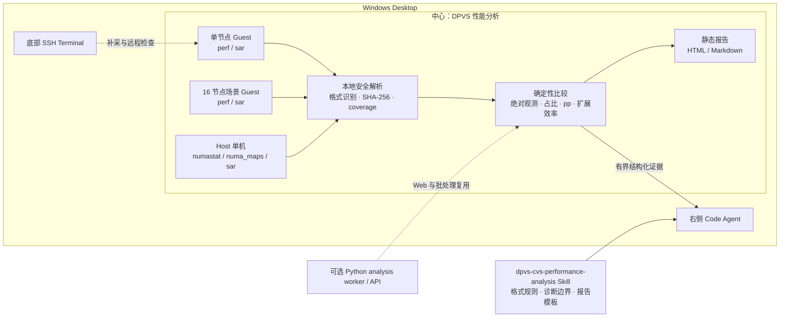

# DPVS / CVS 线性扩展性能分析台

## 目标

桌面工作台新增一个本地优先的 DPVS / CVS 性能分析页面。页面位于已有三栏工作台的中心区域，右侧 Code Agent 和底部 SSH Terminal 继续独立运行。用户可以在没有 SSH 连接时导入采样文件、检查解析结果并导出报告；需要进一步归因时，再把结构化证据交给 Code Agent。

当前分析针对三组证据：

| 数据槽 | 含义 | 主要用途 |
| --- | --- | --- |
| `baseline` | 单 CVS 节点 Guest | 建立函数、CPU、网络、内存和 I/O 基线 |
| `scaled` | 16 CVS 节点场景中的 Guest 采样 | 与基线比较占比、绝对采样量和系统指标 |
| `host_single_node` | 单节点场景 Host / QEMU 证据 | 检查内存页分布、NUMA 策略和宿主机侧异常 |

`scaled` 中导入一台 Guest 的数据时，它仍然只是“16 节点场景中的单节点观测”，不会自动乘以 16 冒充集群总量。只有明确导入了集群汇总数据时，才应把采集范围标记为 cluster。

## 桌面工作流

1. 打开左侧活动栏的“DPVS 性能分析”。
2. 为单节点 Guest、16 节点 Guest 和单节点 Host 分别拖入或选择文件。
3. 补充采样事件、时长、采样配置（例如 `freq=99`）、采样目标（例如 `PID=123/CPU=2-4`）、集群总 PPS/CPS 和采集范围。未知项可以留空；平台不会用猜测补值。
4. 在覆盖矩阵确认哪些文件成功解析，哪些文件只得到部分结果，以及哪些比较条件不足。
5. 在 perf、SAR 和 NUMA 页签检查数值与限制。perf 表同时显示原始量、占比、百分点变化和满足前提时的归一量。
6. 导出静态 HTML 报告，或复制 Markdown 报告。
7. 点击“让 Code Agent 深入分析”，平台把有界的结构化证据提交到右侧 Agent。Agent 读取 `dpvs-cvs-performance-analysis` Skill，并基于当前证据给出候选解释、替代解释和补采建议。

页面不会执行 SVG 中的脚本、链接或样式。二进制 `perf.data`、sar 二进制历史文件和压缩包不会被当作文本猜测解析，应先在对应 Linux 环境导出为文本、folded 或 FlameGraph SVG。

## 支持的数据

### perf / FlameGraph

推荐按优先级提供：

```bash
# 完整 folded 栈最适合同时比较 Self 与 Inclusive
perf script | stackcollapse-perf.pl > perf-cycles.folded

# 平面 report 可保留 Self/Children；-n 保留真实 Samples 列供绝对量比较
LC_ALL=C perf report --stdio -n --percent-limit 0 > perf-cycles.report.txt

# FlameGraph SVG 可用于 Inclusive 可视化；裁剪后的小帧无法恢复
flamegraph.pl perf-cycles.folded > perf-cycles.svg
```

每种事件分别导出。`cycles`、`cache-misses`、`instructions` 等不同事件不能放在同一个函数对比中。只有两侧 event、采样目标、frequency/period 配置和时长满足对比前提时，平台才计算 samples/s 差值；原始样本数始终作为观测量保留，但不会直接解释成 CPU 时间。采样目标必须写清 PID/TID/CPU/lcore 范围，`perf -p <worker> -F99` 与 `perf -a -F99` 不能因频率相同而视为绝对可比。

### sar / sadf

可以导入带表头的 `sar` 文本或 `sadf -d` 分号格式。建议保留完整日期、时区、采集间隔和设备名：

```bash
LC_ALL=C sar -u ALL -f /var/log/sa/saXX > sar-cpu.txt
LC_ALL=C sar -r ALL -f /var/log/sa/saXX > sar-memory.txt
LC_ALL=C sar -n DEV -f /var/log/sa/saXX > sar-network.txt
LC_ALL=C sar -d -p -f /var/log/sa/saXX > sar-io.txt
LC_ALL=C sadf -d /var/log/sa/saXX -- -u ALL > sadf-cpu.csv
```

`all` 与各 CPU 是不同视图，不会相加。`Average:` 行不会和逐时刻样本重复计数。不同接口、不同单位或不同时间窗会保留为独立指标。`sadf` 提供可靠 `interval` 时按时长加权；普通 sar 文本出现变间隔或 `LINUX RESTART` 时保留原始证据并阻止该均值进入场景差值。baseline 与 scaled 时间窗不会自动对齐，报告会持续标出这一限制。

### Host NUMA / QEMU

已知 QEMU PID 后，建议一起保存：

```bash
numactl --hardware > host-numa-topology.txt
numastat > host-numastat-system.txt
numastat -p "$QEMU_PID" > host-numastat-qemu.txt
cat "/proc/$QEMU_PID/numa_maps" > host-qemu-numa_maps.txt
taskset -pc "$QEMU_PID" > host-qemu-affinity.txt
ps -L -p "$QEMU_PID" -o pid,tid,psr,pcpu,comm > host-qemu-threads.txt
```

`numastat -p` 和 `numa_maps` 说明页驻留或分配位置，不是实际远端 load 次数、内存带宽或 cache miss。要判断 OVS-DPDK vhost、QEMU vCPU 和 NIC 是否跨 NUMA，还需要线程到 pCPU、PMD、物理网卡节点和内存 backing 的映射。

## 比较口径

perf 的主要数值如下：

| 数值 | 公式 | 解释边界 |
| --- | --- | --- |
| 占比变化 | `scaled_percent - baseline_percent` | 单位是百分点，不是相对百分比 |
| 相对占比变化 | `scaled / baseline - 1` | 基线为 0 或缺失时不计算 |
| 原始权重变化 | `scaled_weight - baseline_weight` | 只在权重单位一致时展示 |
| 权重率 | `weight / duration_seconds` | 还要求事件、范围和采样策略可比 |
| 每包权重 | `weight / packets` | packets 必须和 perf 同一目标、同一时间窗 |
| 每连接权重 | `weight / connections` | connections 必须有相同口径 |

folded 文件覆盖完整栈时，未出现函数可以按零样本处理。被 top-N、阈值或 SVG 裁剪过的输入中，未出现函数保持缺失，不能按零处理。Self 和 Inclusive 使用不同列，Inclusive 可能重叠，不能跨函数相加成总开销。

SAR 比较按 `entity + metric` 对齐，例如 `CPU=2/%soft`、`IFACE=eth1/rxpck/s`。基线不存在的指标标记为新增，scaled 缺失的指标标记为缺测；两者都存在时才计算差值和相对变化。

## 报告与溯源

报告记录以下内容：

- 输入文件名、原始字节数和 SHA-256；
- baseline、scaled、host 的角色与采集范围；
- 实际命中的解析器、解析置信度、未解析内容和警告；
- perf/SAR/NUMA 的原始值、派生公式和可比性；
- 观测、候选解释、替代解释、待补证和验证动作；
- 生成报告时使用的 schema 与分析代码版本。

HTML 报告是无脚本、无外链的静态文件，通过 Electron 原生保存对话框和原子替换写入。Markdown 适合进入评审或交给其他分析工具。原始输入不会写进 HTML 作为可执行内容。

## Code Agent Skill

Agent Skill 位于：

```text
agent-resources/skills/dpvs-cvs-performance-analysis/
```

桌面发布时，该目录会随版本化 Agent Skills 一起复制到只读的 `HETERO_AGENT_SKILL_ROOT`。Skill 定义了跨平台输入识别、绝对值与相对值规则、SAR/NUMA 边界、DPVS 诊断规则和报告模板。页面提交分析任务时显式指定该 Skill；Agent 仍需说明证据缺口，不得把文件名、函数名或架构假设写成运行事实。

## 架构边界



本地页面承担快速导入、解析、对比和报告预览，因此 SSH 断开、服务器 Profile 改变或 Code Agent 未启动时仍可工作。后端 `dpvs_analysis` 模块提供同一类确定性分析的持久 API，供 Web、Desktop 远程 Worker 或后续批处理复用。Agent 负责解释开放式问题和规划下一轮实验，不负责替换确定性数值计算。

Desktop 的短 RPC 请求有 12 MiB 上限。中心页面本地导入不走该 RPC；把证据交给 Agent 时只提交有界摘要，不把全部原始 SVG、SAR 时间序列或 `numa_maps` 粘贴进终端。

## 验证

```bash
python3 -m unittest backend.tests.test_dpvs_analysis
npm --prefix desktop test
npm --prefix desktop run build
```

Windows 源码构建使用：

```powershell
powershell -NoProfile -ExecutionPolicy Bypass -File .\desktop\run-desktop.ps1 -BuildOnly
```

Windows x64 安装包和便携版使用 `-Package` 生成，产物位于 `desktop/release/`。发布前还应在真实 Windows 环境验证中文路径、拖放、报告保存、页面切换后的状态保留和 Agent 提交。
