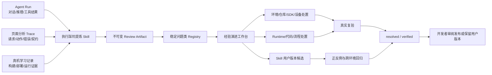

# 执行经验提炼与 Skill 自适应演进 Spec

> 状态：Implemented v1.0。
> 范围：从历史 Agent Run、页面分析 Trace 和真机学习记录中提炼执行踩坑，支持用户研判、处置和后续 Skill 优化。
> 关联规范：[skill_evolution_and_evaluation_spec.md](skill_evolution_and_evaluation_spec.md)、[agent_framework_adapter_guide.md](agent_framework_adapter_guide.md)、[platform_agent_runtime_build_device_bridge_spec.md](platform_agent_runtime_build_device_bridge_spec.md)。

## 1. 问题与目标

同一工作流在开发和生产中可能同时改变模型、Agent 框架、宿主 OS/架构、代码快照、SDK/工具链、运行库、设备型号和设备系统。一次失败不能直接归因于 Skill，也不能把单个错误字符串追加成新的 Prompt 规则。

本能力解决四个问题：

1. 从完整历史执行中恢复“症状、工具事实、尝试动作、动作结果”，而非只读最终回答。
2. 显式比较模型、Agent、宿主、代码、SDK、运行库和设备身份，缺失字段保持未知。
3. 将相同机制的多次失败归并为稳定问题类，并给出可选择、可验证、可回退的处置。
4. 只有经过用户选择、复验和回归的问题，才允许进入 Skill、Runtime Adapter、Build Profile 或知识库的版本化改进。

本能力不自动修改环境、代码、知识库、平台 Skill 或设备配置，也不把模型根因解释升级为事实。

## 2. 总体架构



页面负责选择证据、展示状态和接收用户决策；Agent 负责有界读取、证据链重建和提出候选；后端负责来源校验、Schema 校验、内容寻址工件、问题合并和决策审计。

## 3. 历史证据源

| 源 | 内容 | 关键边界 |
|---|---|---|
| `agent_run` | Agent 目标、状态、逐轮事件、工具调用与结果、运行时身份 | Agent 自述和模型解释不是工具事实 |
| `analysis_trace` | 页面模型请求、工作流动作、契约校验、错误和回填事件 | 只表示页面观察，不自动证明根因 |
| `experiment_learning_report` | 构建、部署、设备命令、功能对照及限制 | 功能通过不证明热点集成或性能收益 |

新建页面 Agent Run 记录非敏感 `agent_execution_environment/v1`：Agent Adapter、可见模型名称、模型服务主机、宿主 OS/版本/架构及采集时间。目标设备/系统、Skill profile、代码仓和快照继续从 Run context 读取。API key、Authorization 和完整凭证不得落盘。

历史记录未包含的环境字段必须显示为“未知”，不得使用当前服务器状态倒填。

## 4. 提炼 Skill

`execution-pitfall-distillation` 的最小方法如下：

1. 调用 `experience_list_sources`，按用户目标、失败阶段和环境选择少量相关记录。
2. 用 `experience_read_source` 分批读取，构造“可观察症状 -> 真实错误/工具结果 -> 尝试 -> 结果”证据链。
3. 比较模型、Agent、宿主、代码快照、SDK/编译器、运行库、设备和 OS；未知保持未知。
4. 生成稳定 `recurrence_key`。键描述机制，不包含 Run ID、设备序列号、临时路径或一次性错误全文。
5. 区分事实和根因假设，给出置信度、适用范围与泛化边界。
6. 为每个问题给出 1-4 个候选处置，分开写用户步骤、Agent 步骤、前置条件、风险和验证方法。
7. 调用 `experience_save_review` 保存；不在本轮自动执行处置。

只有问题来自可泛化的推理方法、工具选择、证据边界或停止条件时，才能建议 `skill_revision`。基础设施、代码仓、SDK 或设备问题优先进入对应处置，不用 Prompt 掩盖。

## 5. 数据与状态契约

### 5.1 Review

`execution_experience_review/v1` 是内容寻址的不可变工件，包含：

- `source_refs`：本次已验证存在的历史源。
- `environment_comparison`：基线、观察环境和可能影响。
- `pitfalls`：问题类、症状、根因假设、证据源、适用边界和候选处置。
- `promotion_policy`：禁止自动改 Skill/环境，并要求用户选择和复验。

### 5.2 Case

后端按 `recurrence_key` 合并为 `pit_<hash>`。同类问题的新 Review 增加 observation，不覆盖历史 Review。状态为：

`observed -> triaged -> action_planned -> resolved -> verified`

也可由用户标记 `dismissed`。`resolved` 表示已执行解决动作；`verified` 表示已按声明范围复验通过，两者不得混用。

### 5.3 Triage Decision

每次处置选择、备注或状态变化都生成不可变 `experience_triage_decision/v1` 工件。可变 Registry 仅服务列表和当前状态，审计事实以工件为准。

## 6. 处置类型

平台支持环境变量、代码仓、SDK/运行库、设备、Runtime Adapter、工作流、Skill、代码、补充证据和暂不处理十类处置。

- 用户选择处置不会立即执行。
- “让 Agent 执行”会读取当前案例和所选合同，再使用现有工具工作。
- Skill 处置跳转到 Skill 编辑器；保存只创建新的自编辑版本并热加载，平台基线不变。
- 环境、仓库和 SDK 处置跳转到代码仓/运行环境区域；设备和实验处置进入机会推理与真机验证链。

## 7. Skill 自适应闭环

```text
历史失败 -> 提炼候选 -> 用户研判 -> 最小复现 -> 修改用户 Skill 版本
         -> 正例 + 反例 + 跨模型/Agent/环境回归 -> 验证 -> 开发者发布或回滚
```

评测至少覆盖：原问题复现、一个语义等价变体、一个不应触发的反例、另一模型或 Agent Adapter、目标生产宿主。若改动只提升一个样本，却降低泛化、增加无效上下文或改变证据等级，必须回滚。

后续可在本工作台增加批量评测和版本对照，但不得让模型同时修改 Skill 和评判自己的改动是否发布。

## 8. API 与 Agent 工具

HTTP：

- `GET /v1/experience-evolution/sources`
- `GET /v1/experience-evolution/sources/{source_type}/{source_id}`
- `GET /v1/experience-evolution`
- `GET /v1/experience-evolution/cases/{case_id}`
- `POST /v1/experience-evolution/cases/{case_id}/triage`

Agent MCP：

- `experience_list_sources`
- `experience_read_source`
- `experience_list_cases`
- `experience_save_review`
- `experience_triage_case`

## 9. 页面要求

左侧“经验演进”是独立工作区。顶部历史源列表可搜索、滚动和多选；下方问题列表与详情分别滚动。详情必须展示症状、根因假设、置信度、适用范围、泛化边界、触发条件、候选处置、用户/Agent 步骤和验证方法。

“技能列表”采用独立列表和编辑器双栏布局，两栏均可滚动。平台版本可以查看但不原地覆盖；任何保存都生成可回退的自编辑版本。经验案例选择 Skill 处置时，可直接定位目标 Skill。

## 10. 验收标准

1. Kimi/MiniMax、Kimi CLI/CodeAgent、macOS/Linux、不同设备等差异可被分维度表达；缺失项保持未知。
2. 不存在的历史源或 Review 外的证据引用被拒绝。
3. 同一 `recurrence_key` 多次观察合并为一个 Case，Review 保持不可变。
4. 用户处置和验证状态有独立决策工件，可追溯且可回退。
5. 单次失败不会自动改写生产 Skill；Skill 改动进入自编辑版本和回归流程。
6. Skill 列表、编辑器、历史源和问题列表在桌面与窄屏均可滚动使用。
