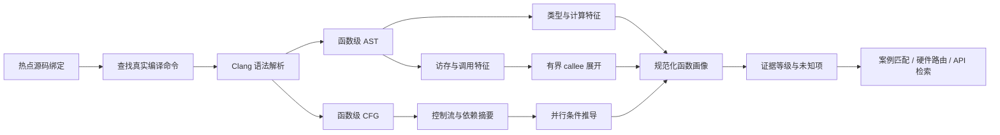

# 函数代码画像技术说明

> 文档状态：技术基线 v1.0  
> 基线日期：2026-08-18  
> 文档角色：定义函数级代码画像的输入、编译上下文、AST/CFG 分析、特征模型、证据等级和验收方法，并给出一个可复现的矩阵乘样例。  
> 关联文档：[总体技术文档](heterogeneous_optimization_enablement_platform_technical_overview.md)、[算法签名方法论](algorithm_signature_based_heterogeneous_opportunity_detection.md)、[跨 Spec 共同契约](cross_spec_contract.md)。

## 1. 定位

函数代码画像是针对明确源码快照和代码范围生成的结构化静态语义对象。它不是源码文本摘要，也不是仅由大模型给出的自然语言判断。画像以编译器可见事实为基础，统一描述数据类型、计算、访存、控制、依赖、运行时边界和并行条件，为以下环节提供共同输入：

1. Trace 热点函数和局部计算核心的解释；
2. CPU/software fallback 与已有异构案例的结构匹配；
3. 硬件单元语义路由和 API Top-N 检索；
4. CPU 并行、算法优化和异构卸载候选生成；
5. 真机实验的输入合同、正确性比较和收益归因。

函数代码画像只提供 E3 静态代码事实和带前提的派生属性。它不能独立证明代码是动态热点、目标设备支持某个 API、数据已经位于设备内存或优化能够获得端到端收益。

### 1.1 当前实现与目标能力

| 能力 | 当前状态 | 目标状态 |
|---|---|---|
| 词法静态扫描 | 已在线使用，适合粘贴代码和无编译上下文输入 | 保留为快速预分析和降级路径 |
| Tree-sitter 函数级画像 | 已用于严格异构案例和热点函数结构提取 | 继续作为跨仓、低成本结构基线 |
| Clang JSON AST | 已有 `precise_feature_extractor.py`，本文样例已实际生成 | 接入真实 OpenHarmony compilation database，成为高价值函数精准路径 |
| Clang CFG | 本文样例已通过 Clang Static Analyzer 实际生成 | 集成到画像流水线，输出分支、早退、循环回边和可达性摘要 |
| def-use、alias 和副作用 | 当前主要是局部语法推导和保守未知 | 结合 Clang/LLVM IR、调用摘要和有界跨过程分析 |
| 动态迭代与时间权重 | 由 Trace 指标独立提供，尚未系统投影到每个 AST 区域 | 将静态区域与采样、插桩或 counter 证据关联 |

因此，本文同时承担两项职责：定义生产目标合同，并保存一份不依赖大模型的 Clang AST/CFG 可复现实例。

## 2. 为什么需要函数代码画像

直接把热点代码发给大模型可以快速得到方向，但难以稳定回答以下问题：

- 模型所说的“连续访存”对应哪一个下标表达式；
- 循环是否真的存在跨迭代依赖，还是只因变量名看起来像累加器；
- 图像、音频或张量是由真实类型/API 合同确认，还是由函数名猜测；
- 建议的并行维度是否会受到别名、锁、共享状态或被调函数副作用影响；
- 代码改名、格式变化或模型版本变化后，结论是否仍可复现；
- 优化知识库中的 CPU fallback 与当前热点究竟在哪些结构特征上相似。

函数画像将这些判断拆成可定位的 AST/CFG 事实、保守派生属性、显式假设和未知项。模型仍负责跨域理解、候选比较与验证规划，但不能改写底层静态事实。

## 3. 输入与编译上下文

### 3.1 必要输入

一次精准提取至少需要：

| 输入 | 内容 | 作用 |
|---|---|---|
| 源码绑定 | connector、snapshot、文件 hash、函数 USR、行范围 | 确保分析对象可追溯 |
| 编译命令 | `compile_commands.json` 中目标翻译单元的 command/arguments | 恢复真实宏、include 和语言选项 |
| 编译器身份 | Clang 路径、版本、target triple | 避免 AST 结构和 ABI 类型漂移 |
| 目标环境 | sysroot、标准库、SDK/NDK 头文件 | 解析 OpenHarmony 平台类型和 API |
| 构建定义 | `-D`、`-I`、`-include`、feature flags、generated headers | 选择真实条件编译分支 |
| 分析范围 | 函数、lambda、局部循环或被调计算核心 | 防止把整个 wrapper 当成热点 |

对 OpenHarmony C/C++ 源码，使用 Clang 提取 AST 是合理的，因为 OpenHarmony 构建链以 Clang/LLVM 为主。但必须使用代码仓当前构建所对应的工具链和编译参数，不能默认使用工作站自带 Clang 替代目标编译环境。

### 3.2 编译上下文指纹

每份精准画像应记录以下 provenance：

```text
source_sha256
compile_command_sha256
compiler_path + compiler_version
target_triple
sysroot_sha256 或 SDK identity
defines/include paths/generated headers 摘要
extractor_name + extractor_version
profile_schema_version
```

同一源码在宏、头文件或 target 不同时可能生成不同 AST。编译上下文指纹是画像缓存键的一部分，不能只按源码 hash 缓存。

## 4. 提取流程



### 4.1 源码绑定

首先确认 Trace 插桩点、包围函数和候选核心代码范围。画像可以针对整个函数，也可以针对一个循环区域，但必须保留父函数、源码行和区域选择原因。对于只包含 wrapper 的热点，应继续解析主要 callee，不能用 wrapper 的低计算量画像替代真实负载。

### 4.2 恢复编译上下文

优先从 compilation database 精确匹配翻译单元。分析器应保留语义参数，移除 `-c`、输出文件和与分析无关的依赖生成参数。找不到编译命令时可以降级，但必须把缺失的宏、include、target 和 sysroot 标记为未知。

### 4.3 AST 提取

AST 提供声明、规范类型、表达式、循环、数组下标、调用、操作符和源码位置。生产输出应使用稳定的规范化字段，而不是将 Clang 内部节点地址或完整 dump 直接作为长期 Schema。

### 4.4 CFG 与数据流

CFG 将条件、循环回边、早退、异常路径和不可达区域转换为基本块与边。def-use 和依赖分析在 CFG 上识别：

- 局部变量的定义与使用；
- 循环携带依赖和归约变量；
- 每个输出元素的写入位置；
- 共享状态、别名和被调函数副作用；
- 锁、IPC、I/O、分配和同步形成的串行边界。

仅靠 Clang AST 不能证明指针互不别名。缺少 `restrict`、不可变容器或调用合同证据时，应将并行安全写成条件，而不是事实。

### 4.5 有界跨过程分析

调用关系按预算展开：优先分析热点区域中的主要计算 callee、循环内 callee 和知识库严格案例锚点。系统调用、第三方库、虚调用和动态 provider 保留调用摘要与边界状态，不能伪造函数体画像。

### 4.6 规范化与证据标记

每个画像字段使用以下状态之一：

| 状态 | 含义 |
|---|---|
| `observed` | 由当前 AST、CFG、声明或编译上下文直接观察 |
| `derived` | 由已观察表达式保守推导，可回溯推导规则 |
| `assumed` | 为完成局部分析显式加入的假设 |
| `unknown` | 当前证据无法确定 |

## 5. 函数代码画像特征模型

### 5.1 数据类型

| 提取内容 | 方法 | 典型规范化字段 | 边界 |
|---|---|---|---|
| 整数、浮点、布尔和精度 | `QualType`、canonical type、literal、cast | `scalar_kind`、`bit_width`、`signedness`、`precision` | typedef 必须展开但保留原名 |
| 向量和 SIMD 类型 | Clang vector type、数组/模板参数、intrinsic | `vector_width`、`lane_type`、`intrinsics` | 普通数组不能直接写成 SIMD |
| 图像和像素 | 类型、format enum、stride、图像 API 合同 | `semantic_type=image`、`pixel_format`、`channels` | 不能只根据变量名 `image` 推断 |
| 音频和 PCM | sample type、channel、frameCount、音频 API 合同 | `semantic_type=audio`、`sample_format`、`channels` | 运行时采样率可能仍未知 |
| 张量 | tensor 类型、shape/layout/dtype API、索引公式 | `semantic_type=tensor`、`shape`、`layout`、`dtype` | 索引像矩阵不等于设备张量已存在 |

### 5.2 计算特征

从操作符、数学调用、循环和 API 语义提取：

- 整数/浮点加减乘除、FMA 候选和位操作；
- 矩阵乘、卷积、模板计算、FFT、直方图和归约等算法形态；
- `sin`、`cos`、`exp`、`log`、`sqrt` 等超越函数；
- 量化、颜色转换、采样格式转换和序列化；
- 符号运算次数和静态算术密度。

静态 FLOP/Byte 是表达式级估计。缓存命中、编译器消除、动态尺寸和真实内存流量必须由编译产物或 profiling 补充。

### 5.3 访存特征

通过数组下标、指针运算、字段访问、CFG def-use 和 alias 信息描述：

- 连续、固定跨步、邻域/stencil、间接或随机访问；
- 读写节点、名义读写比和每个输出的写入次数；
- 循环间数据复用、tile 复用和潜在 cache locality；
- 对齐、restrict/noalias、共享 buffer 和 in-place 更新；
- Host、DMA、NativeBuffer 或设备内存的数据所有权边界。

“源代码下标连续”不等于“真实 DRAM 连续”，也不证明数据已经位于加速器可访问内存。

### 5.4 控制特征

AST 和 CFG 联合提取：

- 循环类型、嵌套层数和符号迭代上界；
- 分支数量、静态分支密度和数据相关条件；
- `break`、`continue`、`return`、异常和提前退出；
- 不同迭代可能走不同路径时的分支发散风险。

动态分支概率、循环次数和发散程度必须由 Trace、采样或硬件 counter 提供，不能由静态节点数量替代。

### 5.5 依赖特征

主要描述：

- true/flow、anti 和 output dependency；
- 循环携带依赖；
- sum/min/max 等可识别归约；
- 全局变量、成员状态、引用参数和共享容器；
- callee 的读写集合、锁和副作用；
- 调用图中尚未解析的动态边界。

### 5.6 运行时边界

通过调用表达式、规范符号、API 合同和有界跨过程摘要识别：

- mutex、rwlock、spinlock、原子操作和内存序；
- Binder/IPC、Parcel、socket 和跨进程等待；
- 文件、网络、设备和数据库 I/O；
- heap 分配、对象构造、GC 或资源生命周期；
- fence、condition variable、future、thread join 和设备同步。

符号命中是静态事实，不代表该边界占据主要运行时间。它的动态权重仍需 profiling。

### 5.7 并行特征

并行属性是建立在前述事实上的派生结果，至少包含：

- 哪些循环维度或任务之间独立；
- 归约是否满足可拆分与合并条件；
- 输出是否重叠，输入输出是否可能别名；
- callee、共享状态和异常语义是否线程安全；
- 符号任务量、单任务粒度和调度/同步成本；
- 已有 FFRT、线程池、OpenMP 或 GPU/NPU 调度边界。

画像应输出“可并行条件”，而不是在缺少运行时尺寸和别名合同时直接输出“可并行”。

## 6. 画像数据结构

推荐的顶层结构如下：

```json
{
  "schema_version": "function_code_profile/v1",
  "source_binding": {},
  "compile_context": {},
  "analysis_quality": {},
  "scope": {},
  "types": {},
  "computation": {},
  "memory_access": {},
  "control_flow": {},
  "dependencies": {},
  "runtime_boundaries": {},
  "parallelism": {},
  "call_boundaries": [],
  "hardware_mapping_hints": [],
  "unknowns": [],
  "provenance": {}
}
```

`hardware_mapping_hints` 只是供后续硬件路由和 API 检索消费的静态线索，不能包含设备已支持、已经加速或必然收益等跨证据等级结论。

## 7. 分析质量等级

| 等级 | 条件 | 可用于 |
|---|---|---|
| `exact_clang_context` | 真实源码、目标 Clang、target、sysroot、宏、include 和 compilation database 全部可复现 | 高价值函数画像、严格案例和匹配基线 |
| `partial_clang_context` | 函数完整，但部分构建参数或 generated header 缺失 | 候选分析，缺失项必须显式列出 |
| `synthetic_clang_ast` | 代码片段通过显式包装器补全声明 | Demo、粘贴代码预分析，不可冒充真实函数签名 |
| `tree_sitter_ast` | 无编译上下文的结构 AST | 大规模扫描和跨语言结构候选 |
| `lexical_fallback` | 仅词法 token、符号和范围扫描 | 快速提示，不能证明类型与依赖 |

生产匹配必须将质量等级作为特征的一部分。低等级画像可以召回候选，但不能覆盖高等级画像或直接升级证据结论。

## 8. 完整示例：FP32 矩阵乘函数画像

### 8.1 原始 Demo 代码

源码文件：`demo/hardware-api-examples/02_npu_matmul.cpp`，SHA-256 为 `5b7aedca92c057154c6828c23ad828b6a62e54a2107c57f2b9191f61feebf71a`。

```cpp
for (std::size_t row = 0; row < rows; ++row) {
    for (std::size_t column = 0; column < columns; ++column) {
        float accumulator = 0.0F;
        for (std::size_t k = 0; k < reduction; ++k) {
            accumulator += left[row * reduction + k] * right[k * columns + column];
        }
        output[row * columns + column] = accumulator;
    }
}
```

该文件只有语句片段，不是合法的独立 C++ 翻译单元。它没有声明 `left`、`right`、`output`、`rows`、`columns` 和 `reduction` 的真实类型，也没有编译命令。因此不能直接声称已经获得 OpenHarmony 精确 AST。

### 8.2 分析包装器及假设

本次实验使用以下只用于静态分析的包装器，不修改原始 Demo：

```cpp
namespace std {
using size_t = __SIZE_TYPE__;
}

// Synthetic analysis wrapper. The original demo contains only the loop body.
void matmul_reference(const float* left, const float* right, float* output,
    std::size_t rows, std::size_t columns, std::size_t reduction)
{
#line 1 "demo/hardware-api-examples/02_npu_matmul.cpp"


    for (std::size_t row = 0; row < rows; ++row) {
        for (std::size_t column = 0; column < columns; ++column) {
            float accumulator = 0.0F;
            for (std::size_t k = 0; k < reduction; ++k) {
                accumulator += left[row * reduction + k] * right[k * columns + column];
            }
            output[row * columns + column] = accumulator;
        }
    }
#line 100000 ".local-artifacts/analysis-examples/02_npu_matmul_wrapped.cpp"
}
```

显式假设如下：

1. `left` 和 `right` 是 `const float*`；
2. `output` 是可写 `float*`；
3. 三个尺寸参数是 `std::size_t`；
4. 下标表达式表示 row-major 稠密矩阵。

这些假设只用于恢复一个可编译示例。真实源码中的容器、alignment、alias、shape 和 ownership 仍为未知。

### 8.3 AST 与 CFG 生成命令

```bash
/usr/bin/clang++ -std=c++17 -fsyntax-only -Wall -Wextra -Werror \
  .local-artifacts/analysis-examples/02_npu_matmul_wrapped.cpp

/usr/bin/clang++ -std=c++17 -fsyntax-only \
  -Xclang -ast-dump=json \
  -Xclang -ast-dump-filter=matmul_reference \
  .local-artifacts/analysis-examples/02_npu_matmul_wrapped.cpp \
  > .local-artifacts/analysis-examples/02_npu_matmul.ast.json

/usr/bin/clang++ -std=c++17 --analyze \
  -Xclang -analyzer-checker=debug.DumpCFG \
  .local-artifacts/analysis-examples/02_npu_matmul_wrapped.cpp \
  > .local-artifacts/analysis-examples/02_npu_matmul.cfg.txt 2>&1

.venv/bin/python tools/analysis/precise_feature_extractor.py \
  --src .local-artifacts/analysis-examples/02_npu_matmul_wrapped.cpp \
  --out .local-artifacts/analysis-examples/02_npu_matmul.features.json \
  --pretty --verbose
```

本次命令使用工作站 Apple Clang 17.0.0，target 为 `arm64-apple-darwin24.6.0`，所以质量等级是 `synthetic_clang_ast`。生产环境应将命令替换为目标 OpenHarmony compilation database 中的 Clang、target 和 sysroot。

### 8.4 规范化 AST

```text
FunctionDecl matmul_reference
├── ParmVarDecl left: const float*
├── ParmVarDecl right: const float*
├── ParmVarDecl output: float*
├── ParmVarDecl rows: std::size_t
├── ParmVarDecl columns: std::size_t
├── ParmVarDecl reduction: std::size_t
└── CompoundStmt
    └── ForStmt row
        ├── condition: row < rows
        ├── increment: ++row
        └── ForStmt column
            ├── condition: column < columns
            ├── increment: ++column
            ├── VarDecl accumulator: float = 0.0F
            ├── ForStmt k
            │   ├── condition: k < reduction
            │   ├── increment: ++k
            │   └── CompoundAssignOperator +=
            │       └── BinaryOperator *: float
            │           ├── ArraySubscriptExpr left[row * reduction + k]
            │           └── ArraySubscriptExpr right[k * columns + column]
            └── BinaryOperator =
                ├── ArraySubscriptExpr output[row * columns + column]
                └── DeclRefExpr accumulator
```

Clang 原始节点中的关键部分如下：

```text
FunctionDecl matmul_reference
|-ParmVarDecl left 'const float *'
|-ParmVarDecl right 'const float *'
|-ParmVarDecl output 'float *'
|-ParmVarDecl rows 'std::size_t':'unsigned long'
|-ParmVarDecl columns 'std::size_t':'unsigned long'
|-ParmVarDecl reduction 'std::size_t':'unsigned long'
`-CompoundStmt
  `-ForStmt
    `-CompoundStmt
      `-ForStmt
        `-CompoundStmt
          |-VarDecl accumulator 'float' cinit
          |-ForStmt
          | `-CompoundStmt
          |   `-CompoundAssignOperator '+=' ComputeResultTy='float'
          |     `-BinaryOperator '*' 'float'
          |       |-ArraySubscriptExpr 'const float' left[row * reduction + k]
          |       `-ArraySubscriptExpr 'const float' right[k * columns + column]
          `-BinaryOperator '='
            |-ArraySubscriptExpr 'float' output[row * columns + column]
            `-DeclRefExpr accumulator 'float'
```

### 8.5 AST 节点统计

| 节点或操作符 | 数量 | 解读 |
|---|---:|---|
| `ForStmt` | 3 | 三层规则循环 |
| `ArraySubscriptExpr` | 3 | 两个输入读取表达式和一个输出写入表达式 |
| `CompoundAssignOperator +=` | 1 | FP32 累加归约 |
| `BinaryOperator *` | 4 | 一个浮点乘法和三个下标乘法 |
| `BinaryOperator +` | 3 | 三个二维线性化下标加法 |
| `BinaryOperator =` | 1 | 输出写入 |
| `CallExpr` | 0 | 核心片段无函数调用 |
| `IfStmt` / `SwitchStmt` | 0 | 无数据相关分支 |

### 8.6 CFG

Clang 实际生成 13 个基本块，规范化控制流如下：

```mermaid
flowchart TD
  E[B12 Entry] --> R0[B11 row = 0]
  R0 --> RC{B10 row < rows}
  RC -- 否 --> X[B0 Exit]
  RC -- 是 --> C0[B9 column = 0]
  C0 --> CC{B8 column < columns}
  CC -- 否 --> RI[B1 ++row]
  RI --> RC
  CC -- 是 --> K0[B7 accumulator = 0; k = 0]
  K0 --> KC{B6 k < reduction}
  KC -- 是 --> MAC[B5 accumulator += left[...] * right[...]]
  MAC --> KI[B4 ++k]
  KI --> KC
  KC -- 否 --> ST[B3 output[...] = accumulator]
  ST --> CI[B2 ++column]
  CI --> CC
```

CFG 证明 `accumulator` 的定义位于 column 循环内、k 循环前；其更新块经 k 回边再次到达条件块，因此存在 k 维循环携带的归约依赖。输出写入只发生在 k 循环退出之后。

### 8.7 完整函数画像表

| 画像维度 | 提取结果 | 状态与证据 |
|---|---|---|
| 分析对象 | `demo/hardware-api-examples/02_npu_matmul.cpp:3-11` | `observed`，源码 hash 已记录 |
| 分析质量 | 合成函数上的 Clang AST/CFG | `assumed`，等级 `synthetic_clang_ast` |
| 算法语义 | `output[rows, columns] = left[rows, reduction] × right[reduction, columns]` | `derived`，来自三组下标和归约表达式 |
| 基础类型 | `accumulator` 为 FP32 | `observed`，源片段直接声明 |
| Buffer 类型 | `left/right` 为 `const float*`，`output` 为 `float*` | `assumed`，由包装器补全 |
| 计算结构 | 每个输出执行 `reduction` 次浮点乘法和累加 | `derived` |
| 复杂度 | `O(rows × columns × reduction)` | `derived` |
| 名义 FLOPs | `2 × rows × columns × reduction` | `derived`，按乘法与加法各计一次 |
| `left` 访存 | `row * reduction + k`；沿 k 单位步长，同一行跨 column 复用 | `derived`，基于 row-major 假设 |
| `right` 访存 | `k * columns + column`；单个输出沿 k 的步长为 columns，相邻 column 可连续 | `derived`，基于 row-major 假设 |
| `output` 访存 | `row * columns + column`；沿 column 单位步长，每个输出写一次 | `derived` |
| 名义读写 | 每个 k 两次 FP32 读，每个输出一次 FP32 写 | `derived`，不等于实际 DRAM 流量 |
| 数据复用 | left 行跨列复用，right 矩阵跨行复用 | `derived`；能否命中 cache 仍未知 |
| 别名 | 函数签名没有 `restrict/noalias` 合同 | `unknown`；输出可能与输入重叠 |
| 控制流 | 三层规则循环，无数据相关分支、早退和调用 | `observed` |
| 依赖 | k 维上 `accumulator` 存在归约依赖 | `observed/derived`，AST 与 CFG 均支持 |
| 输出独立性 | 不同 `(row,column)` 产生不同输出位置 | `derived`；要求尺寸合法且不存在别名覆盖 |
| 运行时边界 | 未发现锁、原子、IPC、I/O、分配和同步调用 | `observed`，仅限当前片段 |
| CPU 并行 | 可按 row 或输出 tile 拆分 | `derived`；需要 non-alias、线程安全和足够粒度 |
| CPU SIMD | k 归约和/或相邻 column 可向量化 | `derived`；受 FP 语义、布局和编译器影响 |
| NPU 语义 | 与 dense FP32 MatMul/GEMM 高度相似 | `derived`，仅用于检索 NPU MatMul API 候选 |
| GPU 语义 | 规则大规模输出网格也可映射 compute shader | `derived`；是否优于 NPU/CPU 取决于规模和数据位置 |
| 动态任务规模 | `rows/columns/reduction` 的真实值未知 | `unknown` |
| 数据所有权 | Host、共享 buffer 或设备驻留状态未知 | `unknown` |
| 设备能力 | NPU/GPU API、shape、dtype、layout 支持未知 | `unknown`，必须 capability query |
| 收益 | 搬运、调度、同步、功耗和端到端加速比未知 | `unknown`，必须 benchmark |

### 8.8 编译器优化观察

使用相同合成包装器执行：

```bash
/usr/bin/clang++ -std=c++17 -O3 \
  -Rpass=loop-vectorize \
  -Rpass-missed=loop-vectorize \
  -Rpass-analysis=loop-vectorize \
  -c .local-artifacts/analysis-examples/02_npu_matmul_wrapped.cpp
```

Host Apple Clang 17 报告源文件第 6 行的 k 循环已向量化，vectorization width 为 4，interleave count 为 4。LLVM IR 中出现 `<4 x float>` load、multiply 和 `llvm.vector.reduce.fadd.v4f32`。

该结果只证明当前合成签名在本机编译配置下存在 SIMD 转换路径。它不能证明 OpenHarmony 目标 Clang 会做出相同优化，也不能证明 SIMD、NPU 或 GPU 中哪一种端到端性能更高。

### 8.9 优化方向解读

#### CPU 路径

1. 按 row 或二维输出 tile 分派线程，避免多个线程写同一输出区；
2. 对 right 做 transpose/packing，或采用 cache blocking，提高 k 维访问局部性；
3. 为真实接口补充 non-alias 和 alignment 合同后评估 SIMD；
4. 对严格 FP 累加顺序有要求时，验证向量归约的数值误差。

#### NPU 路径

该片段与矩阵乘语义高度一致，后续可以优先检索 NNRT MatMul 语义记录，例如 `OH_NN_OPS_MATMUL`。但该名称只是 API/算子候选，不是设备支持证明。进入实验前至少需要验证：

- 输入 shape 为 `[rows, reduction]` 与 `[reduction, columns]`；
- dtype、layout、transpose 语义和输出精度一致；
- `OH_NNModel_GetAvailableOperations` 等设备能力结果；
- 数据搬运、模型编译/缓存、调度与同步成本；
- CPU fallback 与 NPU 输出误差；
- 目标场景的端到端 latency、throughput 和功耗。

#### GPU 路径

规则输出网格、无数据相关分支和大量独立输出也符合 GPU compute 的基本形态。对于大矩阵或数据已经位于 GPU 的流水线，可检索 `vkCmdDispatch` 或 `glDispatchCompute` 语义族。具体选 NPU、GPU 或 CPU，必须结合矩阵尺寸、数据驻留、调用频率和目标设备实测。

### 8.10 结论

这段代码的静态核心可以可靠识别为规则 FP32 矩阵乘，具备 CPU tile 并行、SIMD 和 NPU/GPU 候选价值。画像能够回答“计算是什么、数据怎样访问、哪里有依赖、哪些维度在什么条件下可并行”，但不能回答“当前场景是否值得优化”和“哪种硬件一定更快”。后两个问题分别需要 Trace 动态证据和真机对照实验。

## 9. 与平台主链路的集成

```text
Trace 热点或用户粘贴代码
  -> 精确源码/局部范围绑定
  -> 选择画像质量路径
  -> Clang AST + CFG + 编译上下文
  -> 函数代码画像
  -> 硬件中立语义路由
  -> 单元 API Top-N 检索
  -> 优化知识库 / 硬件知识库 / Direct 推理
  -> 条件、负证据和验证计划
  -> 可选真机迭代验证
```

页面和 Agent 应同时展示画像摘要与质量等级。模型上下文只携带与当前候选相关的规范化字段和少量源码引用，不默认注入完整 AST dump，以减少 token 消耗和噪声。完整 AST、CFG 和编译命令作为 artifact 保留，供审计和按需读取。

## 10. 工业级验收条件

函数代码画像进入生产匹配前至少满足：

1. 源码 snapshot、文件 hash、函数/区域和编译上下文可重放；
2. AST/CFG 解析无 fatal diagnostic，错误降级不会伪装成精准结果；
3. 特征字段携带 `observed/derived/assumed/unknown` 状态；
4. 图像、音频和张量语义来自类型/API 合同，而非变量名；
5. alias、callee 副作用和运行时尺寸缺失时采用保守结论；
6. wrapper 与主要 callee 分开画像，不把调度代码替代计算核心；
7. AST/CFG/画像均保存 schema、生成器、编译器和输入 hash；
8. 等价改名、格式变化和无关语句变换不应破坏算法语义识别；
9. 正负样本、边界样本和真实 OpenHarmony translation unit 均有回归测试；
10. 硬件映射只生成候选，设备支持和性能收益必须由独立证据升级。

## 11. 后续工程化工作

1. 从 OpenHarmony 构建输出自动定位目标 translation unit 的 `compile_commands.json` 条目；
2. 将 Clang AST、CFG 和当前 `precise_feature_extractor.py` 统一为版本化 extractor；
3. 增加 affine index、def-use、归约、alias 和 side-effect 规范化分析；
4. 对热点循环执行有界 callee 展开，并保留 unresolved boundary；
5. 将 Trace 次数、时间窗口和关键路径权重投影到函数及局部范围；
6. 建立函数画像的变换泛化、正负样本和编译上下文回归集；
7. 将完整 artifact 保存在后端，向模型提供损失感知的精简上下文。

