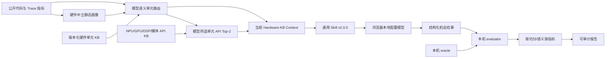

# 硬件知识库上下文策略评测规范

## 1. 目的与结论边界

本规范评测 `strategy-hardware-kb` v2.0.0 是否能在生产工作台的两阶段中文 Skill 下，基于当前硬件知识库、NPU/GPU/DSP/媒体 API 子知识库和热点代码，形成**相对准确、保守且可泛化**的下一步判断：

1. 是否存在应继续验证的硬件/API 语义方向；
2. 是否应拒绝把非计算、受同步约束或无关的代码写成硬件卸载；
3. 是否可提出 CPU 并行方向，以及切分、依赖、归并和粒度条件；
4. 是否正确停在 `evidence_required`，而不是把静态候选、用户选择的麒麟/鸿蒙画像或模型常识升级为设备支持与收益。

它是 **Skill / Prompt / context-retrieval 的回归与泛化评测**，不是设备 benchmark、不是 API 可用性证明，也不是异构机会识别的最终准确率声明。所有 fixture 都没有 device probe，因此即使正确命中 API，顶层结论也应保持 `evidence_required` 或 `not_recommended`。

严格 source-backed 异构 CPU fallback 的独立、冻结 benchmark 仍按 [tools/evaluation/README.md](knowledge/evaluation/README.md) 执行；两类评测不得混合统计。

## 2. Prompt 与知识库的分层

v1.5 曾把 NNRT、GPU、DSP、Codec/HDI 等具体路径和大量已知反例写入同一段 Prompt。它能避免一批已知错误，但存在两类风险：Prompt 随 API 增长而膨胀，且模型会对固定措辞和固定案例形成“背规则”倾向。

v1.6 将职责明确分为两层；v1.6.1 在此基础上把“局部核心是否结构适配”与“整条调用路径是否可落地”明确拆开；v1.7 曾以确定性规则选择单元，但它把领域判断编码进路由器，函数名、术语或写法变化即可失效。v2 改为模型优先的受控漏斗：

| 层 | 内容 | 更新频率 | 不承担的责任 |
| --- | --- | --- | --- |
| 通用策略 Skill | 证据等级、可观察核心作用域、语义匹配、CPU 切分与依赖、端到端落地门禁、结论校准 | 低 | 罗列某个 API、芯片或 HDI 的专属规则 |
| 模型语义单元路由 Skill | 根据可见代码、硬件中立静态画像和四张 `hardware_unit` 能力卡选择 `0-2` 个 NPU/GPU/DSP/媒体候选并写出 semantic profile | 随模型 Skill/能力卡契约演进 | 比较每个 API、声称设备可用、通过 generic loop/buffer 猜测硬件 |
| 确定性规则路由基线 | 离线对照、回归和误差分析；不进入模型输入 | 随规则演进 | 决定生产单元或 API 目录、充当模型答案 |
| 版本化 KB context record | 单元/API 摘要、语义族、输入输出形态、暴露层级、`capability_boundary`、`runtime_verification`、源码契约 | 随 API/源码演进 | 声称当前设备已经支持或有收益 |

第一阶段模型先从源码形成 `semantic_profile`：数据表示、操作模式、依赖/状态、外部边界和不确定性；它再独立比较 NPU/GPU/DSP/媒体能力卡并选择目录。生产链**不执行**确定性规则路由；只有显式离线审计才会生成 `deterministic_router_baseline`。模型输入还隔离 trace 名、模块名、源码路径和额外函数提示。第二阶段只在模型选择的目录中，以该 `semantic_profile` 和 API 摘要做 Top-N 召回；最终机会模型精核语义族、数据生命周期和运行时门禁。没有路由或没有 API 语义相容候选时保持为空，不能猜具体单元或 API；最多保留为明确标注的抽象 `model_hypothesis`。

每一项机会都必须声明 `analysis_scope`，其 `level` 为 `function`、`loop_region`、`data_pipeline`、`callee` 或 `unknown`。这是对**当前可见源码范围**的声明，不是“该作用域已可部署”的宣称：

| 层次 | 可以据此回答的问题 | 缺失时如何处理 |
| --- | --- | --- |
| 核心级结构适配 | 某个已观察循环、连续数据处理片段或已展开 callee 是否具备规则数据并行、算子语义或 CPU 切分条件 | 仍可输出带作用域的异构/并行方向，但标为假设或 `evidence_required` |
| 端到端落地可行性 | 数据所有权、格式/搬运、调度、同步、数值/错误语义、功耗、回退、小批量成本是否允许该方向真正获益 | 写入 `missing_evidence` 和 `verification_plan`，通常阻止顶层升级为 `candidate`，但不能反向否定已观察到的核心结构 |

长函数中的日志、参数校验、错误处理和包装代码不能覆盖已有源码依据的核心片段；反过来，函数只调用了 `Encode`、`Filter` 或其他计算型名称而没有给出函数体时，只能输出 `callee` + `callee_unresolved`，不能把名称当作其内部计算特征。

这使新增加速器、模型版本或 API 细节主要通过 KB 更新完成，而不是不断增加 Prompt 例外条款。

## 3. 执行链与泄漏隔离



- 浏览器模型只接收公开 fixture、fresh context 和生产路径中的 `buildStrategyPromptPlan`，不使用单独的“考试 Prompt”。
- `hardware_semantic_routing/v2` 使用 `hardware_semantic_routing_context/v3` 在浏览器本地配置模型上运行；其 model input 只能包含可见代码、移除了具体函数符号的 `generic_static_code_profile/v1`、通用候选作用域、Trace 时间指标和能力卡。生产构建不得执行 `hardware-unit-routing`；`deterministic_router_baseline`、单元特定静态 feature flag、静态 API Top-N、trace 名、模块名、源码路径和额外函数提示均不得进入。通过校验的 `hardware_routing.selected_units` 进入最终 Hardware-KB context；任何跨单元 API 进入仍为 context preflight 失败。
- API key 只在浏览器 `localStorage` 中，浏览器经本机 relay 调模型；后端不保存 key、Authorization 或完整模型 Prompt。
- `oracle` 不进入目录 API、prepare API、model context 或 prompt。评分时会重建 context 并校验 `context_sha256`，避免不同 KB 版本、画像或过期 context 混入同一报告。
- `holdout` 的公开输入可以在页面中运行，但其 oracle 不进入模型。它是冻结比较集：不得根据逐例结果继续调 Prompt、检索阈值或 KB 后，再把同一结果称为泛化能力。

## 4. 样本集与切分

源文件为 [tools/evaluation/hardware_kb_strategy_skill_cases.json](../data/evaluation/hardware_kb_strategy_skill_cases.json)，由 [tools/build_hardware_kb_strategy_evaluation_suite.py](tools/build_hardware_kb_strategy_evaluation_suite.py) 可复现生成。

当前共 **60 条**：

| 切分 | 数量 | 用途 | 规则 |
| --- | ---: | --- | --- |
| `smoke` | 20 | 快速发现 Prompt、context 或检索回归 | 每次改动必须运行 |
| `development` | 16 | 复现问题、定位 Prompt/KB/retriever 的责任 | 可用于迭代，但必须记录变更 |
| `validation` | 14 | 选择候选版本、比较改动前后趋势 | 不应用于逐例调词 |
| `holdout` | 10 | 冻结盲测比较 | 运行后冻结；若用于调参，必须换新版本/新 holdout |

语义覆盖包括：

- NPU：矩阵、卷积、深度卷积、池化、归约、激活、归一化、布局和逐元素张量操作；
- GPU：RGBA 图像效果、OpenGL/Vulkan compute 与传输、ASTC，以及小工作量搬运边界；
- DSP：PCM effect 处理和反向处理；
- 媒体：AVCodec 生命周期、JPEG/HEIF、HCodec/Codec Component HDI 及硬件/软件 capability；
- 反例：同步 IPC、锁/原子竞争、I/O、递推 scan、图搜索、排序、解析和网络轮询；
- CPU 并行：独立 map、块归约、私有 bin、无共享写入 tile、随机样本归并及小粒度/单锁边界。

每条机会策略 case 都有 `partition`、`family_id` 和 `variation_axis`。扩展样本时必须优先增加新的数据域、控制边界、调用形态和输入约束，不能仅替换变量名或函数名。

模型路由另有独立的 [hardware_semantic_routing_generalization_cases.json](../data/evaluation/hardware_semantic_routing_generalization_cases.json) 套件，共 17 条：NPU/GPU/DSP/媒体各含基准、函数改名和等价结构改写；另含 IPC、锁、I/O、递推依赖与“领域语义完全删去”的通用数值循环。该套件专门衡量模型路由的变换不变性，不能由 60 条 API 策略 fixture 替代。它是**第一层防回归门禁，不是强泛化证明**：当前仅有 2 条 holdout，不能据此宣称跨仓库、跨算法或跨实现风格的泛化能力。

要把模型语义路由提升为“强泛化已验证”，必须另建 source-disjoint 的冻结集：至少覆盖 80 个由真实源码人工确认的计算核心与反例，包含每类单元不少于 12 个正例、至少 24 个非加速器边界、至少 3 个未见实现风格/数据域，并保证其函数、文件、模块和 strict case 不参与 Prompt/KB 迭代。评测报告要同时给出按单元、数据域、源码仓、变换族和 holdout 的宏平均；在该集上达到发布门槛前，工作台只可称“模型优先候选路由”，不能称“已证明泛化”。

## 5. 评分与解释

每条 oracle 仍包含期望 context evidence、硬件选择/拒绝、CPU 并行判断、允许的顶层结论和验证方向，但它只用于 evaluator-side 语义断言。

逐例 `0-100` 分保留为**诊断工具**：它帮助定位是 context 预检、结构化契约、硬件/API 方向、并行判断还是验证计划失效。它不是发布目标，更不是“模型准确率”。`self-check=100` 只说明 evaluator 的 reference response 与本身一致，不能代表真实模型效果。

真实模型报告的主指标为：

| 维度 | 指标 | 含义 |
| --- | --- | --- |
| 硬件语义 | selection recall、rejection specificity、balanced accuracy | 应命中时能否引用正确单元/API；不应命中时能否拒绝幻觉硬件 |
| CPU 并行 | recall、specificity、balanced accuracy | 是否区分可切分工作、递推/锁/I/O/小粒度边界 |
| 证据校准 | recommendation calibration rate | 无 device probe 时是否保守降级 |
| 可执行性 | verification action rate | 是否提出可验证动作或明确缺失证据 |
| 作用域忠实性 | scope disclosure / unresolved-callee boundary | 是否声明实际分析范围，并避免把未提供 callee 写成可见计算核心 |
| 稳定性 | 切分与语义族宏平均 | 不让某一个 API 家族或 smoke 样本掩盖退化 |

报告还给出 `healthy`、`review`、`regression` 质量带作为趋势提示；这不是自动发布阈值。出现硬件事实越界、证据 ID 越界、契约解析失败或 holdout 明显退化时必须人工审查，不能用高平均分抵消。

强泛化冻结集准备完成后的建议发布门槛是：结构/证据契约 100% 通过；非加速器反例的 `rejection_specificity >= 0.90`；按单元和数据域宏平均的 `balanced_accuracy >= 0.75`；每个已覆盖变换族的 `transformation_family_invariance >= 0.70`。这不是追求 100 分，而是把“对已知样本精确”与“对改名、新写法和未知边界保持保守”分开验收；任一跨单元幻觉或设备事实越界都必须单列审查。

验证关键词仅保留为**诊断覆盖率**，不再要求模型逐字复述固定 API 名称。通过条件是提供可执行验证动作或缺失证据；具体设备/格式/生命周期要求由被引用 record 的 `runtime_verification` 决定。

## 6. 运行方式

静态检验不访问模型：

```bash
python3 docs_ffrt/tools/build_hardware_kb_strategy_evaluation_suite.py
python3 docs_ffrt/tools/evaluate_hardware_kb_strategy.py preflight \
  --out /tmp/hardware-kb-preflight.json
python3 docs_ffrt/tools/evaluate_hardware_kb_strategy.py self-check \
  --out /tmp/hardware-kb-selfcheck.json
```

- `preflight` 验证 60 条历史策略样本的静态基线、目录/API 隔离与 KB 完整性；它发现的是 KB/retriever 问题，不是模型语义路由表现，也不能作为生产目录选择证明。
- `self-check` 验证 fixture 与 evaluator 的一致性；reference 的满分不是模型 benchmark。

生产链的真实模型泛化评测在工作台的 **分析 Skill 列表 → 模型语义路由评测** 中执行。它运行 17 条变换样本，报告 `selection_recall`、`rejection_specificity`、`balanced_accuracy` 和 `transformation_family_invariance`；模型 key 仍只来自右侧工作助手配置。页面中的 **规则/API 漏斗回归对照** 是历史静态基线，不能作为生产泛化指标。报告 artifact 类型分别为 `hardware_semantic_routing_generalization_report` 与 `hardware_kb_strategy_skill_evaluation_report`。

## 7. API 契约

| API | 职责 | oracle 可见性 |
| --- | --- | --- |
| `GET /v1/skill-evaluations/hardware-kb` | 返回历史规则/API 基线的 oracle-free 目录、切分和语义族 | 不可见 |
| `POST /v1/skill-evaluations/hardware-kb/cases/{id}/prepare` | 按当前 KB/画像显式构建静态基线 context | 不可见 |
| `POST /v1/skill-evaluations/hardware-kb/cases/{id}/score` | 校验 context hash，输出历史诊断分与语义 assessment | 仅服务端可见 |
| `POST /v1/skill-evaluations/hardware-kb/report` | 聚合历史基线指标为 artifact，不代表生产泛化 | 仅服务端可见 |

模型语义路由泛化套件使用独立端点，避免把 60 条机会策略 oracle 与路由变换 oracle 混在同一报告中：

| API | 职责 | oracle 可见性 |
| --- | --- | --- |
| `GET /v1/skill-evaluations/hardware-semantic-routing` | 返回 17 条变换样本的安全目录 | 不可见 |
| `POST /v1/skill-evaluations/hardware-semantic-routing/cases/{id}/prepare` | 生成没有规则基线泄漏的模型路由 context | 不可见 |
| `POST /v1/skill-evaluations/hardware-semantic-routing/cases/{id}/score` | 校验 context hash，评分单元选择或保守拒绝 | 仅服务端可见 |
| `POST /v1/skill-evaluations/hardware-semantic-routing/report` | 汇总选择召回、拒绝特异性和变体不变性 | 仅服务端可见 |

一次报告最多接受 72 条结果，为当前 60 条全集和后续小幅扩展保留余量。

## 8. 变更控制

修改通用 Skill、模型语义路由、API 检索、硬件 record schema、模型 context 投影或 fixture 时，必须：

1. 区分变更属于 Prompt 通用原则、KB record 内容、retriever 规则还是 evaluator，并升级相应版本；
2. 先补充最小复现 case，明确其切分、语义族和新变化轴；不得把 oracle 文本写进 Prompt；
3. 运行 suite rebuild、preflight、self-check、后端测试、前端 lint/build；路由改动还必须验证模型输入的基线隔离、MatMul/NPU、RGBA/GPU、PCM effect/DSP、视频/媒体、IPC/锁/I-O/递推与语义缺失的保守结果；
4. 用至少一个配置模型运行 smoke 和 validation；需要比较泛化时再一次性运行冻结 holdout；
5. 保存版本化报告并人工阅读误差簇，而不是只比较均分；
6. 仅通过版本控制发布或回滚。模型不能自行改写 Skill、KB、golden oracle 或阈值。

未来若新增真实设备 probe 或端到端 benchmark，应创建独立的 device-bound evaluation 层；不要修改本规范的静态语义结论边界。
