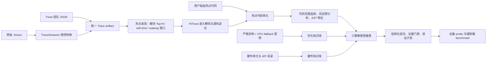

# 异构优化使能平台关键技术说明

> 状态：当前单用户工作台实现基线与工程设计说明。
> 目的：说明平台如何从真实 Trace 或热点代码出发，形成可审计的异构/并行优化判断；本文不是设备能力声明、性能验收报告或替代各项权威 Spec 的规范。
> 总体入口：[异构与并行优化使能平台总体技术文档](heterogeneous_optimization_enablement_platform_technical_overview.md)。
> 关联规范：[Spec 索引](spec_index.md)、[Trace 分析技术 Spec](trace_analysis_technology_spec.md)、[异构机会识别 Spec](heterogeneous_optimization_opportunity_platform_spec.md)、[Web 平台 Spec](heterogeneous_enablement_web_platform_spec.md)、[多策略推理 Spec](multi_strategy_hotspot_opportunity_reasoning_spec.md)、[Skill 演进与评测规范](skill_evolution_and_evaluation_spec.md)。

## 1. 平台解决的不是一个问题，而是一条证据链

“一段代码看起来适合 GPU/NPU”不是工程结论。平台需要回答的是：**哪一个真实场景中的哪一段代码，在什么数据、设备、语义和成本条件下，值得验证哪一种异构或并行优化。**

因此，平台把确定性程序、知识库和大模型分别放在不同位置：确定性程序负责采集、定位、筛选和约束；知识库提供已有实现和接口语义；模型负责在受控事实之间解释、比较、提出条件化假设和验证计划。模型不拥有把猜测升级为事实的权限。

## 2. 关键技术总览

| 编号 | 关键技术 | 当前状态 | 要解决的核心问题 |
|---:|---|---|---|
| 1 | 双主输入 Trace 规范化与受控 `.htrace` 转换 | 已落地 | 不要求用户同时提供原始 Trace 和分析报告，也不把原始 Trace 过度解释为关键路径。 |
| 2 | 多路径热点发现、模块归类与时间局部性排序 | 已落地 | 不让 FFRT、Binder 等系统事件淹没 ArkUI、图形、多媒体等业务关注模块。 |
| 3 | HiTrace 标签语义解码与受限源码反查 | 已落地 | event name 不等于函数名时，仍能定位插桩点并明确定位可信度。 |
| 4 | 源码快照绑定与不可变 artifact 证据链 | 已落地 | 防止 Trace、代码仓和知识库跨版本混用。 |
| 5 | 代码仓 connector、容量预检与检索隔离 | 已落地 | 在大代码仓、多场景和后续多用户环境中，防止误用另一份源码或耗尽本机磁盘。 |
| 6 | 最小分析范围选择 | 部分落地 | 从“整函数猜测”收缩到可观察循环、数据管线或已归因 callee。 |
| 7 | 词法静态预分析 | 已落地 | 快速提供可复现的代码形状事实，辅助模型聚焦，而不伪装成 AST。 |
| 8 | 函数级 AST 特征与跨过程边界建模 | 已落地基线，持续增强 | 提取 CPU fallback 和热点核心的可匹配结构特征，并避免 wrapper 污染。 |
| 9 | 严格异构实现 + CPU/software fallback pair 挖掘 | 已落地 | 从真实已有实现中抽取可复核的优化模式，而不是收集名称相似的候选。 |
| 10 | 优化知识库 | 已落地 | 让热点与已验证的 CPU fallback 结构、回退语义和异构单元建立可解释关联。 |
| 11 | 硬件单元知识库 | 已落地 | 把“源码中有能力路径”与“目标设备真的可用”严格分离。 |
| 12 | NPU/GPU/DSP/媒体加速 API 子知识库 | 已落地 | 从“可能适合某单元”进一步收缩到可比较的 API/HDI/SDK 语义候选。 |
| 13 | 硬件单元路由 -> API Top-N 漏斗 | 已落地 | 避免对每段代码遍历所有 API，降低噪声、成本和误判。 |
| 14 | KB-RAG、Hardware-KB、Direct 三策略推理 | 已落地 | 比较知识增强和模型先验的差异，不把单次模型回答当作唯一真相。 |
| 15 | 版本化 Skill 与证据门禁 | 已落地 | 让 Prompt、规则和动作可测试、可回滚，而非会话中自发演化。 |
| 16 | Agent-Native 页面 action 状态机 | 已落地 | 让工作助手能操作平台，但不能凭语言跳过真实 Trace、热点或源码步骤。 |
| 17 | 最小充分上下文、Token 预算与 compaction | 已落地 | 减少 artifact 包装和无关信息对模型判断、时延和成本的干扰。 |
| 18 | 本机模型中继、流式进度与结构化结果校验 | 已落地 | 用户可见真实推理进度，同时保证密钥不落盘、模型输出不直接写入结论。 |
| 19 | 分析记录、推理 transcript 与可重放审计 | 已落地 | 一条 Trace 可保留多轮推理，事后能检查每轮实际看到的上下文。 |
| 20 | Skill 回归、Hardware-KB fixture 与独立 benchmark | 已落地基线 | 防止 Prompt 迭代只在个案上“看起来更聪明”。 |
| 21 | 设备能力 probe、专用 Harness 与真机迭代闭环 | 已落地基线，持续增强 | 将静态候选逐级升级为编译、设备执行、功能等价、热点集成和端到端收益证据。 |

下文对每项技术统一按 **What / Why / How / 边界** 展开。

## 3. Trace 与源码证据层

### 3.1 双主输入 Trace 规范化与受控 `.htrace` 转换

**What**

平台有两种正式输入：Trace 团队输出的 JSON 分析报告，以及设备采集的原始 OpenHarmony `.htrace`。二者最终汇合为统一的 `trace_analysis_result`，但始终保留输入类型、原始 hash、转换器版本、质量信息和降级原因。

**Why**

Trace 团队报告通常已经带有热点、关键路径或场景语义；原始 `.htrace` 则更通用，却只提供基础时间和调度事实。若把二者混为一谈，平台很容易把本地的 span 统计误称为“关键路径”，或者要求用户不必要地重复提供两份输入。

**How**

1. 对报告 JSON 保留上游热点、关键路径和源码字段，并在进入代码分析前单独验证源码绑定。
2. 对 `.htrace` 先校验 `OHOSPROF` 容器、文件 hash、容量和磁盘预算，再使用受控 TraceStreamer 转换为只读派生数据库。
3. 将转换器二进制 hash、stdout/stderr、数据库 schema 和缓存 key 写入 artifact；超时、损坏或能力缺失产生明确失败 artifact，而不是返回伪造空热点。
4. `.sys` 文本调度 trace 仅保留为实验性 Spike，不作为正式主输入。

**边界**

原始 `.htrace` 当前只能形成基础 span、scheduler 和 wakeup 事实；它本身不能证明 critical path、GPU 时间、DMA 因果或源码行号。详细约束见 [Trace 分析技术 Spec](trace_analysis_technology_spec.md)。

### 3.2 多路径热点发现、模块归类与时间局部性排序

**What**

热点发现不是一个“按总耗时排表”。平台同时支持 wakeup-window cluster 和 trace-wide event self-time 两条路径，并按模块聚合后展示各模块自己的 Top-N event。

**Why**

一个 event 在十秒中累计 10 ms，与一帧内连续出现 10 ms，优化价值完全不同；同样，全局 Top-N 往往被 Binder、FFRT、调度器占据，真正需要看的 ArkUI、Render、Media 事件会被隐藏。

**How**

1. self-time 路径在可用父子 span 数据上估计 event 的排他执行时间，同时保留 inclusive 时间、最大单次时间、次数、观察窗口和时间压力。
2. cluster 路径把 wakeup 链收缩为可审计时间窗；它是发现候选的观察工具，不直接等于热点函数。
3. 模块归类优先使用从 `hitrace_meter.h` 派生的 tag 映射，其次才是 event、进程和线程文本线索。
4. 页面先按模块汇总排序，再展开模块内的 Top-N，系统模块可折叠，避免长列表吞没业务模块。

**边界**

模块名是 trace 分诊标签，不是 ELF 模块归属，也不是源码 ownership；cluster 也不能替代真实 critical path 分析。

### 3.3 HiTrace 标签语义解码与受限源码反查

**What**

对 `H:VisitRootGlobalRefHandle|M47` 这类 HiTrace 文本标记，平台解析 event label、level、option 和 tag bit，再在受限源码范围内寻找对应的 `OHOS_HITRACE`、wrapper 或函数派生插桩点。

**Why**

插桩名称常由开发者自由定义，无法直接等同于函数名。直接按 event name 全仓搜索会造成大量文本误命中，尤其在大型 OpenHarmony 代码仓中会把引用点、重复 label 或无关模块误认成热点源码。

**How**

1. 从当前 connector 的 `hitrace_meter.h` 建立带文件 hash 的 tag 目录，将 `M0538` 等编码拆解为 level、option 和模块 tag，而不是把数字当作单一模块号。
2. 使用版本化 tag-to-source-scope hint 先缩小到可能的源码子树，再做受限的字面量、宏参数、`__func__` / `__PRETTY_FUNCTION__` 和 wrapper 反查。
3. 将结果明确标为 `declared_source`、`instrumentation_point_exact`、`instrumentation_point_function_derived`、`symbol_text_candidate`、`symbol_text_reference` 或 `unresolved`。
4. 代码视图分别展示插桩行、包围函数和后续可分析范围，避免把“函数中有一个插桩点”误解成“整个函数都是热点”。

**边界**

`instrumentation_point_exact` 证明的是插桩协议匹配，并不自动证明 Trace 的实际计时范围、唯一调用点或函数内部哪一个 callee 消耗了时间。

### 3.4 源码快照绑定与不可变 artifact 证据链

**What**

平台使用 source connector、snapshot ID、文件 hash、worktree 内容指纹和 immutable artifact，把 Trace、热点事件、源码范围、知识库版本和推理结果连接为可重放证据链。

**Why**

大型仓库会持续修改。把设备上的 Trace 直接匹配到今天本地工作树的函数，即使函数名相同，也可能是错误版本；同样，修改了 KB 或 Prompt 后也必须能复盘旧结论依据的版本。

**How**

1. 每个 connector 生成受控快照，开发工作树允许未提交修改，但这些修改的内容指纹进入 snapshot identity。
2. 每次需要精确分析时重新核对 snapshot；源码变化后拒绝继续使用旧绑定，要求刷新和重新绑定，而非强制用户先提交代码。
3. Trace、source resolution、context pack、模型 transcript 和结果各自创建不可变 artifact，并通过 ID 和 SHA-256 串联。
4. 对没有版本声明的 Trace，可创建用户明确声明的 development attestation；它保留“平台无法独立证明设备 build 来源”的事实。

**边界**

attestation 允许开发分析，不可替代 release 场景中的真实 device-build mapping。`unknown`、文本候选或源码引用不能进入自动 AST/KB 匹配。

### 3.5 代码仓 connector、容量预检与检索隔离

**What**

代码仓以 source connector 作为一等对象：用户可以选择已有本地仓、注册本地路径，或提供 GitHub、GitCode、Gitee 等 Git URL 创建受控 clone。每个 Trace、source resolution 和分析记录都关联明确的 connector。

**Why**

OpenHarmony 代码仓可达数十 GB。后续多用户、多仓、多场景时，最大的隐性风险之一是把 A 仓的 Trace 在 B 仓中“恰好搜到同名函数”，或因为自动 clone 耗尽磁盘而让分析中断。

**How**

1. 默认 connector 指向完整本地 `oh` 工作区；历史 `source_code/` 小镜像只能显式选择，不能悄悄成为分析默认仓。
2. Git connector 先建立可审计计划，要求至少 80 GiB 可用空间并保留 10 GiB 余量，再 clone 并 pin 到确定 commit。
3. HiTrace source resolver 的 scope hint 仅在当前 connector 内收缩搜索范围；禁止为了命中某个 event 跨 connector 自动搜索另一份 OpenHarmony 源码。
4. connector snapshot、工作树指纹和路径映射进入 artifact，使后续分析和历史记录可区分来源仓。

**边界**

当前产品切片仍是单用户、单机、一个活动代码仓、多个场景。connector 契约已经为后续多用户/远端仓隔离预留，但不等于已经提供共享存储、权限管理或服务端多租户能力。

### 3.6 最小分析范围选择：函数不是默认的计算核心

**What**

平台把“热点函数”与“应分析的最小代码范围”分开。当前可见代码会产生函数、loop region、data pipeline 和未展开 callee 等候选作用域；后续会用 AST/CFG 和动态归因抽取真正的 execution slice。

**Why**

一个函数常同时包含日志、参数校验、锁、错误处理、多个分支和被调计算核。直接对整个函数做特征匹配，会把 wrapper 误识别为算法；反过来，热点也可能真正发生在一个未展开的被调函数中。

**How**

1. 当前词法范围选择器保留可见循环和数据处理片段，并将看起来像计算的未展开调用显式标记为 `callee_unresolved`。
2. 模型必须在结果中声明它分析的是函数、循环区、数据管线、已解析 callee 还是未展开 callee。
3. 精确路径的下一阶段使用 measurement scope、AST/CFG 局部 slice 和动态 trace/sample/critical-path 证据，才能把 callee 升级为“已归因热点”。

**边界**

当前 `candidate_scopes` 是范围提示，不是控制/数据依赖证明，更不是性能归因。真正跨过程计算核心的确认必须看到 callee 实现和动态证据。

### 3.7 词法静态预分析

**What**

`lexical_static_scan/v1` 对当前可见 C/C++ 文本做低成本、可复现的结构观察：循环、分支、IPC/Parcel、锁、并行运行时、批量内存和数学符号等；同时给出有限的候选局部范围。

**Why**

模型不应在长代码片段里反复“找有没有循环、有没有 Binder 调用”。显式的确定性事实能减少上下文噪声、帮助模型关注关键片段，也便于用户核查推理起点。

**How**

1. 用稳定的词法规则统计构造数量，并只返回实际命中的预定义符号。
2. 将结果作为 `code_observations` 注入精简的模型上下文，而非将原始 artifact、检索词和 hash 全部送给模型。
3. 词法扫描和 candidate scope 的生成逻辑位于 [reasoning_lab.py](../backend/reasoning_lab.py)，前端会保留兼容性归一化。

**边界**

它不是 AST：`loop_construct_count=2` 只表示文本中匹配到两个循环构造；空的 `ipc_transaction_symbols` 只表示当前片段未命中预定义符号，不证明被调函数没有 IPC。页面和模型 Skill 都必须称其为“词法预分析（非 AST）”。

### 3.8 函数级 AST 特征与跨过程边界建模

**What**

函数级 AST profile 为 CPU/software fallback 或已精确定位的热点函数抽取类型、循环、分支、数组/指针访问、数学调用、操作符、并行 pragma 和可见 callee 等结构化特征。

**Why**

异构机会不能仅按函数名、目录或“有循环”匹配。可比较的 CPU 特征能把图像像素处理、PCM effect、矩阵计算、codec 生命周期和 IPC wrapper 区分开来，并能揭示“函数只是调用计算核”的情况。

**How**

1. 当前可复现基线采用 Tree-sitter 函数级 profile；Clang AST 用于高价值语义复核和后续增强，见 [算法签名方法论](algorithm_signature_based_heterogeneous_opportunity_detection.md)。
2. profile 记录 `binding_status`、`compute_core.matching_status` 和 AST 解析状态；未找到唯一 CPU 核心时保留 `not_ready` / `runtime_selected_provider`，不硬填特征。
3. 对模型上下文仅投影与决策有关的 AST 摘要和 CPU signature，完整 profile 保留在知识库 artifact 中。

**边界**

函数 AST 只描述该函数可见语法结构，不能自动描述被调函数的真实 CPU 负载、连续性/stride、DMA 可行性或迭代独立性。用户粘贴代码的当前策略路径仍以词法预分析为主，不能伪称已经完成精确 AST 绑定。

## 4. 真实实现知识与硬件知识层

### 4.1 严格异构实现 + CPU/software fallback pair 挖掘

**What**

pair 挖掘从 OpenHarmony Foundation、ArkCompiler、图形、多媒体和第三方库源码中寻找“已有异构实现”与“真实 CPU/software fallback”共同存在的实现关系，并对每条关系保存源码锚点、函数范围、条件和审计结论。

**Why**

仅凭 `GPU`、`NPU`、`hardware` 等关键词会得到大量假阳性。平台真正需要的训练和检索样本是：同一功能在异构路径不可用、格式不满足或策略选择不同的时候，确实有 CPU/software 实现承担语义回退。

**How**

1. 先从 dispatcher、provider 选择、feature flag、capability 判断和 fallback 分支中发现候选。
2. 静态核对异构锚点、CPU 实现锚点、连接条件和语义关系；只有能够证明关系的记录才进入 `source_confirmed`。
3. 为 CPU fallback 提取函数级 profile，并单独记录“是否已定位计算核心”，防止把 dispatch wrapper 当作计算实现。
4. 正式优化知识库当前保留 40 条用户态/第三方严格 case；内核 device-offload pair 明确不进入该运行时 KB。

**边界**

严格 pair 证明的是已有源码实现关系，不证明新热点与该 case 相同，也不证明目标设备可用或一定有性能收益。

### 4.2 优化知识库：从真实 CPU fallback 中学习模式

**What**

优化知识库描述“什么样的 CPU/software 结构可能对应已有异构路径”，而不是描述某台手机的能力。当前正式 artifact 包含 57 条记录，其中 40 条为严格异构 + CPU/software fallback case，17 条为内部规则、映射和代价层记录。

**Why**

当 Trace 定位到一个热点时，最有价值的先验不是模型凭常识猜“也许能上 GPU”，而是源码中已经存在的同类 CPU fallback：它包含数据类型、访问、控制流、算法、回退语义和已使用异构单元的真实证据。

**How**

1. 每条 strict case 存放异构锚点、CPU fallback、目标单元、AST binding、CPU feature summary 和源码 provenance。
2. 通过函数/事件名与代码文本的受限语义检索召回少量候选，再由模型比较计算核心、数据格式、搬运、同步和回退条件。
3. `cpu_code_feature_summary/v1` 将 `algorithm_tags`、数据类型线索、指针/数组访问、循环/分支、数学调用和可见 callee 组织为可匹配证据。

**边界**

知识库的 case 是模式参考，不是当前热点的性能证明。页面只展示严格异构案例，内部规则与候选发现不得被伪装为同等级的真实 case。详见 [优化知识库 README](knowledge/optimization/README.md)。

### 4.3 硬件单元知识库：代码能力、设备能力与收益分层

**What**

硬件知识库以硬件单元为中心组织源码中可见的执行路径、接口、格式/数据路径、约束、关联 strict case 和运行时验证要求。它与优化知识库独立发布。

**Why**

“源码里有 OpenCL、HCodec 或 NNRT”只说明存在集成路线，不说明用户手中的麒麟设备、驱动、权限、输入格式和 workload 一定支持。把这些层级混在一起，是异构建议最常见的过度声明来源。

**How**

1. 当前基线有 22 条硬件单元记录，覆盖 GPU、NPU、DSP、JPEG/HEIF、HCodec 和硬件视频编解码等方向。
2. 每条记录保留源码集成、暴露层级、接口合同、严格案例关联、`device_availability=evidence_required` 和运行时验证项。
3. 硬件单元记录成为“先选哪个单元”的第一层依据；具体 API 选择由后续 API 子知识库完成。

**边界**

用户选择“麒麟 + 鸿蒙”只是目标画像，不是设备 probe。硬件知识库不声明某型号实际存在、启用或有收益的加速器。详见 [硬件知识库 README](knowledge/hardware/README.md)。

### 4.4 NPU、GPU、DSP 与媒体加速 API 子知识库

**What**

API 子知识库把“适合哪个硬件单元”的粗粒度判断进一步细化为可比较的公开 API、系统集成路径或 HDI/VDI 合同。当前目录包含 NPU 146 条、GPU 18 条、DSP 9 条和媒体加速 31 条记录。

**Why**

真正的优化落地通常不是自写驱动，而是复用已有 NNRT、图形、音效或编解码接口。若只知道“这段代码像矩阵乘法”，却不知道相应 API 的输入 shape、dtype、buffer 生命周期和验证方式，结论仍不可实施。

**How**

1. 从 OpenHarmony 源码和头文件生成版本化目录，为每条记录保存一句话摘要、详细描述、语义族、数据形态、静态匹配信号、源码位置/sha、暴露层级、关联案例和 runtime verification。
2. NPU 目录区分公开 NNRT 图算子/入口与 MindSpore 内部 delegate；`OH_NN_OPS_*` 仅表示图语义候选。
3. GPU 目录区分公开 Vulkan/OpenGL ES 表面与系统内部图像路径；DSP 目录区分 Audio Effect HDI/VDI 与应用侧可见层；媒体目录区分 AVCodec、HCodec Codec Component HDI、JPEG/HEIF Image Codec HDI 和内部 delegate。

**边界**

header、HDI/VDI 或内部系统路径都不自动等于普通应用可调用的 API。每类目录都有自己的 capability、格式、buffer、同步和 software fallback 门禁。详细目录见 [NPU](knowledge/hardware/NPU_API_KNOWLEDGE_BASE.md)、[GPU](knowledge/hardware/GPU_API_KNOWLEDGE_BASE.md)、[DSP](knowledge/hardware/DSP_API_KNOWLEDGE_BASE.md) 与 [媒体](knowledge/hardware/MEDIA_ACCELERATOR_API_KNOWLEDGE_BASE.md)。

### 4.5 自建 API 合同发现与质量门禁

**What**

该技术允许用户从已登记的模块级代码仓，为 NPU、AAE、ISP 或其他新异构单元建立独立、可删除的 API 候选库。当前 `bounded_api_contract_discovery/v2` 不是简单的相关函数搜索，而是面向消费方合同的有界静态发现器。

**Why**

硬件模块通常同时包含公开头文件、算子枚举、HDI 合同、framework 实现、CPU fallback、service、test 和示例。宽泛的 `model`、`tensor`、`buffer` 词项可能让内部方法获得高分，即使模型 Prompt 知道“寻找 API”，它也无法恢复扫描器没有提供的公开接口。总记录数和 JSON 落盘因此都不能代表知识质量。

**How**

1. 只扫描已登记 Connector，并按公开 SDK/NDK、接口合同、导出头文件、实现和示例划分源码暴露层。
2. 将函数声明、算子/能力枚举、宏和外部调用点分型保存；公开合同优先，内部实现只补充语义证据。
3. 对可调用合同和算子合同分别保留 Top-N 容量，避免大型枚举或大量普通方法垄断 300 条输出。
4. 输出公开/契约、算子、内部实现、元素类型和暴露层计数，并独立计算 `quality.status=pass|warning`。
5. 页面 Agent 的 Skill 只负责编排与检查质量，不重新猜候选。修改扫描、Skill 或 UI 任一层时，同时运行合成干扰回归和代表性真实仓 shadow scan。

**边界**

这仍是词法合同候选，不是精准 AST、公开 ABI 审核、设备支持或收益证明。NNRT 回归要求 `OH_NN*` 和 `OH_NN_OPS_*` 同时可见、CPU 示例 service 不得成为主体，但这些符号只属于测试 oracle，生产实现仍依据通用暴露层和记录角色。详见 [自建异构单元 API 知识库 Spec](custom_accelerator_api_knowledge_base_spec.md)。

### 4.6 规则路由审计基线：保留对照，不参与生产判断

**What**

该确定性链根据可见代码的正向领域信号选择单元并返回 API 候选。它仍保留在仓库中，但从 v2 起只用于审计、回归和误差簇分析，不再进入模型 Prompt，也不再决定生产 Hardware-KB 的单元或 API 目录。

**Why**

它是一个有价值的高精度基线：可以帮助发现知识库或模型的退化。但若把它的结果放进模型输入，模型的“准确率”会变成确认既有规则，无法证明函数改名、表达式改写或新领域代码上的泛化能力。

**How**

1. 基线继续以矩阵/张量、RGBA、PCM effect、codec 生命周期等正向领域信号产生稳定输出，并保留 IPC、锁、I/O、递推依赖的零路由反例。
2. 基线只能由显式离线审计任务调用，才以 `deterministic_router_baseline` 保存到 audit artifact；生产 `hardware_semantic_routing_context` 不执行该路由，`model_input_context` 中也不得出现它、其选中单元、静态 feature flag 或静态 API Top-N。
3. 只有离线评测可以比较“基线是否命中”和“模型是否命中”；两者的差异用于定位误差，不得把基线答案作为模型上下文或评分提示。

**边界**

基线仍不是 API 支持、设备 capability 或性能预测。它也不再是生产漏斗的入口。

### 4.7 模型优先硬件语义路由 -> API Top-N 精核

**What**

这是生产 Hardware-KB 的第一阶段。它把热点代码、**硬件中立**静态画像、候选代码范围和四张固定的 NPU/GPU/DSP/媒体能力卡交给模型，只允许模型选择 `0-2` 个**单元级**候选，或返回“需要展开计算核心 / 当前无加速器候选”。它不选择具体 API。

**Why**

真正需要泛化的工作是把“代码表示什么计算和数据流”与“某个能力卡的语义是否相容”分开。函数名、变量名、注释或既有 API 名称可以是弱线索，却不能成为隐藏的路由答案。相反，如果领域数据语义被完全删除，只剩一个通用数值循环，系统应保守地要求展开计算核心，而不是强猜 DSP/GPU/NPU。

**How**

1. 后端生成 `hardware_semantic_routing_context/v3` artifact：生产路径不执行确定性路由；完整审计 artifact 保留代码与来源，但模型投影只包含可见代码、移除了具体函数符号的 `generic_static_code_profile/v1`、通用候选作用域、Trace 时间指标和四张带 `hardware:*` 来源 ID 的能力卡。trace 名、模块名、源码路径与额外函数提示均被隔离。
2. 浏览器使用用户本地保存的模型配置进行一次流式调用；API Key 只经本机中继转发，不进入 context、结果或 transcript artifact。
3. 模型必须返回 `hardware_semantic_routing/v2`：先声明 `semantic_profile`（数据表示、操作模式、依赖/状态、边界和不确定性），再返回 `select_units`、`needs_compute_core` 或 `no_accelerator_candidate`；每个候选必须给出可见代码依据、作用域、缺失证据和能力卡 evidence ID。
4. 服务端白名单校验单元枚举、候选上限、代码依据和 `hardware:*` evidence，并把原始回答、规范化结果和校验错误分别存档。
5. 模型选中单元后，API 只在该目录内以模型 `semantic_profile` 与 API 摘要的语义文本相容性召回 Top-N；没有相容候选时保持为空，而不是回退到单元专属源码关键词规则。最终 Hardware-KB 推理仍执行格式、生命周期、设备 probe 与端到端 benchmark 门禁。

**边界**

模型语义路由不是设备 capability 或 API 支持结论。泛化不能由单个命中样例证明：工作台提供 17 条隔离 oracle 的重命名、等价控制流、语义缺失和反例样本，报告 selection recall、rejection specificity、balanced accuracy 与 transformation-family invariance；它只是防止规则泄漏与命名依赖的第一层门禁。要宣称强泛化，还需要 source-disjoint、跨数据域的真实源码冻结集（目标至少 80 条，且当前 2 条 holdout 明显不足）。`holdout` 一旦用于调词或规则改动，就必须换新版本后再称为泛化评测。

## 5. 受控推理与 Agent-Native 交互层

### 5.1 三策略推理：知识增强、硬件增强与直接基线

**What**

同一个热点代码单元可以分别运行三种策略：优化知识库上下文（KB-RAG）、硬件能力/API 上下文（Hardware-KB）和直接代码推理（Direct baseline）。三者的热点、源码、时间指标和目标画像相同，差异只在允许使用的上下文。

**Why**

这能回答两个工程问题：已有 fallback 案例是否真的带来结构化信息增益，以及硬件/API 知识是否比纯模型先验更能提出可验证方向。也能暴露三种策略的分歧，而不是把一个模型答案包装为真相。

**How**

1. KB-RAG 只检索严格 case 和 CPU fallback 结构特征，要求模型核对计算核心、格式、数据搬运、同步和回退语义。
2. Hardware-KB 先由模型执行“可见代码 + 硬件中立画像 + 能力卡 -> 单元假设”，再以该模型语义画像检索单元内 API Top-N，最后检查具体接口语义与端到端门禁。
3. Direct baseline 不提供 KB 或硬件记录，只能给出保守的代码/Trace 对照；在证据不足时只能输出 `evidence_required` 或 `not_recommended`。
4. 三路结果按结构化 recommendation、机会类型、置信度、证据状态、反证、缺失证据和验证计划比较，而不按“投票数”裁决。

**边界**

三种策略都是分析工具，不能替代设备 probe 和 benchmark。Direct 策略尤其禁止把通用常识写成麒麟或鸿蒙设备事实。

### 5.2 版本化 Skill 与证据门禁

**What**

Skill 是有版本、有输入输出契约、有质量门禁和回归样本的能力资产，包含确定性 Trace/源码/检索 Skill、模型分析 Skill 和页面 Agent 控制 Skill。

**Why**

大模型 Prompt 很容易在一次修正后变得更长、更积极，却在另一个场景中引入硬件幻觉、错误升级或上下文污染。没有版本、回归和回滚，所谓“优化 Skill”无法成为工业能力。

**How**

1. 每个 Skill 声明 `skill_class`、claim boundary、required evidence、quality gates、evaluation 和 change control。
2. 模型 Skill 使用中文的总分析 Skill 加策略 Skill，要求同时给出 Trace 事实、源码/AST 事实、正反证、条件和验证计划。
3. 后端保存 Prompt/上下文契约版本；规则修改、检索修改和 Prompt 修改必须进入版本控制并通过对应回归。
4. 模型只能提出改进建议，不能在运行时自行写回 Prompt、阈值、KB 或发布版本。

**边界**

Skill 是决策过程的约束，不是独立 oracle。它提升结论校准和可复现性，但不自行证明异构收益。

### 5.3 Agent-Native 页面 action 状态机

**What**

工作助手拥有受限的页面 action catalog，可以导航、选择代码仓、导入 Trace、提取热点、选择事件、粘贴代码、准备 context 和发起已选择策略，但不能任意操作 DOM、shell 或文件系统。

**Why**

用户希望通过对话完成复杂流程，但模型自然语言不能成为流程真相。若允许模型凭一句“已选好热点”跳过真实 action，后续所有源码和推理证据都会失去依据。

**How**

1. 用状态机约束 `select_trace -> extract_hotspots -> select_hotspot_or_code -> choose_strategy -> strategy_running -> complete`。
2. 每个 action 有 JSON schema、风险等级、幂等规则和审计字段；Agent 只能说 action 成功返回的事实。
3. 导入/选择/粘贴等页面操作不自动请求模型；只有用户显式选择策略、context 准备完成后才发起模型调用。
4. 工作助手会话和页面工作区在导航切换后保留，只有用户点击重置才清空当前轮状态。

**边界**

Agent 的“全权限”指已注册的平台操作，不是任意机器权限。源码、Trace 名、注释和用户消息都按不可信数据处理，不可作为指令执行。

### 5.4 最小充分上下文、Token 预算与 compaction

**What**

平台区分完整审计 context pack 与真正发送给模型的语义投影，并显示输入/输出 Token、上下文窗口、预算、压缩状态和被压缩的历史消息数。

**Why**

artifact ID、hash、检索词、重复 metadata 和完整代码包装通常不能帮助判断，却会稀释热点指标、核心代码和关键反证，增加调用时延与成本。

**How**

1. 模型投影只保留热点时间语义、源码绑定/范围、词法或 AST 观察、当前策略允许的少量证据记录和 evidence ID。
2. Hardware-KB 上下文中保留一个路由单元和该单元的 API Top-N，而不混入全部目录。
3. 超出窗口时，先去掉重复说明和低排序记录，再压缩代码 excerpt 与早期会话；保留证据 ID、来源等级、负证据和策略边界。
4. 完整 context 仍作为不可变 artifact 保存，压缩行为写入 transcript，便于复现模型实际看到的内容。

**边界**

compaction 不能“发明摘要”。当关键计算核只存在于被省略的 callee 中，结论必须显示该事实和缺失证据，而不是从函数名猜测其复杂度。

### 5.5 本机模型中继、流式进度与结构化结果校验

**What**

浏览器保存用户自己的模型 base URL、API key、模型名和上下文窗口；本机 FastAPI relay 仅在单次请求内转发 OpenAI-compatible 调用，并将流式响应转给页面。页面展示真实请求、上下文装载、响应、JSON 校验和回填进度。

**Why**

浏览器直连 provider 可能受 CORS 限制；长推理如果没有可观测进度，用户无法判断是在工作、超时还是失败。与此同时，模型输出若直接写入卡片，格式损坏或引用虚构 evidence 会污染平台结论。

**How**

1. relay 对允许的 provider URL 执行受限转发，模型密钥不写入服务器 artifact、日志或配置文件。
2. 使用 SSE 流式解析 `reasoning/content` 增量，在助手面板展示“待校验的思考草稿/回答草稿”；这不是宣称或保存模型隐藏思维链。
3. 最终回答通过 JSON schema、枚举、evidence ID allowlist、策略专属门禁和保守降级校验，成功后才回填策略结果。
4. 发生网络、超时或契约失败时，保留错误与已完成的确定性步骤，不伪造分析结论。

**边界**

实时展示仅用于让用户理解请求状态和已知验证方向，不应被描述为完整或可信的模型内部推理。最终可信边界仍是本地结构化校验和后续设备验证。

### 5.6 分析记录、推理 transcript 与可重放审计

**What**

平台以“一个 Trace 分析记录包含多轮策略推理”为模型，而非把一个 Trace 等同于一次模型调用。每轮保存 context artifact、策略、模型标识、Token 用量、阶段时间线、原始响应、校验结果和最终结果 artifact。

**Why**

同一热点可能先跑 Hardware-KB，再补充代码后重试，或对比 Direct/KB-RAG。没有完整记录，就无法解释“为什么这次结论与上次不同”，也无法定位是 Prompt、知识库、代码还是模型配置改变了。

**How**

1. 左侧记录列表保存 Trace/热点/策略摘要，点击后按轮次加载完整 transcript。
2. transcript 关联 context SHA、Prompt contract version、KB 版本、源码摘要和 evidence ID，支持将历史记录装载回推理工作台。
3. 敏感字段递归脱敏；API key、Authorization、secret 和 token 不进入 artifact。

**边界**

可重放指的是输入和决策过程可审计，不保证外部模型每次产生逐字相同的自然语言回答。

## 6. 质量治理与验证闭环

### 6.1 Skill 迭代优化与分层回归

**What**

Skill 演进将用户反馈、失败 artifact、模型误判和检索错误转化为版本化的问题分类、最小复现输入、回归样本和发布记录。

**Why**

“某次回答不够 solid”是重要信号，但不能据此直接把 Prompt 改得更激进。一个看似改善的规则可能让 IPC wrapper 被误判成可并行，或让 PCM effect 被误路由到 NPU。

**How**

1. 将问题分为 context redundancy、evidence miscalibration、retrieval mismatch、hardware claim overreach、timeout/truncation 等类别。
2. 每次改动都要说明问题、预期行为、影响 Skill、版本、回归断言和回滚路径。
3. 确定性 Skill 运行 golden、失败、幂等和资源上限测试；模型 Skill 检查结构语义、证据引用、结论等级和禁止声明，而不要求逐字一致。
4. 当前 Hardware-KB 策略有 60 条分层 fixture，覆盖 NPU/GPU/DSP/媒体正例、IPC/锁/I-O/递推反例、CPU 并行边界、作用域声明和 device gate。

**边界**

fixture 用于回归 Prompt 与检索边界，不能成为 KB 数据源，也不能用作“模型准确率已经证明”的替代品。详见 [Hardware-KB 策略评测 Spec](hardware_kb_context_strategy_evaluation_spec.md)。

### 6.2 独立机会识别 benchmark 与知识库泄漏防护

**What**

平台将“Skill 是否遵守约束”与“异构机会识别是否有效”分成两类评测。后者需要独立审核的 source-backed case、冻结 manifest、masked KB/source 和 evaluator-side oracle。

**Why**

若用构建知识库时发现的同一案例来评估知识库，或者让模型看到该 case 的精确 mapping ID，就会把记忆/泄漏误当作泛化能力。

**How**

1. 对真实来源候选进行独立双人审核，形成 `existing_heterogeneous_implementation`、`optimization_opportunity`、`ineligible` 或 `evidence_required` 标签。
2. 冻结 source snapshot、KB manifest、策略版本和评测 policy。
3. 泛化评测通过 `mask-kb` 排除当前 case 的映射和必要源码证据，再按 target-unit、分类和门禁质量评分。
4. 将黄金 oracle 保留在 evaluator 侧，运行中的识别器只接收 oracle-free 输入。

**边界**

当前已经具备 benchmark 工具链和初始审核队列，但独立人工标注后的正式准确率报告仍需要按该流程完成，不能提前宣称 precision/recall。

### 6.3 设备能力 probe 与端到端 benchmark 闭环

**What**

这是从“静态可研究候选”走向“可以实施的优化”的最终验证层：在目标设备上确认 API/驱动/格式能力，通过固定 Profile 生成、编译、部署和迭代实验，并进一步测量数据搬运、调度、同步、功耗、回退和端到端收益。

**Why**

即使 CPU AST 与 API 语义高度相似，也可能因为 shape、dtype、layout、NativeBuffer 生命周期、DSP provider、HCodec component、任务粒度或能耗而不值得卸载。静态分析永远无法替代真实运行时合同。

**How**

1. 页面 Agent 从独立真机任务包取得热点、策略、目标单元和已有 probe，以每轮真实 action 返回作为下一步依据。
2. 固定 `native_c`、`native_cpp`、`gpu_gles3`、`gpu_vulkan`、`npu_nnrt` 和 `media_avcodec` Profile，后端负责受控源码暂存、交叉编译、产物部署与 provenance。
3. NPU 方向需查询设备、以真实 shape/dtype/layout 完成模型、检查可用算子、指定 device 编译并 benchmark。
4. GPU 方向需验证 context、extension、shader、格式、上传下载、buffer 生命周期和 fence/sync。
5. DSP 方向需验证 provider、PCM sample format、channel、frameCount、实时延迟、bypass 与 AP fallback；缺少公开直调面时形成有证据的停止结论。
6. 媒体方向需执行 codec capability/component 查询，并验证 bitstream、色彩空间、Ashmem/DMA/NativeBuffer 和 software fallback。
7. CPU 并行方向需测量任务粒度、依赖/归并正确性、锁竞争和调度开销，而不是只看有无循环。

**边界**

当前平台已具备 HDC 设备发现/probe、固定构建 Profile、源码暂存、后端编译、部署、手机 Shell 和多轮修订基线。它们可以形成真实的编译与设备执行证据，但仍不能把用户画像、API 记录、上传成功或零退出码升级为热点集成和性能收益；产品级 workload、功能比较器、功耗测量和 benchmark recipe 仍需持续建设。

## 7. 工程落地原则

1. **先收窄对象，再做深判断**：Trace -> 模块 -> event -> 插桩/源码 -> 最小代码范围 -> 硬件单元 -> API Top-N，而不是一开始向模型塞满仓库、所有硬件和所有 API。
2. **确定性事实与概率判断分层**：解析、检索、绑定、Token 预算和结构校验由程序完成；模型只解释已提供事实，并产出条件化假设。
3. **把“不知道”做成正式终态**：`unresolved`、`evidence_required` 和 `not_recommended` 是防止错误实施的有效输出，不是失败后的空白页。
4. **以计算核心而非函数名为匹配对象**：wrapper、日志、插桩和 dispatch 需要与真实循环、数据管线或已归因 callee 区分。
5. **区分源码存在、接口可用、设备支持和收益成立**：这四种陈述需要不同证据，任何一步缺失都不能跨级升级。
6. **让每轮结论可复盘、可回归、可回滚**：context、Skill、KB、源码、模型配置摘要和校验结果都必须带版本和 provenance。

## 8. 推荐阅读与代码入口

| 主题 | 推荐入口 |
|---|---|
| 平台运行边界与本地启动 | [heterogeneous-enable-web/README.md](../README.md) |
| Trace 与源码定位 | [trace_analysis_technology_spec.md](trace_analysis_technology_spec.md) |
| 知识库和静态特征 | [heterogeneous_optimization_knowledge_base.md](heterogeneous_optimization_knowledge_base.md)、[algorithm_signature_based_heterogeneous_opportunity_detection.md](algorithm_signature_based_heterogeneous_opportunity_detection.md) |
| 真实 strict case 与 CPU fallback | [strict_heterogeneous_cpu_fallback_overview.md](strict_heterogeneous_cpu_fallback_overview.md) |
| 优化知识库 | [tools/optimization_kb/README.md](knowledge/optimization/README.md) |
| 硬件单元与 API 知识 | [tools/hardware_kb/README.md](knowledge/hardware/README.md) |
| 三策略推理与审计 | [multi_strategy_hotspot_opportunity_reasoning_spec.md](multi_strategy_hotspot_opportunity_reasoning_spec.md) |
| Skill 治理和评测 | [skill_evolution_and_evaluation_spec.md](skill_evolution_and_evaluation_spec.md)、[tools/evaluation/README.md](knowledge/evaluation/README.md) |
| 真机 Harness 与证据校准 | [real_device_validation_spec.md](real_device_validation_spec.md) |
| Agent Runtime、Build Worker 与 Device Bridge | [platform_agent_runtime_build_device_bridge_spec.md](platform_agent_runtime_build_device_bridge_spec.md) |
| 词法预分析、上下文投影、结果校验 | [reasoning_lab.py](../backend/reasoning_lab.py) |
| 硬件路由与 API 召回 | [hardware_semantic_routing.py](../backend/hardware_semantic_routing.py)、[generic_code_semantic_profile.py](../backend/generic_code_semantic_profile.py)、[model_semantic_api_retrieval.py](../backend/model_semantic_api_retrieval.py)；[hardware_unit_routing.py](../backend/hardware_unit_routing.py) 仅作离线审计基线 |
| 页面 Skill、上下文压缩和模型调用 | [reasoning-prompt.ts](../app/lib/reasoning-prompt.ts)、[model-context.ts](../app/lib/model-context.ts)、[token-budget.ts](../app/lib/token-budget.ts) |

这套技术组合的最终价值不是“让模型给出更多异构建议”，而是让每一条建议都能回答：它来自哪个真实热点、哪段代码、哪类已有实现或 API、缺什么证据，以及下一步怎样验证。
