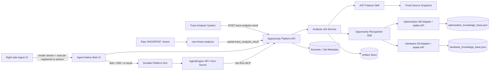
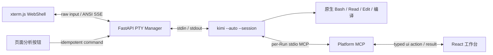
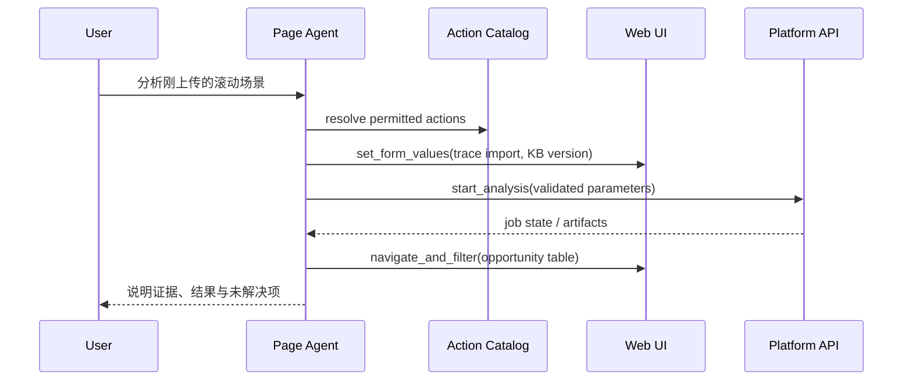
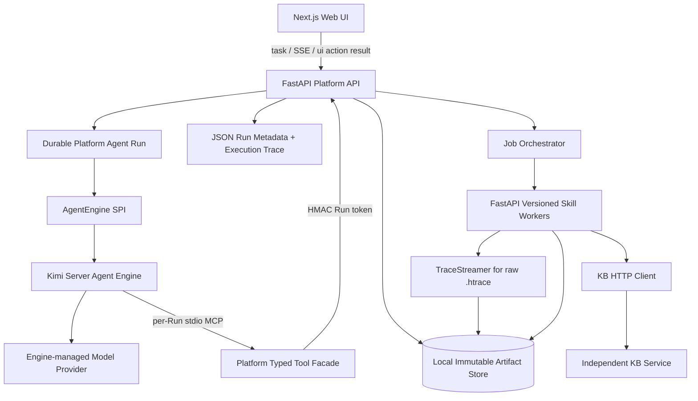

# Agent-Native 异构优化机会识别 Web 平台 Spec

> 状态：`Implemented Phase A + Kimi Agent Engine v2.2 + remote Web deployment`
> 范围：消费 Trace 团队的分析结果，或把原始 OpenHarmony `.htrace` 转为受限的基础 span / 调度候选；结合独立异构知识库服务和源码静态分析，生成可解释的异构优化机会。  
> 范围更新（2026-10-27）：场景采集、Trace 管理、负载特征、寻优校准与并行建模已接入工作台，分别遵循专项 Spec；本文保留早期 Phase A 的机会识别接口设计。
> 非目标：本期不建设人工审核工作台、KB staging 或 KB release 平台。
> 共同契约：artifact、状态机、source binding、Git connector、page action 与 skill manifest 以 `cross_spec_contract.md` 为准。
> 部署演进：当前默认为后端 Platform Run + `KimiServerAgentEngine` + per-Run MCP；浏览器 Agent loop 和 BYOK relay 只保留为 `legacy` 兼容基线。隔离编译及 Windows HDC Device Bridge 架构以 [platform_agent_runtime_build_device_bridge_spec.md](platform_agent_runtime_build_device_bridge_spec.md) 为准。

## 1. 定位与边界

平台是面向性能工程师的 **agent-native 异构机会识别工作台**。人可以直接操作界面，右侧 Agent 也能完成页面上的全部可操作动作，并通过受控 skills 执行复杂分析。

| 本平台负责 | 外部系统负责 |
|---|---|
| 上传、校验、展示外部 trace 分析结果；通过采集专项模块执行设备采集 | 外部 Trace 工具及目标设备的驱动、系统权限和底层采集能力 |
| 对原始 `.htrace` 做 TraceStreamer 转换、能力探测、基础 span/调度候选与簇选择 | Trace 团队的全量因果图、场景语义和权威 critical path 分析 |
| 源码定位、AST 特征提取、KB 检索、机会匹配 | KB 的审核、版本发布与权威内容维护 |
| Agent 编排、分析任务、机会报告和导出 | 身份提供方、源代码托管、硬件/驱动事实资料 |

页面有两个并列的主入口：**Trace 团队分析报告 JSON** 与 **原始 `.htrace`**。前者可携带上游已经验证的 critical path、场景和源码定位；后者由 `raw-htrace-analysis` skill 生成 `partial` 的基础事实候选，绝不自动声称关键路径、源码行号或 GPU 时间。用户不需要同时提供二者。`traces/` 中的 report 与 `.htrace` 都是正式 fixture；`.sys` 仅保留为折叠的实验性调度文本入口。

## 2. Phase A 部署与技术选型

桌面工作台是新增实验执行拓扑，详见 [desktop_workbench_design.md](desktop_workbench_design.md)。原型让 Code Agent 和 HDC 运行在 Windows 本机，通过 SSH 操作 Linux 工作区；当前 Web 的页面、服务端 Runtime 和 Bridge 合同继续有效，完整业务页面尚未因此变为离线桌面能力。

### 2.1 Phase A 单用户部署假设

- 当前产品边界是**单用户、一个受信任后端工作区、可登记多个代码仓、每个仓多个 trace 场景**。浏览器既可与后端同机，也可从 Windows PC 访问 Linux 后端；这不等于多用户隔离，也不应直接暴露到公网。
- 代码仓保留在后端服务器已登记的路径。平台只登记 workspace root、`source_snapshot`、文件路径和 SHA-256，不复制、上传或全量索引整仓源码。30GB 源码不会进入 artifact 目录，也不会传到浏览器。
- 用户可在“代码仓”页面选择已注册 workspace，或添加 GitHub、GitCode、Gitee 等 Git URL。clone 安全规则、协议限制、临时目录、80 GiB 门禁和 commit 固化遵循共同契约；不执行仓库 hook、submodule、安装或 build。
- 项目、场景、job、会话和审计元数据存为 JSON artifact；上传的 trace 分析结果和派生产物存入本地 artifact 目录，以 SHA-256 内容寻址。服务重启后可重建状态。
- FastAPI、Kimi Server、Build Worker 和运行时状态默认留在后端 loopback/用户目录；远程模式只让 Next.js Web 监听可访问网卡，并通过同源 `/v1` 代理后端。连接手机的 PC 可运行 Windows HDC Device Bridge；同机开发也可使用 Local HDC compatibility adapter。
- Phase A 没有认证、数据库和多用户隔离。操作系统账号、受控内网/VPN 与 Source Connector 授权共同构成当前信任边界。

### 2.2 后续多用户扩展原则

多用户不共享本地源码目录，也不上传完整代码仓。每个用户/项目注册一个 `source_connector`：本地 workspace、受控 NFS 挂载或后续 Git worktree 服务；connector 只向分析 worker 暴露该用户获授权的路径。每个项目独立保存 KB version、source snapshot、trace artifact、job 和 Agent 配置引用。

页面助手作为产品角色保持不变，其对话、推理、compaction 和工具循环由可替换 Agent Engine 承载，当前默认为后端 Kimi Server。每个浏览器页面/标签页生成一个 `page_session_id`，对应一个 Platform Run 和一个 Kimi Session；该页面中的硬件路由、硬件机会推理、真机验证、页面助手和多条分析记录均在其中连续工作。`analysis_id` 只标识当前审计和工件上下文，不触发 Session 切换。Kimi 使用原生 Coding Agent 工具直接操作后端源码、文件、Shell、编译器和本机 HDC；Platform Run 负责阶段契约、页面/远程设备跨边界 action、证据、artifact、幂等和审计。浏览器是任务组装、流式 UI 和 `ui.*` executor；连接手机的 Windows PC 运行轻量 HDC Device Bridge。固定 Build Worker 是证据型 Harness，而不是 Kimi 后端能力的替代品。详细边界见 [platform_agent_runtime_build_device_bridge_spec.md](platform_agent_runtime_build_device_bridge_spec.md)。

| 维度 | Phase A 单用户部署 | 后续多用户 |
|---|---|---|
| 用户/仓库 | 1 用户 / 一个后端工作区 / 多个已登记 connector | 多用户 / 多项目 / 每项目多个 connector |
| 源码 | Kimi 直接访问后端已授权路径；具体任务可声明只读或允许修改，浏览器不接收整仓 | 用户隔离 workspace 或按需 worktree，不传输 30GB 整仓 |
| trace 与场景 | 每个仓可有多个本地场景 | 项目/用户命名空间隔离、配额和保留策略 |
| 元数据 | JSON artifact | 数据库 + 项目级 RBAC |
| Agent 配置 | Kimi Code 自动安装；浏览器保存 provider URL/key/model，后端用短期内存租约配置 Kimi Session | 每用户/项目 Engine binding + 企业密钥服务 |

迁移不改变 `source_snapshot`、trace artifact hash、KB HTTP API 和 analysis run 契约；它们从一开始就包含 `project_id` 与 `source_connector_id`。

### 2.3 技术栈

| 层 | 选择 | 原因 |
|---|---|---|
| Web/API gateway | Next.js App Router + TypeScript（UI）+ FastAPI（Platform API） | React 工作台与既有 Python 工具链分层；前端不直接连接 provider |
| UI | CSS design tokens + 组合式 React 组件 + Lucide | 无额外 design-system runtime，仍保留可访问、可组合的高密度工程界面 |
| 后台分析 | FastAPI + 既有 Python 工具 | 直接复用 AST、KB、matching 工具链 |
| Agent | `AgentEngine` SPI + Kimi Server + Kimi CLI/PTY + per-analysis Run/MCP/Session | Server 管理会话与模型配置，真实 CLI 承载用户交互和原生 Coding 工具；MCP 只承载页面、工件发布和 Windows HDC 跨边界操作 |
| WebShell | xterm.js + FastAPI POSIX PTY + SSE proxy | 浏览器键盘与页面任务进入同一真实 Kimi CLI Session，ANSI/TUI 输出原样流回页面；不向浏览器开放任意 login shell |
| 持久化 | JSON artifact + 本地文件系统 | 满足本期无数据库，且结果可追溯、易迁移 |

UI 采用苹果式工程工作台：暖白、石墨灰、克制蓝色状态色、系统字体、细分隔线、低圆角、紧凑表格、分栏证据面板和右侧 Agent；不使用营销式 hero、渐变或卡片堆叠。

### 2.4 Agent Engine 配置

当前单用户部署使用 FastAPI 托管的 loopback Kimi Server。`heteroctl install` 自动获取 Kimi 官方 `install.sh`，以 runtime-local `KIMI_INSTALL_DIR` 和 `KIMI_NO_MODIFY_PATH=1` 安装最新版，再按对应 manifest 独立校验 SHA-256；`heteroctl start` 启动 FastAPI 后，由 FastAPI 主动拉起 Kimi 并由控制器等待 Engine service ready，用户不单独启动 Kimi。后端已有 Kimi/provider 配置时直接使用；浏览器保存 provider URL、API key、模型名和上下文长度时，通过同源 API 建立短期进程内租约并原子重载托管 Engine。Key 不写入 Kimi `config.toml`、Platform Run、artifact、审计或日志。Platform 读取 Kimi Server service token 进行 REST/WS 认证，并为每个 Run 派生独立 MCP token。

每个 Prompt 使用 `permission_mode=yolo`，保留 `Bash/Read/Edit/Glob/Grep/ReadMediaFile`，只显式禁用 `WebSearch` 与 `FetchURL`。`heteroctl preflight` 校验有效策略，`heteroctl start` 再通过 Agent Engine health 复核；任一原生 Coding 工具被误禁或外部搜索/抓取被开启时，部署检查失败。服务配置中存在 search/fetch endpoint 不代表工具可调用，运行时 Prompt policy 才是权威事实。

- 默认 Engine 配置使用 `HETERO_KIMI_SERVER_URL`、`HETERO_KIMI_SERVER_TOKEN_FILE`、`HETERO_KIMI_MODEL` 和 `HETERO_KIMI_THINKING`。
- 页面问候、硬件路由、机会推理、流程发现和真机验证默认复用同一个持久 Kimi Session，统一使用 `HETERO_KIMI_THINKING` 及 Engine 自身的 compaction。不再由浏览器先发一次轻量入口模型，也不为路由或策略另起结构化会话。
- `HETERO_KIMI_STRUCTURED_IDLE_TIMEOUT_SECONDS` 仅保留给独立盲推基线与旧版直连结构化推理兼容路径；主 Session 的长任务由 Engine 事件、用户停止和 `HETERO_KIMI_REQUEST_TIMEOUT_SECONDS` 管理。
- 页面提供 provider 预设、自定义 HTTP/HTTPS OpenAI-compatible base URL、key、model 与上下文窗口；Base URL 不接受账号、查询参数、片段或完整 `/chat/completions` 路径。HTTP 仅用于可信本机/内网，并在页面显示传输未加密警告。不提供产品级轮次或每轮 action 门禁，并展示 Engine 返回的实际 Token/cache/context 观测。
- Engine service health 与 model readiness 是两个独立状态：`service_status=ready` 可以同时伴随 `model_configuration_required`，页面不得把它描述为“Engine 尚未连接”。
- Key 只在配置、Run 创建/续接或凭证恢复请求中短暂进入 API 内存，持久化身份只包含非秘密 URL、model 和 TTL。页面在租约临近到期时自动续租；清除配置撤销浏览器覆盖并回落到后端/Kimi 既有模型，没有后端模型时只进入“模型待配置”，不停止 Engine service。
- 托管 Engine 配置与旧直连 relay 使用不同地址策略：Engine 可接收合法自定义 HTTP/HTTPS provider root；显式 `direct_relay` 仍使用固定官方地址白名单。不可恢复的 4xx 配置错误按配置签名抑制自动重试，用户修改配置后才重新提交；服务中断、409、429 和 5xx 保持自动恢复。
- Kimi Server 不可用或模型尚未配置时，手动页面工作流仍可完成；Agent 分别显示服务故障或模型待配置诊断。
- Next.js 为 `/v1/model-relay/chat-completions/stream` 提供专用同源 Route Handler，逐块透传 FastAPI SSE，避免代理缓冲思考流；其余 API 继续使用统一同源代理。默认的 `heteroctl start --remote` 只暴露 Next.js，FastAPI 与 Kimi 保持 loopback。Nginx 是可选加固拓扑；采用时才由 `/v1/` 直连 FastAPI，并必须关闭流式响应缓冲。

### 2.5 当前实现基线

当前单用户工作台已经实现为 `heterogeneous-enable-web/`，可同机运行，也可采用 Linux 后端与 Windows 浏览器/Device Bridge 拓扑；它用于验证 Phase A 主路径，而不是多用户服务化架构的替代：

- 支持“Trace 团队分析报告 JSON”与“原始 `.htrace`”二选一导入；原始 `.htrace` 的结果始终显示为基础 span/调度事实，不把 wakeup 簇自动称为 critical path。
- 热点探索将“按 module 聚合的 event 自耗时”和“wakeup chain cluster”做成并列 tab；表格按固定高度滚动，cluster 展示 module name（缺失时回退 top event/function），支持筛选。选中 cluster 后展示其时间窗内的 event，选中 event 后再进入源码定位。
- HiTrace event 会解析 `H:<name>|<level><tag_bits>`，结合 tag/module 目录、源码插桩宏和函数范围定位代码。源码面板高亮已匹配的插桩行，并显示 `ast_target` 与定位证据；无法精确定位时明确停在 `unresolved`，不调用机会匹配。
- 机会识别遵循“事件/局部切片 -> 精确函数 AST -> CPU fallback profile / KB 匹配”的顺序。源码绑定未知时仅提示绑定或刷新本地 snapshot；本地未提交代码可以在用户明确 attestation 后参与 development 分析，但源码再次变化必须重新绑定。
- 右侧页面助手在桌面页面固定，不随主内容滚动。上半区展示连接/Run 状态、Token 和实时推理进度；下半区由 xterm.js 连接后端 POSIX PTY，PTY 中实际执行 `kimi --auto --session <session_id>`，原样展示 Kimi TUI、用户输入、原生 Coding 工具、MCP action 和 compaction。Kimi Session 以 `page_session_id` 为边界在后端持续；页面按钮经幂等 command API 写入同一 PTY，浏览器只做终端投影、页面 action 执行和工件展示。

当前实现尚未把 raw `.htrace` 的 event 归因、动态 callee attribution 或关键路径推断提升为权威结论；这些仍由 Trace 技术模块或版本化上游分析 artifact 提供。

## 3. 解耦架构



### 3.1 为什么解耦

- **trace 专业分工**：热点和关键路径由能理解 trace 格式、调度和设备事件的上游系统负责；本平台只校验其契约和 provenance。
- **两类 KB 独立演进**：优化知识库与硬件知识库各自以 JSON artifact 保存、各自携带版本和 provenance。硬件知识库可包含版本化 API 子目录：`npu_api_knowledge_base` 用于 NNRT 图语义，`gpu_api_knowledge_base`、`dsp_api_knowledge_base`、`media_accelerator_api_knowledge_base` 分别用于图像/GPU、PCM effect/DSP、AVCodec/HCodec/JPEG/HEIF 媒体与图像编解码路径。子目录不改变“优化模式”和“硬件事实”分层，也不把 API 目录升级为 device binding。Phase A 将 adapter 与本地 API 同进程部署，暴露稳定的 `/v1/optimization-kb/*` 与 `/v1/hardware-kb/*` 契约；`/v1/kb/*` 仅保留兼容别名。后续拆为独立服务时不改变 trace、机会 artifact 或页面动作。
- **自建 API 库隔离、质量分层与推理接入**：用户可从已登记 Source Connector 为任意异构单元生成独立的 `XYZ API（自建）` 候选库。同名单元每次新建，不覆盖平台 API 子库；自建资产位于运行时状态根并允许用户删除。构建器必须以消费方可见 API、算子/能力枚举和接口合同为主体，并把持久化状态与 `pass|warning` 质量状态分开；内部实现占主导时页面与 Agent 均不得报告质量通过。每份可读自建库以 `custom:<kb_id>` 动态加入硬件路由，选中后只在该库检索 API Top-N，并将库 hash 固化到推理工件。平台发布资产无用户写入、删除或合并入口。详细契约见 [自建异构单元 API 知识库 Spec](custom_accelerator_api_knowledge_base_spec.md)。
- **检索技术可替换**：业务编排只依赖 KB adapter 契约。后续可在不改平台契约的前提下叠加数据库或向量召回；机会结论仍以结构化规则和 provenance 为准。
- **Agent 为核心且边界明确**：Agent 可在授权后端工作区使用原生 Bash/Read/Edit/Glob/Grep、编译器和同机 HDC；浏览器 DOM、用户本地文件和 Windows 设备仍只能经过参数 Schema、租约、幂等和审计保护的 MCP/Device Bridge。

## 4. 输入、输出与版本一致性

### 4.1 Trace 上传 API

平台提供两个主输入模式；它们都保留原始输入 artifact，并输出同一 `trace_analysis_result` 契约。

| 页面模式 | API / 文件 | Skill | 结果边界 |
|---|---|---|---|
| Trace 团队分析 | `POST /v1/projects/{project_id}/trace-imports` 或上传 `.json` | `trace-result-ingestion` | 只校验、规范化和保留上游 evidence；critical path / source location 只在上游显式提供时保留。 |
| 原始 `.htrace` | multipart 上传 `.htrace` | `raw-htrace-analysis` | 校验 `OHOSPROF`、调用可信 TraceStreamer、保留转换 DB evidence，提取基础 span / scheduler 候选；输出为 `partial`。 |

Trace 团队 JSON 的结构如下：

```json
{
  "artifact_type": "trace_analysis_result",
  "schema_version": "1.0",
  "project_id": "local-default",
  "source_connector_id": "local-workspace",
  "trace_id": "scenario-scroll-001",
  "source_revision": "source_snapshot_xxx",
  "producer": {"name": "trace-team-analyzer", "version": "1.0"},
  "hotspots": ["trace_hotspot contract records"],
  "critical_path_segments": ["optional typed segments"],
  "artifact_sha256": "..."
}
```

每个 hotspot 沿用已有 `trace_hotspot` 契约，必须具有场景、进程/线程、时间与度量；关键路径段必须指向 hotspot 或明确标记不可定位。平台校验文件 hash、schema、重复 ID、`project_id`、`source_connector_id` 和 `source_revision`，保留上传原文为不可变 artifact。浏览器文件上传读取 JSON 内嵌的 `source_revision`；显式表单值可覆盖它。缺失 revision 时只产生 `unknown` binding，不允许根据符号或路径猜测 exact。

平台同时接受 Trace 团队的阶段型报告 schema。该 schema 以 `stages`/`stageList` 集合承载阶段，以 `top_events`/`topEvents` 等事件集合承载阶段内代表事件；阶段可附带 `start_event`、`end_event`、时间范围和事件计数。导入器递归穿透任意业务包装对象，按**字段名、容器类型和字段组完整度**选择阶段集合，不使用阶段名、事件名、进程名、模块名或硬件关键词决定是否提取热点。空的同名集合不得遮蔽更完整的集合；同一阶段出现多个兼容事件集合时合并并按 occurrence 去重。归一化结果记录 `stage_container_path`、`matched_stage_fields`、`stage_schema_score` 和 `value_independent_schema_detection=true`，便于生产问题审计。

阶段 `top_events` 仍只表示上游列出的代表性 inclusive span。阶段总时长不能归到单个事件，事件标签也不能直接证明插桩函数或其 callee 是 CPU self-time 热点；它们首先作为源码与调用路径调查候选进入后续 Agent 深挖。

`.htrace` 路径先写入 `raw_trace_input`，成功时依次写入 `htrace_conversion` 和 `trace_analysis_result`；失败时写入 `htrace_analysis_failure`，不删除原始输入。转换缓存 key 为输入 SHA-256、TraceStreamer 二进制 SHA-256 和 profile version；默认单文件上限 2 GiB（`HETERO_MAX_TRACE_UPLOAD_BYTES` 可配置）、转换上限 300 秒、派生空间预检为 `max(512 MiB, 3 x input_bytes)`。`HETERO_TRACE_STREAMER` 是部署时的显式二进制入口；工作区 archive 仅用于本地开发 bootstrap。

### 4.2 KB HTTP API

KB 后端至少暴露：

| API | 用途 |
|---|---|
| `GET /v1/optimization-kb/versions/{id}` | 查询优化知识库版本、来源与 40 条严格案例统计 |
| `POST /v1/optimization-kb/search` | 按算法、CPU fallback、AST 特征或 target unit 检索优化模式与 strict case |
| `GET /v1/optimization-kb/strict-cases/{case_id}` | 返回一个严格异构案例、CPU 代码特征摘要、AST profile、异构实现/CPU fallback 证据，以及仅在文件 SHA 与 profile 一致时返回的 CPU 函数源码片段 |
| `GET /v1/optimization-kb/records/{type}/{id}` | 获取优化规则或 strict case 的完整 provenance 和引用 |
| `GET /v1/hardware-kb/versions/{id}` | 查询硬件知识库版本、来源与设备证据边界 |
| `POST /v1/hardware-kb/search` | 按硬件单元、接口、算法或约束检索源码集成记录 |
| `GET /v1/hardware-kb/records/{type}/{id}` | 获取硬件单元/来源能力记录及关联 strict case |
| `GET /v1/hardware-kb/npu-api-version` | 查询 NPU API 子知识库版本、来源与固定证据边界 |
| `GET /v1/hardware-kb/npu-api/records?query=` | 浏览由源码生成的 NNRT 图算子与公开 NPU/NNRT/MindSpore 入口摘要；按算子、语义族、职责或中文说明受限检索，不返回设备支持结论 |
| `GET /v1/hardware-kb/npu-api/records/{record_id}` | 获取单个 API/图算子的完整中文说明、头文件契约、静态匹配信号、构图职责、严格案例/内部 delegate 证据与运行时门禁 |
| `POST /v1/hardware-kb/npu-api/search` | 对给定热点代码进行确定性 Top-N NNRT 图算子候选排序；返回静态信号、源码接口与运行时门禁，不返回设备支持结论 |
| `GET /v1/hardware-kb/accelerator-api/units` | 枚举 GPU、DSP、媒体加速 API 子知识库及其 scope、版本和固定证据边界 |
| `GET /v1/hardware-kb/accelerator-api/{unit}/records?query=` | 浏览一个单元的 API/系统集成目录；`unit` 只能为 `gpu`、`dsp`、`media`，按符号、语义族、暴露层级或中文说明受限检索 |
| `GET /v1/hardware-kb/accelerator-api/{unit}/records/{record_id}` | 获取单条完整记录，包括源码契约/文件 SHA、静态信号、数据形态、暴露层级、strict case 关联和单元专属运行时门禁 |
| `POST /v1/hardware-kb/accelerator-api/{unit}/search` | 对给定热点代码执行确定性 GPU/DSP/媒体 API Top-N 排序；媒体只接受视频 codec、JPEG/HEIF 或 HCodec/Codec HDI 正向信号，不返回 SDK 可调用性、设备支持或收益结论 |
| `GET /v1/custom-api-kbs` | 列出与平台发布库隔离的用户自建 API 候选库，并返回分类计数与质量状态 |
| `POST /v1/custom-api-kbs/build` | 对已登记 Connector 执行有界合同扫描，每次创建新的 `（自建）` 资产；返回公开/契约、算子、内部实现计数和 `pass|warning` |
| `GET /v1/custom-api-kbs/{kb_id}` / `records/{record_id}` | 检索自建库或查看带元素类型、暴露层、源码声明、行号和文件 hash 的单条候选 |
| `DELETE /v1/custom-api-kbs/{kb_id}` | 只删除 `custom_api_kb_*` 用户资产；不能删除或合并平台库 |
| `POST /v1/projects/{project_id}/hardware-semantic-routing/prepare` | 动态装载四个平台能力卡与当前自建目录能力卡；自建目录使用稳定 `custom:<kb_id>` |
| `GET /v1/skill-evaluations/hardware-kb` | 返回 Hardware-KB 策略评测目录；只含公开 case 名称和类别，绝不返回 oracle |
| `POST /v1/skill-evaluations/hardware-kb/cases/{id}/prepare` | 为一个公开 case 构建当前 KB 的 oracle-free context；隔离 Agent Engine Session 随后使用生产策略 Prompt 调模型 |
| `POST /v1/skill-evaluations/hardware-kb/cases/{id}/score` | 重新构建 context、校验 `context_sha256` 后按 evaluator-side hidden oracle 评分 |
| `POST /v1/skill-evaluations/hardware-kb/report` | 聚合浏览器已完成的结果为不可变评测报告；不接收 API key、完整 prompt 或浏览器配置 |
| `POST /v1/kb/validate-query` | 兼容入口：检查请求的知识库类型、snapshot、可信度和筛选条件 |
| `GET /v1/kb/evaluations/{manifest_id}`（后续） | 只读获取冻结 benchmark 的 coverage、指标、quality gate 与输入 hash；不返回人工标注原文或模型 key |

`search` 返回 `knowledge_base`、`record_id`、`record_type`、score、matched_fields、provenance 和独立 KB version，绝不只返回向量相似度。优化知识库命中 strict case 时，必须显示 CPU/software fallback、AST profile 状态和 `target_unit`；硬件知识库命中时，必须显示 `device_availability=evidence_required`（除非未来有已验证的 device binding）。NPU API 的目录接口和 Top-N search 共用同一不可变 JSON artifact：目录摘要可用于人工审查，详情记录必须保留一行摘要、完整说明、源码头文件/版本/库契约、`operator_aliases` 与语义族信号的区别、构图职责、关联 strict case 和运行时门禁。GPU/DSP/媒体 API 目录同样共用不可变 JSON artifact，但必须保留 `exposure`：公开 Vulkan/OpenGL/AVCodec SDK、系统源码集成、Audio Effect HDI/VDI/Codec HDI 合同不可混写。GPU 命中验证 context/extension/format/搬运/同步；DSP 命中验证 provider、PCM 格式、实时回退；媒体命中按类别验证：公开视频 codec 使用 `OH_AVCodec_GetCapabilityByCategory` 与 Configure/Prepare/Start，HCodec 使用 Component HDI capability/component lifecycle，JPEG/HEIF 使用 Image Codec HDI、bitstream、Ashmem/DMA/NativeBuffer、格式/色彩空间与 software fallback。普通 IPC、锁等待、通用循环或仅有 `buffer` 名称不得返回这些候选。调用方必须把已有实现显示为“已有模式/可复用参考”，不能将其计为新机会。平台生产分析默认只消费可信记录；开发模式可显式包含未确认记录，结果必须显示该降级状态。

优化知识库页面是严格案例目录：只显示 40 条已确认的**异构案例**，不展示通用优化规则/记录或候选案例。点击案例后显示 CPU/software fallback、从函数级 AST 派生的 CPU 代码特征说明、结构化特征、完整 AST profile、异构单元与源码证据。CPU 源码仅在 profile 记录的文件 SHA 与当前工作区一致、且函数范围可验证时显示；源码变更、runtime provider 或过大函数范围时必须说明原因并拒绝以新代码替代旧 profile。

### 4.3 输出

- `opportunity_report`：热点、关键路径证据、源文件/函数、AST 特征、KB 命中、收益假设、约束、风险和缺失条件；命中的已有实现必须写入独立 `existing_implementation_references`，并与新 `optimization_opportunity` 结论分栏显示。
- `analysis_run`：输入 artifact hash、source snapshot、优化知识库 metadata、硬件知识库 metadata、实际参与检索的硬件子知识库 metadata（例如 `npu_api_kb`、`accelerator_api_kbs.gpu/dsp/media`、`custom_api_kbs[custom:<kb_id>]`）及 `accelerator_api_manifest`、skill 版本、参数、日志和状态。
- `unresolved_hotspots`：符号或源码无法定位的输入，不能被静默丢弃。
- `heterogeneous_evaluation_report`（后续只读接入）：独立 benchmark 的分类/检索/安全指标及 quality gate；它是 KB 质量证据，不是 KB 写入请求。

trace、源码 snapshot、KB version 三者不一致时，平台只能预览，禁止生成 `production` 机会报告。

## 5. Agent-Native 交互

右侧常驻 Agent 不是包装了几个流程按钮的聊天框，也不是把 Server 事件套上终端样式，而是后端 PTY 中真实 Kimi CLI 的 WebShell。同一个 Session 负责理解用户键盘命令和页面按钮投递的高层意图、使用原生 Coding 工具、调用显式注册的页面/MCP 动作，并将结果回填左侧工作台。浏览器不再另行编排一套模型流程。



PTY API 只能选择平台校验的 Kimi binary、既有 Run workspace 和既有 Kimi Session，不接受任意 executable 或 shell 参数。浏览器断线不终止 CLI，SSE 使用 sequence cursor 续接；API 进程退出时统一回收 PTY。当前实现支持 POSIX 后端，Windows 浏览器正常使用，Windows 后端需要后续 ConPTY adapter。



### 5.1 页面动作协议

所有可交互控件注册为 typed `page_action`：`id`、说明、输入 JSON schema、权限、幂等性、审计级别和返回 schema。示例：

| 动作 | Agent 与人工等价行为 |
|---|---|
| `trace.upload_result` | 上传已分析 trace 结果并显示校验结果 |
| `trace.upload_raw_htrace` | 由用户授权浏览器文件访问后上传 `.htrace`，显示转换和基础提取质量；Agent 不得绕过文件选择权限 |
| `trace.import_fixture` | 导入与当前输入模式匹配的真实 report 或 `.htrace` fixture |
| `trace.bind_source_snapshot` | 对 `source_binding=unknown` 的当前 trace 创建不可变的源码快照声明；接受当前 connector 的开发快照，本地修改通过内容指纹纳入绑定，保留原 artifact，Agent 必须提供场景证据说明 |
| `repository.refresh_snapshot` | 重新采集当前本地工作树的 source snapshot；无需提交修改，刷新后旧 trace binding 仍保持不可变，须按需重新绑定 |
| `trace.explorer.select_tab` | 在 `热点 Event` 与 `Wakeup Cluster` 两条等价热点发现路径间切换；只改变浏览器状态，不改写 trace 证据 |
| `cluster.filter` | 设置 Cluster Explorer 的模块/函数/cluster 筛选词，并展开或收起系统模块簇 |
| `trace.list_cluster_events` | 对当前 cluster 读取按窗口 overlap 排序的 Top Event catalog；不改变 trace artifact 或选择结论 |
| `trace.resolve_event_source` | 为一个 event 生成保守的源码证据 artifact，并显示代码块或 unresolved 原因 |
| `trace.list_hotspot_discovery` | 读取注册的 trace-wide 热点发现 catalog；首个 `event_self_time` 支持可选 `module_key`，先按模块过滤再按 direct-child subtraction estimate 排序，不改变 cluster/机会结论 |
| `trace.resolve_hotspot_discovery_event` | 为 trace-wide discovery event 生成与 cluster event 相同等级的源码证据 artifact；必须携带该 event 的 `module_key`，避免模块 Top-N 中的 event 在全局重取时丢失 |
| `event.inspect_execution_slice`（下一里程碑） | 对一个已选择、已解析的 event 解析计时语义、提取局部执行块并输出可归因子调用；输入必须是 `trace_analysis_result + trace_event_source_resolution`，而不是 cluster 或模糊函数名 |
| `event.identify_opportunity` | 对已选择 event 的 `trace_execution_slice.focus_candidate` 执行 exact binding 检查、AST 特征提取和 KB 匹配；不得直接以外层函数作为高置信度输入，并将已有实现参考与新机会结论分开输出 |
| `kb.evaluation.open`（后续） | 打开已冻结 evaluation manifest/report，筛选 oracle class、算法族和泄漏/质量门禁；只读，不暴露外部标注原文 |
| `kb.evaluation.run`（后续） | 对指定 manifest 发起受限 benchmark job；必须验证 case hash、KB/source masking、detector/policy version，不能创建/审批 oracle 或写 KB |
| `scenario.select` / `scenario.create` | 切换或创建场景 |
| `analysis.start` / `analysis.cancel` | 启动或取消分析任务 |
| `opportunity.filter` / `opportunity.open` | 筛选、排序、打开机会证据 |
| `source.open_location` | 在代码证据面板定位文件和行号 |
| `optimization-kb.search` / `hardware-kb.search` | 分别查询优化知识库或硬件知识库；返回类型不得交叉 |
| `knowledge.list_custom_api_kbs` / `knowledge.build_custom_api_kb` | 核对已登记服务端代码仓，并为指定异构单元创建独立自建 API 候选库；类型化 builder 只消费 Connector 范围，Agent 也可用原生工具做聚焦语义审查，但不得把内部方法冒充公开 API 或自动合并平台库 |
| `kb.search` / `kb.select_version` | 兼容 action；必须显式携带 `knowledge_base=optimization|hardware` |
| `device.discover` | 发现本机 HDC 已连接设备；只读，不触发设备侧写入 |
| `device.probe` | 对用户选定 serial 执行固定的只读属性/运行库白名单探测，并保存 `device_probe` |
| `device.describe_experiment_profiles` | 按 profile 和可选多名称 `header_query` 返回固定 LLVM、OpenHarmony NDK musl、领域 SDK 根中真实存在的头文件、`libc_header_surface` 与设备链接面；这是构建环境事实，不能由 KB 或案例源码替代 |
| `device.stage_experiment_source` | 将 Agent 给出的完整 C/C++ 实验源码写入内容寻址的本地 artifact；字面量 include 可解析到固定 LLVM、OpenHarmony NDK musl、领域 SDK 根中的任意真实头文件，多个缺失头一次返回；绝对路径、穿越、宏 include、主机路径和模型编译参数仍被拒绝 |
| `device.build_upload_experiment` | 使用服务端固定的交叉工具链、链接参数、HDC 二进制与已探测 serial 构建并上传已暂存源码；不接受模型提供的 host shell、链接参数或上传目标 |
| `device.execute_shell` | 在用户已授予 `full_access` 的真机实验会话中执行 Agent 选择的**设备侧** HDC shell 命令；记录命令、退出码、stdout/stderr、超时和远端路径，不能反向获得宿主 shell 或文件访问能力 |
| `report.export` | 导出已授权的机会报告 |

Phase A 采用 `full_access`：Kimi 对后端原生 Coding 工具无需平台二次确认；`resource_heavy` action（clone、全仓扫描）仍应显示计划并遵守工具自身资源门禁。浏览器侧只能执行已注册 `ui.*`，Windows Bridge 只能执行租约绑定的 HDC job；两者不能被升级为任意 JavaScript、SQL 或 Windows 通用 Shell。Agent 不得读取 Engine/provider 密钥或自动写入平台发布 KB；自建知识库只能进入隔离命名空间。原生工具调用与 MCP action 都记录 Run/Session、命令或输入摘要、结果和错误。

### 5.2 Trace 证据钻取与无人值守分诊

当前页面以并列 Tab 呈现两条可审计热点发现路径：`热点 Event` 与 `Wakeup Cluster`。第一条是 trace-wide `event_self_time`：在原始 `.htrace` 的 parent-linked callstack 上按 direct-child subtraction 的 self-time estimate 降序列出 event，点击 event 即生成 source-resolution artifact 与代码块。该表先按 `event_name + callid + process/thread` 归类，再以 `HiTrace tag -> event label -> process/thread identity` 的优先级映射低基数模块；页面第一层按模块 self-time 总量排序，展开模块才按该模块的 self-time 请求并显示 Top Event。模块筛选发生在每模块 Top-N 截断之前，因此 ArkUI/ACE、Render、Graphics 等类别不会被全局 Binder/FFRT Top 100 淹没。每个 event 同时显示 inclusive span、exclusive self-time estimate、最大单次值和 `child covered = inclusive - self estimate`，使嵌套事件的耗时归属可见；后者仅是 instrumentation span 记账辅助，不是 CPU 子调用时间。模块字段只是 trace 分诊标签，不表示源码目录 ownership。第二条是 wakeup/span cluster：用户或 Agent 先选 cluster，再查看该时间窗内按 overlap 排序的 Top Event。前者用于从全 trace 直接发现候选代码，后者用于解释调度关系与局部时间窗；两者共用 event evidence、HiTrace 解码、源码反查和 source-binding 门禁，不能因为来自 self-time 排名而提升为 CPU self-time、critical path 或已定位源码。

两条 Tab 在 `selected event -> trace_event_source_resolution -> trace_execution_slice -> 识别机会` 汇合，不能直接从 cluster 或“候选热点”列表启动 AST。当前 Phase A 已把 `ast_target` 显示为外层函数容器；下一里程碑必须在此处加入 `event.inspect_execution_slice`，将 marker 的计时范围、局部语句块和子调用归因单独展示。`event.identify_opportunity` 先验证 trace 与 connector 的 `exact` snapshot binding，并要求 source-resolution 状态为 `declared_source`、`instrumentation_point_exact` 或 `instrumentation_point_function_derived`；它只能消费 execution-slice 的 `focus_candidate`，然后写入 `code_feature_inspection`（AST/compile-context/diagnostics）和 `kb_match_result`，最后生成 `opportunity_report` 与 `analysis_run(run_kind=manual_trace_event)`。`symbol_text_*`、`instrumentation_point_pattern`、`instrumentation_point_candidate`、`unresolved`、未知 binding、无可用 slice/归因、无 AST feature 或无 KB 命中都生成可审计的 `partial` gate artifact，绝不把浏览证据升级为异构机会。

原始 `.htrace` 通常不携带 source tree revision。若导入后 `source_binding=unknown`，页面显示当前 connector 的 immutable development snapshot，并提供 `trace.bind_source_snapshot`：用户明确确认设备构建来自当前工作树后，后端写入 `trace_source_binding_attestation`，再派生新的 `trace_analysis_result`；工作树有本地修改时，snapshot v1.1 将受影响文件内容纳入 snapshot ID，并记录聚合 content fingerprint。无需提交修改，但源码再次变化后必须刷新 snapshot 并重新绑定。原 trace、转换和分析 artifact 永不改写。该 artifact 同时记录“snapshot / worktree equality 已验证”和“设备构建来源无法由平台独立证明”两项事实。已声明 mismatch 不得被此动作覆盖；Agent 仅能在输入 `attestation_note` 记录了场景证据时发起该动作，不能凭空声明版本。该绑定只解决 trace 与源码版本一致性，事件仍需完成下述精确源码定位。

代码块不是一律“已定位源码”。对于 `H:<name>|Ixx/Mxx` event，Top Event 行必须显示 decoder 得到的输出级别和模块 tag；`M0538` 必须拆成 Commercial level、commercial option 和 `GRAPHIC_AGP` module，而不是显示为一个伪模块。页面必须展示 `declared_source`、`symbol_text_candidate`、`symbol_text_reference`、`instrumentation_point_exact`、`instrumentation_point_function_derived`、`instrumentation_point_pattern`、`instrumentation_point_candidate` 或 `unresolved`。插桩点状态显示宏/API 行、tag match 和文本化外层函数，便于用户理解“自定义 event name 在哪里插桩”；代码视图必须分别高亮精确插桩行与 AST 目标函数声明行，并显示目标函数范围。外层函数必须通过函数体范围覆盖插桩行验证，而不是选择最近的前置函数定义；它是定位容器，不代表整个函数都被 trace 计时。下一里程碑的代码视图还必须高亮并标注三个互不混淆的区域：`计时范围`（例如 RAII 宏至词法 block 结束）、`局部执行块`（含分支/循环控制上下文）和 `已归因子调用`。对子调用只展示动态证据支持的耗时归因；只有静态解析成功时应显示“可展开，待归因”。其中 function-derived 明确显示 `__func__` / `__PRETTY_FUNCTION__` 的派生方式，动态 label（如 `name:...`）使用静态前缀匹配并保持 pattern 证据等级。仅当 `instrumentation_point_exact`（字面标签精确相等）或 `instrumentation_point_function_derived`（由所在函数的 `__func__` / `__PRETTY_FUNCTION__` 派生）同时具备已验证 tag bits 和 `exact` snapshot binding 时，才是 AST 可消费的事件源码位置；它们仍必须保留宏、tag、函数和 snapshot 证据。pattern、candidate、文本引用一律只读浏览。页面可显示 source-scope 检索范围和当前 connector 缺失的候选 scope，但不能把 tag-to-directory hint 解释成 ownership 或 source binding，也不能跨 connector 自动检索。没有代码块时页面显示失败原因和保留的候选数量，而不展示虚构定位。

后续的 `trace-auto-triage` 是后台编排能力，不是要求用户逐级点击的页面动作。它会读取同一 catalog，对所有候选执行确定性排序、source resolution 和 evidence gate，并输出 `auto_trace_triage` artifact：包含被选 cluster/event、排序理由、被折叠的系统链、拒绝原因和终态。终态只能是 `completed`、`evidence_required`、`unresolved` 或 `not_heterogeneous_candidate`；缺少证据时自动结束并产出缺失项，不能停在等待人工操作。该 action/skill 属于后续自动化里程碑，Phase A 的 Explorer 先复用其底层提取和解析能力。

### 5.3 Agent-Centric 多策略分析

页面保留 `select_trace -> extract_hotspots -> bind_code -> route -> reason -> validate` 的可见工件状态，但状态机不再担任模型编排器。用户在 CLI 输入需求，或点击“硬件路由”、“机会推理”、“发现流程”和“真机验证”时，前端只把一条高层任务提交给当前 Session。Agent 根据目标与已有事实决定是直接回答、补读代码、调用页面 action，还是进入真机实验。

硬件路由和机会推理采用“确定性准备 + Session 内推理 + 确定性落盘”：`reasoning.prepare_hardware_semantic_route` / `reasoning.prepare_context` 返回精确 context artifact 与 Schema；当前 Kimi Session 形成结构化结果；`reasoning.run_hardware_semantic_route` / `reasoning.run_strategy` 只校验该 `context_artifact_id + agent_result`、持久化并回填页面。因此不会为每个阶段派生隔离模型请求，也不会把前一阶段的失败诊断丢在浏览器临时状态中。独立盲推基线是刻意保留的唯一隔离 Session，用于避免流程证据污染基线。

默认 Kimi Agent 采用 stop-driven 控制：不设置产品级轮次、每轮 action、上下文窗口或输出 Token 预算，Engine 可持续调用工具直至任务完成、形成明确外部阻塞或用户主动停止。浏览器在 Agent Run 与策略流式推理期间始终提供停止按钮；停止会取消当前 Engine prompt 和可取消的构建/设备任务，且不回滚已有证据。实际 provider usage、cache read、context limit 与 compaction 以 Engine 事件为准，仅用于观测。若 Engine 明确报告长度截断，平台必须拒绝执行可能不完整的 action，并显示可操作诊断。

### 5.4 可选真机验证

策略结果只产生静态候选；用户可以在此后点击一次“开始真机验证”，启动页面 Agent 的**自主实验循环**。该阶段的权威契约见 [real_device_validation_spec.md](real_device_validation_spec.md)。循环并不把任意热点伪装成已经可下发的实现：Agent 先根据可见代码、策略证据、设备 probe 和硬件/API 知识选择实验目标与 profile，再自行决定是否写一个最小可验证 adapter、怎样构造输入/输出合同、怎样编译、上传、运行、读取日志、修复或停止。执行不拆成固定三步或用户预算轮次；浏览器停止是用户主动终止入口。

启动入口必须生成 `device_validation_task_input/v1`，把完整或明确标记压缩的热点源码、与目标单元相关的策略投影、目标 profile 建议和已有 probe 直接送入本次 Agent 任务；页面对话只展示短摘要。`art_*`、`artifact:*`、`trace:*`、`source:*` 是引用而非路径，用户粘贴热点或 `source.path=null` 时不得触发 `workspace.read_file`。profile 查询返回可编译 include 名称、链接面和可按需读取声明的精确 `repository_header_paths`。discover、probe、stage、build/upload、remote shell 的动态 ID 必须由前一轮真实 action 返回，不能在同一轮猜测或把其他类型工件 ID 代入。

执行边界按所在主机拆分：

- Linux 后端：Kimi 可直接使用原生 Shell、文件、编译器和本机 HDC。任务需要可复现 Harness 时，再把源码提交到 `.local-artifacts/agent-device-experiments`，由固定 profile、内容 hash、SDK 和 Build Worker 形成标准工件；Harness 约束不反向限制普通 Coding 工作。
- Windows 客户端：只通过 Device Bridge/MCP 暴露租约绑定的 HDC job，不开放 Windows 通用 Shell、任意文件或环境变量。Agent 可以自主选择手机侧命令，Bridge 固定 HDC executable、目标设备、超时、输出和审计。
- 模型凭证与内部 token：无论原生工具还是 MCP 都不得读取、回显或写入工件。平台 Prompt 禁用 `WebSearch/FetchURL`，避免把源码和分析内容送入外部搜索/抓取服务。
- 页面以“真机验证”作为一个入口，不再要求“生成受控 Adapter”“登记 recipe”或逐步人工确认。对 GPU，Skill 要求验证 EGL/GLES context、shader、format、读回与 CPU 对照；对 NNRT，验证枚举、`Finish`、可用算子、指定设备编译、运行与数值比较；对媒体验证 capability、format、buffer 生命周期和 software fallback；没有通用 direct DSP API 时不得伪造 DSP 卸载。失败、不可用和无性能收益都是正常终态。

真机实验 artifact 只增加“该设备、该源码、该输入和该命令下观察到的功能/日志/基准证据”；它不会自动提升静态策略的 `recommendation`、`confidence`，也不会把一次能运行升级为通用 API 支持或性能收益结论。

## 6. Skill 设计

### 6.1 总编排 Skill

`heterogeneous-opportunity-orchestrator` 是唯一面向 Agent 的大 Skill：根据用户目标读取场景状态，选择下列小 Skill，保持 `analysis_run` 上下文，并将可视化操作映射为 page actions。

它负责：输入完整性预检、任务编排、失败降级、证据汇总、自然语言解释；它**不**绕过小 Skill 的校验，也不自行编造热点、函数定位或硬件能力。

### 6.2 原子 Skills

| Skill | 输入 / 输出 | 设计原因 |
|---|---|---|
| `trace-result-ingestion` | analyzed trace result → normalized hotspots / unresolved / quality report | 隔离上游结果格式差异，与 trace clustering 分工 |
| `raw-htrace-analysis` | raw `.htrace` → converter provenance / schema capabilities / span + wakeup-window catalog / module summaries | 让原始采集可用于本地快速分诊；端点模块仅来自 trace-label heuristic，严格保留 parser、DB 与结论边界 |
| `trace-clustering` | `.sys` experimental export → wakeup-window candidates | 保留调度文本 Spike，不将它伪装成正式 `.htrace` 或 critical-path 解析 |
| `trace-event-extraction` | trace artifact + cluster → bounded Top Event catalog + optional header-derived HiTrace marker | 把“cluster 是观察窗口”与“event 是待定位代码对象”分离；按窗口 overlap 排名，保留原始 event evidence 和可回溯 tag catalog provenance |
| `trace-event-source-resolution` | trace artifact + cluster + event → source-resolution artifact / code block / unresolved | 先按版本化 tag source-scope 缩小搜索范围，再对字面量、`__func__`/`__PRETTY_FUNCTION__` 和插桩宏做受限反查，最后回退到符号文本检索；强制区分 declared source、插桩证据、candidate、reference 和 unresolved |
| `trace-hotspot-discovery` | trace artifact + discovery ID + optional module key → trace-wide ranked event catalog + module catalog | 将 self-time、后续 CPU sample、critical path、GPU timeline 或业务规则等发现器与 cluster 观察路径解耦；每种方法声明 scope、排序、模块分类、质量、上限和证据 |
| `trace-hotspot-discovery-source-resolution` | trace artifact + discovery ID + event + module key → source-resolution artifact / code block / unresolved | 让不同发现器复用同一个保守源码反查和 evidence gate，避免为 self-time 或未来方法复制不一致的定位逻辑 |
| `trace-source-snapshot-attestation` | unknown trace artifact + connector development snapshot + actor/evidence note → attestation artifact + derived trace artifact | 在 raw trace 无版本字段时保存显式声明、snapshot equality 和本地修改内容指纹，不篡改输入，也不覆盖 mismatch |
| `source-snapshot-resolver` | snapshot ID + source connector → 源码可用性与路径映射 | 防止 trace 与代码跨版本匹配 |
| `trace-measurement-scope-resolution`（下一里程碑） | source resolution + HiTrace API semantics → measurement scope / evidence-required | 将 scoped RAII、显式 pair、async 与 instant/counter 分开，避免以外层函数结尾猜测 event 范围 |
| `code-execution-slice-extraction`（下一里程碑） | measurement scope + AST/CFG → local slice / control-data context / static callsites | 将插桩行所在局部 block 作为最小代码分析单位，避免整函数特征污染 |
| `trace-callee-attribution`（下一里程碑） | local slice callsites + span/sample/critical-path evidence → attributed callees / unresolved boundaries | 只有动态证据才能把 callee 升级为热点；Binder、FFRT、GPU、虚调用和函数指针边界保留不确定性 |
| `ast-feature-extraction` | focus candidates (local slice / attributed callee) → AST features + diagnostics | 封装 compile context、缓存、文件级失败隔离；函数级特征仅作诊断回退 |
| `kb-retrieval` | features + constraints → provenance-bound KB matches | 屏蔽 KB DB/向量索引实现，保留可解释检索 |
| `custom-accelerator-api-kb-builder` | registered Connector + unit name → isolated custom API contract catalog | 以公开合同分层、函数/算子平衡 Top-N 和文件/字节/时长/记录上限执行只读发现；保留元素类型、暴露层、声明、源码 hash、质量计数和证据降级，同名单元不覆盖 |
| `kb-evaluation-benchmark`（后续） | approved cases + frozen manifest + recognizer predictions → evaluation report / quality gate | 将“已有实现覆盖”和“新机会判断”分开计分；执行前验证 KB/source masking，结果只能作为 review evidence |
| `hardware-kb-context-strategy-evaluation` | 公开 fixture + fresh Hardware-KB context + 隔离 Engine Session 结果 → hidden-oracle score/report | 回归 Hardware-KB Prompt、API Top-N context、单元拒绝、CPU 并行边界和设备门禁；不替代独立机会 benchmark，不允许模型看到 oracle |
| `device-capability-probe` | 已验证 HDC serial → `device_probe` | 以固定只读命令观察设备时刻的属性/运行库；运行库存在不是 API 或卸载支持结论 |
| `agent-native-device-experimentation` | hotspot code + strategy evidence + device probe + browser stop control → native/Harness build observations / device artifacts / terminal experiment summary | 让 Kimi 用原生后端工具持续迭代；需要可复现证据时进入固定 Harness，Windows 设备命令经 Bridge 自主选择并审计 |
| `device-experiment-source-staging` | 完整 C/C++ 实验源码 + profile → `staged_experiment_source` | 以内容寻址与 header/预处理器限制把模型源码隔离在 artifact 根目录，杜绝模型指定任意宿主文件或 include 路径 |
| `device-experiment-build-upload` | staged source + profile + probe → `device_experiment_build_upload` | 只使用服务端定义的交叉编译与 HDC 合同构建上传，不把模型文本转成宿主 shell |
| `device-remote-execution` | build-upload artifact + device shell command → `device_experiment_remote_execution` | 将设备侧试错与工作站安全边界解耦；保存命令、输出、退出码与超时，供 Agent 的下一轮推理消费 |
| `selected-event-opportunity-identification` | trace analysis + selected source-resolution → feature inspection / KB match / report | 固化手动和 Agent 的单 event 识别链；严格拒绝 non-exact binding 与 browsing-only source state |
| `opportunity-recognition` | trace + features + KB matches → opportunities | 固化排序、约束、置信度与缺失条件 |
| `optimization-space-analysis` | opportunity → parallelism/data-layout/pipeline options | 将“有机会”与“如何优化”分离 |
| `report-export` | authorized analysis run → report | 保持导出权限、版本和审计一致 |
| `trace-auto-triage`（后续） | trace catalog + source snapshot + policies → auto triage artifact / terminal state | 让全链路机会识别可无人值守运行；重用上述原子 skill，遇到证据不足输出终态而不猜测或等待用户选择 |

每个 Skill 定义：输入/输出 JSON schema、版本、所需权限、资源上限、可重试性、artifact 依赖、错误码、fixture 和审计字段。还必须定义证据边界、质量门禁、golden/失败场景和变更控制，详细规则见 [skill_evolution_and_evaluation_spec.md](skill_evolution_and_evaluation_spec.md)。Skill 可以被 Agent 或后台 job 调用；复杂/耗时 Skill 必须异步执行并返回 job ID。模型或 Agent 不得根据单次会话自行改写 Skill；改进必须进入版本控制、回归和可回滚发布流程。

### 6.3 运行时版本与自适应回路

平台以 Skill profile 管理一组协同版本。页面可以在稳定版与新版本之间切换，并展示 profile/Skill 内容 SHA；选择按页面 Agent Run 固化，切换只影响后续调用。默认流程先完成路由、机会推理与真机验证，再以全新隔离 Session 运行盲推基线并对照完整流程；盲推输入仍严格排除前序结论。路由、机会推理和真机验证不是单向流水线：策略或设备证据可以触发同单元 API 重选或带原因重新路由，旧 artifact 保留审计但退出当前态。详细合同见 [adaptive_reasoning_and_skill_version_spec.md](adaptive_reasoning_and_skill_version_spec.md)。

## 7. 网页信息架构

| 页面 | 主要工作 | Agent 可操作内容 |
|---|---|---|
| 项目总览 | 查看 KB/源码/场景健康度 | 选择项目、打开阻塞项、创建分析 |
| 代码仓 | 选择、添加和切换 source connector | 选择 workspace、验证路径、填写 Git URL、磁盘预检、克隆、切换 snapshot |
| Trace 导入 | 在 Trace 团队 JSON 与原始 `.htrace` 主模式间切换并导入 | 切换模式、触发文件选择、导入 fixture、查看转换/质量与 unresolved |
| Trace Explorer | 从导入 trace 发现热点并钻取事件 | 以 `热点 Event` / `Wakeup Cluster` Tab 二选一展示，不把两种表纵向堆叠。任一路径选 event 后都展示带证据状态的代码块和同一枚 `识别机会` 操作；操作只能对该 event 的 immutable source-resolution artifact 生效。 |
| 场景工作台 | 选择 trace、snapshot、KB，发起分析 | 配置参数、启动/取消任务、查看日志 |
| Trace Explorer | 观察热点与关键路径证据 | 筛选模块/线程/函数、时间范围、打开证据 |
| 机会工作台 | 比较和解释机会 | 筛选、排序、查看源码/KB/优化空间/硬化建议，并单独查看已有实现参考 |
| 真机验证 | 将静态候选与设备 probe、Agent 生成的最小实验和真实设备观察分层关联 | 点击一次启动自主实验，查看每轮源码、原生或 Harness 构建、上传、设备命令和日志；Linux 后端由 Kimi 原生控制，Windows 设备经 HDC Bridge |
| KB 浏览器 | 检索平台 KB，并管理隔离的自建 API 候选库 | 平台库保持只读；自建页可选择已登记 Connector、交给页面 Agent 构建，显示公开/契约、算子、内部实现计数和质量状态，并支持检索详情与删除整份自建资产 |
| 评测基准（后续） | 只读比较 KB/识别器版本的 frozen benchmark report | 打开 manifest、查看 coverage/confusion matrix/Recall@K/负例门禁；Agent 可触发已注册的只读筛选或 benchmark job，不能制作 oracle |
| 运行记录 | 复现与导出 | 打开 run、重试允许的任务、导出报告 |

界面采用高密度表格、时间线、代码证据面板和右侧 Agent。普通操作与 Agent action 使用同一后端命令，因此结果、权限和审计完全一致。

## 8. 服务与安全架构



- 前端不直连 KB 文件；当前版本经同源 `/v1` 访问后端只读 KB adapter，以统一 snapshot 校验、缓存和审计。后续 adapter 可替换为独立 KB HTTP 服务而不改前端契约。
- artifact 使用 SHA-256 内容寻址；Phase A 的项目、场景、job、动作、引用和审计元数据保存为 JSON。
- 当前 Job、Skill 与 Build Worker 由受控后端进程承载，使用资源上限、超时、幂等键、原子 artifact 和可恢复 Run event；源码/trace 输入视为不可信。容器或系统级 sandbox 属于生产加固选项，不得在未启用时写成已具备隔离证据。
- Provider key 持久化归当前浏览器，Platform 只维护可撤销的进程内租约并将其注入自己托管的 Kimi 子进程；Kimi service token 仅由 Platform 后端读取，每个 Run 的 MCP token 由服务端主密钥派生且不能跨 Run 使用。上述密钥均禁止进入 artifact、审计、日志、job 参数和导出。mock 数据必须标为 `mock`，不得进入生产报告、KB 检索质量 KPI 或跨场景趋势。

## 9. Phase A 验收与非目标

### Phase A 实施范围

1. `trace_analysis_result` / `trace_hotspot` 上传、`report_json_v1` fixture adapter，以及 `.htrace` 的 `raw-htrace-analysis` adapter；`.sys` `trace-clustering` 仅作为 experimental Spike。
2. 代码仓注册、切换与 Git URL clone；clone 前 80 GiB 可用空间硬门禁。
3. 独立 KB HTTP client（可先连接本仓 KB 的轻量只读服务实现）。
4. 场景工作台、Trace Explorer（self-time discovery + Trace 簇 Explorer）、机会工作台、KB 浏览器、运行记录与右侧 Agent。
5. 上述大/小 Skill 的 schema、注册表、job 编排和 action catalog。
6. 使用 `traces/captured/output_existing_db/report.json`、`traces/direct_analysis/report.json` 与 `traces/captured/hitrace_capture_20260708.htrace` 完成端到端测试；`.sys` fixture 只验证实验性 adapter。
7. 对真实 raw `.htrace` fixture 验证 `event_self_time -> source-resolution` 与 `cluster -> Top Event -> source-resolution`：函数名仅命中调用引用时必须显示 `symbol_text_reference`，Binder/FFRT 等不可定位标签必须显示 `unresolved`。
8. 离线 `evaluation_benchmark.py` 可从 source-backed `knowledge_case_catalog` 产生 20 条 pending annotation item，并拒绝将其直接作为 oracle、KB record 或 opportunity KPI；它仅向识别器/网页 Agent 导出 oracle-free run input，golden case 与完整 manifest 保持 evaluator-side。网页只在后续读取批准后的 manifest/report，不建设审核界面。
9. 可选真机验证遵循 [real_device_validation_spec.md](real_device_validation_spec.md)：Kimi 可用原生后端工具完成源码、编译、诊断和同机 HDC，也可选择固定 profile/Build Worker 形成可复现实验；Windows 设备通过 Bridge/MCP。任何路径都不自动判定性能收益。

### Phase A 验收门禁

| 编号 | 标准 |
|---|---|
| A1 | trace 上传、源码 connector/snapshot、KB version 全部 hash 可追溯 |
| A2 | trace 分析与机会识别只经稳定 KB adapter 契约；Phase A 可内嵌 JSON adapter，后续独立 HTTP 服务替换时不得改变调用语义 |
| A3 | Agent 能完成所有 Phase A 页面动作，且每次动作与人工操作产生相同审计记录 |
| A4 | Agent 不能调用未注册动作或越权访问 artifact/API |
| A5 | AST/KB/匹配任一失败都保留 job 和失败 artifact，不丢失其他热点 |
| A6 | `mock` 和 snapshot 不一致输入无法产生 production report |
| A7 | 真实 fixture 可端到端生成带 evidence/constraints/unresolved 的机会报告 |
| A8 | Provider key 只持久化在浏览器并以短期内存租约注入 Kimi 子进程，不进入 Run/artifact/日志/导出；Platform 的 Kimi service token 与 per-Run MCP token 同样不得外泄且不能跨 Run。Kimi 原生后端工具保持可用，`WebSearch/FetchURL` 必须禁用；浏览器和 Windows Bridge 不能执行未注册 action 或通用远程 Shell，隔离自建库不能自动写入发布库。 |
| A9 | Git clone 在可用磁盘少于 80 GiB 或不满足 Git connector 安全契约时必须拒绝；源码 connector 切换不得复制既有仓库 |
| A10 | 原始 `.htrace` 可稳定产出基础 span / 调度候选、converter/DB/schema evidence 与 capability diagnostics；它不得自动声称 critical path、源码位置、GPU 时间或 DMA 因果。未由人工、Agent 或自动 policy 选定的簇、未通过时间局部性判据或缺少 source binding 的输入不得产生 `development_candidate` opportunity。 |
| A11 | 无模型或 Agent API 失败时，用户可完成同一手动分析工作流；每个 job 具备 idempotency、原子 artifact 写入和 interrupted 恢复 |
| A12 | 每次 `exact` analysis run 前复核当前 connector snapshot；含本地修改时还复核 content fingerprint。源码在绑定后发生变化必须以 `SOURCE_BINDING_MISMATCH` 拒绝，而不是继续使用陈旧位置；开发绑定不要求提交修改 |
| A13 | 两个 Trace Explorer Tab、代码块与 Agent action 对同一 trace artifact 返回相同 event/source-resolution 状态；candidate/reference、插桩点、未知 binding 不能进入 AST/KB。 |
| A14 | 后续 `trace-auto-triage` 在无用户点击条件下完成全量候选分诊，并把每个入围或拒绝决策固化为 artifact；缺证据时终态为 `evidence_required`，不等待人工选择。 |
| A15 | 后续 evaluation action 只能把 oracle-free run input 暴露给 Agent/recognizer，并对 frozen manifest 的 case hash、KB/source view、detector 和 policy ID/version/content hash 做同一性校验；analysis KB 必须携带对应的 `evaluation_mask` binding。发现 holdout mapping/source anchor 泄漏，或 generalization prediction 回显 excluded mapping ID 时必须拒绝并记录 `EVALUATION_LEAKAGE_DETECTED`。 |
| A16 | 真机阶段必须记录设备发现/probe、原生或 Harness 构建、上传及每次设备执行。固定 Harness 继续校验 profile、源码 hash、超时和输出；原生后端命令进入 Kimi/Platform execution trace。Windows Bridge 拒绝非法租约、断开的 serial、任意本机命令和越界文件访问。所有路径保存 stdout/stderr、返回码和“不自动改变策略结论”的校准说明。 |
| A17 | 自建 API 知识库只能扫描已登记 Connector；每次构建产生新的隔离 `kb_id`，记录扫描上限、截断状态、API 元素/暴露层分布和独立质量状态。存在公开合同时，内部 Service/Manager/Builder/示例不得成为主体；`warning` 资产可以保留但页面和 Agent 不能表述为质量通过。用户删除仅适用于自建命名空间，平台库合并必须经过开发者离线复核和发布。 |

### 后续但不在本期

- 任意设备采集 Adapter、任意 `.db` 导入和自研全格式 protobuf trace parser；本期 `.htrace` 仅通过受控 TraceStreamer 做有限、可证据化的基础提取。HDC 是 Agent 真机实验的受限传输/设备命令通道，不等价于通用设备管理、更不是工作站 shell 代理。
- 人工审核工作台、KB staging、KB release 签批和发布中心。
- 在网页内编辑 evaluation oracle、单人批准 case 或由 benchmark result 自动提升 KB confidence；评测决策继续由平台外独立流程产生。
- 自动修改代码、自动提交 PR、自动提升 KB confidence。

## 10. 已确认与待提供项

已确认：单用户、一个受信任后端工作区、多个已登记代码仓与多个场景、JSON KB + 专用匹配代码、Next.js/React 工程栈、无认证/无数据库、Kimi Server 默认 Agent Engine、Phase A `full_access`、Trace 团队 JSON 与真实 `.htrace` 为两个主输入。Linux 后端与 Windows 浏览器是当前支持拓扑；Windows HDC Device Bridge 用于设备连接不在后端主机的场景，并在首次运行时零交互自动登记，不要求页面配对码。

默认约定：`heteroctl start` 使用 `--remote`，Web 监听可访问网卡的 `4032`，并允许通过 `--web-port` 为当前 runtime 持久化修改；Platform API `8006` 与 Kimi Server 仅监听后端 loopback，并由 Web 同源代理访问；`--local` 时 Web 也只监听 loopback。后续部署仍需补齐：多用户认证/RBAC、企业密钥服务、生产级 Build Worker 隔离、Windows Device Bridge 的生产证书、配额与运维基线。

## 2026-10-21：阶段特征工作台与页面任务提交

导航提供「负载特征」，与采集、并行建模、寻优校准共享数据集。能力 / 数据合同分别见 [负载特征模型](workload_features_model.md) 与 [双任务干扰校准](parallel_pairwise_interference_v1.md)。新 MCP `workload_features_catalog/list_profiles/analyze/read_profile` 通过平台 action 执行，数据分析无需绑定应用源码；列表与目录重读实时状态，profile 是不可变内容校验对象。分析 / 搜索转发 `feature_profile_id`，所用版本随结果保存。

页面按钮统一通过 `page-agent-autonomous-task` 提交，使用 `required_skill_id`，兼容旧 `skill_id`。提交前等待终端就绪并串行同步上下文、写入文本和提交键；后端完成写入才确认已提交。相同 command ID 的并发请求等待首发完成，失败后支持重试。具体 Agent 的输入 / 提交协议由其 Adapter 定义，平台提交成功表示传输完成，不独立证明模型已经产生结果。完整合同及回归证据见 [Agent 框架接入指南](agent_framework_adapter_guide.md)。

### 2026-10-22 主导航整理

主导航依次为：场景采集、负载特征、寻优校准、并行建模、应用流程、机会推理、代码仓、代码知识库、优化知识库、机会报告、技能列表、Trace 管理、经验演进。首次进入默认展示场景采集；指定历史分析的恢复行为保持原有语义。「追踪场景」「Playground」「Playground 2」隐藏侧栏入口，保留页面注册及已有内部跳转。优化分析记录继续作为独立历史区块显示。

场景采集在测量前自动亮屏、滑开无密码锁屏并核验页面。PMU 结果分别展示事件/计数完整性及实际采样质量，初始零计数基线不计为读取失败；旧验证记录显示旧口径说明，原始采集证据保持不变。校验版本、中文诊断与实测间隔字段见[场景采集接口规范](scenario_capture_parallel_modeling_spec.md)。

采集页面从 catalog 读取 PMU 目标间隔范围（当前 10–10000 μs），默认仍为 100 μs；页面明确目标间隔不等于实测精度。旧设备采样器缺少 10 μs 能力时保留 Trace/HiLog 并解释升级要求。屏幕尺寸在执行时从目标设备布局自动识别，无需用户输入分辨率；尺寸变化后的坐标与核验记录随批次保存。
