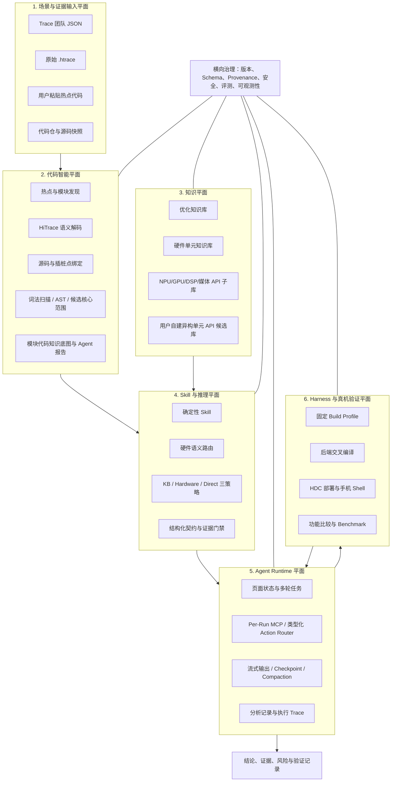
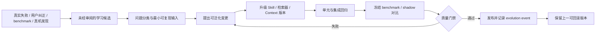
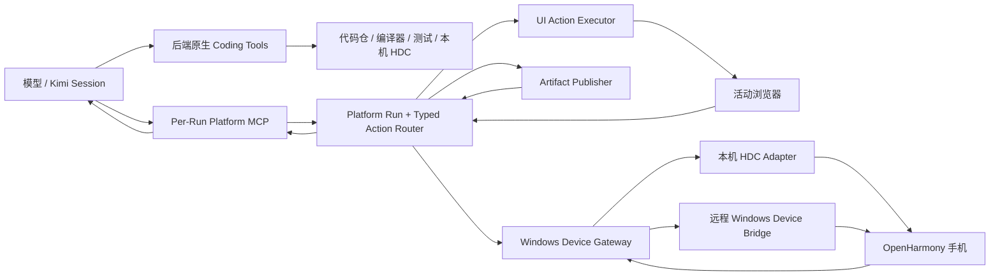
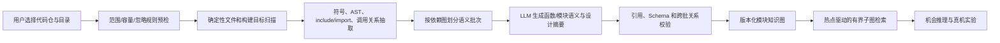

# 异构与并行优化使能平台总体技术文档

> 文档状态：总体技术基线 v1.8
> 基线日期：2026-10-31；Web 兼容链路 0.1.25 / Bridge 1.4.9，Desktop-first 工作台 0.1.93
> 文档角色：统一描述平台定位、技术体系、工程资产、证据闭环和演进路线。本文不替代各专项 Spec；专项 Spec 继续作为接口、状态机、数据契约和代码实现的权威依据。  
> 关联入口：[Spec 索引](spec_index.md)、[关键技术说明](heterogeneous_enablement_key_technologies.md)、[跨 Spec 共同契约](cross_spec_contract.md)。
> v1.8 摘要：HiTrace 的 TraceFS 状态与服务 recording session 分层核验；私有直连设备可有界复位服务残留，Trace 冲刷按缓冲区分级，PMU 未启动与采样器缺失分开诊断。保留 v1.7 的校准恢复、动态拓扑与计算强度证据；Code Agent 提供显式初始化、托管工具 Skill、MCP/CLI 双路径发现及可复制的原生 MCP 自配置任务，长提示使用可诊断的 PTY 收敛等待和单次提交键。
> 0.1.77 增量：逐阶段真实 CPU 驻留通过硬件画像映射核组，并用观测/期望 on-CPU 时长评价驻留覆盖，只有完整证据可作源锚；分型和微基准方法对用户可见；校准 Worker 提供同窗 PMU 与公开频响公式；来源完整性仍阻断，统计质量或覆盖不足改为显式风险发布；活动栏点击收起 hover tip，采样设备和硬件画像建立可追溯关联。
> 0.1.78 增量：并行建模页公开最低时延/预算内最低频点的字典序模型和两级求解语义；搜索冻结完整配置以支持可复现加载；Code Agent 通过有界 readiness 握手预加载本地和 SSH 工具上下文；资源管理器同时支持本地/远端工作区及带 revision/CAS 的有界 Search/Replace。
> 0.1.79 增量：活动栏在不改变固定 50px 主布局的前提下，以覆盖层展开全部功能名称；复用真实导航按钮保持 active、计数和点击语义一致，并允许在“界面”配置中持久关闭、回退到单项提示。
> 0.1.80 增量：活动栏收紧展开宽度并重新分配图文间距；Agent 启动上下文改为软确认、迟确认与首任务确认门，确认缺失不再被误报为启动失败，也不会中断仍在响应的 Agent。
> 0.1.81 增量：删除 Code Agent 自动启动输入与确认链路，启动 PTY 保持零写入；配置页提供可审阅、可复制的长期记忆系统提示，当前连接事实仍由工具动态读取。
> 0.1.82 增量：Agent 标题栏增加显式初始化动作，读取托管工作台工具 Skill，通过自描述 `--list-tools` 与只读调用验证 MCP/CLI 接入并建立长期记忆；页面预设任务按本次 TUI 输出和提示词长度等待粘贴收敛，再发送单次 CR/LF。
> 0.1.83 增量：移除活动栏顶部内边距，使标题栏、活动栏、导航列表及首个入口的纵向边界连续，并用实际 Electron 几何回归锁定该视觉合同。
> 0.1.84 增量：Code Agent 配置页提供可预览、可复制的原生 MCP 自配置任务，引导目标 Agent 识别真实 Loader、保留动态 Broker 环境并用原生只读工具完成验证；任务不自动发送，也不写入长期记忆。
> 0.1.85 增量：负载采样计划生成采用本地确定性快路径和 `capture_update_plan` 差量路径；有界任务合同剔除 provenance、artifact、全量 catalog 和无关工具。原子 revision CAS、request ID 幂等及任务级 Broker 权限拒绝并发或迟到覆盖，90/120 秒等待合同和精确终态事件避免永久等待，并记录首次工具调用与采样工具耗时。
> 渐进式工具发现增量：Desktop MCP/CLI 默认只向 Agent 提供工具名、能力分组和简短摘要；Agent 选定工具后通过 `desktop_tool_describe` 或 `--describe-tool` 读取单个完整合同。初始化不再执行大型 `capture_catalog`，页面已携带精确合同时直接调用，避免全量 Schema 与零工具知识两个极端。
> 0.1.86 增量：经验演进页读取本机 Code Agent JSONL Session，形成消息血缘、工具调用/结果、耗时、错误及平台 Skill/工具使用视图；采样端以持久 claim、boot ID、token 和持续 marker 识别平台遗留 Trace，文件回传与归档使用唯一临时名、排他发布和哈希幂等复用。

> 0.1.87 增量：显式初始化只写入稳定长期规则，工具与 Skill 在真实任务中按需发现；Agent Workspace 通道后台预热，运行记录使用异步 single-flight 快照落盘。经验演进区分 Agent 观察跨度、平台墙钟、远端执行、排队、通道获取与 RPC 往返，并以最大单次耗时而非同类累计耗时标识慢操作。

> 0.1.88 增量：桌面错误通知可把页面、操作位置、错误码、设备及脱敏诊断一键发送给 Code Agent，异步采样终态错误也纳入统一入口。明确选中的本机直连私有设备在新采样前可用 `hitrace --trace_finish` 保存并结束归属不明的残留 Trace，同时保持 Bridge/共享设备的保守合同；崩溃恢复只接受目录、设备、项目、计划和 run 元数据完全一致的本次启动中断记录。

> 0.1.89 增量：负载采样页“负载与模板”采用渐进展开，首屏保留负载模板和计划名称，其余应用、步骤、准备方式、执行范围及高级参数默认收进详情区；主操作始终可见，字段校验或 Agent blocker 自动展开并聚焦，切换模板和历史计划保留折叠状态。

> 0.1.90 增量：连接配置新增默认关闭的错误自动恢复、手机操作授权和服务器操作授权。接入恢复合同的步骤只在 Agent 以匹配请求 ID 明确回执修复完成后重试一次；恢复冻结所选设备、计划 revision 或 SSH 目标，授权撤销、目标变化、超时、无法修复和再次失败都终止流程，不递归重放。

> 0.1.91 增量：并行建模可从已保存搜索的冻结血缘一键生成无脚本、无外链的 HTML 报告，汇总负载、特征、硬件、校准方案、拟合证据、优化公式和最优配置，并附带按历史方案由当前部署资产重建的校准代码快照；Desktop 通过原生窗口与原子写入保存，并显式标记有界传输投影。优化公式改为目标、约束、字典序、两级求解和符号表的全宽审阅卡。

> 0.1.92 增量：Desktop Code Agent 的提交延迟开放为真实 `100–5000 ms`，负载采样区直接展示失败自动重试与手机授权状态。Runner 1.2.14 对精确旧会话中的 PMU sampler、Trace finisher 等完成 TERM/KILL 有界恢复；设备步骤内 action、Trace heartbeat、PMU、HiLog 和 Trace 收尾不再无界等待，宿主清理余量从 180 秒降至 45 秒，并在失败时回传最后清理阶段。屏幕保亮继续保留设备已有的更长设置，与采集器收尾分别取证。

> 0.1.93 增量：Runner 1.2.15 在明确选择的本机直连私有设备上，把 TraceFS 空闲与 HiTrace 服务 recording session 空闲分开核验；所有可读 `tracing_on=0` 时有界执行 `hitrace --trace_finish_nodump`，复核失败即阻断，Bridge/共享设备不执行。Trace finisher 自然等待按缓冲区从 3 秒分级增长，1 GiB 为 18 秒且保留 25 秒硬上界。PMU 二进制身份已确认且兼容路径已接受、但前置环节在 sampler 启动前失败时返回 `PMU_NOT_STARTED`，不再误报部署缺失。

## 1. 执行摘要

异构与并行优化使能平台不是一个“把代码发给大模型并询问能否上 GPU”的问答页面。它是一套从真实运行场景出发，将 Trace 热点、源码语义、已有优化实现、硬件/API 能力、模型推理和真机实验连接起来的工程系统。

平台要连续回答三个问题：

1. **哪里值得优化**：从 Trace 团队报告或原始 `.htrace` 中识别时间上有意义的热点、关键路径证据和候选事件。
2. **可以怎样优化**：定位精确源码和计算核心，结合静态代码事实、真实异构案例、硬件/API 知识及多策略模型推理，形成带条件的异构、CPU 并行或算法优化方向。
3. **是否真的有效**：通过固定构建 Profile、后端交叉编译、HDC 下发、手机执行、功能比较和端到端 benchmark，将静态假设逐步升级为设备证据。

平台的核心价值不在于单次回答比通用大模型更长，而在于形成六项可复用能力：

- 可追溯、可构建的优化知识和硬件/API 知识；
- Trace 到源码、代码范围和静态结构的确定性分析；
- 可版本化、可评测、可回滚的 Skill 工程；
- 能维持多轮状态并调用类型化工具的 Agent Runtime；
- 面向 OpenHarmony 的专用构建与设备实验 Harness；
- 从模型假设到真机结果的分级证据闭环。

一句话定位如下：

> 本平台是一个以真实热点代码为对象，以知识和代码理解为推理基础，以 Agent Runtime 为执行中枢，并以真机实验为证据终点的异构与并行优化使能系统。

## 2. 目标与非目标

### 2.1 目标

- 支持 Trace 团队分析报告和原始 `.htrace` 两类正式输入。
- 将热点事件绑定到明确的代码仓、源码快照、插桩点、函数及候选核心代码范围。
- 从 OpenHarmony 真实异构实现和 CPU/software fallback 中构建可复查的优化知识。
- 从 OpenHarmony SDK、HDI/VDI 和系统集成源码中构建分层硬件/API 知识。
- 同时支持确定性检索、知识增强模型推理和直接代码推理，并保留策略差异。
- 让页面 Agent 能在可审计边界内自主操作页面、读取代码、构建实验和执行设备命令。
- 通过真实编译、部署、执行和比较形成可证伪实验，而不是只输出建议文本。
- 对 Prompt、Skill、检索器、模型和 Harness 建立独立回归与发布门禁。
- 面向数十 GB 代码仓按仓、模块和场景隔离分析，避免把全部源码放进模型上下文。

### 2.2 非目标

- 不取代 Trace 团队的完整关键路径、采样剖析、GPU counter 或功耗分析系统。
- 不把函数名、关键词、API 头文件或模型判断当作设备支持证明。
- 不自动修改业务仓并声称已经完成产品级优化集成。
- 不把“编译成功”“手机执行成功”直接写成“热点已加速”或“存在性能收益”。
- 不在当前阶段建设大型多租户源码托管、企业权限、全量图数据库或全仓向量化平台。
- 不允许模型直接修改生产 Skill、评测 oracle、知识库证据或发布版本。

## 3. 总体技术架构

平台由六个技术平面和一个横向治理体系组成。




> 图 1：平台六个技术平面及横向治理体系。图片用于快速建立整体认知，模块边界与证据约束仍以本文和专项 Spec 为准。

### 3.1 运行主链路

```text
Trace / Trace 分析报告 / 粘贴代码
  -> 热点发现和时间语义
  -> Trace event 与源码绑定
  -> 最小候选代码范围和静态特征
  -> 硬件单元语义路由
  -> 对应单元 API Top-N 检索
  -> 优化知识库、硬件知识库或 Direct 策略推理
  -> 结构化机会、负证据和验证计划
  -> 可选真机自主实验
  -> 功能、设备参与和收益证据
  -> 可重放分析记录
```

### 3.2 当前部署与桌面演进

当前单机基线中，浏览器、Next.js Web UI、Python/FastAPI 后端、代码仓、构建工具和 HDC 位于同一工作站。`heteroctl` 自动安装并校验 Kimi Code；FastAPI 在服务启动时托管 Kimi Agent Engine 的启动、健康检查、重载与关闭。后端已有模型配置时直接使用；浏览器提供模型 URL、模型名与 API key 时，后端通过可续期的短期内存租约和官方 `KIMI_MODEL_*` 通道重载 Engine。Key 不写入 Kimi 配置、分析 artifact、Run event 或日志。

已实现的远程部署由 Linux 后端承担 Agent Runtime、代码分析和编译，由 Windows PC 上的 HDC Device Bridge 连接手机。浏览器仍是交互入口，但设备事实来自 Bridge，源码和构建事实来自后端；两类事实通过 run、device、lease 和 artifact ID 显式关联。平台 0.1.25 / Bridge 1.4.9 已将心跳、诊断、实时回传和历史对账分开，设备列表与 Bridge 在线状态分层显示。

另有 Windows 本地采集包：在 PC 直接执行完整采集，再将标准归档导入平台，降低逐条 HDC 命令的远程往返。0.1.41 将该方向确立为 Desktop-first：交互式 Code Agent、HDC、原始 Trace 和真机执行均归 Windows，Linux 通过共享 SSH 连接收敛为源码分析、Trace 解析和异构案例编译 Worker。它改变执行拓扑，不重写特征、校准和建模算法；本机 Agent、SSH、HDC、本地场景采集和 Trace 管理已接入，分析页面按共享页面与可替换 transport 继续迁移。详见 [桌面设计与架构复核](desktop_workbench_design.md)。

### 3.3 采集、表征与建模链路

```text
操作描述 / 已保存采集计划
  → 明确设备目标 → 本机或 Bridge Runner → Trace / HiLog / PMU manifest
  → Trace 管理与副本校验 → BuildItem 阶段及调度账目
  → PMU 窗口映射、覆盖与候选负载分型 → 版本化特征
  → 单任务核频模型 + 双任务干扰校准 → 条件 DAG 仿真
  → 按核心组合展示时延与频点候选 → 后续真实应用验证
```

这条链路与“Trace → 源码 → 异构机会 → 真机实验”共享输入工件、Agent 接入和设备能力。特征反映测量事实及估计口径；并行寻优反映给定模型与硬件下的条件预测，两者分别保存版本和证据。

0.1.77 在阶段特征中保存真实逻辑 CPU 驻留，只以数据集 `hardware_profile_id` 对应画像的 `core_groups.logical_cpu_ids` 映射核组；`cpu_residency_evidence/v1` 以阶段 CPU 时间为期望值保存观测时长、覆盖率和完整/部分/不足/不可用状态，页面仅在覆盖完整时报告主驻留，其他状态保留可见 CPU 但不作确定源锚。缺画像时保留 CPU 编号并标记核型未知。采样设备与画像关联使用用户选定的完整设备身份和可核验来源，没有唯一匹配时保持未绑定，不按列表顺序或 CPU 编号猜测。

校准 Worker 在目标线程用户态正式计时窗内采集 cycles、retired instructions 与通用 cache reference/miss，按 `raw × time_enabled / time_running` 缩放并派生 IPC、Cache MPKI；事件不可用不单独阻断时延样本。任务类型频响公开 `L(g,class,f)=Lmax×G(f)` 的连续分段幂律公式，跨条件预测使用目标/观测曲线比值。发布侧继续以结构和来源完整性为硬门；统计质量或覆盖门失败但已有可用实测与估计参数时生成 `risk_calibrated`，保留风险等级、证据等级和逐项失败门禁，寻优消费时持续显示风险。负载特征表下默认折叠分型判据和微基准设计说明，方法可审阅而不增加主界面噪声。

## 4. 证据模型：从候选到收益

平台不使用单一的“成功/失败”表示优化结论，而是按证据强度逐级推进。


> 图 2：E0 至 E6 证据阶梯。模型假设、设备事实和场景收益属于不同等级，不能由措辞或单次成功跨级升级。

| 等级 | 名称 | 可以声明 | 不能声明 |
|---|---|---|---|
| E0 | 用户输入 | 用户选择了场景、代码或硬件方向 | 输入内容真实、完整或适合优化 |
| E1 | Trace 观测 | event 的次数、时间、窗口、模块和已提供关键路径状态 | event 名就是函数名，跨度时间就是 CPU 计算时间 |
| E2 | 源码绑定 | 插桩点、函数、文件、快照和绑定等级 | 整个函数都是热点，被调函数一定是瓶颈 |
| E3 | 静态代码事实 | 可见 AST、循环、类型、访问、调用、锁和 IPC 等结构 | 运行时输入、依赖独立性、缓存行为或真实占比 |
| E4 | 知识/模型候选 | 某异构单元、API、并行或算法方向值得验证 | 当前设备支持、能够接入或一定有收益 |
| E5 | 实验功能证据 | 固定 Profile 编译、部署、设备执行和结果比较的真实输出 | 已接入原热点、硬件确实参与、性能更好 |
| E6 | 集成与收益证据 | 目标热点已集成，端到端性能、功耗和稳定性经对照测量 | 超出指定设备、版本、输入和场景的普遍收益 |

任何结论都必须保留当前最高证据等级。模型不能跨级升级，用户选择的麒麟/HarmonyOS 画像也不能替代设备 probe。

## 5. 场景与代码智能平面

### 5.1 What

该平面负责把“一个 Trace 名称或一段粘贴代码”转换为可分析、可引用的热点代码对象，包括时间指标、代码仓、源码快照、插桩点、函数、候选局部范围和静态结构事实。

### 5.2 Why

异构优化判断最常见的误差并非模型不知道 GPU，而是分析对象错了：event name 不等于函数名、插桩点只覆盖某个分支、wrapper 内部调用才是真正计算核，或者 Trace 对应的代码版本与本地工作树不同。若不先解决对象绑定，后续再精细的 AST 和硬件知识也会建立在错误代码上。

### 5.3 How

1. 将 Trace 团队 JSON 和原始 `.htrace` 归一化为带输入 hash、生产者和质量信息的 artifact。
2. 按 self-time、inclusive time、次数、最大单次耗时、观察窗口和 wakeup cluster 发现热点，并按模块展示 Top-N。
3. 解码 `H:`、`Mxx`、`Ixx` 等 HiTrace 信息，结合版本化 tag 目录缩小源码范围。
4. 在当前 source connector 内定位字面量插桩、函数派生插桩和 wrapper，不跨代码仓偷取命中。
5. 允许 dirty worktree，但把工作树内容指纹纳入 snapshot，不强制用户提交代码。
6. 对用户选定模块先异步预估文件规模、时间和磁盘，再经确认构建快照绑定的 SQLite 底图；运行中持续校准 ETA，并支持协作式中止。
7. 通过 `code_graph_query_knowledge` 按问题返回限幅的符号、调用和 HiTrace 候选，再由页面 Agent 读取决定结论的源码。
8. 复用当前页面 Agent Session 对静态代码底图进行有界检索和源码复核，将模块解释、Mermaid 和后续代码问答发布为版本化 Markdown 报告；详见[模块代码知识库构建 Spec](code_knowledge_base_spec.md)。
9. 分别展示插桩行、包围函数和候选分析范围；源码视图高亮真实命中行。
10. 对可见代码执行词法预分析，对精确绑定函数执行 Tree-sitter 函数级 AST profile；高价值样本使用真实编译上下文生成 Clang AST/CFG。完整特征模型、质量等级和矩阵乘实例见[函数代码画像技术说明](function_code_profile_technology.md)。
11. 将未展开但疑似计算的 callee 标记为边界，不把 wrapper 的 AST 当成 callee 负载。

### 5.4 当前静态特征

| 特征族 | 当前可观察内容 | 主要用途 | 证据边界 |
|---|---|---|---|
| 控制流 | 循环、嵌套、分支、早退 | 数据并行、依赖和任务粒度初筛 | 不等于动态迭代次数 |
| 数据表示 | 可见整数、浮点、对象、容器和尺寸类型 | 与 API 的 dtype/format 约束比较 | 未观测类型不能补写 |
| 内存访问 | 数组下标、指针表达式、读写节点 | 识别像素、PCM、张量等访问形态 | 不证明连续性、stride、对齐或 DMA |
| 计算形态 | 操作符、数学调用、归约和 notable callee | 与严格 CPU fallback 和 API 语义比较 | 未展开 callee 仍需解析 |
| 串行边界 | 锁、IPC、Parcel、I/O 和同步调用 | 形成负证据或转向算法优化 | 名称命中不等于运行时占比 |
| 并行信号 | OpenMP、FFRT、任务和并行运行时符号 | 识别已有并行结构及冲突 | 未出现不代表不能并行 |

函数代码画像的目标合同覆盖数据类型、计算、访存、控制、依赖、运行时边界和并行条件，并对每个字段区分直接观察、保守推导、显式假设和未知。当前在线路径仍以词法扫描和 Tree-sitter 为主；Clang AST/CFG 已形成可复现实例，下一阶段将接入真实 OpenHarmony compilation database、局部 def-use、alias/side-effect 摘要和有界跨过程展开，使“热点函数”进一步收缩为“已归因的计算核心”。

## 6. 知识平面

### 6.1 What

知识平面包含三个平台发布知识域和一个用户扩展域：优化知识库回答“过去哪些 CPU/software 结构已有异构实现”，硬件单元知识库回答“有哪些能力类别和运行约束”，API 子知识库回答“具体可比较的接口或算子是什么”；自建 API 候选库允许用户从已登记代码仓扩展新单元，但不直接进入平台发布资产。

### 6.2 Why

将三者混在一个 JSON 中会造成证据越界：已有 OpenCL fallback 案例不能证明目标设备有 OpenCL；源码中存在 NNRT 算子枚举不能证明 NPU 支持该算子；硬件能力描述也不能替代一段 CPU 代码与现有实现模式的结构相似性。

### 6.3 How

#### 6.3.1 优化知识库

- 当前正式 artifact 包含 57 条记录。
- 其中 40 条是严格 source-confirmed 的“异构实现 + CPU/software fallback”用户态/第三方库案例。
- 其余 17 条为算法映射、代码签名、代价模型、fallback 和热点规则，仅作为内部检索与判断层。
- 每条严格案例保存异构锚点、CPU fallback、源码引用、函数级 AST profile、代码特征摘要、计算核心状态和目标单元。
- 内核 device-offload pair 不进入当前运行时优化知识库。

#### 6.3.2 硬件与 API 知识库

| 知识库 | 当前记录 | 主要内容 |
|---|---:|---|
| 硬件单元知识库 | 22 | 单元能力、暴露层级、源码路径、约束、关联严格案例和设备证据要求 |
| NPU API 子库 | 146 | NNRT 图算子、公开构图/设备入口、MindSpore 集成语义和 runtime verification |
| GPU API 子库 | 18 | Vulkan、OpenGL ES、NativeBuffer 和系统图像/GPU 集成入口 |
| DSP API 子库 | 9 | Audio Effect HDI/VDI、provider、PCM 处理与 AP fallback |
| 媒体 API 子库 | 31 | AVCodec、HCodec、JPEG/HEIF、Image Codec HDI 和格式/buffer 生命周期 |

每条 API 记录至少包含：

- 一句话中文摘要和详细语义；
- API family、输入输出和数据形态；
- SDK、系统内部接口或 HDI/VDI 的暴露层级；
- 源码文件、行号、文件 hash 和生成器版本；
- 可见代码的静态匹配信号；
- 与严格 fallback 案例的关联；
- 必须执行的设备能力查询和端到端验证步骤。

#### 6.3.3 硬件到 API 的检索漏斗

```text
热点代码 + 中立静态画像
  -> 模型语义选择一个主硬件单元
  -> 用户可审阅或覆盖主单元
  -> 只检索该单元 API 子库
  -> 返回少量 Top-N API
  -> 模型精确比较语义、数据合同和运行时缺口
```

确定性路由仍保留为离线审计基线，但不再替模型完成生产路由。函数重命名、无关包装和等价表达不应使主硬件判断失效。


> 图 3：从 Trace 热点、计算核心和静态画像，经过主硬件路由与 API Top-N，最终进入三种策略推理。规则、模型和真机承担不同责任。

### 6.4 知识构建原则

- JSON/JSONL 是当前可审计 source of truth，所有派生索引都可以重建。
- 生成器与输入文件 hash 一同发布，避免人工编辑后的不可复现状态。
- 真实案例、硬件描述、API 目录、评测样本和机会结果分别存储。
- `source_confirmed` 只证明源码关系；`device_availability` 和 `performance_envelope` 默认仍为 `evidence_required`。
- 检索只产生候选，不产生设备事实，也不直接产生 `candidate` 结论。
- API 知识构建必须区分消费方合同与内部实现。总记录数不是质量指标；公开/契约、算子和内部实现分布必须单独统计，JSON 持久化成功不能替代质量门禁。

### 6.5 用户自建异构单元 API 候选库

用户可在“代码仓”登记服务端源码目录，再在“优化知识库 > 自建 API”选择该 Connector 和异构单元名称；也可在同一个页面 Agent Session 中用自然语言发起。Agent 通过 `knowledge.list_custom_api_kbs` 核对授权路径，再调用 `knowledge.build_custom_api_kb` 执行有界只读合同扫描。

每次调用都会生成新的 `XYZ API（自建）` JSON 资产，即使同名单元已经存在也不覆盖。资产保存在 `.local-artifacts/custom-api-kbs`，与 `data/knowledge-bases` 下的平台发布库物理分离；用户可以删除自建库，但没有覆盖、合并或删除平台库的接口。

当前 v2 采用 `bounded_api_contract_discovery/v2`：按公开 SDK/NDK、接口合同、导出头文件、内部实现和示例分层，提取函数、算子/能力枚举、宏和调用点，并对可调用合同与算子执行平衡 Top-N。结果单独给出公开/契约、算子和内部实现计数以及 `quality.status`；内部实现占主导时资产可保留诊断，但页面 Agent 不能报告质量通过。该机制解决“相关内部方法很多，但真正 API 被淹没”的系统性问题，生产规则不硬编码某个仓库符号。精准 AST、调用链、公开性、设备能力和性能收益仍需独立复核。详细合同与 NNRT 真实仓回归基线见 [自建异构单元 API 知识库 Spec](custom_accelerator_api_knowledge_base_spec.md)。

自建库不再只是浏览资产。每份库以稳定 `custom:<kb_id>` 形成独立能力卡，与平台 NPU/GPU/DSP/媒体卡一起进入模型语义路由。若被选为主目录，平台只在该库内做 API Top-N，并将 `custom_api_kb:*` 与 `custom_api_record:*` 证据、库 hash 一起固化到推理工件。同名库不合并；删除或变更会使旧路由失效。

## 7. Skill 与推理平面

### 7.1 What

Skill 是带版本、输入输出 Schema、执行器、资源限制、证据边界、错误码、fixture 和回归要求的工程能力。它既包括确定性的 Trace/源码/检索程序，也包括控制模型行为的策略 Skill 和页面 Agent 控制 Skill。

### 7.2 Why

普通 Prompt 很容易在一次失败后被临时加规则，最终变成只适配固定函数名和固定案例的长文本。将 Skill 作为版本化资产，才能判断修改究竟改善了准确率、泛化性、校准度还是只让某一次回答更讨喜。

### 7.3 当前类型化执行 Skill

运行时当前登记 25 个类型化执行 Skill，其中包含隔离盲推理、页面分析、真机实验和自建异构单元 API 知识库等复合能力。

| 类别 | Skill | 职责 |
|---|---|---|
| 编排 | `heterogeneous-opportunity-orchestrator` | 根据页面状态和用户目标编排已注册 action |
| Trace 输入 | `trace-result-ingestion`、`raw-htrace-analysis`、`trace-clustering` | 规范化上游报告、转换 `.htrace`、保留实验性文本 cluster |
| Trace 发现 | `trace-event-extraction`、`trace-hotspot-discovery` | 提取 cluster event 和按模块组织的 self-time 热点 |
| Trace 到源码 | `trace-event-source-resolution`、`trace-hotspot-discovery-source-resolution` | 将两类热点入口解析为源码候选和绑定 artifact |
| 源码证据 | `trace-source-snapshot-attestation`、`source-snapshot-resolver` | 管理 Trace 声明、代码仓快照和 dirty worktree 指纹 |
| 静态分析 | `ast-feature-extraction` | 对精确源码位置抽取函数级结构特征 |
| 机会识别 | `selected-event-opportunity-identification`、`kb-retrieval` | 执行事件级确定性匹配和版本化 KB 检索 |
| 硬件路由 | `hardware-unit-routing`、`hardware-semantic-routing-experiment` | 提供规则审计基线，并在本轮平台/自建能力卡中执行模型优先语义路由 |
| API 检索 | `npu-api-semantic-retrieval`、`accelerator-api-semantic-retrieval`、自建目录检索 | 在所选的精确目录 ID 内返回带边界的 API Top-N |
| 设备 | `device-capability-probe`、`agent-remote-device-shell` | 发现设备能力并执行 probe 绑定的手机 Shell |
| 真机实验 | `agent-native-device-experimentation` | 以设备探测与构建准备两条独立分支推进最小实验，在部署前汇合并进入设备迭代 |
| 工作区 | `page-agent-workspace-files` | 在 connector、路径、hash 和权限约束下读写文件 |

### 7.4 当前模型与控制 Skill

| Skill | 作用 |
|---|---|
| `page-agent-control` | 维护页面状态、动作边界、继续/停止和恢复语义 |
| `device-validation-control` | 指导自主真机实验、Profile 选择、错误诊断和证据校准 |
| `full-optimization-analysis` | 统一机会输出契约、证据引用、负证据和验证计划 |
| `strategy-kb-rag` | 使用严格案例和 CPU fallback 特征进行知识增强推理 |
| `strategy-hardware-kb` | 使用硬件能力和所选单元 API Top-N 进行推理 |
| `strategy-direct-baseline` | 不注入 KB 的直接代码推理基线，用于比较模型先验 |
| `skill-evolution-governance` | 约束版本、变更、回归、发布和回滚流程 |

### 7.5 Agent-Centric 精简版本库

模型 Skill 不再依赖“持续向旧 Prompt 追加规则”的单一路径。`agent-resources/skill-library/` 保存不可变 Skill 文件和 profile manifest；运行时支持历史 `append` 与新版 `replace` 两种模式。当前推荐的 `agent-centric-page-2026-08-20` 对 Agent runtime、页面工件、真机验证、应用流程、自建 API 库、硬件路由、机会分析、三种策略和盲推对照共 13 个模型 slot 做完整替换。该版新增页面级 Session 归属、已知 action 直接执行、字段级 JSON Schema 和模型等价字段适配；应用流程仍采用 Mermaid 单一模型输入，由确定性工具编译标准 JSON 与证据记录。`agent-centric-fast-2026-08-20` 作为分析级隔离行为的回滚对照保留。

精简原则是只保留目标、非显然工具边界、不可违反的证据/结构合同和停止条件；工具选择、搜索路径、修订次数和中间计划交给持久 Kimi Session 自主决定。Schema、action catalog、context pack、测试框架 reference 和硬件模板按需渐进披露。确定性 Skill 的资源限制、错误码和审计门禁仍保留在 registry，不因 Prompt 变短而删除。

Skill 页面可选择精简版、完整 Agent-Centric、原生后端、自适应或稳定 profile，并显示每个版本的替换/追加模式、内容规模和 SHA。切换只影响后续 Run；历史 transcript 和工件继续绑定原 profile。

### 7.6 三策略机会识别

三种策略使用同一热点事实和输出 Schema，但允许的上下文不同：

| 策略 | 主要上下文 | 适合回答 | 主要风险 |
|---|---|---|---|
| 优化知识库上下文 | 严格案例、CPU fallback、AST/代码特征和代价规则 | 是否与已有成功实现模式相似 | 样本覆盖不足或 wrapper 相似造成误匹配 |
| 硬件知识库上下文 | 主硬件能力和对应 API Top-N | 哪一类硬件/API 值得进一步验证 | 把接口存在误写成设备可用 |
| 直接代码推理 | 热点时间、源码和静态观察 | 建立不依赖内部 KB 的模型基线 | 常识推断不可追溯、容易过度自信 |

平台可以并列展示三种结果，但不会用多数投票把假设升级为事实。最终应根据证据等级、必要条件和验证成本合并，而不是只比较模型措辞。

## 8. Skill 优化方法论与质量评测

### 8.1 What

Skill 优化是一个以真实失败 Trace、冻结样本、结构化 oracle 和版本控制为基础的离线工程闭环，不是模型在运行时自行修改 Prompt。

### 8.2 Why

一个 Skill 可能在已知案例上得到满分，却因函数重命名、循环改写、增加日志或换一个模型供应商立即失效。工业级质量必须同时覆盖准确性、拒绝能力、泛化性、可操作性、成本和审计性。

### 8.3 How




> 图 4：Skill 从真实失败进入问题分类、最小复现、可泛化修改和分层评测，发布后仍保留可回滚版本。

问题至少分为：上下文冗余、证据校准错误、源码绑定错误、检索错配、硬件声明越界、动作状态漂移、Schema 适配失败、超时/截断和成本回归。不同问题应修改不同层，不能一律向 Prompt 添加特例。

真机任务存在非显然新发现时，Agent 可通过 `platform_record_experiment_findings` MCP 工具把关键发现、有效修订、适用范围、限制和证据工件保存为 `experiment_learning_report/v1`。记录失败或没有新发现不得阻塞已经闭合的实验结论。工件初始状态固定为 `captured_unreviewed`；单次设备现象不能自动修改 Skill、硬件/API 知识库或 Build Profile。候选必须经过复现或明确的单例范围、正反回归、版本化变更、审阅和回滚设计，才能晋升为生产资产。

### 8.4 评测层次

| 层次 | 评测对象 | 主要检查 |
|---|---|---|
| 确定性单元测试 | parser、resolver、retriever、validator、build profile | 固定输入输出、失败码、幂等、资源上限和 hash 稳定性 |
| Golden fixture | Trace、源码、KB、HDC fake、构建样例 | 关键字段、证据等级和错误分支不回归 |
| 模型结构回归 | 路由与三策略 Skill | JSON 合法性、允许 evidence ID、结论等级、必须/禁止事实 |
| 正负样本 | 可卸载、不可卸载、证据不足代码 | 召回、误报、拒绝特异性和校准度 |
| 变形测试 | 重命名、等价改写、包装、无关代码和语义删除 | 变换不变性以及真正缺少语义时的合理降级 |
| 端到端工作流 | 页面 Agent、Runtime、Action、Artifact | 状态延续、失败恢复、停止、重试和记录完整性 |
| 真机回归 | 编译、上传、远端执行和比较 | 环境真实性、错误可诊断性、功能结果和证据边界 |

### 8.5 当前评测资产

- Hardware-KB 策略使用 60 条分层样本：20 条 smoke、16 条 development、14 条 validation 和 10 条冻结 holdout。
- 硬件语义路由另有 17 条泛化 fixture，覆盖重命名、等价改写、语义缺失和反例。
- 40 条严格用户态/第三方异构 fallback 案例是知识资产和正向参考，但不能与同源发现结果一起充当独立有效性证明。
- 负样本覆盖同步 IPC、锁、I/O、递推依赖、普通 buffer、无 codec 生命周期图像代码和小粒度调用。
- 真机和 fake-HDC fixture 分别验证真实环境行为与可重复失败路径。

### 8.6 核心质量指标

| 维度 | 指标示例 |
|---|---|
| 识别准确性 | 硬件单元 Top-K recall、API family recall、CPU 并行判断正确率 |
| 反例能力 | 单元拒绝特异性、不相关 API 零召回率、过度推荐率 |
| 泛化性 | 重命名一致率、等价改写一致率、无关代码鲁棒性、语义删除敏感度 |
| 证据校准 | `candidate` 越级率、设备事实幻觉率、负证据完整率 |
| 结构质量 | JSON 契约通过率、evidence ID 合法率、结果可回填率 |
| Agent 能力 | 任务完成率、失败后有效修订率、重复无效 action 率、状态恢复率 |
| 效率 | 输入/输出 Token、上下文利用率、延迟、工具调用次数和 compaction 次数 |
| 可审计性 | 请求、响应、action、artifact、版本和错误链完整率 |

发布目标是相对准确且能够泛化，不追求把开发集调到逐例满分。冻结 holdout 只能用于版本比较，不能在看过结果后继续针对性调词并重复宣称有效。

## 9. Agent Runtime 平面

### 9.1 What

Agent Runtime 将模型从“文本回答器”变为可以维持任务状态、调用类型化 Action、读取真实返回、继续修订并留下完整记录的执行主体。

### 9.2 Why

硬件优化分析天然是多轮 Coding Agent 任务。模型可能需要先路由硬件，再查 API、浏览代码、写实验、编译运行，并根据真实错误持续修订。把每一步拆成互不相关的单次请求，或强迫成熟 Agent 用低带宽 MCP 逐个搜索和读文件，都会丢失状态与原生工具优势。后端执行遵循 Kimi 自身权限和安全策略；平台重点治理外部搜索、浏览器与远程设备等跨边界能力。

### 9.3 How

- 浏览器为每个页面/标签页生成一个 `page_session_id`，它固定绑定一个 Platform Run 和一个持久 Kimi Session。普通对话、热点绑定、硬件路由、机会推理、流程分析、分析记录切换和真机验证都向该 Session 追加任务；`analysis_id` 只是当前审计与工件上下文。独立盲推基线才使用隔离 Session。
- Runtime 保存 run、任务输入包、页面工件状态、已选热点、策略、目标硬件、模型消息和工具观察。
- Kimi 可直接使用后端 Bash、Read、Edit、Glob、Grep、编译器、测试和本机 HDC；这些原生工具调用由 Kimi Session 记录，不由平台重写成简化 ReAct Action。
- 页面操作、平台工件发布和 Windows HDC 通过 MCP/Bridge 跨边界执行；`WebSearch` 与 `FetchURL` 每轮显式禁用，并由部署预检与 Engine health 校验。
- 右侧下半区不是终端样式的事件列表，而是 xterm.js 连接的真实后端 PTY；PTY 固定启动 `kimi --auto --session <session_id>`，用户键盘输入与页面按钮命令进入同一 CLI。后端 PTY 不设空闲超时，浏览器 cursor poll 只是可替换的传输通道，不改变长期 Session；短暂轮询失败先显示为输出链路恢复，持续 30 秒仍未恢复才显示浏览器链路中断，并把后端 PTY 状态标为待确认。页面分别展示 Agent 活动与 PTY 在线、恢复、链路中断、重建状态。ANSI/TUI 输出与 Run 事件按 sequence cursor 增量返回，刷新时取消旧请求，恢复时从最后序号续读；SSE 仅保留为旧客户端兼容入口。相同上下文的连续消息直接写入现有 PTY，只有上下文、Skill 版本或 Adapter 投影签名改变时才热更新工作区。上半区从同一输出提取紧凑实时进度和原生 context 用量。
- PTY endpoint 不接受任意 executable 或 login shell；Kimi 启动后按自身权限使用后端 Bash、Read、Edit、编译器和本机 HDC。浏览器/Windows 设备等跨边界动作继续通过 per-Run MCP/Bridge，并把真实结果送回同一个 Session。
- 浏览器短暂断线只中断显示，后端 CLI 继续运行；sequence cursor 支持续读。Kimi Server 仍负责会话创建与模型租约，Kimi CLI 是实际交互和工具执行入口，两者职责不可混写。
- 路由与机会推理使用两段工具契约：prepare action 构建精确 context artifact，当前 Session 完成推理，run/save action 只校验和持久化 `context_artifact_id + agent_result`。它们不再触发第二个模型会话。
- 用户可停止当前 run；恢复时注入 checkpoint、最新用户意图和保存的工具事实，不机械重走硬件路由。
- 上下文接近上限时按证据优先级压缩，保留目标、未完成意图、关键事实、负证据、动态 ID 和最近失败。
- 429、网络中断和 provider overload 不清空分析状态；下一次继续从保存的 task state 和 tool observation 推进。

### 9.4 MCP 工具适配层

#### 9.4.1 为什么使用 MCP

MCP 是 Agent Engine 与浏览器、平台工件及远程 Windows Device Bridge 之间的标准跨边界协议。它让模型操作 React 页面和客户端 HDC，而不需要知道组件、FastAPI 路由或 Bridge 传输细节。常规后端文件、Shell、编译和测试直接使用 Kimi 原生 Coding Agent 工具，不经过 MCP 转发。

MCP 不是 Kimi 后端能力的权限来源。跨边界动作的状态、幂等、风险等级和输入输出校验仍由 Platform Run 与类型化 Action Router 决定；后端原生工具则遵循 Kimi Agent 自身权限、安全过滤和工作区策略。

默认 Kimi Agent Engine 为每个 Platform Run 创建独立工作区、Skill 和 MCP 配置。工作区可绑定规范 Source Connector，Kimi 直接使用原生工具完成后端工作；MCP 进程从环境取得当前 `run_id` 和 HMAC 派生 token，无权切换到其他 Run，只负责页面、工件和远程设备边界。模型外部搜索与抓取能力保持关闭。




> 图 5：Kimi 原生工具承担后端 Coding 工作；Per-Run MCP 只承载页面、平台工件和远程 Windows 设备等跨边界动作，真实结果回到同一个 Session 继续推理。

#### 9.4.2 当前 MCP 工具面

| 工具组 | MCP 工具 | 作用 |
|---|---|---|
| 任务与工件 | `platform_get_task_context`、`platform_read_artifact` | 按当前 Run 读取精简任务事实和明确类型的 artifact |
| 页面 | `platform_list_page_actions`、`ui_execute_registered_action` | 查询当前允许的页面动作并请求活动浏览器执行 |
| 构建 | `build_describe_profile`、`build_stage_source`、`build_create` | 查询固定 Profile、暂存完整源码并由 Build Worker 构建 |
| 设备发现 | `device_list_bridges`、`device_create_lease`、`device_discover`、`device_probe` | 选择本机/远程设备、建立租约并形成 probe 事实 |
| 设备执行 | `device_deploy_artifact`、`device_execute_shell`、`device_collect_artifact` | 部署构建产物、运行手机 Shell 并回收结果文件 |

这些工具位于 `heterogeneous-enable-web/backend/kimi_mcp_server.py`。它们不直接实现业务，而是调用当前 Run 的内部 action endpoint，由 `runtime_action_router.py` 选择唯一执行器。

#### 9.4.3 网页操作如何包装成 MCP 工具

网页不向模型暴露 CSS selector、屏幕坐标或任意 DOM API。平台把用户能理解的业务操作注册为语义 Action，例如：

- `workspace.navigate`：切换工作台视图；
- `repository.select`：选择代码仓；
- `target-platform.set`：设置目标芯片和操作系统画像；
- `reasoning.load_hotspots`：提取当前 Trace 的热点；
- `reasoning.resolve_hotspot`：选择热点并解析源码；
- `reasoning.paste_hotspot_code`：填充用户提供的热点代码；
- `reasoning.prepare_hardware_semantic_route`、`reasoning.run_hardware_semantic_route`：分别准备路由上下文，以及校验/持久化当前 Session 的路由结果；
- `reasoning.prepare_context`、`reasoning.run_strategy`：分别准备策略上下文，以及校验/持久化当前 Session 的机会结果。

每个页面 Action 都包含 `action_id`、版本、风险等级、输入/输出 JSON Schema、幂等规则、审计字段和前端实现引用。Agent 不需要为每个按钮加载一个独立 MCP tool：Skill 或任务已给出精确 action ID 与参数合同的热点、路由和策略动作直接调用 `ui_execute_registered_action(action_id, input)`；只有未知动作才调用 `platform_list_page_actions(action_ids=[...], include_schemas=true)` 精确查询。这样既避免把动态页面动作永久塞入模型工具目录，也避免每轮重复注入整份 action catalog。

页面动作的同步握手如下：

```text
模型从 Skill/任务取得精确 action ID 与参数合同
  -> 若合同未知，仅精确查询所需 action 和 Schema
  -> 模型调用 ui_execute_registered_action
  -> 后端验证 registry、mode、Schema 和幂等键
  -> Run 写入 ui.action_requested 并进入 waiting_for_ui
  -> 活动浏览器通过 SSE 收到请求
  -> 浏览器调用已注册 handler，更新页面或调用既有后端 API
  -> 浏览器回传 request_id + result/error
  -> 后端保存 ui.action_result 并解除 MCP tool 等待
  -> 模型在同一任务中读取真实结果并决定下一步
```

对于文件选择等必须由用户授权的浏览器能力，Agent 只能高亮入口、引用页面提供的 `attachment_id` 或等待用户动作，不能通过 MCP 绕过浏览器权限读取本机文件。

#### 9.4.4 设备交互如何适配 MCP

从 Agent 视角，设备发现、probe、部署、执行和结果收集全部是 `device_*` MCP 工具。从平台内部看，MCP 只是入口，真实调用链为：

```text
device_* MCP tool
  -> 当前 Run 内部 action endpoint
  -> Typed Action Router 校验依赖、serial、lease 和 artifact
  -> Device Gateway
  -> 本机固定 HDC Adapter 或远程 Windows Device Bridge
  -> OpenHarmony 手机
  -> stdout / stderr / exit code / collected artifact
  -> Device Gateway 与 Run execution trace
  -> MCP tool result
```

远程 Windows Device Bridge 不必再向模型暴露第二套 MCP。它只需要实现平台定义的类型化 Device Job 协议，通过普通 HTTP poll/event 主动连接后端；同一组 `device_*` MCP tools 可以无感切换本机 HDC 和远程 Bridge。这样能保持 Skill 与部署拓扑解耦，也避免模型直接选择 `hdc.exe` 路径、serial 或宿主机命令。WebSocket 仅作为旧 Bridge 的兼容通道。

#### 9.4.5 MCP、Action 与执行器的职责分工

| 层 | 负责 | 不负责 |
|---|---|---|
| MCP | 工具发现、参数传递、等待结果、把真实结果返回模型 | 决定权限、直接操作 DOM/HDC、保存业务状态 |
| Action registry/router | Schema、风险、所有权、前置条件、幂等和审计 | 理解页面组件细节或实现设备传输 |
| UI executor | 将语义 Action 映射到当前 React 状态和现有页面能力 | 接受任意 DOM 指令或伪造执行结果 |
| Build Worker | 可选地使用固定 Profile 构建可复现 artifact | 接受模型向该 Worker 注入宿主路径、编译器或任意参数 |
| Device Gateway/Bridge | 设备租约、传输、HDC 执行、进度和结果 | 解释优化结论或替模型选择实验方向 |

当前默认 Kimi Agent Engine 用原生 Coding 工具处理后端源码、文件、Shell、编译和本机 HDC，用上述 Per-Run MCP 处理页面、工件发布及 Windows HDC 跨边界动作。`legacy` 浏览器 JSON Action 模式仅为兼容路径，不应作为后续功能扩展的主架构。

### 9.5 页面 Agent 能力边界

页面 Agent 可以：

- 导入用户授权的 Trace 或分析报告；
- 选择场景、热点、源码和策略；
- 调用知识检索和模型推理；
- 直接读取、搜索和修改后端任务所需文件；
- 使用后端工具链，或选择固定构建 Profile 产生可复现 artifact；
- 通过本机 HDC 或 Windows HDC Bridge 在绑定手机上自主执行、观察结果并迭代。

页面 Agent 不可以：

- 读取浏览器保存的 API key 并写入 artifact；
- 调用 `WebSearch/FetchURL`，或把源码与分析内容发送给外部搜索/抓取服务；
- 把 Windows Device Bridge 当作通用远程 Shell 或任意文件通道；
- 把 `art_*`、`trace:*` 或 `source:*` 标识当作文件路径；
- 绕过源码、设备或证据门禁；
- 自动修改并发布自己的生产 Skill。

## 10. 专用 Harness 工程

### 10.1 What

Harness 是连接模型生成实验与 OpenHarmony 真机的受控工程环境。它固定编译器、SDK 头文件、链接面、产物目录、HDC 目标和审计格式，同时允许 Agent 自主编写最小实验代码。

### 10.2 Why

没有 Harness 时，模型会从知识库案例中猜头文件、把系统内部 API 当应用 SDK、在不同轮次更换工具链，或只生成代码而无法验证。完全自由的宿主机 coding agent 又会把工作站文件和命令暴露给模型。Harness 在可重复性和自主迭代之间提供明确边界。

### 10.3 当前固定 Profile

| Profile | 用途 | 固定能力边界 |
|---|---|---|
| `native_c` | C reference、CPU baseline 和诊断 | freestanding C 头/链接面，不宣称异构 |
| `native_cpp` | C++ reference、CPU baseline 和比较器 | 固定 C++/运行库边界 |
| `gpu_gles3` | EGL/OpenGL ES 集成和图形实验 | 真实 EGL/GLES 头、库、context 和扩展检查 |
| `gpu_vulkan` | 无窗口 Vulkan compute 实验 | C host + GLSL compute，固定 glslang 生成 SPIR-V |
| `npu_nnrt` | NNRT 构图、设备和算子可用性实验 | Finish、AvailableOperations、指定 device 编译/执行 |
| `media_avcodec` | AVCodec/媒体能力和生命周期实验 | capability、format、buffer、callback 和 fallback |

GPU/NPU/媒体 Profile 公开其真实 OpenHarmony musl 标准 C 头、领域 SDK 头和链接面。知识库只解释 API 语义，不充当构建头文件目录。

动态 E0 Profile 同时公开源码入口和二进制入口：Agent 只实现 `int main(void)`，Build Worker 注入版本化的弱 `_start` 启动胶水并链接为真实 ELF 入口。这样 CRT/ABI 启动细节由 Harness 负责，模型把迭代预算用于硬件 API、功能比较和性能实验。`gpu_vulkan` Profile 还返回独立进程 loader 指引：既有真机观察显示直接调用链接符号可能在首次 Vulkan 调用处异常，而 `dlopen/dlsym` 路径成功；该观察用于优先级提示，仍须由当前设备输出复核。

### 10.4 Harness 流程

```text
describe profile
  -> 选择 Hypium/OHJSUnitTest、Developer Test/xDevice、HATS/CTS 辅助或明确 standalone fallback
  -> 从 catalog 选择一个语义相容的 curated hardware API template
  -> 复用 API 脚手架并改写当前热点 kernel/算子、数据合同与 CPU oracle
  -> stage source artifact
  -> 固定工具链构建
  -> 保存 compile stdout/stderr 和 binary hash
  -> 部署到 probe 绑定设备
  -> 官方 runner 返回报告，或手机 Shell 执行明确降级的独立实验
  -> 结果比较与下一轮修订
```

Kimi 在后端普通 Coding 任务中可以直接使用源码、文件、Shell、编译器和本机 HDC；当任务进入可复现的证据型 Harness 时，Build Worker 仍用固定编译器、Profile、artifact root、超时和输出上限。Windows 客户端手机经 HDC Bridge/MCP 操作。所有真实命令和跨边界工具结果进入统一执行记录；只有 runner 的真实报告才能证明 xDevice、Hypium、HATS 或 CTS 已执行，不能用普通 Shell 输出伪造框架报告。

生产 Agent 可以读取版本化 `agent-resources/hardware-api-templates/catalog.json` 及一个精确模板，复用 Vulkan loader、EGL context、NNRT 图生命周期、AVCodec capability 等脆弱脚手架。模板必须标注验证等级、适用语义、修改点、限制和逐文件 SHA-256；运行时只复制登记且 hash 匹配的文件。历史 PASS 不属于当前任务证据。Demo、旧 Run、golden fixture、生成物或研究归档只有经评审发布为 catalog 条目后才能复用。

平台把生产效率和无模板泛化分开评测：生产回归挂载模板库，验证正确选择与改写；template-blind holdout 不挂载模板，验证模型面对新 API/控制流时是否仍能形成合理实验。

## 11. 真机迭代验证方法

### 11.1 What

真机验证不是一个固定三步 Wizard，也不是一次“生成 Adapter”。它是一个由用户启动、Agent 自主推进、可随时停止并可继续的多轮证伪过程。

### 11.2 Why

真实硬件实验会遇到头文件、ABI、extension、格式、shape、dtype、buffer 生命周期、权限、数值误差和设备差异。模型需要根据每次真实编译或运行结果改变下一步，而不是在开始时一次性猜出完美代码。

### 11.3 How

每轮遵循观察驱动循环：

```text
读取当前热点、策略和设备事实
  -> 识别 API 暴露层并选择匹配的官方测试承载
  -> 选择一个相容模板并声明复用/修改边界
  -> 选择本轮最小可证伪问题
  -> 改写热点 kernel/算子、数据合同、CPU oracle 或修订实验
  -> 编译 / 部署 / runner 或 standalone 执行
  -> 读取真实 stdout、stderr、退出码和结果文件
  -> 判断已证明什么、仍缺什么
  -> 继续、换假设或形成有证据的停止结论
```


> 图 6：Agent 围绕最小可证伪问题持续生成、编译、部署、执行和比较。源码生成、编译、设备执行和功能等价不能自动证明硬件参与及热点收益。

轮次数量不是算法步骤。平台不预设产品级固定轮次或 action 数量，并保留用户停止和继续能力；只要仍有新的事实和有效修订，Agent 可以继续推进。重复相同无效输入、没有新证据的循环或真实环境阻塞应停止并说明原因。

### 11.4 结果校准

真机实验必须分别记录：

1. 使用了哪个 template_id/版本，复用和修改了什么；
2. 源码是否成功生成；
3. 选择了什么测试承载、官方 runner 是否真实执行及为何降级；
4. 固定 Profile 是否编译成功；
5. 产物是否上传并在目标手机运行；
6. CPU reference 与候选结果是否功能等价；
7. 是否取得目标硬件实际参与的证据；
8. 是否接入原热点的数据和调用边界；
9. 是否在目标场景取得稳定性能、功耗或时延收益。

前六项通过不能自动推导后三项。

## 12. Artifact、可观测性与可恢复执行

### 12.1 核心 Artifact

| Artifact | 主要内容 |
|---|---|
| Trace artifact | 原始输入 hash、转换器、模块、热点和质量信息 |
| Source resolution artifact | connector、snapshot、文件、插桩点、函数、范围和绑定等级 |
| Static profile artifact | 词法观察、AST 特征、候选核心和解析状态 |
| Reasoning context artifact | 当前策略实际可见的最小充分事实投影 |
| Model transcript | 请求、流式片段、最终文本、usage、停止原因和契约校验 |
| Action audit | action ID、输入、输出、错误码、耗时和关联 run |
| Build artifact | Profile、源码 hash、编译命令模板、stdout/stderr 和产物 hash |
| Device artifact | probe、serial、部署路径、命令、退出码和设备输出 |
| Experiment learning report | 真机关键发现、触发条件、有效修订、适用范围、复现状态、限制、证据和建议去向；默认未经审阅 |
| Opportunity report | recommendation、confidence、evidence、风险和验证计划 |

### 12.2 一次分析记录

一次分析记录以 Trace 场景或粘贴代码为根，可以包含多轮硬件路由、多种策略推理和一个或多个真机实验 run。重新装载记录时，应恢复当时的热点、源码、策略结果和运行上下文，而不是只打开一张只读报告。

### 12.3 失败诊断

`Failed to fetch`、HTTP 4xx、模型超限、JSON 不完整、构建失败、设备断开和远端命令超时必须保留不同错误类型。每次失败均写入 execution trace，使后续可以判断问题属于供应商、Runtime、Skill、Action Schema、构建 Profile、设备环境还是业务实验本身。

## 13. 模块级代码知识库

### 13.1 目标

完整 OpenHarmony 仓库可达数十 GB，但一个热点通常只涉及一个几 MB 到数百 MB 的模块及少量跨模块依赖。代码知识库应按用户选择的代码仓和目录构建，为流程、热点、API 追踪和代码问答提供共享的结构、语义与设计上下文，而不是对整个仓做一次昂贵的无差别 LLM 分析，也不是代码知识库页面的私有能力。

### 13.2 实现方法与取舍

平台以 Tree-sitter/SQLite 静态底图、公共有界查询 Skill 和 Agent 原生源码分析形成正式代码理解路径，主要能力包括：

- 用户指定子目录的范围分析；
- Tree-sitter 等确定性结构抽取；
- 文件、函数、类和依赖关系图；
- 先解析 import，再按依赖图进行语义分批；
- 分批产物合并和确定性图校验；
- 基于 Git/hash/结构指纹的增量更新；
- Agent 生成带源码引用的模块摘要、架构解释和业务流程；
- SQLite 底图与 Markdown/JSON 工件作为可检查、可迁移的持久化产物。

平台仍保留以下取舍：

- 不要求首次扫描完整 OpenHarmony 仓库；
- 不把 LLM 生成的调用关系覆盖确定性分析事实；
- 不为了展示知识图而收集与热点优化无关的大量节点；
- 不在第一阶段强制引入 Neo4j 或向量数据库；
- 不把通用代码问答替代现有 source binding、AST 和证据门禁。

### 13.3 三层代码知识

| 层级 | 内容 | 主要采集方式 | 初期存储 |
|---|---|---|---|
| 语法层 | AST、符号、类型、include/import、调用图、局部 CFG、def-use 摘要 | Tree-sitter、Clang tooling、构建数据库和确定性解析 | 版本化 JSON/JSONL + 派生索引 |
| 语义层 | 函数意图、输入输出、状态、副作用、接口契约和不变量 | 代码、注释、测试、提交信息和 LLM 结构化摘要 | 带源码引用的 JSON + 可选 embedding 索引 |
| 设计层 | 模块边界、线程模型、主流程、数据生命周期、扩展点和硬件抽象层 | BUILD/GN、目录、依赖图、设计文档、ADR 和 LLM 分批分析 | Markdown + 结构化图元数据 |

平台在此基础上增加第四个面向任务的投影层：

| 层级 | 内容 | 用途 |
|---|---|---|
| 优化投影层 | Tracepoint、热点范围、重计算 callee、数据搬运边界、串行边界、fallback、异构 API 接点 | 为一次热点推理检索最小相关子图 |

### 13.4 建议图模型

节点至少包括：`repository_snapshot`、`module`、`file`、`function`、`type`、`data_object`、`tracepoint`、`build_target`、`api_contract`、`accelerator_api` 和 `design_concept`。

边至少包括：`contains`、`imports`、`calls`、`reads`、`writes`、`mutates`、`guarded_by`、`runs_on`、`traced_by`、`implements`、`dispatches_to`、`fallback_to`、`build_depends_on` 和 `documented_by`。

每条节点和边都必须标记来源：

- `deterministic`：由 parser、编译信息或确定性规则得到；
- `llm_inferred`：由模型解释得到，必须带源码引用和置信状态；
- `runtime_observed`：由 Trace、probe 或实验观察得到；
- `human_declared`：由用户或设计文档明确声明。

### 13.5 模块级构建流水线




> 图 7：代码知识库按用户选定模块构建，将确定性语法事实、模型语义/设计摘要和优化投影汇入版本化知识图，再为热点返回有界子图。

初次构建只分析选定目录和明确依赖。后续根据 Git diff、文件 hash 和结构指纹更新受影响文件，并对调用者、被调者和模块摘要执行有界失效传播。

### 13.6 与机会识别的结合

运行时用公共 `code-context-retrieval` Skill 统一消费代码知识：有 ready `graph_id` 时调用 `code_graph_query_knowledge` 获取限幅静态候选，随后读取决定结论的源码。应用流程以用户操作和入口/出口为种子，热点分析以 trace event、包围函数和 callee 为种子，API 追踪以接口族和实现符号为种子。

热点定位后，代码知识库不把整个模块发给模型，而是以热点函数为种子返回受预算约束的子图：

- 包围函数和候选核心范围；
- 一到两层高相关 callee/caller；
- 数据对象、所有权和同步边界；
- Tracepoint 与 build target；
- 已有 fallback、provider 或硬件 API 接点；
- 与结论直接相关的语义/设计摘要及源码引用。

这可以补足当前只看局部代码时缺失的 callee、状态所有权和模块设计上下文，同时控制 Token 和错误传播。

### 13.7 代码知识库质量指标

- 符号和函数范围准确率；
- 调用边抽样 precision/recall；
- build target 与 include 解析成功率；
- LLM 摘要的源码引用覆盖率和无依据声明率；
- 热点相关子图检索 recall；
- 增量更新正确率和陈旧节点比例；
- 相比直接发送源码的 Token 降幅；
- 对机会识别准确率、证据完整性和真机任务完成率的实际增益。

## 14. 当前能力成熟度

| 能力 | 当前成熟度 | 说明 |
|---|---|---|
| Trace 团队报告导入 | 已落地 | 标准化热点、关键路径状态和来源质量 |
| 原始 `.htrace` 基础分析 | 已落地 | TraceStreamer 转换、模块、cluster 和 self-time 热点 |
| Trace 到源码 | 已落地基线 | 支持 HiTrace 标签、插桩点和候选函数；复杂 wrapper 继续增强 |
| 词法静态扫描 | 已落地 | 用于快速、可复现代码画像，不伪称 AST |
| 函数级 AST profile | 已落地基线 | Tree-sitter 可复现，Clang 用于高价值复核 |
| 跨过程计算核心归因 | 部分落地 | 已显式建模未展开 callee，完整 slice 仍待建设 |
| 优化知识库 | 已落地 | 57 条记录，其中 40 条严格用户态/第三方 fallback 案例 |
| 硬件/API 知识库 | 已落地 | 22 条硬件记录和 204 条分单元 API 记录 |
| 用户自建 API 候选库 | 已落地 v2 | 已登记 Connector、有界合同扫描、公开面分层、函数/算子平衡 Top-N、质量门禁、独立存储、同名新建、浏览检索与用户删除 |
| 模型语义路由和三策略推理 | 已落地 | 支持用户覆盖、结构化校验和证据校准 |
| Skill 治理与评测 | 已落地基线 | registry、evolution、60 条策略样本和 17 条路由泛化样本 |
| Agent Runtime | 已落地基线 | 多轮状态、类型化 action、流式进度、停止/恢复和审计 |
| 后端 Build Worker 与设备 Gateway | 已落地基线 | 固定 Profile、artifact 构建和 HDC 设备操作 |
| 真机自主迭代 | 已落地基线 | 可根据真实编译/运行结果修订，产品级 benchmark 仍需扩充 |
| 模块级代码知识库 | 已落地 v1.6 | Tree-sitter C/C++ + SQLite 静态底图、跨 Agent Skill 投影、有界查询、源码复核和版本化报告；Clang 精确增强待建设 |
| 场景采集、Trace 管理与本地采集包 | 已落地 | 本机/Bridge 共用计划与 Runner；Windows 离线执行包产出可导入归档 |
| 阶段负载特征、校准与并行寻优 | 已落地基线 | 调度分解、PMU 覆盖/估计、单任务与双任务模型、核心组合搜索；真实应用并行收益另验 |
| 跨主机设备连接 | 已落地基线 | 平台 0.1.25 / Bridge 1.4.9；实时回传与历史对账隔离，版本和运行环境分别验证 |
| 桌面工作台 | Desktop-first 0.1.93 | 本地 Agent/SSH/HDC 与采样、Trace/负载特征/硬件模型/校准/并行建模闭环、持久 Platform/Workspace RPC、离线校准模型及 Monaco/Markdown 本地/远端工作区；Agent 提交延迟支持真实 100 ms 下限；负载采样区展示失败自动重试与手机授权状态；Runner 1.2.15 对精确旧会话和步骤内 Trace/PMU/HiLog 子进程执行有界恢复并回传清理阶段，私有直连设备额外核验并有界复位 HiTrace 服务态，Trace 冲刷等待按缓冲区分级；并行建模可从冻结搜索血缘生成五章离线 HTML 报告，并通过原生窗口原子保存；接入合同的错误可在分域授权下交给 Agent 修复，并在类型化完成回执后按冻结目标只重试一次；采样计划完整时走本地确定性快路径，需要语义补全时使用 revision/request ID 围栏的一次差量调用；工具发现按摘要目录和单工具合同渐进加载，经验演进可审计本机 JSONL Session、Skill/工具调用与分层延迟证据；可断线恢复的通用 typed long job 与跨机大工件自动传输继续建设 |
| 多用户与企业认证 | 规划中 | 仍需身份、项目隔离和运维体系 |

## 15. 工程原则

1. **热点先于建议**：没有场景和时间价值，不进入高成本异构推理。
2. **对象先于特征**：先确认源码和计算核心，再提取 AST 和匹配知识。
3. **确定性事实先于模型解释**：能由 parser、hash、编译器或设备返回得到的事实不交给模型猜。
4. **知识与设备分离**：源码/API 存在不等于目标设备支持。
5. **核心适配与端到端收益分级**：局部计算核心可以先成为候选，但必须逐步补齐搬运、同步、集成和 benchmark。
6. **模型可以自主，工具必须类型化**：开放手机实验决策，固定工作站执行边界。
7. **失败是数据**：失败请求、编译错误和设备输出都进入 Trace，用于修订和 Skill 回归。
8. **按模块扩展，不按仓库蛮力扩展**：30GB 仓库通过 scope、缓存、依赖图和增量更新处理。
9. **评测与知识发现隔离**：不能用同源样本同时构建知识和证明方法有效。
10. **任何结论可回溯**：结论必须能追到 Trace、源码、知识版本、模型请求、action 和设备输出。

## 16. 后续路线

### M1：模块代码知识库闭环（v1.6 已完成）

- 已支持在应用流程页面按代码仓、快照和目录构建底图。
- 已生成确定性文件、符号、调用/include/HiTrace 候选的 SQLite 索引和版本化 `module_code_graph` 工件。
- 已将代码分析与检索 Skill 同时投影到 Kimi 与中立 Agent 工作区，由 Agent 对底图候选执行源码复核和语义归纳。
- 已支持快照/范围绑定、有界查询、源码复核和底图/报告双层 artifact 血缘。
- 后续增加文件级增量失效、语义图谱独立存储目录、Clang 精确边和热点推理复用。

### M2：计算核心和跨过程分析增强

- 引入 compile database、Clang AST/CFG、def-use 和 side-effect 摘要。
- 将 Trace measurement scope 与 callee 调用图结合。
- 为 CPU 并行增加依赖、归约和任务粒度的确定性证据。

### M3：Skill 与 Harness 规模化评测

- 扩充分硬件单元、反例、变形和真实模块样本。
- 建立 shadow run、版本对比、失败聚类和 Skill 回归页面。
- 为 GPU、NPU、媒体和可用 DSP provider 建立更多功能比较器和 benchmark recipe。

### M4：跨主机与多用户产品化

- 部署后端 Agent Runtime 和隔离 Build Worker。
- 产品化 Windows HDC Device Bridge、设备租约和断线恢复。
- 增加身份、项目、代码仓、设备和 artifact 权限。
- 建立企业密钥服务、配额、审计保留和运维监控。

## 17. 文档与代码入口

### 17.1 总览与方法

- [关键技术说明](heterogeneous_enablement_key_technologies.md)：逐项 What / Why / How 和证据边界。
- [严格异构 fallback 总览](strict_heterogeneous_cpu_fallback_overview.md)：真实案例、CPU 实现、AST 特征和异构单元。
- [算法签名方法论](algorithm_signature_based_heterogeneous_opportunity_detection.md)：AST、函数 profile 和匹配思路。
- [Skill 演进与评测规范](skill_evolution_and_evaluation_spec.md)：版本、门禁、回归和发布治理。

### 17.2 权威专项 Spec

- [Trace 分析技术 Spec](trace_analysis_technology_spec.md)
- [异构机会识别 Spec](heterogeneous_optimization_opportunity_platform_spec.md)
- [Web 平台 Spec](heterogeneous_enablement_web_platform_spec.md)
- [多策略推理 Spec](multi_strategy_hotspot_opportunity_reasoning_spec.md)
- [真机验证 Spec](real_device_validation_spec.md)
- [Agent Runtime、Build Worker 与 Device Bridge Spec](platform_agent_runtime_build_device_bridge_spec.md)
- [自建异构单元 API 知识库 Spec](custom_accelerator_api_knowledge_base_spec.md)
- [跨 Spec 共同契约](cross_spec_contract.md)

### 17.3 主要代码和数据

- Web 工程：`heterogeneous-enable-web/`
- Skill registry：`heterogeneous-enable-web/backend/skills.py`
- 页面模型/控制 Skill：`heterogeneous-enable-web/app/lib/optimization-workflow.ts`
- Agent Runtime：`heterogeneous-enable-web/backend/agent_runtime.py`
- 模型引擎：`heterogeneous-enable-web/backend/agent_engine.py`、`kimi_agent_runtime.py`
- Per-Run MCP facade：`heterogeneous-enable-web/backend/kimi_mcp_server.py`
- 类型化 Action Router：`heterogeneous-enable-web/backend/runtime_action_router.py`
- 浏览器 Agent Runtime 适配：`heterogeneous-enable-web/app/lib/backend-agent-runtime.ts`
- 静态与推理上下文：`heterogeneous-enable-web/backend/reasoning_lab.py`
- Build Worker：`heterogeneous-enable-web/backend/build_worker.py`
- 真机实验 Harness：`heterogeneous-enable-web/backend/device_experiment.py`
- 设备 Gateway：`heterogeneous-enable-web/backend/device_gateway.py`
- 优化知识库：`data/knowledge-bases/optimization/`
- 硬件/API 知识库：`data/knowledge-bases/hardware/`
- 自建 API 候选库：`.local-artifacts/custom-api-kbs/`
- 自建 API 构建器：`backend/custom_api_kb.py`
- 评测资产：`data/evaluation/`
- 技术图集提示词：[docs-assets 分支中的生成说明](https://github.com/gyjiang998/heterogeneous-seek/blob/docs-assets/docs/figures/heterogeneous_platform_diagram_prompts.md)

## 18. 总结

平台已经形成的不只是页面功能，而是一组相互约束的工程资产：真实异构案例和硬件/API 知识、Trace 与静态代码分析、版本化 Skill、Agent Runtime、专用 Harness、真机迭代方法和完整可观测证据链。

模块级混合代码知识库已补齐“局部热点代码缺少调用和设计上下文”的基础能力。下一阶段重点是跨过程计算核心、Clang 精确事实与热点/Trace 的实例化结合，同时保持平台最重要的原则：让模型负责理解和探索，让确定性工具负责事实，让真机实验负责证明。

## 场景负载与并行寻优扩展（2026-10-21）

当前工作台把场景采集、阶段负载特征、条件并行仿真和参数校准分开：Trace/PMU 映射到 BuildItem 阶段；特征页保存计算、访存、调度及服务指标与证据质量；单任务校准描述核频成本；双任务定向校准描述资源干扰；DAG 沿任务完成 / 等待事件更新共跑组合，并给出回调终点预测。缺类型或超出实测域的区间显式回退通用争用模型。已实现离线实验包、拟合 / 留出验证、版本发布和搜索消费，目标设备上的并行收益仍待实测。权威合同见 [负载特征模型](workload_features_model.md) 和 [双任务干扰校准](parallel_pairwise_interference_v1.md)。
