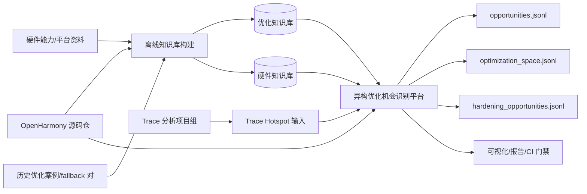
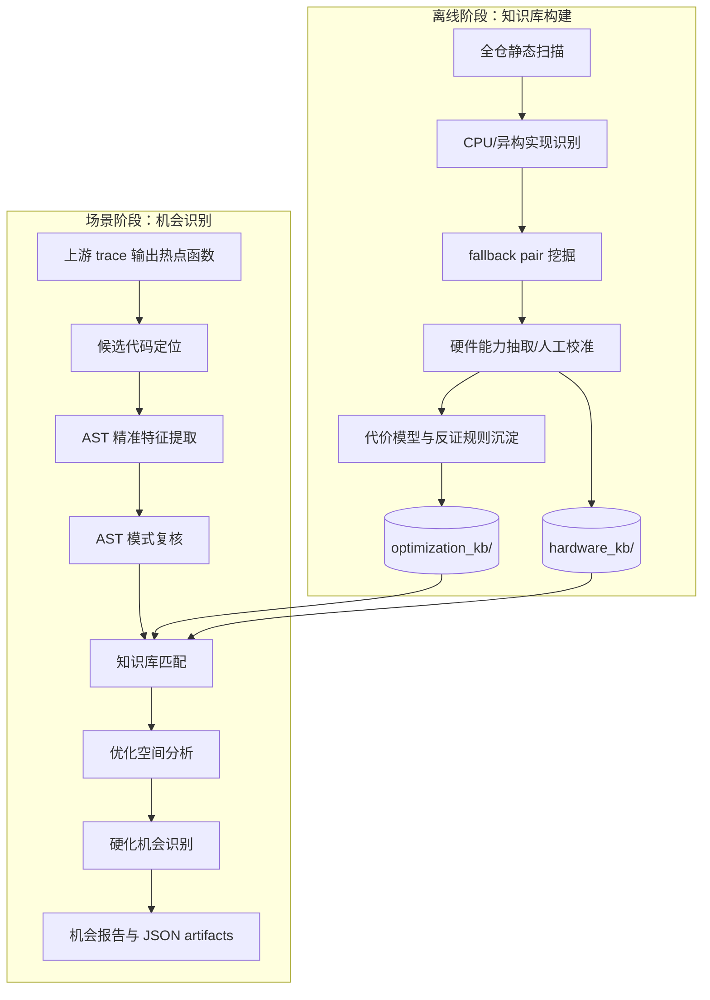
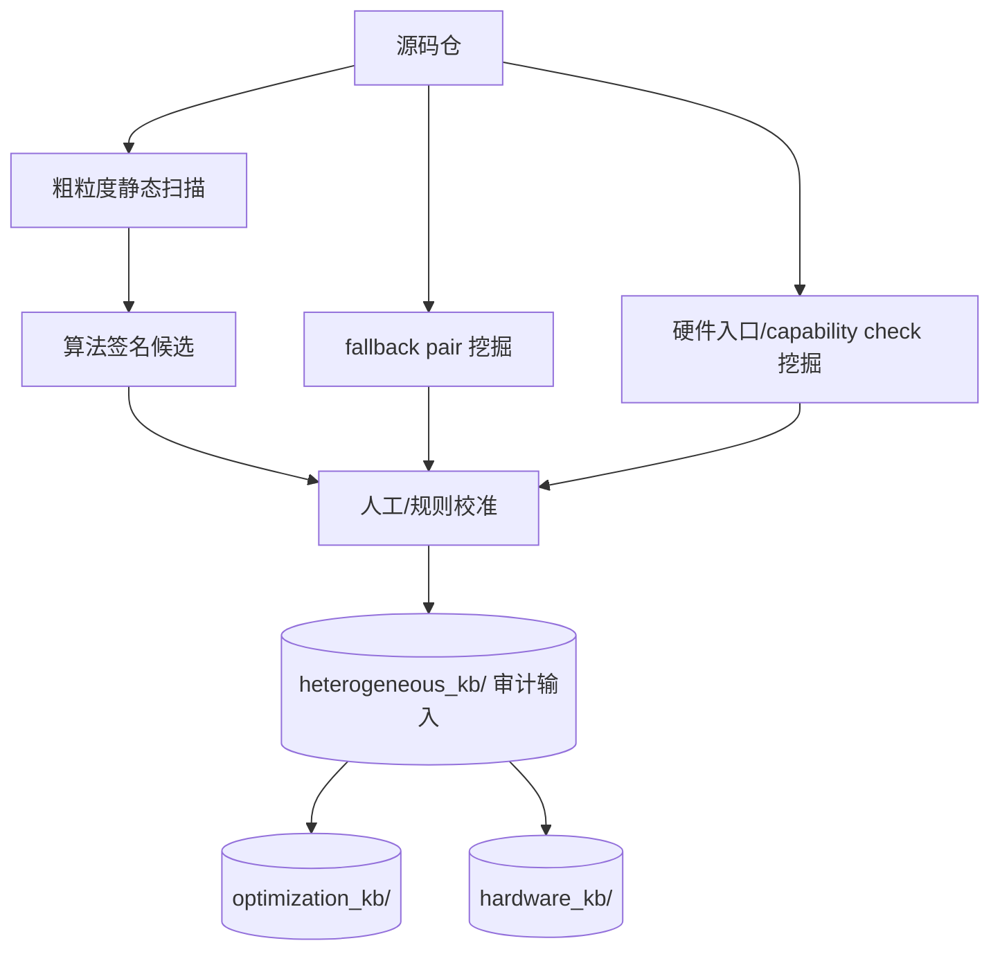
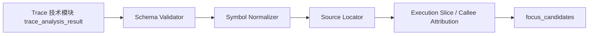
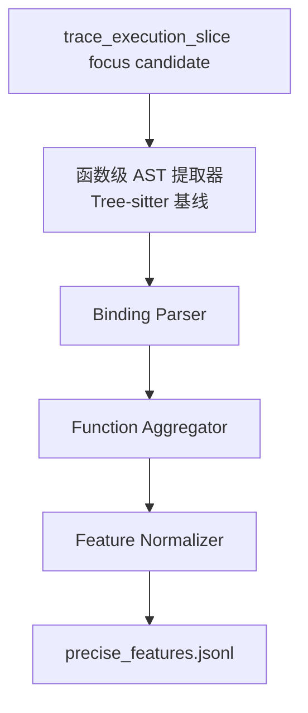
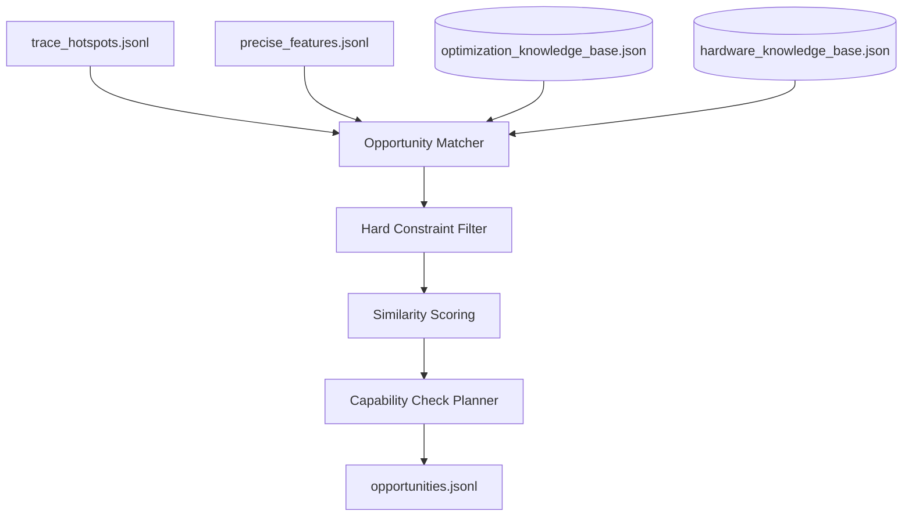
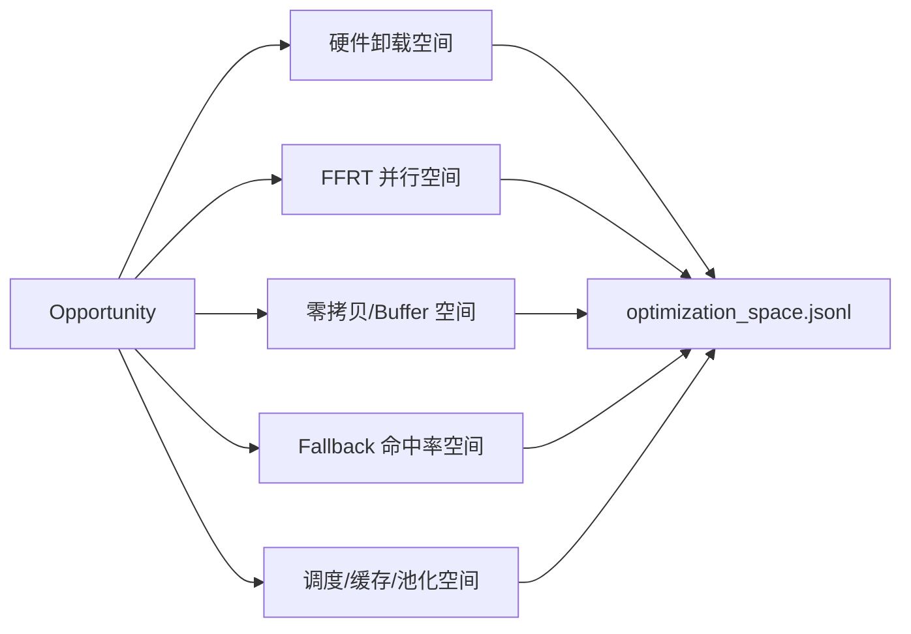
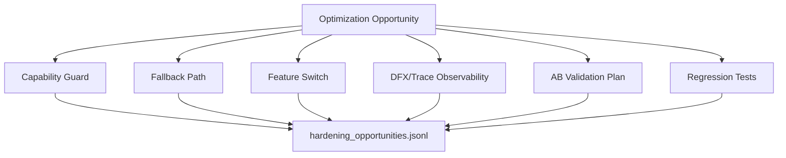
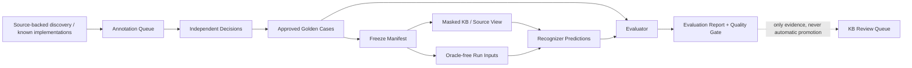

# 异构优化知识库与机会识别引擎 Spec

> 文档状态：Draft v0.1  
> 适用范围：OpenHarmony 大规模源码与场景 trace 驱动的异构优化机会识别  
> 项目定位：本项目管理彼此独立的优化知识库、硬件知识库、源码静态特征和机会匹配引擎；trace 聚类、热点与关键路径技术以 `trace_analysis_technology_spec.md` 为准。本引擎只消费其统一的 `trace_analysis_result`：它可以来自 Trace 团队报告，也可以来自受限的 raw `.htrace` 基础分析，但两者的 evidence grade 不得混同。
> 共同契约：artifact envelope、source binding、状态机、knowledge case 与 API 兼容规则以 `cross_spec_contract.md` 为准。

---

## 1. 背景与目标

OpenHarmony 代码仓中已经存在大量 CPU fallback、GPU/NPU/Codec/HPAE/AAE/Hianimation/HWC 等异构路径，以及 FFRT 并行化实践。当前问题不是“是否存在优化机会”，而是如何以工业级方式持续回答：

1. 哪些 CPU 热点值得优化？
2. 它们在代码语义上属于什么算法或执行模式？
3. 仓库里是否已有相同或类似异构实现可复用？
4. 目标硬件是否支持当前输入约束？
5. 数据搬运、同步、format 转换是否会抵消收益？
6. 最终应输出硬件卸载、FFRT 并行、零拷贝、fallback 修复还是工程硬化建议？

本项目目标是建设一个**知识库驱动、trace 约束、静态分析可解释**的异构优化机会识别平台。

### 1.1 项目目标

| 目标 | 说明 |
|---|---|
| 离线沉淀异构优化知识库 | 从源码、fallback 对、硬件能力、代价模型、已有实践中沉淀可复用知识 |
| 消费场景 trace 输出 | 接收统一 `trace_analysis_result`；Trace 团队可提供热点、critical path、调用链和场景指标，raw `.htrace` 仅提供受限的基础候选 |
| 精准代码语义分析 | 对热点代码做 AST 特征提取、模式复核、调用关系补充 |
| 识别异构优化机会 | 输出可解释、可排序、可验证的 opportunity JSONL |
| 分析优化空间 | 给出硬件卸载、并行化、零拷贝、调度、fallback 修复等优化空间 |
| 识别硬化机会 | 识别 capability check、fallback、DFX、开关、AB 验证、失败保护等工程硬化事项 |

### 1.2 非目标

| 非目标 | 说明 |
|---|---|
| 不负责原始 trace 采集或格式解析 | 采集由 trace 项目组完成；`.htrace` 转换与基础事实提取属于 Trace 技术模块，本引擎不直接解析二进制 |
| 不直接自动修改业务代码 | 本阶段只生成机会报告、优化空间和硬化建议；机会识别流水线本身应可无人值守地完成或以证据不足终态结束 |
| 不以大模型作为判定核心 | 核心判据必须来自确定性规则、结构化知识库和可复现分析 |

### 1.3 核心术语

| 术语 | 定义 | 边界 |
|---|---|---|
| dispatcher（分发函数） | 本平台定义的内部抽象：根据能力、输入约束、开关或执行状态，在异构实现与软件实现之间选择执行路径的函数或等价控制流片段。 | 不是 C++ 或 OpenHarmony 的保留概念；可以是一个函数、lambda，或调用链中的控制节点。 |
| hw_impl | 实际调用 GPU/NPU/Codec/AAE 等异构单元的实现入口。 | 仅有名称含 `gpu`/`npu` 不足以证明其为硬件实现，必须保留 AST/调用链证据。 |
| cpu_impl | 与 hw_impl 语义等价或可接受降级的软件/CPU 实现。 | 可以是直接函数、软件路径，或已知的 CPU/GPU 非专用实现。 |
| fallback pair | 由 dispatcher、hw_impl、fallback_impl、分发条件、硬件失败后的回退条件组成的可追溯关系。 | 不是简单的“两个相似函数”配对；fallback 可以是 CPU、GPU 或其他软件路径。 |
| fallback_execution_domain | fallback_impl 的执行域：`cpu`、`software`、`gpu`、`heterogeneous` 或 `unknown`。 | `cpu_impl` 保留为兼容字段；新记录以 fallback_impl 为语义主字段。 |
| capability check | 对 format、shape、buffer、alignment、设备状态等可否进入硬件路径的判定。 | 与硬件执行失败后的 status fallback 分开记录。 |
| failure reason | 导致未走硬件路径或硬件执行失败后转入软件路径的可归类原因。 | 供命中率统计、硬化建议和知识库回流使用。 |

---

## 2. 总体架构

### 2.1 系统上下文



### 2.2 核心流水线



---

## 3. 数据分层与 Artifact

本项目必须区分**优化知识库**、**硬件知识库**和**异构优化机会结果**。三者不能写在同一个 JSON 文件里：优化知识库描述代码/算法/fallback 模式，硬件知识库描述源码集成单元和设备证据边界，机会结果只描述当前场景。

### 3.1 正式可消费知识库 Artifact

正式运行时只消费下列两个**顶层** artifact；硬件知识库可携带有独立 hash 的 API 子知识库。`heterogeneous_kb/` 中的旧文件是构建输入和审计链，不能被当成一个未分层的运行时知识库。

| Artifact | 当前 development 基线 | 职责 | 明确不证明 |
|---|---:|---|---|
| `tools/optimization_kb/optimization_knowledge_base.json` | 57 条记录，其中 40 条严格用户态/三方库异构实现 + CPU/software fallback 案例 | 优化规则、算法/硬件映射、代价与 fallback 语义、CPU AST profile、`cpu_code_feature_summary/v1` 和严格案例证据 | 设备是否存在/启用目标单元、格式支持、性能或功耗收益 |
| `tools/hardware_kb/hardware_knowledge_base.json` | 22 条记录，其中 11 个严格案例聚合单元、11 条来源能力记录 | 源码集成路径、软件接口、约束、关联严格案例和设备证据门禁 | 当前设备 SKU、驱动/API 可用性、吞吐/时延/功耗 |
| `tools/hardware_kb/npu_api_knowledge_base.json`（硬件 KB 子 artifact） | 146 条记录：108 个 NNRT 图算子 + 38 个公开 NPU/NNRT/MindSpore 入口 | 在硬件单元路由选择 NPU 后，将热点代码静态语义检索为 Top-N NNRT 图算子/API 候选，提供源码注释、shape/dtype 约束、构图路径与验证协议 | 当前 NPU 是否暴露、任一算子/shape/dtype/layout 是否支持、模型是否能编译、收益是否为正 |
| `tools/hardware_kb/gpu_api_knowledge_base.json`（硬件 KB 子 artifact） | 18 条 GPU API/系统集成入口 | 在路由选择 GPU 后，将图像/像素/texture/compute 正向信号检索为 Vulkan/OpenGL ES 或当前系统图像路径候选，并保留公开性和传输/同步门禁 | 当前驱动、context、extension、format、shader、NativeBuffer/DMA 互操作和收益 |
| `tools/hardware_kb/dsp_api_knowledge_base.json`（硬件 KB 子 artifact） | 9 条 Audio Effect HDI/VDI、系统回退和高层控制入口 | 在路由选择 DSP 后，将 PCM/sample/frame 与 effect 语义检索为 DSP/HDI 或 AP fallback 对照路径，并区分 HDI 合同与应用 API | 当前 provider、DSP offload、采样格式、实时性、权限和收益 |
| `tools/hardware_kb/media_accelerator_api_knowledge_base.json`（硬件 KB 子 artifact） | 31 条公开 AVCodec、HCodec Codec Component HDI、JPEG/HEIF Image Codec HDI 与系统集成入口 | 在路由选择媒体后，将视频 codec、JPEG/HEIF 图像编解码和 HCodec/Component HDI 形态检索为媒体硬件候选，并显式区分 NDK、系统集成、驱动合同与 CPU/software fallback | 当前 MIME/profile/size/format/surface、ICodecImage/Component 服务、driver、buffer/allocator、色彩空间、资源和收益 |

优化知识库的 40 条严格案例固定由 `v21_user_space=17`、`v37_audio_dsp=1`、`v38_mindspore=22` 组成；禁止混入 40 条 kernel device-offload pair 或待验证候选。每个 strict case 必须同时保留 source-confirmed 审查、CPU/software fallback、函数级 AST profile 与 `target_unit`。硬件知识库必须为每个 `target_unit` 提供引用记录，但所有记录保持 `device_availability=evidence_required`，直到导入目标设备 probe。

两个顶层 artifact 都有独立 `kb_id`、`kb_version`、`content_sha256` 和 `input_provenance`。每个 `analysis_run`、`kb_match_result` 和模型 `reasoning_context_pack` 必须分别绑定 `optimization_kb` 与 `hardware_kb` 元数据，不能只存一个泛化的 KB version；当硬件策略使用 NPU API 检索时，还必须绑定 `npu_api_kb` 的独立 metadata；使用 GPU/DSP/媒体目录时必须按单元绑定 `accelerator_api_kbs.{gpu,dsp,media}` metadata。API 枚举、系统源码路径、HDI/VDI 合同或 internal delegate 代码出现不能视为 device binding 或应用侧可调用性。

Hardware-KB 的生产路径采用两阶段模型优先漏斗，不能把所有 API 子知识库拼接成一个大 prompt：`可见代码/硬件中立画像/候选作用域/Trace 时间指标 + 平台能力卡 + 当前自建目录能力卡 -> hardware-semantic-routing -> 模型选择的精确目录 -> 该目录 API Top-N -> 语义与运行时门禁精核`。平台目录使用 `npu|gpu|dsp|media`，每份自建库使用独立 `custom:<kb_id>`；同名目录不得合并。生产路由不执行 `hardware-unit-routing`，模型也不接收规则结果、trace 名、模块名、源码路径、额外函数提示或完整 API 目录；确定性规则只保留为显式离线对照。没有模型目录候选或没有 API 语义相容候选时不扫描其他目录，结果保持证据不足或转入 CPU 并行/算法分析。每次 `reasoning_context_pack` 必须保存 `hardware_routing` 的模型方法、状态、候选目录、evidence ID、代码依据、模型语义画像和 Top-N 上限；选中自建目录时还必须绑定库 `content_sha256`，以保证模型上下文、审计和回归均可复现。

### 3.1.1 构建源层与审计输入

目录：`data/knowledge-bases/patterns/`。该目录是正式 artifact 的构建输入与审计链。

| 文件 | 类型 | 生命周期 | 职责 |
|---|---|---|---|
| `code_signature_patterns.json` | 知识库 | 长期维护 | 静态代码特征到算法语义的映射 |
| `algorithm_hardware_mapping.json` | 知识库 | 长期维护 | 算法语义到目标异构单元的映射 |
| `hardware_capabilities.json` | 知识库 | 长期维护 | 硬件能力、入口、capability check、buffer/format/shape 约束 |
| `cost_models.json` | 知识库 | 长期维护 | 数据搬运、同步、format 转换、调度开销等代价模型 |
| `fallback_pairs.json` | 知识库 | 持续增量 | 已有 CPU/HW fallback 对、分发函数、失败原因 |
| `existing_heterogeneous_implementation_cases.json` | 知识库事实层 | 持续增量 | 已在源码中实现的异构执行、调度、数据通路与 fallback 组件；每条绑定精确源码锚点和文件 hash |
| `discovered_implementation_case_inventory.json` | 构建审计 artifact | 每次实现事实层刷新 | AST 规则生成的生产源码路径 inventory、规则 hash、函数范围和调用行；不是机会候选或额外 KB 层 |
| `runtime_hotspot_rules.json` | 知识库 | 持续校准 | 场景 trace 热点判据和优先级规则 |
| `knowledge_case_catalog.json` | 案例发现库 | 持续增量 | 源码/trace 发现的 candidate case、假设、缺失证据和晋级链接；不属于正式 KB 层 |
| `kb_manifest.json` | 知识库发布清单 | 每次建库生成 | KB 版本、源码 revision、责任团队、各层记录数和内容 hash |
| `kb_readiness_report.json` | 发布治理 artifact | CI/发布前生成 | development/release 就绪状态、未确认知识清单和明确阻塞原因 |
| `fallback_scan_quality_report.json` | 扫描质量 artifact | 每次全仓/增量扫描后生成 | 绑定 scan manifest 的解析覆盖、失败样本、模块统计与策略门禁结论 |
| `heterogeneous_evaluation_policy.json` | 评测策略 | 版本化维护 | 最小样本/类别覆盖、双人标注、Recall@K、误报和证据升级门禁 |
| `heterogeneous_evaluation_manifest.json` | 评测冻结 artifact | 每次 benchmark run | 单一 source snapshot、KB manifest、detector/policy version、case hash 与泄漏排除项；evaluator-side，不可直接给 Agent/recognizer |
| `heterogeneous_evaluation_run_inputs.jsonl` | 识别器受限输入 | 每次 benchmark run | 仅包含 source/tasks、manifest ID 与 opaque case hash；绝不含 oracle、leakage guard 或 benchmark role |
| `heterogeneous_evaluation_report.json` | 评测结果 artifact | 每次 benchmark run | 分类、检索、负例、防过度升级、置信度和质量门禁结果；不写回 KB |

建库候选必须先以独立 artifact 留存，不能绕过审核直接写入 KB：

| 文件 | 类型 | 职责 |
|---|---|---|
| `fallback_pair_candidates.jsonl` | 候选证据 | AST 提取的 dispatcher/hw/fallback 控制流候选 |
| `fallback_scan_inventory.jsonl` | 扫描审计 | 每个扫描文件的 SHA-256、解析状态及候选数量，可与 manifest 独立核验 |
| `fallback_scan_manifest.json` | 扫描审计 | 扫描源文件 inventory hash、解析状态分布、候选内容 hash 与 extractor/revision 配置 |
| `code_signature_candidates.jsonl` | 候选证据 | 由 fallback 锚定的函数 AST 特征、source hash 与候选 provenance |
| `fallback_pair_review_queue.jsonl` | 审核队列 | 去重后的 fallback 候选、控制流证据、关联签名候选与必填审核项 |
| `fallback_pair_review_decisions.jsonl` | 人工审核输入 | 绑定 review item hash、审核人、审核时间与批准/拒绝结论；批准项包含完整 fallback pair |
| `heterogeneous_benchmark_samples.jsonl` | 实验输入 | CPU、硬件、搬运和同步时间及 workload/device/revision 证据 |
| `cost_model_candidates.jsonl` | 候选证据 | 在同一 device、source revision 和精确 workload 内聚合的净硬件耗时、speedup 与待审核代价模型结论 |
| `heterogeneous_evaluation_annotation_queue.json` | 待标注队列 | 从 source-backed discovery lead 分层抽样的真实源码候选；明确不是 oracle，不能参与指标 |
| `heterogeneous_evaluation_annotation_decisions.jsonl` | 外部标注输入 | 两名独立 reviewer 的分类、约束/成本证据、source snapshot 与泄漏边界声明 |
| `heterogeneous_evaluation_cases.jsonl` | Golden / holdout 输入 | 仅由批准决定物化的可评分案例；与 KB build input 永久隔离 |
| `heterogeneous_evaluation_run_inputs.jsonl` | Recognizer 输入 | 从 frozen golden case 导出的无 oracle 视图；Agent/模型仅可消费该 artifact |
| `heterogeneous_evaluation_predictions.jsonl` | 识别器输出 | 每条绑定 frozen manifest ID、case SHA、分类、置信度和 Top-K mapping/target |

### 3.2 场景输出 Artifact

| 文件 | 类型 | 生命周期 | 职责 |
|---|---|---|---|
| `trace_hotspots.jsonl` | 上游输入 | 每次场景分析生成 | trace 项目组输出的热点函数和 critical path |
| `precise_features.jsonl` | 中间产物 | 可缓存 | AST 精准特征 |
| `validated_patterns.jsonl` | 中间产物 | 可缓存 | AST 模式复核结果 |
| `opportunities.jsonl` | 本项目输出 | 每次场景分析生成 | 异构优化机会 |
| `optimization_space.jsonl` | 本项目输出 | 每次场景分析生成 | 优化空间和收益/风险分析 |
| `hardening_opportunities.jsonl` | 本项目输出 | 每次场景分析生成 | 工程硬化机会 |

### 3.3 知识库生命周期与发布级别

知识库有两种明确的消费级别，不能用开发样例替代生产事实。

| 级别 | 允许内容 | 必须满足的门禁 | 使用范围 |
|---|---|---|---|
| development | `workspace-unpinned` 源码、`candidate`/`unverified` 候选和未分配责任团队 | 全层结构、引用、hash 一致性校验通过；所有非确认记录产生 warning | 提取器开发、规则试验、离线评审 |
| release | 固定源码 revision、明确 owner、已确认知识 | `validate_heterogeneous_kb.py --strict` 通过；所有 fallback 为 `confirmed` | CI 基线、场景机会报告、趋势比较 |

`kb_manifest.json` 由 `build_heterogeneous_kb.py` 生成，不含生成时间，因此相同层内容、版本、revision 和 owner 会得到相同 manifest。多仓源码应通过 `--source-snapshot` 嵌入经验证的 snapshot，并令 `source_revision` 等于其 `snapshot_id`；strict/release 还要求 snapshot clean。任何层文件改动都会导致 hash 校验失败，必须重新建库并递增 KB 版本。正式消费层还必须执行 `build_separated_knowledge_bases.py --check`：它重新生成优化知识库与硬件知识库，并校验输入 provenance、40 条严格案例闭包、无 kernel 泄漏和 target-unit 引用闭包。

所有层内记录还必须有 `provenance`：`origin`（源码、硬件资料、benchmark、人工评审或种子样例）、`confidence`（candidate/confirmed/unverified）和可定位的 `references`。`origin=source_code` 且 `confidence=confirmed` 的记录还必须携带 `file_sha256`，绑定每个引用源码文件的审核内容。机会输出必须透传所依赖的知识 provenance，并以 `knowledge_readiness` 标记 `development_only` 或 `release`；下游不得将前者用作 CI 或量产决策依据。

### 3.4 已有异构实现案例层

`existing_heterogeneous_implementation_cases.json` 是正式的**实现事实层**，与 `knowledge_case_catalog.json` 的待验证发现候选严格分离。它记录代码仓中已经存在的异构路径，用于让识别器说明“该模式已在仓内使能，可复用其调度、数据通路、能力检查或 fallback 设计”，而不是把已有实现重新报告成新机会。

每条记录由受控 inventory 经提取器生成，提取器实际验证 `source_anchors`、`evidence_markers`、源码行号和当前文件 SHA-256。核心字段包括：`case_scope`（端到端、分发、执行或数据通路组件）、`implementation_kind`、`execution_roles`、`constraints`、`fallback`、`source_anchors` 与 `provenance`。除人工锚定种子外，`implementation_path_discovery_rules.json` 会对生产 C++ 源码执行 AST 函数级扫描：证据 marker 必须位于函数体代码区域，不允许从注释、字符串、test、sample 或 fuzz 文件生成事实。自动记录还携带 `implementation_family`、规则 SHA、函数起止行和具体调用行。实现案例可作为知识库匹配的解释和评测待标注来源，但**不单独证明**目标设备实际可用、性能收益、数值正确性或当前场景值得迁移；这些结论仍分别需要 hardware capability、benchmark 与场景证据。

源码经常修改时不要求提交 Git revision。开发模式使用 `source_revision=workspace-unpinned`，但每条事实记录仍绑定生成时的精确文件 hash；变更相关源码后，应重新提取并重建 manifest：

```bash
python3 docs_ffrt/tools/build_existing_heterogeneous_implementation_cases.py \
  --curated-inventory docs_ffrt/tools/implementation_case_inventory.json \
  --rules docs_ffrt/tools/implementation_path_discovery_rules.json \
  --source-root . \
  --out data/knowledge-bases/patterns/existing_heterogeneous_implementation_cases.json \
  --out-discovery-inventory data/knowledge-bases/patterns/discovered_implementation_case_inventory.json

python3 docs_ffrt/tools/build_heterogeneous_kb.py \
  --kb data/knowledge-bases/patterns \
  --kb-version <next-version> \
  --source-revision workspace-unpinned \
  --owner-team <team> \
  --source-root .
```

30 个或更多源码发现 case 必须写入 `knowledge_case_catalog.json`，并遵循共同契约的 candidate 生命周期；它们不能因为数量目标而直接新增 hardware capability、algorithm mapping 或 cost model 的 confirmed 结论。

对于 `origin=source_code` 且 `confidence=confirmed` 的记录，`references` 必须使用 `<workspace-relative-path>:<line>`，`file_sha256` 的 key 必须恰好覆盖这些引用的文件；KB validator 会实际检查文件、行号和内容哈希，不能只填看似合理的字符串。

---

## 4. 输入输出数据契约

### 4.1 上游 Trace 输入

Trace 技术模块输出共同契约定义的 `trace_analysis_result`；本引擎只接受其中已选定/自动分诊选定的 cluster，或已选定/自动分诊选定的 trace-wide hotspot discovery event 的结构化热点。输入来源可以是 Trace 团队的外部分析报告，或 raw `.htrace` 适配器生成的基础候选，但 raw 输入必须先完成 `raw_trace_input -> htrace_conversion -> trace_analysis_result` 证据链，不能把二进制 trace 或转换 SQLite DB 直接送入 AST/KB 流程。旧 `trace_hotspots.jsonl` 是兼容输入，不得绕过 source binding、event selection 与 evidence gate。

| trace evidence grade | 引擎行为 |
|---|---|
| 上游显式 critical path / 场景 profile | 可参与时间局部性和关键路径门禁；仍要求 exact source binding 和已选 cluster。 |
| `raw_htrace` 基础 span / scheduler candidate / event self-time estimate | 可用于分诊、按 trace tag/context 模块筛选候选、选择 cluster 或 trace-wide discovery event、展示 unresolved 与收集补充证据；没有 source location、critical-path 或 profile 证据时不得自动提升为异构机会。`event_self_time` 是 direct-child instrumentation-span estimate，不是 CPU self-time；其 ArkUI/Render/FFRT 等模块标签不是源码 ownership 或 source binding。 |
| `experimental` `.sys` candidate | 仅开发验证，不进入生产或 release 机会排序。 |

对 raw `.htrace`，cluster 是时间窗，event 才是可能关联代码的对象；trace-wide discovery 也同样只产生 event candidate，不能绕过选择、定位和证据门禁。引擎接收带 `catalog_scope.kind=cluster_overlap` 或 `catalog_scope.kind=trace_hotspot_discovery` 的 `trace_event_catalog` 和可选 `trace_event_source_resolution` 时，必须保留下列来源状态，且不能把文本匹配升级为 trace-source binding：

| event source-resolution state | 可做的事 | 不可做的事 |
|---|---|---|
| `declared_source` + `exact` binding | 生成受 binding 约束的 `trace_hotspot`，进入 AST 队列。 | 忽略 source revision/文件 hash 漂移。 |
| `symbol_text_candidate` | 展示候选定义/声明文本、输出 `evidence_required`。 | 生成 `hot_files.txt`、运行 AST、写 KB match 或机会排序。 |
| `symbol_text_reference` | 展示引用代码块，帮助诊断 caller/callee。 | 把引用位置当作实现、热点位置或 source map。 |
| `instrumentation_point_exact` + `exact` binding | 生成精确 trace anchor、计时范围与局部执行切片；仅在切片证据完整时进入 AST/KB。 | 把 label/tag 协议匹配当作 source binding，或将外层函数整体当作热点代码。 |
| `instrumentation_point_function_derived` + `exact` binding | 展示 `__func__` / `__PRETTY_FUNCTION__` 桩、函数标识和 tag match，并生成受同样门禁约束的执行切片。 | 把编译器派生 label 当作唯一 source map，或在无切片/归因证据时作为高置信度机会排序输入。 |
| `instrumentation_point_pattern` / `instrumentation_point_candidate` | 展示 format/prefix 或不完整验证的插桩证据，输出 `evidence_required`。 | 认定动态 label 唯一对应函数，或作为 opportunity 排序输入。 |
| `unresolved` | 归档原因并继续处理其他 event。 | 静默丢弃、猜测文件/行号或阻塞整批 run。 |

```text
trace cluster -> in-window Top Event --+
trace hotspot discovery -> ranked Event -+-> source-resolution artifact
  -> exact source binding + trace-evidence gate -> execution slice / callee attribution
  -> AST(feature for focus candidate) -> KB -> opportunity
  -> otherwise terminal evidence_required / unresolved / not_heterogeneous_candidate
```

人工在 Explorer 中选择 cluster/event 只是一种审计入口。无人值守 run 必须通过版本化 `trace-auto-triage` policy 生成同等的 selection artifact（候选排名、规则版本、排除理由、输入 hash），再进入上述门禁；它不能以“未人工选择”为理由阻塞，也不能为了连续运行而接受 candidate/reference 文本定位。

```json
{
  "artifact_type": "trace_hotspot",
  "schema_version": "1.0",
  "scenario": {
    "name": "launcher_app_switch",
    "trace_id": "2026-07-15-001",
    "device": "kirin_xxx",
    "build": "openharmony_xxx",
    "source_revision": "<immutable-source-revision>"
  },
  "hotspot_id": "hs_0001",
  "symbol": "RSRenderKawaseBlurFilter::DrawBlur",
  "file": "openharmony/foundation/graphic/graphic_2d/...",
  "line": 145,
  "process": "render_service",
  "thread": "RenderThread",
  "metrics": {
    "wall_time_ms": 12.4,
    "cpu_time_ms": 11.8,
    "self_time_ms": 8.1,
    "call_count": 42,
    "frame_miss_count": 3
  },
  "critical_path": {
    "is_critical": true,
    "path_id": "frame_239",
    "stage": "render",
    "predecessors": ["BuildDisplayList"],
    "successors": ["GPU submit"]
  }
}
```

### 4.1.1 Trace 执行切片与调用归因

`ast_target` 解决的是“marker 在哪个函数中”，不是“函数中哪段代码耗时”或“哪个 callee 耗时”。引擎必须把它视为容器，并按以下顺序收窄：

```text
精确 marker
  -> 识别计时语义（RAII 词法范围 / start-end pair / async correlation / 非 duration event）
  -> AST + CFG 提取 marker 所在局部语句块、分支条件和数据依赖
  -> 枚举局部块内的 direct/indirect callsite，并用 USR 解析可达定义
  -> 结合 span、CPU sample 或 critical-path edge 归因
  -> local_slice 或 callee 作为 focus candidate
```

解析器必须先从带 header SHA 的 `trace_api_semantics` 表确认宏/API 展开链和生命周期规则，再计算范围。例如当前 `OHOS_HITRACE(...)` 展开为 `HITRACE_METER_NAME_EX(...)`，后者创建 `HitraceScopedEx`，其构造/析构分别调用 Start/Finish；因此它属于 scoped RAII。该表与 tag catalog 一样版本化，并随源码 snapshot 记录。对于此类宏，范围应从宏行开始，到对应词法 block 的右花括号结束；若宏位于 `else`、循环或 lambda 内，控制条件和该 block 必须一并进入切片，但不得把同一函数的相邻分支、前置准备和后置收尾自动纳入。显式 Start/Finish 需要按 tag/correlation 和线程/进程规则配对；异步 span 需要 trace correlation；instant/counter event 没有可推导 duration scope，只能作为定位证据。

```json
{
  "artifact_type": "trace_execution_slice",
  "schema_version": "1.0",
  "source_resolution_artifact_id": "art_source_resolution",
  "anchor": {"path": "openharmony/.../js_thread.cpp", "line": 564, "kind": "hitrace_instrumentation"},
  "measurement_scope": {
    "kind": "scoped_raii",
    "start_line": 564,
    "end_line": 584,
    "semantics_evidence": ["OHOS_HITRACE expands to a scoped HiTrace object"]
  },
  "ast_container": {"function": "JSThread::Iterate", "start_line": 540, "end_line": 599},
  "local_slice": {
    "kind": "compound_statement",
    "start_line": 563,
    "end_line": 584,
    "control_context": ["visitType != GlobalVisitType::YOUNG_GLOBAL_VISIT"],
    "statement_ranges": [[564, 584]]
  },
  "calls": [
    {"line": 576, "resolution": "direct", "callee_usr": "...", "definition": {"path": "...", "line": 0}}
  ],
  "dynamic_attribution": {"quality": "static_only", "unattributed_ms": null},
  "focus_candidates": [{"kind": "local_slice", "attribution_quality": "static_only", "score": 0.0}]
}
```

原始 `.htrace` 的嵌套 span 只可辅助拆分 instrumentation inclusive/self 范围。要把热点从局部块继续归因至具体 callee，Trace 团队输入至少应提供以下之一：可关联的 parent/correlation span、CPU sample stack（含 IP-symbol mapping）、或带节点/边的 critical path。没有这些证据，系统应展示“子调用待归因”，而不是把静态调用图中的任一函数写成热点。

### 4.2 AST 精准特征输出

由 `precise_feature_extractor_cq.py` / `precise_feature_extractor.py` 生成。

```json
{
  "artifact_type": "code_feature",
  "schema_version": "1.0",
  "execution_slice_artifact_id": "art_execution_slice",
  "analysis_scope": "local_slice",
  "file": "docs_ffrt/tools/test_blur.cpp",
  "container_function": "CpuGaussianBlur",
  "function": "CpuGaussianBlur",
  "signature": "void CpuGaussianBlur(...)",
  "loops": [
    {"type": "for", "depth": 2, "condition": "k <= radius"}
  ],
  "memory_accesses": [
    {"kind": "array_subscript", "base": "src", "index": "y * width + sx", "stride_hint": "row_major_2d"}
  ],
  "operators": ["*", "+", "+="],
  "operation_hints": ["mac"],
  "types_used": ["float", "int"],
  "branch_count": 4
}
```

### 4.3 异构优化机会输出

```json
{
  "artifact_type": "heterogeneous_opportunity",
  "schema_version": "1.0",
  "hotspot_id": "hs_0001",
  "query_file": "docs_ffrt/tools/test_blur.cpp",
  "query_function": "CpuGaussianBlur",
  "matches": [
    {
      "knowledge_base_pattern_id": "map_image_blur_to_gpu_shader",
      "source_layers": {
        "code_signature_pattern_id": "code_sig_image_blur_2d",
        "algorithm": "image_blur",
        "mapping_id": "map_image_blur_to_gpu_shader",
        "hardware_id": "GPU_SHADER",
        "cost_model_id": "gpu_image_filter_cost",
        "fallback_pair_ids": []
      },
      "target_unit": "GPU_SHADER",
      "confidence": 0.6263,
      "knowledge_readiness": "release",
      "capability_constraints": {
        "shape": "2D_image",
        "max_radius": 50,
        "buffer_requirements": ["GPU texture", "SurfaceBuffer preferred"]
      },
      "recommendation": "Verify input format, radius, buffer type, and copy cost before implementation."
    }
  ]
}
```

### 4.4 优化空间输出

```json
{
  "artifact_type": "optimization_space",
  "schema_version": "1.0",
  "hotspot_id": "hs_0001",
  "function": "CpuGaussianBlur",
  "spaces": [
    {
      "space_type": "hardware_offload",
      "target": "GPU_SHADER",
      "benefit_drivers": ["2D data parallel", "neighbor access", "frame critical path"],
      "risk_drivers": ["branch clamp", "CPU-GPU copy", "format convert"],
      "required_checks": ["input buffer type", "radius range", "zero-copy availability"],
      "priority": "P1"
    },
    {
      "space_type": "ffrt_parallelization",
      "target": "FFRT",
      "benefit_drivers": ["two-pass separable blur", "independent rows"],
      "risk_drivers": ["small image overhead", "synchronization cost"],
      "priority": "P2"
    }
  ]
}
```

### 4.5 硬化机会输出

“硬化机会”指让异构优化具备量产可控性的工程化事项，包括开关、fallback、DFX、失败保护、AB 验证、能力检查补齐等。

```json
{
  "artifact_type": "hardening_opportunity",
  "schema_version": "1.0",
  "hotspot_id": "hs_0001",
  "items": [
    {
      "hardening_type": "capability_guard",
      "description": "Add explicit radius/format/buffer capability check before GPU shader path.",
      "severity": "must"
    },
    {
      "hardening_type": "fallback_path",
      "description": "Keep CPU blur fallback and record fallback reason.",
      "severity": "must"
    },
    {
      "hardening_type": "dfx_observability",
      "description": "Trace GPU path hit rate, fallback reason, copy cost, and shader execution time.",
      "severity": "should"
    }
  ]
}
```

### 4.6 Fallback Pair 知识库记录

`fallback_pairs.json` 是离线知识库，不是一次场景的机会输出。每条记录应同时描述路径选择和回退语义，`dispatcher` 是平台内部术语，表示该选择逻辑的归属函数或控制节点。

```json
{
  "pair_id": "jpeg_sw_hw_decode_pair",
  "category": "fallback_pair",
  "algorithm": "jpeg_decode",
  "target_unit": "JPEG_HW_DECODER",
  "cpu_impl": "JpegDecoder::DoSwDecode",
  "fallback_impl": "JpegDecoder::DoSwDecode",
  "fallback_execution_domain": "cpu",
  "hw_impl": "JpegHardwareDecoder::Decode",
  "dispatcher": "JpegDecoder::Decode",
  "dispatcher_type": "capability_guard_with_status_fallback",
  "dispatch_conditions": [
    {"kind": "format", "expression": "IsHardwareFormatSupported(format)"}
  ],
  "fallback_conditions": [
    {"kind": "status_failure", "expression": "Decode(...) != OK"}
  ],
  "failure_reasons": ["format_not_supported", "hardware_decoder_null"],
  "fallback_guarantee": "required",
  "evidence": {"origin": "ast_extractor", "confidence": "confirmed"}
}
```

`dispatcher_type` 取值至少覆盖 `capability_guard`、`status_fallback`、`capability_guard_with_status_fallback`、`feature_switch` 和 `unknown`。自动挖掘只能产出候选记录；只有带源码位置、AST 控制流证据或人工确认的记录才可作为 `confirmed` 知识进入生产知识库。

候选晋级流程固定为：`fallback_pair_candidate JSONL` -> 去重与同名实现归并 -> 源码/调用链复核 -> 补齐 algorithm、target_unit、failure_reasons -> 人工确认 `evidence.confidence=confirmed` -> `validate_heterogeneous_kb.py --strict` 通过 -> 合入 `fallback_pairs.json`。严禁把挖掘器的 `candidate` 记录直接合入生产 KB。

---

## 5. 模块设计

### 5.1 知识库提取模块

**职责**：离线扫描源码，构建和更新分层知识库。



| 子模块 | 输入 | 输出 | 关键规则 |
|---|---|---|---|
| Code Signature Extractor | C/C++ 源码 | `code_signature_patterns.json` 候选 | 循环、访存、类型、操作、领域词；异构关键词仅来自 AST 标识符，不从注释/字符串/子串猜测 |
| Fallback Pair Extractor | 源码 | `fallback_pair_candidates.jsonl` | 提取 dispatcher、分发条件、hw/fallback 调用、status/null-result fallback 与源码证据；经复核后才晋级 `fallback_pairs.json` |
| Hardware Capability Extractor | 源码/资料 | `hardware_capabilities.json` 构建输入，随后聚合为 `hardware_knowledge_base.json` | entry point、format、size、buffer、alignment；不得推断设备可用性 |
| Cost Model Curator | 经验/实验 | `cost_models.json` | copy、sync、format convert、batch、zero-copy |
| Runtime Rule Curator | 历史 trace/专家规则 | `runtime_hotspot_rules.json` | critical path、call count、wall/cpu time 阈值 |

### 5.2 Trace 输入适配模块

**职责**：消费 Trace 技术模块的统一结果，转换为本项目兼容的 `trace_hotspots.jsonl`。raw `.htrace` 的 TraceStreamer 转换、schema probe 和基础候选提取归 `trace_analysis_technology_spec.md` 管理；本模块只读取已证据化的 `trace_analysis_result`。



| 能力 | 说明 |
|---|---|
| Schema 校验 | 缺少 hotspot_id、symbol、metrics、critical_path 时给出错误 |
| 符号归一化 | 处理 namespace、匿名 lambda、重载函数、demangle |
| 代码定位 | 消费上游声明的位置、已验证 source map，或 HiTrace 字面标签精确匹配 / 函数派生且 tag bits 已验证的插桩点；`symbol_text_*`、pattern/candidate 仍只是浏览证据，失败时标记 `source_unresolved` |
| 计时范围解析 | 对 scoped RAII、显式 pair、async 和 instant/counter 分别建模；词法范围、配对 key 或 correlation 不完整时停在 `evidence_required`，不能以函数结尾补全范围 |
| 局部切片与调用归因 | 以插桩点所在 block/CFG 为最小分析单位，保留分支和数据依赖；callee 仅在动态 span/sample/critical-path 证据可关联时晋级，否则标为未归因边界 |
| AST 输入生成 | 只有 `declared_source`、`instrumentation_point_exact` 或 `instrumentation_point_function_derived` 且具备 `exact` binding 的 event，及其 `focus_candidates`，才输出 AST 输入；函数派生点必须保留 `__func__` / `__PRETTY_FUNCTION__`、宏和 tag 验证证据 |

### 5.3 AST 特征提取模块

**职责**：对 `trace_execution_slice.focus_candidates` 做精准静态特征提取；外层函数仅提供编译上下文、符号容器与低置信度诊断回退。



| 设计点 | 说明 |
|---|---|
| 切片驱动 | 推荐通过 `--file-list` 与行/AST-node scope 只分析热点局部块或已归因 callee；不能把整函数特征直接冒充 marker 计时区特征 |
| AST 后端分级 | 当前可复现基线是 Tree-sitter C/C++ 的函数级 profile；当存在可靠编译参数且需要宏展开、类型、调用图或复杂语义验证时，才按候选启用 clang-query / libclang 增强。两者输出必须声明 backend、版本和解析质量，不能混写为同一置信度。 |
| 编译参数复用 | `compile_commands.json` 单次加载 |
| 目录过滤 | 默认跳过 `.llvm`、`.git`、`build`、`out`、`third_party` |
| 可并行 | `--jobs` 支持多文件并行，小规模验证后再放大 |
| 可缓存 | 按 `source_hash + extractor_config_hash + tool_version` 缓存；Clang 增强任务额外纳入 `clang_args_hash` |
| 调用图边界 | direct call 以 libclang USR + 定义位置解析；虚调用、函数指针、Binder/FFRT/GPU 边界保留 unresolved，直到有动态证据 |

### 5.4 异构优化机会识别模块

**职责**：融合 trace 热点、AST 特征、分层知识库，输出候选机会。



评分模型：

```text
OpportunityScore =
  RuntimeHotness
  * SemanticFit
  * HardwareAvailability
  * DataMovementBenefit
  * Confidence
  - RiskPenalty
```

| 维度 | 来源 | 示例 |
|---|---|---|
| RuntimeHotness | trace_hotspots | wall time、CPU time、critical path、call count |
| SemanticFit | AST 特征 + code signature KB | blur、resize、jpeg decode、GEMM |
| HardwareAvailability | hardware_capabilities | format、size、buffer、capability check |
| DataMovementBenefit | cost_models | zero-copy、copy、format convert、sync wait |
| RiskPenalty | hard constraints / negative factors | branch density、small input、global state、lock |

### 5.5 优化空间分析模块

**职责**：对每个机会给出可选优化方向，不只输出一个硬件目标。



| 优化空间 | 典型触发条件 |
|---|---|
| hardware_offload | 算法语义与硬件能力匹配，数据规模足够 |
| ffrt_parallelization | 任务或循环独立，硬件卸载成本不划算 |
| zero_copy | 数据搬运占比高，SurfaceBuffer/DMA 路径可复用 |
| fallback_fix | 已有硬件路径但 capability/fallback 失败频繁 |
| pipeline_overlap | 多阶段串行但存在重叠执行空间 |
| cache_pooling | 重复初始化、重复分配、重复编译模型 |

### 5.6 硬化机会识别模块

**职责**：识别从“可优化”到“可量产”之间缺失的工程保护。



| 硬化类型 | 必要性 |
|---|---|
| capability_guard | 防止 unsupported format/size/buffer 进入硬件路径 |
| fallback_path | 硬件失败时必须可回退 |
| feature_switch | 支持灰度、回滚、AB 对比 |
| dfx_observability | 统计命中率、失败原因、copy cost、硬件耗时 |
| validation_plan | 明确 AB trace、功耗、稳定性、画质/精度验证 |
| regression_tests | 覆盖支持/不支持能力、异常输入、fallback |

### 5.7 知识库与机会识别评测模块

**职责**：以独立、可复现且抗泄漏的 benchmark 验证两种不同能力：一是知识库是否能覆盖/解释已有异构实现，二是机会识别器能否从未使能的代码中正确区分 `optimization_opportunity`、`ineligible` 与 `evidence_required`。它不负责审核页面、KB 晋升或自动修改任何知识记录。



| 设计点 | 强制规则 |
|---|---|
| 任务分离 | `existing_heterogeneous_implementation` 评估 KB 提取/检索覆盖；它不是“新增优化机会”。`optimization_opportunity` 才是 opportunity precision/recall 的正例。 |
| 真值独立性 | 发现器、fallback 扫描和现有 KB 只能产生 annotation item；至少两名独立 reviewer 以源码、硬件/约束、benchmark/trace 证据批准后才能进入分母。 |
| 负例质量 | “当前未优化”不是天然负例；必须明确标注为 `optimization_opportunity`、`ineligible` 或 `evidence_required`。 |
| 数据泄漏 | `generalization` split 的每个 oracle mapping ID 必须排除，并排除同一实现族的其他 answer-bearing mapping/source anchor 和必要时源码文件，生成 `masked_kb`/`masked_kb_and_source`；完整仓运行只能记为 `in_repo_coverage`。识别器/Agent 只能消费 oracle-free run input，不能读取 golden case 或完整 manifest。 |
| 冻结与可复现 | 一个 manifest 只允许一个 source snapshot，并记录 KB manifest SHA、detector、policy ID/version/content hash、seed、case content SHA、Top-K 和 exclusions。case 或 prediction 漂移、重复、混入额外 case、policy 漂移或非本 manifest 派生的 analysis view 均拒绝评分。 |
| 指标 | 输出 4-class confusion matrix、macro-F1、new-opportunity precision/recall/F1、`ineligible` FPR、`evidence_required` unsafe-promotion rate、完整仓 `in_repo_coverage` 的 mapping Recall@K、脱敏 `generalization` 的 target Recall@K 和 confidence calibration。 |
| 小样本边界 | 首批 20 条是 smoke/regression baseline；未满足 policy 的最小样本、类别或算法族覆盖时终态为 `not_evaluable`，不可作为 KB 有效性的结论。 |

`evaluation_benchmark.py` 是该模块的 Phase A 离线执行器：它可从 `knowledge_case_catalog` 生成固定 seed 的 20 条真实源码待标注队列、物化批准 case、冻结 manifest、生成 development-only masked KB、检查泄漏并评分预测。评测 artifact 只允许形成 review evidence，禁止由 report 自动修改 `heterogeneous_kb/`、`knowledge_case_catalog` 或 KB record confidence。

---

## 6. 工程目录规划

建议后续演进为独立包结构：

```text
docs_ffrt/tools/
  optimization_kb/
    optimization_knowledge_base.json
  hardware_kb/
    hardware_knowledge_base.json
  heterogeneous_kb/
    # 构建输入、严格 pair 与审计链，不是单一运行时库
    kb_manifest.json
    code_signature_patterns.json
    algorithm_hardware_mapping.json
    hardware_capabilities.json
    cost_models.json
    fallback_pairs.json
    runtime_hotspot_rules.json

  schemas/
    heterogeneous_kb.schema.json
    trace_hotspot.schema.json
    code_feature.schema.json
    opportunity.schema.json
    optimization_space.schema.json
    hardening_opportunity.schema.json

  extractors/
    code_signature_extractor.py
    harvest_signature_candidates.py
    precise_feature_extractor_cq.py
    fallback_pair_extractor.py
    hardware_capability_extractor.py

  recognizers/
    matching_engine.py
    optimization_space_analyzer.py
    hardening_opportunity_analyzer.py

  pipelines/
    build_heterogeneous_kb.py
    prepare_trace_input.py
    recognize_opportunities.py
    validate_artifacts.py

  evaluation/
    evaluation_policy.json
    initial_annotation_queue.json
    evaluation_cases.jsonl
    evaluation_manifest.json
    evaluation_run_inputs.jsonl
    evaluation_predictions.jsonl
    evaluation_report.json
  evaluation_benchmark.py

  tests/
    test_validate_heterogeneous_kb.py
    test_fallback_pair_extractor.py
    test_harvest_signature_candidates.py
    test_build_fallback_review_queue.py
    test_calibrate_cost_model_candidates.py
    test_prepare_trace_input.py
    test_evaluation_benchmark.py
```

当前 PoC 脚本仍保留在 `docs_ffrt/tools/` 根目录，后续按模块迁移。

---

## 7. CLI 规划

### 7.1 离线建库

```bash
python docs_ffrt/tools/build_heterogeneous_kb.py \
  --kb data/knowledge-bases/patterns \
  --kb-version 0.1.0 \
  --source-revision <immutable-source-revision> \
  --owner-team <responsible-team> \
  --source-root <workspace-root>

# 建库或合入前必须校验字段、引用和 fallback 语义。
python tools/analysis/validate_heterogeneous_kb.py \
  --kb data/knowledge-bases/patterns \
  --strict

# OpenHarmony 源树由多个 Git 仓组成；先固化多仓快照，再将 snapshot_id
# 作为 scan、trace 与 KB 的 source_revision。release 要求所有仓 clean。
python docs_ffrt/tools/source_revision_snapshot.py \
  --source-root <oh-workspace-root> \
  --require-clean \
  --out /tmp/source_revision_snapshot.json

# 生成机器可读的发布就绪报告；CI 可用 --require-release-ready 作为硬门禁。
python docs_ffrt/tools/kb_readiness_report.py \
  --kb data/knowledge-bases/patterns \
  --source-root <workspace-root> \
  --out /tmp/kb_readiness_report.json \
  --require-release-ready

# 将所有非 confirmed 知识生成可分派审核队列；该命令只产出工作项，
# 不会自动把候选提升为生产知识。
python docs_ffrt/tools/build_kb_review_queue.py \
  --kb data/knowledge-bases/patterns \
  --source-root <workspace-root> \
  --out /tmp/knowledge_review_queue.jsonl

# 对全仓或指定目录生成可审计 fallback 扫描；候选不直接写入 KB。
python docs_ffrt/tools/scan_fallback_candidates.py \
  --src openharmony/foundation/graphic/graphic_2d/rosen \
  --file-list /tmp/hot_files.txt \
  --workspace-root <workspace-root> \
  --exclude-regex '/test/|/third_party/' \
  --jobs 4 \
  --source-revision <immutable-source-revision> \
  --out-candidates /tmp/fallback_pair_candidates.jsonl \
  --out-inventory /tmp/fallback_scan_inventory.jsonl \
  --out-manifest /tmp/fallback_scan_manifest.json \
  --fail-on-syntax-error

python docs_ffrt/tools/validate_fallback_scan.py \
  --manifest /tmp/fallback_scan_manifest.json \
  --inventory /tmp/fallback_scan_inventory.jsonl \
  --candidates /tmp/fallback_pair_candidates.jsonl

# 扫描质量由独立、版本化的策略控制。报告先验证三份扫描 artifact 的绑定，
# 再按模块统计解析覆盖和失败率；CI 使用显式策略及 --fail-on-violation。
python docs_ffrt/tools/fallback_scan_quality_report.py \
  --manifest /tmp/fallback_scan_manifest.json \
  --inventory /tmp/fallback_scan_inventory.jsonl \
  --candidates /tmp/fallback_pair_candidates.jsonl \
  --policy configs/fallback_scan_quality_policy.json \
  --expected-source-revision <immutable-source-revision> \
  --require-immutable-source-revision \
  --fail-on-violation \
  --out /tmp/fallback_scan_quality_report.json

# 未变化文件可复用上一轮已经验证的扫描结果；reuse artifact 三者缺一不可。
# scanner 版本变化、候选摘要不匹配或语法错误文件均不会被复用。
python docs_ffrt/tools/scan_fallback_candidates.py \
  --src openharmony/foundation/graphic/graphic_2d/rosen \
  --source-revision <immutable-source-revision> \
  --workspace-root <workspace-root> \
  --out-candidates /tmp/fallback_pair_candidates_next.jsonl \
  --out-inventory /tmp/fallback_scan_inventory_next.jsonl \
  --out-manifest /tmp/fallback_scan_manifest_next.json \
  --reuse-manifest /tmp/fallback_scan_manifest.json \
  --reuse-inventory /tmp/fallback_scan_inventory.jsonl \
  --reuse-candidates /tmp/fallback_pair_candidates.jsonl

python docs_ffrt/tools/harvest_signature_candidates.py \
  --fallback-candidates /tmp/fallback_pair_candidates.jsonl \
  --workspace-root <workspace-root> \
  --out /tmp/code_signature_candidates.jsonl

python docs_ffrt/tools/build_fallback_review_queue.py \
  --fallback-candidates /tmp/fallback_pair_candidates.jsonl \
  --signature-candidates /tmp/code_signature_candidates.jsonl \
  --scan-manifest /tmp/fallback_scan_manifest.json \
  --kb data/knowledge-bases/patterns \
  --source-root <workspace-root> \
  --known-matches-out /tmp/fallback_pair_known_matches.jsonl \
  --out /tmp/fallback_pair_review_queue.jsonl

python docs_ffrt/tools/validate_candidate_artifacts.py \
  --fallback-candidates /tmp/fallback_pair_candidates.jsonl \
  --signature-candidates /tmp/code_signature_candidates.jsonl \
  --review-queue /tmp/fallback_pair_review_queue.jsonl \
  --scan-manifest /tmp/fallback_scan_manifest.json

# 人工生成 review decision 后，验证源码未漂移并生成 staging fallback layer。
# 该命令拒绝原地覆盖 active KB；通过后再走 KB build/release 流程。
python docs_ffrt/tools/promote_fallback_reviews.py \
  --kb data/knowledge-bases/patterns \
  --review-queue /tmp/fallback_pair_review_queue.jsonl \
  --decisions /tmp/fallback_pair_review_decisions.jsonl \
  --workspace-root <workspace-root> \
  --out-fallback-layer /tmp/approved_fallback_pairs.json

# 从 base KB 和 staging layer 组装全新的 KB 目录。release 模式要求无任何未确认知识。
python docs_ffrt/tools/assemble_heterogeneous_kb.py \
  --base-kb data/knowledge-bases/patterns \
  --staged-fallback-layer /tmp/approved_fallback_pairs.json \
  --out-kb /tmp/heterogeneous_kb_0.2.0 \
  --kb-version 0.2.0 \
  --source-snapshot /tmp/source_revision_snapshot.json \
  --owner-team <owner-team> \
  --source-root <workspace-root> \
  --release

python docs_ffrt/tools/calibrate_cost_model_candidates.py \
  --benchmarks /tmp/heterogeneous_benchmark_samples.jsonl \
  --min-samples 5 \
  --min-beneficial-ratio 0.8 \
  --out /tmp/cost_model_candidates.jsonl
```

### 7.2 场景机会识别

```bash
# 1. 从上游 trace 输出生成候选文件
python docs_ffrt/tools/prepare_trace_input.py \
  --trace-hotspots trace_hotspots.jsonl \
  --out-file-list /tmp/hot_files.txt \
  --unresolved-out /tmp/unresolved_hotspots.jsonl \
  --workspace-root <workspace-root> \
  --expected-source-revision <immutable-source-revision>

# 2. 精准 AST 特征提取
python docs_ffrt/tools/precise_feature_extractor_cq.py \
  --src <oh-workspace-root>/openharmony \
  --file-list /tmp/hot_files.txt \
  --out /tmp/precise_features.jsonl \
  --jobs 2

# 3. 机会识别
python tools/analysis/matching_engine.py \
  --query /tmp/precise_features.jsonl \
  --kb data/knowledge-bases/patterns \
  --require-release-kb \
  --source-root <workspace-root> \
  --out /tmp/opportunities.jsonl

# 4. 优化空间与硬化机会
python docs_ffrt/tools/recognizers/optimization_space_analyzer.py \
  --opportunities /tmp/opportunities.jsonl \
  --out /tmp/optimization_space.jsonl

python docs_ffrt/tools/recognizers/hardening_opportunity_analyzer.py \
  --opportunities /tmp/opportunities.jsonl \
  --out /tmp/hardening_opportunities.jsonl
```

### 7.3 知识库与机会识别评测

```bash
# 1. 从 30 个真实 source-discovered lead 中按 target hypothesis 分层抽取首批 20 条。
# 输出仍是 pending annotation queue，绝不是测试真值或 KB 记录。
python data/evaluation_benchmark.py bootstrap-review-queue \
  --catalog heterogeneous-enable-web/data/knowledge_case_catalog.json \
  --sample-size 20 \
  --seed openharmony-evaluation-bootstrap-v1 \
  --out data/evaluation/initial_annotation_queue.json

# 2. 外部双人标注批准后，才物化成可评分的 case JSONL。
python data/evaluation_benchmark.py materialize-cases \
  --queue data/evaluation/initial_annotation_queue.json \
  --decisions /tmp/evaluation_annotation_decisions.jsonl \
  --policy data/evaluation/evaluation_policy.json \
  --out /tmp/evaluation_cases.jsonl

# 3. 冻结 source snapshot / KB / detector / policy / case hashes，随后生成 holdout KB view。
python data/evaluation_benchmark.py build-manifest \
  --cases /tmp/evaluation_cases.jsonl \
  --policy data/evaluation/evaluation_policy.json \
  --kb data/knowledge-bases/patterns \
  --detector-name heterogeneous-opportunity-engine \
  --detector-version <version> \
  --out /tmp/evaluation_manifest.json

python data/evaluation_benchmark.py mask-kb \
  --manifest /tmp/evaluation_manifest.json \
  --kb data/knowledge-bases/patterns \
  --source-root /path/to/oh-workspace \
  --out-kb /tmp/evaluation_masked_kb

# 4. 给识别器/Agent 的唯一 case 输入不包含 oracle、leakage guard 或 benchmark role。
python data/evaluation_benchmark.py export-inputs \
  --cases /tmp/evaluation_cases.jsonl \
  --manifest /tmp/evaluation_manifest.json \
  --policy data/evaluation/evaluation_policy.json \
  --out /tmp/evaluation_run_inputs.jsonl

# 5. 识别器 prediction 必须携带 manifest ID 和 case SHA；评分器同时检查泄漏和门禁。
python data/evaluation_benchmark.py evaluate \
  --cases /tmp/evaluation_cases.jsonl \
  --run-inputs /tmp/evaluation_run_inputs.jsonl \
  --predictions /tmp/evaluation_predictions.jsonl \
  --manifest /tmp/evaluation_manifest.json \
  --policy data/evaluation/evaluation_policy.json \
  --analysis-kb /tmp/evaluation_masked_kb \
  --out /tmp/evaluation_report.json \
  --require-quality-gate
```

---

## 8. 质量门禁与验收标准

### 8.1 功能验收

| 编号 | 验收项 | 标准 |
|---|---|---|
| F1 | 可加载分层知识库 | 所有 KB schema、跨层引用和 manifest hash 校验通过；release 必须 strict 通过 |
| F2 | 可消费 trace 热点输入 | 100% 合法 trace_hotspot 记录可进入 pipeline |
| F3 | 可提取 AST 特征 | 对候选文件输出函数级 feature JSONL |
| F4 | 可生成机会结果 | 每个机会包含 KB 引用、证据、置信度、capability constraints |
| F5 | 可生成优化空间 | 每个 P0/P1 机会至少给出一个优化空间 |
| F6 | 可生成硬化机会 | 每个硬件卸载类机会必须包含 capability、fallback、DFX 建议 |
| F7 | provenance 可定位 | 所有 confirmed source_code 引用均能在指定 source root 中定位到文件和行号 |
| F8 | fallback 结构召回 | 已知 AAE 的 null-result fallback 与分支/status 样例均可被 AST 提取器召回 |
| F9 | 候选证据闭环 | review queue 的每个签名候选引用均存在，且未审核项不含自动推断的 algorithm/target |
| F10 | 代价模型可复现 | cost model candidate 可追溯到 benchmark sample，净收益必须计入 transfer 与 synchronization |
| F11 | trace 输入可消费 | 合法 hotspot 生成稳定 hot_files；无源码定位的热点进入 unresolved artifact，且不阻塞其他热点 |
| F12 | 候选晋升可审计 | approved 决定必须绑定 review item hash、审核人和审核时间；源码 hash 漂移或原地覆盖 KB 时失败 |
| F13 | 发布组装可复现 | 从 base KB 和 staging layer 生成全新目录及 manifest；release 不得包含未确认记录、浮动 revision 或未分配 owner |
| F14 | 已确认源码防漂移 | 每个 confirmed source_code 记录的文件指纹覆盖全部引用文件，且与指定 source root 内容一致 |
| F15 | 代价模型分组可信 | benchmark 不得跨 device、source revision 或精确 workload 聚合；收益结论需满足最小样本量和净收益样本比例 |
| F16 | AST 关键词精度 | 硬件关键词只能由 C/C++ AST 标识符产生；注释、字符串和普通标识符子串不得形成异构证据 |
| F17 | 全仓扫描可审计 | 每次 fallback 扫描必须产生 source inventory hash、候选 hash、源码 revision 和解析状态；可配置语法错误即失败 |
| F18 | 扫描候选不可替换 | 进入审核队列的候选数量和 canonical hash 必须与 scan manifest 一致；任一候选被改写即拒绝 |
| F19 | 发布阻塞可观测 | readiness report 必须列出未确认记录、源码 revision/owner 问题和结构校验错误；CI 可据此拒绝 release |
| F20 | release 消费隔离 | opportunity matching 的 release 模式必须在输出前拒绝非严格发布 KB；旧单文件 KB 不得用于 release |
| F21 | 扫描 inventory 可核验 | scan manifest 必须与逐文件 inventory 和候选 JSONL 的 canonical hash、数量完全一致 |
| F22 | AST 扫描固定开销受控 | C/C++ grammar 在进程内复用，parser 按 worker thread 缓存；并行 worker 不共享可变 parser 实例 |
| F23 | 增量扫描可信 | 仅当上一轮 manifest/inventory/candidates 完整校验、extractor 版本一致且文件 SHA 不变时复用候选；异常文件不得复用 |
| F24 | fallback 候选可执行性 | 资源清理、日志/诊断和 C++ 类型转换不得被识别为硬件或软件执行实现 |
| F25 | status fallback 方向正确 | 仅失败/null/异常状态分支可形成 status fallback；成功状态后的提交/后处理不得被误判为回退 |
| F26 | 已知 pair 不重复送审 | 已确认 fallback pair 的精确 dispatcher/hw/fallback 匹配必须进入 known-match 审计 artifact，而非 pending 审核队列 |
| F27 | 扫描源码一致性 | scan 产生的每条候选必须包含扫描时文件 SHA；签名 harvest、已知 pair 去重和审核不得接受源码已漂移的候选 |
| F28 | trace 源码版本一致 | 同一次 AST 分析只接受单一 trace source_revision，且可按预期 revision 拒绝跨版本 trace 热点 |
| F29 | 扫描质量可治理 | quality report 必须先校验 manifest/inventory/candidates 绑定，再按目录输出解析覆盖、语法/读文件失败和有限失败样本；仅显式版本化 policy 可驱动 CI 阈值门禁 |
| F30 | 扫描质量版本一致 | 质量门禁可要求 immutable source revision，并可拒绝与预期 revision 不一致的 scan artifact；浮动 revision 不得通过 release 质量门禁 |
| F31 | 多仓源码版本可复现 | 多仓 source tree 必须可生成确定性 source revision snapshot；release snapshot 必须记录每个仓库 HEAD 且所有仓 clean |
| F32 | 未确认知识可分派 | 每条非 confirmed KB 记录必须生成稳定 review ID、所需证据和 release 阻塞标记；审核队列不得自动改变 KB confidence |
| F33 | raw trace 边界不穿透 | `raw_htrace` 的 symbol-only、无 critical-path 或无 source-location 候选必须停留在 unresolved / evidence-required 状态；不得绕过 Trace 技术模块直接进入 AST、KB 或 release 排序 |
| F34 | event 浏览证据不穿透 | `symbol_text_candidate`、`symbol_text_reference`、`instrumentation_point_pattern` 与 `instrumentation_point_candidate` 只能作为代码浏览和补充映射证据；只有 `declared_source`，或“标签精确/函数派生 + tag bits 验证”的 `instrumentation_point_exact` / `instrumentation_point_function_derived`，并同时具备 exact binding，才可写入 `hot_files.txt`、AST 输入和 KB match。 |
| F35 | 无人值守分诊可复现 | `trace-auto-triage` 必须在无人工点击的条件下生成稳定 selection artifact，并以 `completed`、`evidence_required`、`unresolved` 或 `not_heterogeneous_candidate` 终态结束；artifact 必须记录 policy/version、排名、排除理由和全部输入 hash。 |
| F36 | 评测真值独立 | `knowledge_case_catalog`、KB record、扫描候选或 recognizer 输出不能直接成为 oracle；只有双人批准、带 source snapshot/evidence 的 evaluation case 才进入指标分母。 |
| F37 | benchmark 冻结 | 每次评测必须固定一份 case content hash、一个 source snapshot、KB manifest SHA、detector、policy ID/version/content hash 和 seed；case/prediction 漂移、重复、缺失、混入额外 case、policy 不匹配或非本 manifest 派生的 analysis view 必须拒绝评分。 |
| F38 | 泛化泄漏门禁 | `generalization` benchmark 必须使用 masked KB，必要时使用 masked source；manifest 列出的 mapping/source anchor 仍出现在 analysis view，或 prediction 回显该 case 的 excluded mapping ID 时输出 `EVALUATION_LEAKAGE_DETECTED`。 |
| F39 | 类别与负例边界 | `existing_heterogeneous_implementation`、`optimization_opportunity`、`ineligible`、`evidence_required` 必须分别计分；“未优化”不可自动标为负例或正例。 |
| F40 | 评测结论门禁 | 样本数、类别覆盖和算法族覆盖不足时只产生 `not_evaluable` report；不能以 20 条以下或单一模式的结果修改 KB/阈值。 |
| F41 | 评测结果不反写 | evaluation report 只可作为 review evidence；不得自动变更 KB record confidence、promotion link、mapping 或 cost model。 |
| F42 | oracle 输入隔离 | recognizer/Agent 在 holdout run 中只能读取 `heterogeneous_evaluation_run_input`；该 artifact 不得含 oracle、leakage guard、benchmark role、review 或 stratum。golden case 与完整 manifest 必须保留在 evaluator-side。 |

### 8.2 准确性验收

| 指标 | 目标 |
|---|---|
| 首批基准规模 | >= 20 条 approved case，>= 4 个算法族；类别最小覆盖由版本化 policy 规定 |
| `optimization_opportunity` precision / recall | >= 70% / >= 70% |
| `ineligible` 误报率 | <= 20% |
| `evidence_required` 非法升级率 | = 0 |
| `in_repo_coverage` mapping Recall@3 | >= 70%（仅对完整仓、可见 mapping 的 case 计算） |
| `generalization` target Recall@3 | >= 70%（脱敏集不允许回显 holdout mapping ID） |
| 分类 macro-F1 | >= 65% |
| 机会证据完整率 | >= 95% |

### 8.3 性能验收

| 场景 | 目标 |
|---|---|
| 100 个候选文件 AST 分析 | <= 5 分钟 |
| 1000 条 feature 与 KB 匹配 | <= 30 秒 |
| 单次场景端到端分析 | <= 10 分钟 |

### 8.4 稳定性验收

| 项 | 标准 |
|---|---|
| 单文件解析失败 | 不影响整体任务，记录 SKIP |
| KB 字段缺失 | schema validator 给出明确错误 |
| confirmed 源码引用失效 | validator 拒绝构建；`tests/test_validate_heterogeneous_kb.py` 覆盖错误 source root 回归 |
| trace 符号无法定位 | 输出 unresolved 状态，不崩溃 |
| clang-query 超时 | 文件级失败隔离 |

---

## 9. 迭代路线

### Phase 0：Spec 与数据契约

- 固化分层 KB schema
- 固化 KB manifest、版本和发布门禁
- 固化 trace_hotspot / opportunity / optimization_space / hardening schema
- 明确与 trace 项目组的交付边界

### Phase 1：PoC 工具链工程化

- 整理现有脚本目录
- 增加 schema validator
- 完成 `--file-list` 候选驱动 AST 分析
- `matching_engine.py` 支持分层 KB
- 建立独立 evaluation policy、annotation queue、frozen manifest 和 scorer；首批 20 条仅作为待标注 smoke/regression 队列

### Phase 2：知识库规模化构建

- 批量挖掘 fallback pair
- 建立硬件能力库
- 建立 cost model 初版
- 覆盖 graphic、multimedia、camera、ai 重点模块
- 将已确认异构实现、可优化 CPU 路径、真实不适用样本和证据不足样本分层标注；按实现族切分 holdout，避免仓内答案泄漏

### Phase 3：场景机会识别闭环

- 接入 trace 项目组输出
- 对 3 个典型场景产出机会报告
- 运行 frozen benchmark，先通过 precision/recall、负例和 evidence-upgrade 门禁，再以评测 report 支持规则/阈值调整

### Phase 4：优化空间与硬化分析

- 输出 `optimization_space.jsonl`
- 输出 `hardening_opportunities.jsonl`
- 为 P0/P1 机会生成验证 checklist

### Phase 5：CI/平台化

- 增量扫描
- 历史趋势
- dashboard
- 误报样本回流知识库

---

## 10. 风险与应对

| 风险 | 影响 | 应对 |
|---|---|---|
| trace 符号无法准确定位源码 | 无法做 AST 分析 | 引入符号归一化、debug info、人工映射表 |
| AST 分析误报 | 机会质量下降 | AST 模式复核 + hard constraints + 负样本 |
| 硬件能力知识不完整 | 推荐不可落地 | capability extractor + 人工校准 + 失败原因回流 |
| 数据搬运成本低估 | 异构负优化 | cost model 必须纳入 copy/format/sync |
| 知识库变成大杂烩 | 难维护 | 严格分层 schema 和 validator |
| 用已有实现自证有效 | 虚高覆盖率与泛化能力 | 评测 oracle 独立、双人批准、按实现族 holdout，generalization 使用 masked KB/source |
| 未优化代码被错误当负例 | 误伤真实机会或掩盖误报 | 强制四类 oracle；无硬件/成本/语义证据时标记 `evidence_required` |
| 项目边界不清 | 与 trace 项目重复建设 | 本引擎只消费 `trace_analysis_result`；raw `.htrace` 的受限转换和候选提取由 Trace 技术模块负责，不能绕过证据链进入 AST/KB |

---

## 11. 当前代码映射

| 现有文件 | 在 Spec 中的位置 |
|---|---|
| `data/knowledge-bases/optimization/` | 正式消费的优化知识库：结构化模式与 40 条严格用户态/三方库异构 + CPU/software fallback 案例 |
| `data/knowledge-bases/hardware/` | 正式消费的硬件知识库：源码集成单元、接口、约束与设备证据门禁 |
| `data/knowledge-bases/patterns/` | 两个正式知识库的分层构建输入、扫描结果与审计链 |
| `docs_ffrt/tools/function_signature_extractor.py` | 第一层粗筛 |
| `docs_ffrt/tools/build_cpu_fallback_ast_profiles.py` | 对严格 source-confirmed pair 的精确 CPU/software 函数定义提取 Tree-sitter AST profile |
| `docs_ffrt/tools/validate_cpu_fallback_ast_profiles.py` | 校验函数范围、源码 SHA、AST backend、特征与可匹配性状态 |
| `docs_ffrt/tools/match_hotspot_cpu_fallback_profiles.py` | 将热点函数 profile 与已确认 CPU fallback profile 做保守结构匹配 |
| `docs_ffrt/tools/precise_feature_extractor_cq.py` | 高价值候选的 Clang AST 语义增强，不是当前 profile 基线 |
| `docs_ffrt/tools/ast_pattern_validator.py` | AST 模式语义复核 |
| `docs_ffrt/tools/fallback_pair_extractor.py` | fallback pair 挖掘 |
| `docs_ffrt/tools/discover_mindspore_npu_cpu_fallback_pairs.py` | MindSpore Lite 的 Kirin NPU/NNRT 到 CPU kernel 严格 pair 增量发现 |
| `docs_ffrt/tools/scan_fallback_candidates.py` | 全仓/限定范围 fallback 扫描编排，输出候选及可复现 scan manifest |
| `docs_ffrt/tools/validate_fallback_scan.py` | 验证 scan manifest、逐文件 inventory 与候选 artifact 的完整性绑定 |
| `docs_ffrt/tools/fallback_scan_quality_report.py` | 在已绑定 scan artifact 上按版本化策略生成模块级解析质量报告和 CI 门禁结论 |
| `docs_ffrt/tools/source_revision_snapshot.py` | 归一化多 Git 仓 source tree 的 HEAD、工作树状态与 v1.1 dirty-file 内容指纹，生成 scan/trace/KB 共用的 snapshot ID；release 流程可额外要求 clean |
| `tools/analysis/validate_heterogeneous_kb.py` | 分层 KB 的字段、引用与 fallback 语义校验 |
| `docs_ffrt/tools/kb_readiness_report.py` | 生成 KB development/release 就绪状态与可操作的发布阻塞清单 |
| `docs_ffrt/tools/build_heterogeneous_kb.py` | 生成可复现 manifest，绑定 KB 版本、源码 revision 和责任团队 |
| `docs_ffrt/tools/tests/test_validate_heterogeneous_kb.py` | KB 完整性与 confirmed 源码 provenance 回归测试 |
| `docs_ffrt/tools/tests/test_kb_readiness_report.py` | KB readiness 状态和发布阻塞可观测性回归测试 |
| `docs_ffrt/tools/tests/test_fallback_pair_extractor.py` | fallback AST 结构提取回归测试，覆盖命名中性回退实现 |
| `docs_ffrt/tools/tests/test_scan_fallback_candidates.py` | 扫描 manifest 的并行确定性和语法错误审计回归测试 |
| `docs_ffrt/tools/tests/test_fallback_scan_quality_report.py` | 扫描质量策略、解析失败阈值和 immutable revision 门禁回归测试 |
| `docs_ffrt/tools/harvest_signature_candidates.py` | 将 fallback 候选锚定到函数 AST 特征，产出待审核的签名候选 |
| `docs_ffrt/tools/tests/test_harvest_signature_candidates.py` | fallback 锚定的签名候选回归测试 |
| `docs_ffrt/tools/build_fallback_review_queue.py` | 去重并关联 fallback/签名候选，生成不直接写入 KB 的审核队列 |
| `docs_ffrt/tools/tests/test_build_fallback_review_queue.py` | 审核队列的真实源码回归测试 |
| `docs_ffrt/tools/validate_candidate_artifacts.py` | 校验 fallback/signature/review artifact 的字段和跨 artifact 引用 |
| `docs_ffrt/tools/calibrate_cost_model_candidates.py` | 从 benchmark 样本校准待审核 cost model，明确纳入搬运与同步成本 |
| `docs_ffrt/tools/tests/test_calibrate_cost_model_candidates.py` | benchmark 校准的样本量、净收益和重复样本门禁回归测试 |
| `data/evaluation_benchmark.py` | 生成待标注队列、物化双人批准 case、冻结 manifest、mask KB/source evidence 并评分分类/检索/安全指标 |
| `data/evaluation/` | 版本化评测 policy、真实源码待标注队列及后续 case/manifest/report 存放边界；不属于 KB 层 |
| `docs_ffrt/tools/tests/test_evaluation_benchmark.py` | 评测队列确定性、双人标注门禁、case freeze、误报指标和 masked-KB 泄漏防线回归测试 |
| `docs_ffrt/tools/prepare_trace_input.py` | 校验 trace_hotspot 合约、解析源码文件并显式输出未解析热点 |
| `docs_ffrt/tools/tests/test_prepare_trace_input.py` | trace 输入定位、未解析热点隔离和重复 ID 门禁回归测试 |
| `docs_ffrt/tools/promote_fallback_reviews.py` | 将人工批准的 review decision 校验为 staging fallback layer，防止源码漂移和原地写 KB |
| `docs_ffrt/tools/tests/test_promote_fallback_reviews.py` | fallback 审核批准、源码漂移和重复审核决定的回归测试 |
| `docs_ffrt/tools/assemble_heterogeneous_kb.py` | 从 base KB 和批准的 staging layer 原子组装新 KB 目录，并可启用 release 门禁 |
| `docs_ffrt/tools/tests/test_assemble_heterogeneous_kb.py` | KB 非原地组装和未确认知识 release 拒绝的回归测试 |
| `tools/analysis/matching_engine.py` | 异构优化机会识别 |
| `docs_ffrt/tools/tests/test_matching_engine_release_gate.py` | opportunity matching 的 release KB 消费门禁回归测试 |
| `docs_ffrt/tools/sample_opportunities.jsonl` | opportunity artifact 示例 |

### 11.1 当前知识库基线与实现边界

当前 `openharmony` 工作区的严格证据层由三批不可混淆的 source-confirmed artifact 组成：v21 基线 57 条、v37 Audio Effect DSP 增量 1 条、v38 MindSpore Lite Kirin NPU/NNRT 增量 22 条，共 **80 条异构实现到 CPU/software fallback pair**。其中 40 条来自 Foundation/图形/多媒体/ArkUI/WebView/三方库，40 条为 kernel 设备卸载回退，后者默认不参与用户态 trace 热点排序。

80 个 pair 的函数 profile 中，29 个已定位唯一的 CPU/software 函数定义并标记源码 AST `matchability.status=ready`；其余 51 个是 runtime provider、factory、软件后端或模型子图保留路径，必须保留 `not_ready`，不得把 dispatcher 当作算法主体。源码 AST `ready` 不得直接进入机会匹配：机会引擎还必须要求 `compute_core.matching_status=ready`，该状态由主计算函数体或已解析 CPU callee 的审计证据解锁；缺少该字段的历史 profile 一律拒绝。当前自动解锁数为 0，直到逐条完成调用图与计算核心复核。

已有异构实现组件事实层的 163 条记录、结构候选、闭环候选与 80 条严格 pair 是不同层次的数据，不能按数量相加或互相提升。OpenCV 在 MindSpore converter 中存在工具代码和外部依赖配置，但本轮没有形成同时具备真实异构执行、同操作 CPU/software 实现和可证明回退关系的严格 pair，因此当前计数为 0。

完整统计、代表案例和 AST 特征见 [严格 pair 总览](strict_heterogeneous_cpu_fallback_overview.md)，可复现命令和逐批审计见 [知识库 README](../data/knowledge-bases/patterns/README.md)。

---

## 12. 结论

工业级异构优化机会识别平台的关键不是单个匹配算法，而是稳定的数据契约和可追溯证据链：

```text
知识库分层沉淀
  + trace 热点约束
  + AST 语义证据
  + 硬件能力与代价模型
  + 工程硬化检查
  = 可评审、可验证、可持续迭代的异构优化机会
```

本 spec 将项目拆成离线知识库构建、trace 输入适配、AST 特征提取、机会识别、优化空间分析、硬化机会识别六个核心模块，后续实现应围绕这些模块边界和 JSON artifact 契约推进。
