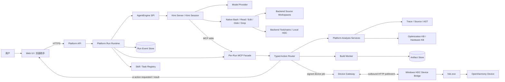
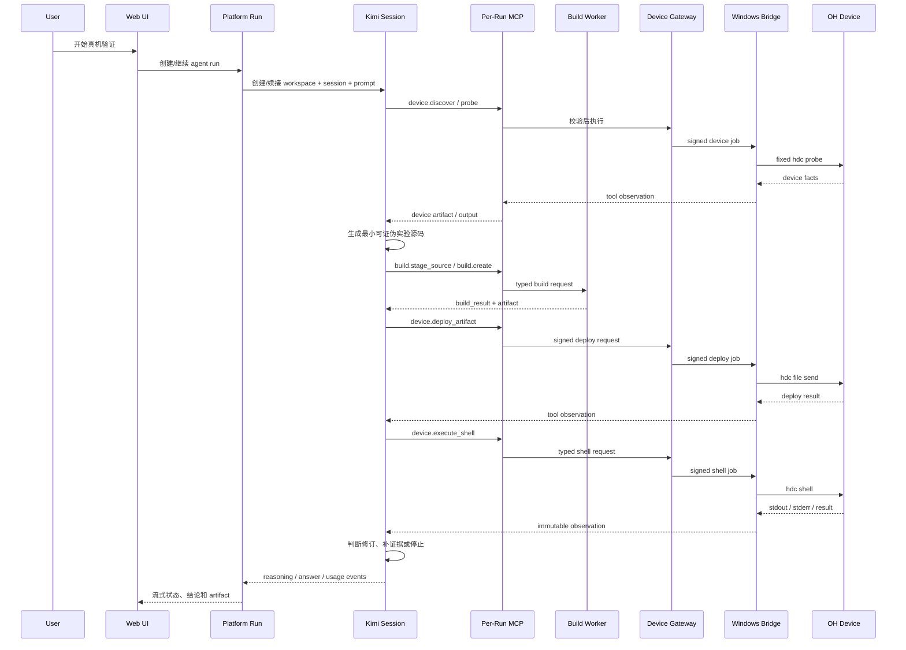

# 平台 Agent Runtime、后端编译与 HDC Device Bridge Spec

> 状态：`Implemented M0-M3.5 v2.3.0`
> 适用范围：异构优化平台的可部署 Web Agent Runtime，以及 Linux/macOS 后端编译服务与 Windows 真机连接。
> 核心决策：平台不再自行实现模型 ReAct 循环，而是定义可替换 `AgentEngine` SPI；默认实现由 Kimi Server 管理会话和模型配置，并在后端 POSIX PTY 中运行真实 `kimi --auto --session` 作为用户交互与原生 Coding 工具入口。Platform Runtime 负责持久化任务、证据、页面/远程设备跨边界工具、幂等和审计；浏览器的 xterm.js 只投影 PTY、组装页面任务并执行已注册页面动作。
> 关联规范：[heterogeneous_enablement_web_platform_spec.md](heterogeneous_enablement_web_platform_spec.md) 定义产品和页面能力，[real_device_validation_spec.md](real_device_validation_spec.md) 定义真机实验与证据边界，[cross_spec_contract.md](cross_spec_contract.md) 定义 artifact、action 和恢复契约。
> 2026-10-27 实现补充：Web 平台 0.1.25 / Bridge 1.4.9，实时/历史事件隔离见 §11.2.1；Windows 本地 Code Agent + SSH 与 0.1.27 本地采集的桌面拓扑见 [desktop_workbench_design.md](desktop_workbench_design.md)，不改变本文 Bridge 只执行 HDC 的边界。

## 1. 背景与目标

早期工作台同时维护了浏览器内多轮 Agent、后端 JSON action loop、策略一次性模型中继、固定 profile 编译和本机 HDC 真机实验。该实现暴露出五个结构性问题：

1. 浏览器页面关闭、刷新或休眠会中断长时间 Agent 循环。
2. 后端看不到 Windows PC 上通过 USB 连接的手机，无法直接调用本机 HDC。
3. 浏览器不能可靠、安全地承担编译器、HDC 和长任务执行环境。
4. 平台自行维护模型 JSON 协议、多轮续跑、流式思考、compaction 和 tool harness，难以达到成熟 Coding Agent 的鲁棒性。
5. 把成熟 Coding Agent 限制为逐次调用低带宽 MCP 搜索/读文件，会失去原生代码导航、批量检索、编译诊断和自主迭代能力。

本规范的目标是以最小的新运行时边界解决这些问题：

- 成熟 Agent Engine 负责会话、推理、compaction 和自主工具循环，平台不重新实现一套简化 ReAct；
- Platform Run 持久化任务状态、Engine binding、工具事实、证据、失败恢复点和审计轨迹；
- Kimi Agent 可直接操作后端代码仓、文件、Shell、编译器和本机工具；需要固定 Harness、可复现实验工件时仍可使用 Build Worker；
- Windows PC 只安装一个轻量 Device Bridge，负责发现设备并执行 HDC；
- 浏览器继续提供页面助手、实时推理过程、页面操作和人工接管；
- 真机实验可以根据真实编译和设备输出自主迭代，不规定固定轮次职责；
- 产品不设置轮次、每轮 action、上下文窗口或输出 Token 预算；浏览器提供始终可见的停止入口，并把取消传播到当前 Engine prompt、Build Worker 和可取消的设备任务；
- 所有模型事件、Kimi 原生工具调用、MCP 跨边界调用、页面动作、编译、设备命令和结果形成统一、可追溯的执行记录。

### 1.1 非目标

本期不负责：

- 建设通用 IDE 或替代开发者现有编辑器；
- 在平台内 fork 并维护 Kimi Code 内核；平台只依赖其服务协议与事件契约；
- 开放 WebSearch、FetchURL，或允许模型把代码和分析数据发送给外部搜索/抓取服务；
- 自动完成完整 OpenHarmony 产品构建、系统镜像烧录和系统签名；
- 让浏览器直接持有设备长期凭证或成为设备任务的唯一传输通道；
- 因一次编译、上传或功能测试成功而自动宣称热点已异构化或获得性能收益；
- 在多用户版本中沿用单用户 `full_access` 作为最终授权模型。

## 2. 架构决策

| 主题 | 决策 | 理由 |
|---|---|---|
| Agent Engine | 通过 `AgentEngine` SPI 可替换，默认为 `KimiServerAgentEngine` | 复用成熟 Agent 的会话、工具循环、compaction、中断与恢复，不再要求模型输出平台自定义 ReAct JSON |
| Platform Runtime | 保留为业务编排、结果发布与审计层，不实现模型思考循环 | 稳定掌握 Run、artifact、证据门禁、跨边界动作和前端恢复，不取代 Kimi 后端工具循环 |
| 浏览器职责 | UI、任务组装、流式展示、用户文件授权和受控页面动作 | 浏览器不持有 Agent 会话，不适合作为长任务、编译和设备执行宿主 |
| 编译位置 | Kimi 可直接使用后端工具链；标准真机 Harness 可选 Build Worker | 普通 Coding 任务保持 Agent 自主性，证据型实验仍可获得固定 Profile、缓存和 manifest |
| 设备连接 | Windows HDC Device Bridge | HDC 必须运行在 USB 设备实际连接的 PC |
| Bridge 网络 | Bridge 主动连接 Web 入口的普通 HTTP poll/event；WebSocket 仅作旧版兼容 | 只暴露 Web 端口，同时避开 Windows 入站端口、浏览器 PNA/CORS、Upgrade、压缩帧和 close-frame 兼容问题 |
| 执行边界 | 后端遵循 Kimi Agent 自身权限与安全策略；Windows Bridge 只暴露 HDC job | 后端 Agent 能完整完成任务，同时不把 Windows 客户端升级为远程通用 Shell |
| 外部网络工具 | 每次 Prompt 禁用 `WebSearch` 与 `FetchURL`，部署预检和 Engine health 双重声明 | 防止代码与分析内容进入搜索/抓取链路，不牺牲本地 Coding Agent 能力 |
| 可见推理语言 | 可见思考、计划、诊断和结论使用中文；源码、命令与工具原始输出保持原文 | 长任务在实时分析进度中可读，同时不改写或伪造真实工具证据 |
| Agent 步骤 | Engine 在同一 Session 内自主决定步骤，运行至完成、明确外部阻塞或用户显式停止 | 真机调试不能硬编码为三轮、固定阶段或每轮 action 上限 |
| 状态与恢复 | Kimi Session 保留对话，Platform Run append-only 事件日志保留业务检查点 | 页面刷新只需重连 SSE；后端或 Engine 恢复时可明确区分会话事实与执行事实 |
| 模型密钥 | URL/key/model 持久化在当前浏览器，Platform 只维护短期内存租约并用 `KIMI_MODEL_*` 注入托管 Kimi 子进程 | 无需服务器交互登录；模型 key 不进入 Kimi 配置、artifact、Run event、日志或执行 trace |

一个重要术语约束是：**页面助手**是产品角色，不等于代码必须运行在浏览器。目标架构中，页面助手的推理循环位于后端；浏览器仍呈现同一个助手并执行其受控 `ui.*` 动作。

### 2.1 当前实现映射

本规范的 M0-M3 与 Agent Engine M3.5 已由下列组件实现；M4 的 E1 module harness、多用户授权和企业级 Engine 密钥服务仍是后续里程碑，不伪称已交付。

| 边界 | 实现 | 说明 |
|---|---|---|
| Agent Engine SPI | `heterogeneous-enable-web/backend/agent_engine.py` | Engine binding/result 契约与每 Run HMAC 工具 token |
| Kimi Server Adapter | `heterogeneous-enable-web/backend/kimi_server_engine.py` | Kimi REST/WS、workspace/session、事件流、取消、token/cache/context 用量 |
| Engine-backed Runtime | `heterogeneous-enable-web/backend/kimi_agent_runtime.py` | Platform Run 与 Kimi Session 绑定、每 Run workspace/Skill/MCP、SSE 投影与恢复 |
| 持久化 Platform Run | `heterogeneous-enable-web/backend/agent_runtime.py` | append-only Run event、checkpoint、SSE 恢复、动作幂等、同步页面动作等待与取消传播 |
| Per-Run MCP Facade | `heterogeneous-enable-web/backend/kimi_mcp_server.py` | 页面动作、平台工件发布和 Windows HDC Bridge 等跨边界能力；不代理常规后端代码导航与 Shell |
| 类型化 Action Router | `heterogeneous-enable-web/backend/runtime_action_router.py` | 按 `ui.*`、`build.*`、`device.*` 所有权分发；新真机流程不使用旧浏览器组合 action |
| Build Worker | `heterogeneous-enable-web/backend/build_worker.py` | E0 固定 profile、工具链/运行库哈希、缓存、资源限制、可审计 manifest 与可取消编译 |
| Device Gateway | `heterogeneous-enable-web/backend/device_gateway.py` | 零交互登记、租约、签名 job、重连对账、产物短期下载、Local HDC compatibility 与进度镜像 |
| Windows Device Bridge | `heterogeneous-enable-web/device-bridge/hdc_device_bridge.py` | 出站 HTTP poll/event、固定 `hdc.exe` argv、spool、hash 校验、取消 HDC 子进程 |
| 页面助手接入 | `heterogeneous-enable-web/app/components/AgentPanel.tsx` | 任务组装、后端 Run SSE、Kimi 思考/回答投影、同步 `ui.*` 回传、脱敏 Trace 下载与 Bridge 选择 |

生产部署必须显式配置 `HETERO_BUILD_REQUIRE_NETWORK_SANDBOX=1`、管理员管理的 `HETERO_BUILD_SANDBOX_PREFIX` 和 `HETERO_BUILD_SANDBOX_NETWORK_ISOLATED=1`。未配置时，单机开发模式仍可运行 E0，但 build manifest 会明确标记网络隔离未被硬性强制，不能作为生产隔离证据。

## 3. 总体架构

配套的视觉图集见 [platform_agent_runtime_architecture_figures.md](platform_agent_runtime_architecture_figures.md)。图集用于导航和评审；本 Spec 的文字契约仍是实现与验收依据。



### 3.1 双事实源与一致性边界

| 事实类型 | 权威来源 | 不得替代它的来源 |
|---|---|---|
| 对话历史、思考流、模型回答、Agent 内部工具循环 | Kimi Session | 浏览器 localStorage、Platform 自造 memory |
| 任务 ID、工具输入输出、artifact、证据、幂等、构建和设备命令 | Platform Run / Artifact Store | 模型叙述、Kimi 终端文本 |
| 页面当前可见状态和用户文件授权 | 活动浏览器 | 后端的过期页面快照 |

Platform 以浏览器页面生成的 `page_session_id` 作为交互式主会话边界，并持久化 `page_session_id -> run_id -> engine_id + workspace_id + session_id`。同一页面中的普通对话、分析记录切换、硬件路由、硬件机会推理、真机验证和页面助手都追加到该 Session；`analysis_id` 仅标识当前审计/工件上下文，阶段或记录切换只更新 Run 的任务模式与精简上下文。Kimi Session 丢失时可以创建新 Session，但必须把这次重绑写入 Run event；不得把新 Session 伪装为原会话无缝延续。隔离盲推和兼容结构化调用可继续使用分析级 Session，但不得取代页面主 Session。

### 3.2 三类 Action 执行器

后端 `Typed Action Router` 必须按所有权分发动作，模型不能绕过它直接访问执行环境。

| Action namespace | 执行位置 | 示例 | 断线语义 |
|---|---|---|---|
| `platform.*` / `workspace.*` / `build.*` | 后端 | Trace 查询、KB 检索、读取授权源码、暂存源码、编译 | 浏览器断线不影响执行 |
| `device.*` | Windows Device Bridge | discover、probe、deploy、shell、install、pull logs | Bridge 断线时暂停并可重派 |
| `ui.*` | 当前浏览器页面 | 切换页面、选择热点、填充代码、突出按钮、请求文件选择 | 无活动页面时进入 `waiting_for_ui` |

所有动作共享 `page_action`/`tool_action` schema、风险等级、幂等键、超时、输入输出 hash 和审计字段。页面助手不能直接操作 DOM；浏览器只执行已注册、schema 校验通过且与当前项目状态一致的 `ui.*` 动作。

#### 3.2.1 Kimi 到页面的同步工具协议

1. Kimi 先调用 `platform_list_page_actions`，获取当前 Run mode 允许的 action 和 JSON schema。
2. Kimi 调用 `ui_execute_registered_action(action_id, input)`。Platform 校验 registry、mode、schema 和幂等键。
3. Platform 写入 `ui.action_requested`，Run 进入 `waiting_for_ui`，MCP tool call 在服务端等待，不结束 Kimi prompt。
4. 活动浏览器经 SSE 收到动作，执行后以 `request_id` 回传真实 result/error。
5. Platform 原子地保存 `ui.action_result`、更新幂等记录并唤醒原 MCP call；Kimi 在同一 prompt 内基于结果继续。

默认等待上限为 15 分钟。超时、页面断线或 Run 取消都必须返回结构化失败，不得伪造页面已操作。`device_validation` mode 仅允许必要的授权源码读取，不允许借真机任务操作其他页面工作流。

## 4. 部署拓扑

### 4.1 当前同机兼容模式

```text
macOS/Linux/Windows PC
  Web UI + Platform API + Agent Runtime + Build Worker
  Local HDC adapter
  USB OpenHarmony device
```

当前实现可以继续使用服务端固定 HDC adapter。它与远程 Bridge 实现同一个 `DeviceExecutor` 接口，避免真机 Skill 感知部署差异。

### 4.2 目标部署模式

```text
Linux server
  Platform API
  Agent Runtime
  Build Worker
  Artifact Store
  Device Gateway

Windows client PC
  Browser
  HDC Device Bridge
  hdc.exe
  USB OpenHarmony device
```

Device Bridge 主动轮询平台的 HTTP endpoint。用户从浏览器启动任务，但命令、产物和结果经后端与 Bridge 传输，不依赖浏览器标签页持续打开。

### 4.3 浏览器本机 RPC 兼容模式

可为早期 Windows 单用户版本提供：

```text
Browser -> http://127.0.0.1:<bridge-port> -> hdc.exe
```

该模式必须满足：

- Bridge 只绑定 loopback；
- 浏览器只转发后端签名的 opaque device job，不能自行构造 HDC 参数；
- Bridge 校验签名、过期时间、project/session 和幂等键；
- 明确配置 CORS 与 Private Network Access；当前单用户可信部署不增加人工配对令牌；
- 页面关闭导致的中断必须在后端显示为 `bridge_transport_interrupted`；
- 它不是远程部署的首选方案。

## 5. Agent Engine 与 Platform Run

### 5.1 `AgentEngine` SPI

Platform 只依赖下列最小能力：

1. `health()`：返回非敏感的 Engine 连接、版本和默认模型状态。
2. `ensure_session(run_id, workspace, existing_binding)`：创建或恢复 workspace/session，返回持久化 binding。
3. `run_prompt(binding, prompt, on_event, cancel_requested)`：在同一会话中执行任务，连续流出思考、正文、工具和 token 事件。
4. `cancel(binding, prompt_id)`：终止当前 prompt 及可取消的工具链。

SPI 不暴露任何 Kimi 专有 UI 概念。替换其他 Engine 时，必须保留 Platform Run、MCP tool schema、artifact 和 SSE event 契约；不得要求前端重写业务工作流。

### 5.2 `KimiServerAgentEngine`

默认 Adapter 使用 Kimi Server REST 创建 workspace/session/prompt，使用 WebSocket 消费 session event。每个页面级 Platform Run 生成独立 workspace：

```text
.local-artifacts/kimi-engine/workspaces/<run_id>/
  .git/                         # 轻量项目边界，不绑定用户源码仓
  AGENTS.md
  task.json
  .kimi-code/mcp.json
  .kimi-code/skills/heterogeneous-device-validation/SKILL.md
  .kimi-code/skills/heterogeneous-page-analysis/SKILL.md
  .kimi-code/skills/custom-accelerator-api-kb-builder/SKILL.md
  .kimi-code/skills/application-execution-flow-reconstruction/SKILL.md
```

- Kimi 按最近的 Git 项目根发现项目级 Skill。Run 工作区通常位于平台源码仓内部，因此平台必须先生成轻量、有效且不含用户源码的 `.git` 元数据边界，再创建 Kimi workspace/session；否则 Kimi 会越过 Run 目录并忽略其中的 `.kimi-code/skills`。
- Session 创建后，Adapter 必须读取 Kimi Server 的真实 Session Skill 清单，确认所有已物化项目 Skill 均可见。旧 Session 缺失清单时，Platform Run 保持不变并显式重绑新 Kimi Session；新 Session 仍缺失时以 `KIMI_SESSION_SKILLS_MISSING` 停止，不能把“文件已复制”当作“Skill 已装载”。WebShell 仅可复用与最新 binding 具有相同 `session_id` 的 PTY。
- `AGENTS.md` 定义证据边界、自主执行和停止原则；面向用户的回答通常跟随用户语言，原始思考流不做语言强制。
- `task.json` 是精简任务投影，不是第二份会话历史。
- `.kimi-code/mcp.json` 启动当前 Run 的 Platform MCP，用于页面动作、平台工件发布以及 Windows HDC Bridge 等跨边界能力；常规后端操作不经 MCP 代理。
- Kimi 内建 `Bash/Read/Edit/Glob/Grep/ReadMediaFile` 保持可用，Agent 可直接控制后端代码仓、编译器、测试和本机 HDC。每次 Prompt 显式禁用 `WebSearch` 与 `FetchURL`；部署预检和 Agent Engine health 必须报告该策略。
- focused task 在 `task.json` 中保存规范 Connector、快照与后端源码范围，并提供 `repository` 工作区入口；这些字段约束证据归属，不削弱 Kimi 原生 Coding Agent 能力。
- Agent-Centric 主路径中的硬件路由和机会推理由同一页面 Session 完成：MCP 的 prepare action 只提供上下文与 Schema，run/save action 只校验和落盘。兼容 OpenAI-shaped 结构化调用及独立盲推使用隔离的 `structured_read_only` Session，并硬拒绝 MCP action；它们不能取代页面主编排器。

### 5.3 Platform Run 职责

Platform Run 负责：

- 保存任务、执行控制模式、Engine binding、检查点和 append-only execution trace；
- 把大对象保存为 artifact，只向 Engine 提供最小引用和按需读取工具；
- 校验 action schema、Run 所有权、证据 ID、状态前置条件和风险等级；
- 使用 `action_id + canonical input` 形成幂等键，恢复后不重放已完成构建或设备命令；
- 将 Kimi 事件投影为受控 SSE 事件，将高频 delta 合并后持久化；
- 将最终结果回填到策略、机会报告或真机验证记录。

它不再解析模型自定义 ReAct JSON，不负责重现 Kimi 的思考循环，也不得把模型判断写成硬件事实。

### 5.4 运行状态

`agent_run/v1` 至少包含以下状态：

```text
created
  -> running
       -> waiting_for_tool
       -> waiting_for_ui
       -> waiting_for_device
       -> compacting
  -> paused_model_overloaded
  -> paused_bridge_offline
  -> completed
  -> failed
  -> cancelled
```

`waiting_for_model_credential` 与 `paused_turn_budget` 仅保留为 `legacy` Engine 和旧 Run 的兼容状态。默认 Kimi Engine service 由 FastAPI 托管；provider 可以来自后端既有配置，也可以来自浏览器提交给后端的短期内存租约。

- 状态变化写入 append-only `agent_run_event`，不能覆盖旧事件。
- `waiting_*` 和 `paused_*` 都必须携带下一步恢复条件。
- 用户输入“继续工作”时，Runtime 恢复最后一个未完成检查点，不重新执行硬件路由或已经成功的 action。
- 页面重置只重置浏览器当前视图；删除或取消后端 run 必须是独立显式动作。

### 5.5 步骤、重试、停止与压缩

- Kimi 可在一次 prompt 内连续调用多个工具。Platform 不按轮次或 action 次数截断合法工具调用；相同 `action_id + canonical input` 仍使用幂等记录避免恢复后重复产生副作用。
- 浏览器在 Agent Run 和一次性策略推理运行期间始终显示停止按钮。停止先在页面冻结后续回填，再调用 `POST /v1/agent-runs/{id}/cancel` 或中止流式请求；后端取消当前 Engine prompt，并尽力终止 Build Worker、HDC 或 Bridge job。已经完成的事件和 artifact 不回滚。
- Engine 负责 provider 的 HTTP 429、可重试 5xx、上下文 compaction 和对话续跑；Platform 记录对应事件并决定 Run 是否暂停。
- 重试耗尽后保存原始模型输入、已接收流片段和精确恢复点，进入 `paused_model_overloaded`。
- 页面可声明模型上下文窗口，作为临时 provider 配置和前端预算依据；不配置或宣称产品级剩余轮次与每轮 action 门禁。实际输出、context usage、cache read 和 compaction 以 Engine/provider 事件为准。
- 上下文 compaction 由 Engine 完成；Platform 的任务投影仍必须保留未解决目标、artifact ID、设备/profile、错误诊断和禁止重复的失败动作。
- 已保存的大段源码、完整 KB 记录、编译日志和设备输出默认以引用进入后续轮次，只有模型按需读取相关片段。

### 5.6 认证与每 Run MCP

1. FastAPI 启动时主动拉起 Kimi Engine service；Engine service 连通与 provider/model 就绪分别观测，模型未配置不能误报为 Engine 未连接。
2. 后端已有 Kimi/provider 配置时直接使用。浏览器需要覆盖时保存合法的自定义 HTTP/HTTPS provider Base URL/key/model，Platform API 只建立带 TTL 的进程内租约，不把 secret 写入文件或 Run；URL 不得包含账号、查询参数、片段或完整 completion endpoint。HTTP 只用于可信本机/内网，页面必须提示后端到 provider 的密钥与内容传输未加密。
3. Platform 托管的 Kimi 子进程通过官方 `KIMI_MODEL_*` 临时环境取得浏览器租约；新租约触发受认证的 loopback Engine 重载，页面在到期前续租。清除后回落到后端配置；API 退出时终止由其启动且继承浏览器 secret 的进程。
4. Platform 使用 Kimi Server 的 loopback service token 调用 REST/WS；该 token 不是 provider key。
5. Platform 在本地持久化一个权限为 `0600` 的随机主密钥，用 HMAC 派生每 Run MCP bearer token。
6. MCP 请求无权选择其他 Run；Run ID 与 token 由进程环境绑定，不暴露为模型参数。

### 5.7 实时展示

后端通过 SSE 或 WebSocket 发布：

- 当前阶段和具体状态；
- provider 返回的 reasoning stream；
- action 计划、开始、进度与结果摘要；
- input/output/context token 和 compaction 事件；
- 编译、上传、执行和设备输出摘要；
- 暂停原因与可执行恢复动作。

页面原样展示 provider 返回的思考流，不要求其必须使用中文，也不得翻译或伪造未由 provider 返回的思考内容。面向用户的最终回答通常跟随用户语言；技术标识、源码和原始工具输出保持原文。

## 6. 后端 Build Worker

### 6.1 构建等级

“在后端编译”必须区分三个等级，不能把最小实验成功等价为业务代码已经完成移植。

| 等级 | 输入 | 目的 | 能证明 |
|---|---|---|---|
| `E0 standalone_experiment` | Agent 生成的完整小型源码、固定 SDK/profile、CPU reference | API 可达、功能比较、最小设备实验 | 该实验在指定设备和输入下的结果 |
| `E1 module_harness` | 选定模块快照、受控依赖、测试 harness | 验证更接近热点的数据类型、调用边界和依赖 | 该模块级 harness 的构建与功能事实 |
| `E2 product_integration` | 完整源码快照、产品构建系统、签名和运行场景 | 验证真实热点集成 | 只有配套 Trace/benchmark 才能证明端到端收益 |

Phase B 首先交付 E0，并为 E1 预留契约。E2 不属于本规范首期交付。

### 6.2 `build_request/v1`

构建请求至少包含：

```json
{
  "artifact_type": "build_request",
  "schema_version": "1.0",
  "project_id": "local-default",
  "agent_run_id": "run_xxx",
  "source_artifact_id": "art_source_xxx",
  "source_sha256": "<sha256>",
  "build_level": "E0",
  "profile_id": "gpu_gles3",
  "target": {
    "os": "OpenHarmony",
    "abi": "arm64",
    "api_level": "observed-or-unknown",
    "device_probe_artifact_id": "art_probe_xxx"
  },
  "resource_policy_id": "build-worker-default/v3",
  "idempotency_key": "<stable-key>"
}
```

当 Agent 选择 Build Worker 这条证据型路径时，只能选择已登记 profile，不能向 Worker 注入编译器路径、任意 flags、链接器参数、宿主环境变量或输出路径，源码引用必须绑定内容 hash。Agent 在普通后端 Coding 任务中仍可直接使用宿主工具链；两种构建面的证据等级不得混写。

### 6.3 隔离与可复现性

Build Worker 必须：

- 使用版本固定的 SDK、LLVM、sysroot、profile 和依赖清单；
- 在临时、项目隔离的工作目录编译，默认禁止网络；
- 限制 CPU、内存、磁盘、执行时间和日志大小，并将 `ld.lld` 固定为单线程链接；
- Linux 共享服务账号不得使用按 real UID 计数的低值 `RLIMIT_NPROC` 模拟单构建进程树隔离；需要硬性限制进程树时，由部署侧使用 cgroup/systemd scope 等独立容器边界；
- 不执行代码仓 hook、安装脚本或模型提供的宿主命令；
- 校验 include 只解析到 profile 的固定 SDK/源码根，但不维护脆弱的精确头文件名白名单；
- 缓存键包含源码 hash、profile version、toolchain hash、target tuple 和参数 hash；
- 产出编译 argv、环境白名单、工具版本、stdout/stderr、退出码和产物 hash；
- 失败时保留完整、受大小限制的诊断，供 Agent 下一轮最小修订。

部署侧用 `provision_openharmony_sdk_bundle` 从已登记 OpenHarmony `source_connector` 提取紧凑 SDK。产品 API 只接受 `source_connector_id`，不接受请求方提供的绝对路径；后端解析 Connector 当前路径，并把 SDK 来源 Connector、快照与 manifest hash 持久化。浏览器分别恢复当前分析 Connector，后端恢复 SDK 来源 Connector，二者都不依赖页面内存。无网页部署时才以 `heteroctl install --source-root ...` 作为管理员兜底。设备预检与打包器必须复用同一份路径清单，至少覆盖 NDK musl include、AArch64/generic 模板、`alltypes.h.in` 和各领域 API header。缺失其中任一项属于部署资产阻塞，Agent 应停止改写实验源码并报告修复命令，不能通过删除标准 C include 或手写 libc 声明绕过。

运行库的物理存储与 profile 逻辑链接面必须解耦。管理员可把所有目标 AArch64
OpenHarmony `.so` 放在一个只读目录，并通过
`runtime-library-source.json` 或 `HETERO_BUILD_RUNTIME_LIBRARY_ROOT` 登记；不得要求为
`gpu_gles3`、`gpu_vulkan`、`npu_nnrt`、`media_avcodec` 分别复制目录。profile 仍声明
精确允许的本地库名，Build Worker 只从共享根解析这些名称。链接前，Worker 按登记哈希
把本次所需文件快照进内容寻址构建目录并再次校验；构建 identity 和 manifest 记录实际
库哈希，而不把宿主绝对路径作为缓存 identity。共享根发生变更时必须重新登记或停止
构建，不能静默回退到手机临时拉库。

### 6.4 构建产物

成功构建产生 `build_result/v1` 和内容寻址产物包：

```text
manifest.json
bin/<executable-or-package>
lib/<optional-runtime-libraries>
symbols/<optional-map-or-debug-info>
run/experiment.json
logs/build.stdout
logs/build.stderr
```

`experiment.json` 定义远端相对目录、入口、参数、环境、超时、预期输出类型、CPU/reference 比较方式和清理策略。Device Bridge 只能部署 manifest 声明且 hash 校验通过的文件。

远程部署的固定数据路径为：Linux 内容寻址产物 -> 短期 job-bound 下载授权 -> Windows Bridge 私有 spool -> Windows `hdc.exe file send` -> 手机端目标路径。Bridge 以固定大小分块下载并校验平台声明的 SHA-256，手机落盘后再次校验；Linux 绝对路径不会发送给 Windows。`artifact_download_started`、`artifact_download_verified`、`hdc_file_send_started` 与 `device_deployment_verified` 作为同一 Agent Run 的非终态进度事件，便于定位网络、Windows spool、HDC 或手机端边界。

### 6.5 源码和 30GB 代码仓边界

- E0 只需要热点片段、生成的实验源码和后端 SDK，不要求传输 30GB 整仓。
- E1 要求选定模块及其可解析依赖位于后端可访问的 `source_connector` 中。
- 若真实代码仓只存在 Windows PC，首期不隐式同步整仓。用户必须登记后端 Git/worktree、受控网络挂载，或以后引入独立的 module snapshot 同步能力。
- 任何 module snapshot 必须保留相对路径、文件 hash、源码 revision、dirty patch 和依赖 manifest。

设备 probe 提供 ABI、系统和运行时观察，不提供编译头文件。编译头文件和库始终来自后端固定 SDK/profile。

## 7. Windows HDC Device Bridge

### 7.1 职责与实现边界

Device Bridge 是一个轻量、可独立升级的 Windows 后台进程。它负责：

- 定位部署时配置的 `hdc.exe`；
- 发现 USB/TCP HDC target，并上报连接状态；
- 为项目建立短期设备租约；
- 下载并校验后端构建产物；
- 使用固定 HDC 进程启动方式执行 deploy、shell、install、launch 和 pull；
- 流式返回 stdout/stderr、进度、退出码和超时；
- 网络中断时保存有限的本地 job spool，重连后对账；
- 接收取消请求并终止对应 HDC 子进程。
- 启动与设备发现时检查固定 HDC 路径、HDC 版本、target 列表和 Windows spool，并把同源诊断投影给页面与 Agent。

它不负责模型推理、源码分析、代码生成、编译、KB 检索或机会判定。

### 7.2 设备能力接口

首期注册以下类型化动作：

| Action | 作用 | 关键限制 |
|---|---|---|
| `device.discover` | 列出 HDC target | 只读，返回逻辑 device ID 和受保护 serial |
| `device.probe` | 读取系统、ABI、运行时和必要 capability | 固定只读命令集，产生 probe artifact |
| `device.deploy_artifact` | 下载并 `hdc file send` 构建产物 | 只接受签名 job 与匹配 hash |
| `device.execute_shell` | 执行手机侧实验、诊断和清理 | command 是设备侧参数，不能变成 Windows Shell |
| `device.install_package` | 安装已构建并签名的 HAP/包 | 仅在 profile 显式支持时注册 |
| `device.launch` | 启动已登记 bundle/ability | 目标来自构建 manifest 或安装结果 |
| `device.collect_artifact` | 拉取日志和结果 | 只能写入 Bridge 管理的临时目录，再上传 Artifact Store |
| `device.cancel_job` | 终止 HDC 子进程 | 绑定 request/job ID |

Agent 在用户授予的真机实验会话内可以自主决定设备侧 Shell 内容。Bridge 的安全目标是保护 Windows 工作站，不把设备侧命令错误解释为宿主机命令。

### 7.3 连接、注册与租约

目标连接流程：

1. 管理员安装 Bridge，并配置平台 URL 与 `hdc.exe` 路径。
2. Bridge 首次运行直接向当前单用户平台登记，自动取得不可见的 bridge identity；不要求账号、页面确认或配对码。
3. Bridge 重复安装或重启时复用本机 identity，并通过普通 HTTP poll 主动发送版本、OS、HDC 版本和 capability catalog；WebSocket 只保留兼容路径。
4. 后端为当前项目与确定的 Bridge/逻辑设备自动获取、复用设备租约。远程 `probe/deploy/execute_shell/collect` 可省略 `device_lease_id`，保留显式租约参数兼容旧调用；serial/probe 必须与目标逻辑设备一致。写任务按目标设备原子占用，同一设备的另一个租约不能绕过未闭合任务。
5. Heartbeat 丢失超过连接宽限期后暂停新任务。发送前确认 Bridge 离线时不占用租约；已发送但结果未知的任务保留占用并等待对账。心跳、建租和任务状态采用同一注册表事务锁，终态不被迟到的 accepted/timeout 回退。
6. Bridge 重连时按 `job_id + request_id + idempotency_key` 对账，再决定返回已有结果、继续等待或重新执行。

Phase A 没有用户认证。Bridge identity 是透明的机器与任务绑定标识，device lease 是并发和目标约束，两者都不是用户认证步骤，也不能只凭设备 serial 建立任务关联。可信内网可使用 HTTP/WS；不可信链路由外部 VPN、SSH 隧道或 HTTPS 网关保护。

平台 `0.1.3` 将租约维护收回控制面：明确 `bridge_id + logical_device_id` 后自动处理获取及过期替代，并返回 `lease_resolution.automatic`、`requested_lease_id`、`effective_lease_id` 与替代原因；自动获取时 requested 为空。显式提供的错项目、错设备或不存在租约仍返回诊断。历史 `bridge_offline` 记录只在证据表明尚未发送时释放并允许重试；已经接收、执行或结果未知的记录保留对账语义。正常后端重启和 Bridge 重连沿用持久化身份及租约；删除或更换状态目录不属于正常续租。

### 7.4 Device Job Envelope

后端派发的请求至少包含：

```json
{
  "schema_version": "device_job/v1",
  "job_id": "devjob_xxx",
  "request_id": "req_xxx",
  "idempotency_key": "<stable-key>",
  "project_id": "local-default",
  "agent_run_id": "run_xxx",
  "bridge_id": "bridge_xxx",
  "device_lease_id": "lease_xxx",
  "logical_device_id": "device_xxx",
  "action": "device.deploy_artifact",
  "deadline": "2026-07-31T12:00:00Z",
  "payload": {
    "artifact_id": "art_build_xxx",
    "artifact_sha256": "<sha256>"
  },
  "signature": "<backend-signature>"
}
```

Bridge 必须先校验 schema、签名、目标、租约、deadline 和幂等键，再执行任何 HDC 动作。结果包含相同关联 ID、开始/结束时间、HDC argv 的脱敏结构、返回码、超时、stdout/stderr 引用和产物 hash。

Bridge 诊断采用 `device_bridge_diagnostics/v1`。它不依赖模型猜测，也不开放 Windows Shell；由 Bridge 自身观察固定的 HDC executable、版本命令、target 列表、spool 写入和每次 HDC invocation。所有失败同时给出 `stage` 与稳定的 `failure_domain`，至少区分 `windows_bridge_configuration`、`windows_spool`、`windows_hdc_process`、`windows_hdc_device_connection`、`linux_to_windows_transport`、`windows_hdc_to_device_transport`、`device_filesystem` 和 `device_integrity`。`device.discover` 返回最新诊断，任务结果附带执行时诊断，页面 Bridge 选择器显示其压缩摘要；Windows 管理员可用 `test-device-bridge.ps1 -TransferCheck` 独立验证临时文件发送和设备端哈希。

## 8. 端到端真机实验流程



对页面 action、Platform artifact 和 Windows Device Bridge，Agent 只能使用 MCP 已经真实返回的 serial/lease、artifact 和 remote path；后端原生工具结果则以真实命令、文件和返回码为事实。编译失败、设备命令失败或功能不一致都不得自动转换为“硬件不存在”或“热点不适合异构化”。

## 9. 安全与信任边界

### 9.1 后端

- Kimi Session 获得后端原生 `Bash/Read/Edit/Glob/Grep` 等 Coding 工具，并以 `permission_mode=yolo` 自主执行；Kimi 自身安全策略和项目工程纪律继续生效。
- 每个 Prompt 只禁用 `WebSearch` 与 `FetchURL`，部署预检和 Engine health 必须复核这一有效策略；不得通过其他路径把源码发送到搜索/抓取服务。
- Per-Run MCP 负责页面、Platform 工件和 Windows HDC 跨边界契约，不代理常规后端 Shell 或源码导航。
- MCP bearer token 只对所属 Run 有效，不允许模型传入或替换 Run ID。
- 可选 Build Worker 与主 API 进程隔离，使用最小文件系统和网络权限；其固定 profile 约束只适用于提交给 Worker 的证据型构建。
- 源码、编译产物和模型内容按项目隔离。
- Platform 仅连接管理员配置的 Kimi Server origin；Kimi 到 provider 的网络和认证由 Engine 部署边界管理。
- 所有下载 URL 短期有效，并绑定 artifact hash、Bridge 和 job。
- Platform execution trace 不记录 Kimi Server token、MCP token 或 provider key；工具参数与返回中的敏感字段按字段和 header 双重脱敏。

### 9.2 Windows Bridge

- Bridge 以非管理员账户运行；非安装必要不得申请提升权限。
- HDC executable path 由部署配置决定，模型和 device job 不能覆盖。
- 使用 argv 启动 HDC，不通过 `cmd.exe`、PowerShell 或 `shell=True`。
- `deploy` 只能读取 Bridge 下载缓存中的已校验文件。
- `collect` 只能写 Bridge 管理的 spool，不能让设备路径决定 Windows 目标路径。
- 限制并发、磁盘、输出、命令时长和子进程树；取消时清理对应进程。
- Bridge 自动更新必须校验签名，并允许企业环境固定版本。

### 9.3 手机

单用户 `full_access` 真机实验允许 Agent 自主选择设备侧诊断、执行和清理命令。平台仍需显示目标设备、保存命令和结果，并提供立即停止能力。多用户部署必须增加设备所有权、租约、项目授权和配额，不能仅依赖 `full_access`。

## 10. Artifact 与可观测性

一次分析必须使用统一 `trace_id` 串联：

| Artifact / event | 内容 |
|---|---|
| `agent_run` | 目标、Skill 版本、停止控制、状态和最终结论 |
| `agent_turn` | 本轮上下文引用、模型请求、token、结束原因 |
| `model_stream_event` | provider 返回的 reasoning/output/tool delta |
| `tool_call` / `tool_result` | action、schema version、输入输出 hash、时延和错误 |
| `agent_checkpoint` | 精确恢复输入、未完成目标、已完成 action 和压缩摘要 |
| `build_request` / `build_result` | 工具链、profile、源码/产物 hash 和完整诊断 |
| `device_bridge_event` | 注册、heartbeat、断线、重连和版本 |
| `device_job` / `device_job_result` | 设备租约、HDC 动作、输出和退出状态 |
| `device_experiment_result` | 功能、硬件参与、热点集成和收益证据的分层结论 |

每个 run 额外导出 `analysis_execution_trace.jsonl`。它按时间记录模型请求、响应、reasoning stream、action、页面调用、编译、设备调用、重试、压缩和恢复。大内容可以存为独立 artifact，但 trace 中必须保留引用、hash、大小和摘要。API key、Authorization、Bridge identity secret 和签名私钥绝不进入该文件。

前端“实时分析进度”至少显示 Agent、硬件路由、策略推理、编译和真机验证阶段。折叠态显示当前状态和最近一条具体说明，展开态显示完整时间线。

## 11. API 与传输契约

### 11.1 Web API

| Endpoint | 用途 |
|---|---|
| `GET /v1/agent-engine/health` | 查询当前 Engine、版本、默认模型与连接状态，不返回密钥 |
| `POST /v1/agent-runs` | 创建 Platform Run，并由默认 Engine 自动创建/绑定 Session |
| `GET /v1/agent-runs/{id}` | 查询状态、执行控制、检查点和结果引用；旧版 `budget` 字段仅作兼容，不约束默认 Kimi Engine |
| `POST /v1/agent-runs/{id}/messages` | 提交用户消息或继续指令 |
| `POST /v1/agent-runs/{id}/resume` | 从指定检查点继续同一 Engine Session；旧版预算参数由默认 Kimi Engine 忽略 |
| `POST /v1/agent-runs/{id}/cancel` | 取消模型、构建和可取消设备 job |
| `GET /v1/agent-runs/{id}/events` | SSE 事件流，支持 `Last-Event-ID` 续接 |
| `POST /v1/agent-runs/{id}/ui-action-results` | 浏览器提交已注册 `ui.*` 动作结果 |
| `POST /v1/internal/agent-runs/{id}/actions/{action_id}` | 每 Run MCP 调用类型化 Action；仅接受 run-scoped HMAC bearer token |
| `GET /v1/internal/agent-runs/{id}/page-actions` | MCP 获取当前 Run mode 允许的页面 action schema |
| `GET /v1/internal/agent-runs/{id}/artifacts/{type}/{artifact_id}` | MCP 按明确类型和 ID 读取平台工件 |
| `POST /v1/builds` | 创建受控构建任务 |
| `GET /v1/builds/{id}` | 查询构建结果和 artifact |
| `POST /v1/device-leases` | 为项目和 Bridge 申请设备租约 |

所有写 API 要求 `Idempotency-Key`。SSE 断线重连不得重复执行 action。

### 11.2 Bridge Transport

Bridge 默认使用 `device-bridge-http-poll/v1`：`POST /v1/device-bridges/poll` 领取有界任务队列，`POST /v1/device-bridges/events` 回传接受、进度、取消与结果。普通 HTTP 请求失败后由 Bridge 退避重试，完成结果先写本地 spool，服务端确认后才从待回传队列移除。该通道不依赖 WebSocket Upgrade、扩展压缩、帧边界或 close frame。

逻辑消息至少支持：

```text
bridge.hello
bridge.heartbeat
bridge.capabilities
job.offer
job.accepted
job.progress
job.result
job.cancel
job.reconcile
```

消息带协议版本。后端只向兼容 capability 的 Bridge 派发动作；协议不兼容时进入 `bridge_upgrade_required`，不能降级为任意命令通道。`device-bridge-ws/v1` 端点保留给旧 Bridge，但不属于默认生产健康门禁。

### 11.2.1 活性、实时结果与历史对账（Bridge 1.4.9）

HTTP 模式由四个独立异步工作任务组成：poll、后台诊断、实时事件发送、历史结果回放。诊断在有设备任务时让路；事件在首次成功 poll 建立连接身份后发送。实时 accepted/progress/result 保持任务顺序，历史 spool 独立低优先级回放，历史 HTTP ACK 延迟不阻塞实时结果。连接退出时统一取消并收敛工作任务。

结果按 job ID 去重，ACK 只移除实际发送的对象，避免并发队列裁剪误删后继结果；同一结果不会同时被两个发送器领取。队列达到上限时优先丢弃旧进度，必要时移出尚未发送的历史结果为实时结果保留空间，历史结果仍在磁盘 spool。已确认结果记录 `result_delivery.state=acknowledged` 及时间、平台和 Bridge 身份；进程重启仍允许低优先级回放进行恢复，不能将确认字段理解为永久删除历史。

服务器重连对账批量处理 receipt，同一批次避免按每个 job 重复读写 registry。Bridge 心跳、HDC 检测和当前 job 的结果确认分别属于不同事实：`connected` 不代表手机列表已经返回；发现 timeout 表示未确认，不是确定无设备。状态未知的设备命令继续通过重连对账恢复，不直接重复执行。

核心修复兼容平台 0.1.24；平台 0.1.25 增加准确的设备列表状态展示。发布说明应分别标注需更新的服务器和 Windows 组件，不要求用户为客户端专属修复重复更新无关执行端。回归见 `test_device_bridge_http_workers.py`、`test_device_bridge_http_liveness.py` 与 `test_device_gateway.py`。

## 12. 失败与恢复语义

| 故障 | 必须行为 |
|---|---|
| 浏览器刷新或关闭 | 后端任务继续；`ui.*` 动作等待页面重连 |
| 模型 HTTP 429 | Kimi Engine 自动退避；耗尽后 Platform 保存 Engine 错误与 Run 检查点 |
| Engine 输出/上下文上限 | 保存 Kimi 事件和最后完整工具事实，继续时复用同一 Session |
| Platform 后端重启 | 旧 PTY ID 失效但不得清除 `page_session_id -> run_id`；从 event store 恢复原 Run、自动退避重建 PTY并重连原生 Agent Session；客户端 Run 缓存缺失时由后端按页面所有权恢复，原生 Session 丢失时显式记录重绑 |
| Kimi Server 重启 | 优先按 session ID 恢复；不得丢弃 Platform 已完成工具事实 |
| 页面动作等待超时 | 原 MCP call 返回 `UI_ACTION_TIMEOUT`，记录失败并由 Kimi 决定询问用户或停止 |
| Build Worker 超时/崩溃 | 保存诊断并标记失败；相同幂等键不重复产生不同事实 |
| Bridge 临时断线 | 暂停设备阶段；重连后先 reconcile，不能直接重发 |
| HDC target 断开 | 设备 job 失败或暂停，不自动选择另一台设备 |
| deploy 中断 | 校验远端文件 hash；不完整文件不能执行 |
| 设备命令超时 | 终止 HDC 子进程，保留部分输出和 timeout 事实 |
| Artifact hash 不匹配 | 拒绝部署并记录安全事件 |
| 用户取消 | 立即阻止新模型与工具调用，取消当前 Engine prompt 和可取消的构建/HDC 进程，保留已有证据 |

## 13. 分阶段实施

### M0：契约固化

- 引入 `AgentRuntime`、`ActionExecutor`、`BuildExecutor` 和 `DeviceExecutor` 接口；
- 为现有浏览器 Agent、本机编译/HDC 适配器建立兼容实现；
- 固化 run、turn、checkpoint、build 和 device job schema。

### M1：后端 Agent Runtime

- 把 Platform Run、action 路由、checkpoint、幂等和 SSE 恢复移到 FastAPI 后端服务；
- 前端改为 SSE 消费者和 `ui.*` action executor；
- 保持现有页面操作和手动工作流不变。

### M1.5：Kimi Agent Engine

- 固化 `AgentEngine` SPI，实现 Kimi Server REST/WS Adapter；
- 为每个 Run 生成 workspace、中文 Skill 和 run-scoped MCP；
- 将页面动作实现为同步 MCP 等待/回传，而不是恢复平台自定义 ReAct JSON；
- 保留 OpenAI-shaped 接口作为兼容结构化传输契约；Agent-Centric 主路径由页面 Session 执行 prepare、推理与 run/save，`analysis_id` 仅随工件进入审计。独立盲推或兼容调用必须显式隔离并在 prompt 内强制只读。

### M2：独立 Build Worker

- 将现有 stage/build 逻辑拆为 E0 Build Worker；
- 固化 toolchain/profile hash、资源隔离、缓存和产物 manifest；
- build 与 deploy 分离，构建成功不再隐含 HDC 可用。
- 将现有 `device.build_upload_experiment` 兼容动作在 Action Router 内拆解为 `build.create` 与 `device.deploy_artifact`；新 Skill 不再直接调用旧的组合动作。

### M3：Windows Device Bridge

- 先实现 discover、probe、deploy、execute shell、collect 和 cancel；
- 支持零交互自动登记、出站 HTTP poll/event、设备租约、job reconcile 和本地 spool；
- 保留同机 Local HDC adapter 作为测试与兼容实现。

### M4：模块级验证与多用户准备

- 增加 E1 module snapshot/harness；
- 引入项目隔离、用户认证、设备授权、配额和企业密钥服务；
- 在功能验证后接入独立性能、功耗 benchmark。

每个里程碑都必须可独立回退到上一种 executor，不能要求一次性替换整个工作台。

## 14. 验收标准

| ID | 验收条件 |
|---|---|
| R1 | 浏览器刷新后可通过 `Last-Event-ID` 恢复同一 Agent run，已成功 action 不重复执行 |
| R2 | Kimi Server 端模型过载后进入可恢复状态；“继续工作”复用原 Kimi Session 和 Platform 工具事实，不重新硬件路由 |
| R3 | 默认 Kimi Run 不存在产品级轮次或 action 门禁；连续执行超过旧版上限仍可推进，浏览器停止后不得再发起模型或工具调用 |
| R4 | `ui.*` 通过注册表、SSE 和 request ID 回传；同一 Kimi MCP call 等待真实结果，模型不能直接操作 DOM |
| R5 | 进入固定 Harness/Build Worker 的证据型构建必须无网络、受资源限制，并由 profile 固化编译器、flags 与环境；这不限制 Kimi 在普通后端 Coding 任务中直接使用宿主工具链 |
| R6 | 相同源码、profile、toolchain 和 target 产生相同构建缓存 identity，并保留可审计差异 |
| R7 | Windows Bridge 只启动固定 `hdc.exe` argv，不调用宿主 Shell |
| R8 | Bridge 断线重连通过幂等键对账，不重复执行状态未知的设备命令 |
| R9 | 浏览器不持有 Bridge 长期凭证；Bridge 不开放生产入站端口 |
| R10 | Provider key、Kimi Server token、MCP token 和 Bridge identity secret 不出现在 artifact、execution trace、日志和导出中 |
| R11 | 编译、上传、设备执行、功能等价、硬件参与、热点集成和性能收益分别记录，不互相自动升级 |
| R12 | 当前同机 Local HDC adapter 与远程 Bridge 通过同一 DeviceExecutor contract test |
| R13 | 真机任务可在用户停止后终止模型、构建和 HDC 子进程，并保留部分输出 |
| R14 | E0 实验不要求上传 30GB 代码仓；E1 缺少后端可访问模块快照时明确阻断 |
| R15 | 使用非 Kimi 的 fake Engine 通过 SPI contract test，无需修改 Run store、Action Router 或前端事件契约 |
| R16 | 真实 Kimi Session 可用原生后端工具完成源码分析、编辑、编译与本机诊断，并通过 MCP 完成页面工件和 Windows HDC 跨边界操作；证据型 Harness 全链路保留 artifact ID 与 execution trace |
| R17 | 同一 `page_session_id` 的普通对话、分析记录切换、路由、机会推理、真机验证和页面助手返回相同 `run_id/session_id`；不同页面不得复用主 Session，独立盲推保持隔离 |

## 15. 已知限制与后续决策

1. 需要 OpenHarmony 应用上下文、系统权限或签名的 API 不能通过普通 `/data/local/tmp` CLI 完整验证；必须增加相应 HAP/system profile。
2. DSP/HDI 等非公开应用接口可能只能验证 provider 或系统集成路径，不能伪造通用直调实验。
3. 后端 SDK 与设备系统版本不匹配时，编译成功也可能无法加载；profile 必须声明兼容范围并由运行时事实复核。
4. 真机性能比较还需要温度、频率、预热、重复次数和统计方法，继续由独立 benchmark 规范定义。
5. 首期 Device Bridge 可采用易于 Windows 分发的单文件实现，但具体语言不是协议的一部分；选型不能改变 HTTP poll/event、签名 job 和 executor contract。
6. M0-M3.5 的自动化回归覆盖 AgentEngine binding、每 Run token、Kimi 事件投影、页面 MCP 等待、Run 恢复/幂等/取消、Build Worker 缓存与网络隔离 fail-closed、Bridge 自动登记/签名/重连与本机 HDC argv。生产验收仍需在目标 Linux 后端、Windows Bridge、真实设备与管理员网络隔离 wrapper 上完成部署验证；开发模式的 `not_hard_enforced_development` 明确不满足 R5 的生产隔离要求。
7. Kimi Server 不在 prompt REST 契约中接受每请求输出 Token 硬上限；Platform 只报告 Engine 返回的实际 usage、cache 和 context 观测。若未来 Engine 提供管理员级资源治理能力，应通过 SPI capability 和部署策略显式声明，不能重新包装成用户工作流轮次。

## 2026-10-21：阶段特征工作台与页面任务提交

导航新增「负载特征模型」，与采集、并行建模、寻优校准共享数据集。能力 / 数据合同分别见 [负载特征模型](workload_features_model.md) 与 [双任务干扰校准](parallel_pairwise_interference_v1.md)。新 MCP `workload_features_catalog/list_profiles/analyze/read_profile` 通过平台 action 执行，数据分析无需绑定应用源码；列表与目录重读实时状态，profile 是不可变内容校验对象。分析 / 搜索转发 `feature_profile_id`，所用版本随结果保存。

页面按钮统一通过 `page-agent-autonomous-task` 提交，使用 `required_skill_id`，兼容旧 `skill_id`。提交前等待终端就绪并串行同步上下文、写入文本和提交键；后端完成写入才确认已提交。相同 command ID 的并发请求等待首发完成，失败后支持重试。具体 Agent 的输入 / 提交协议由其 Adapter 定义，平台提交成功表示传输完成，不独立证明模型已经产生结果。完整合同及回归证据见 [Agent 框架接入指南](agent_framework_adapter_guide.md)。

2026-10-22 提交合同 v1.4 增加正文写入后的有界处理等待：bracketed-paste 至少等待 1000 ms，再结合输出静默窗口，避免慢 TUI 合批吞掉 Enter；普通回显不当作编辑器就绪。默认关闭额外提交键重试，显式旧配置保持兼容。终端及匹配命令的 Run 事件保留等待策略/实际等待/键次数等传输诊断；同 ID 不因主键已写出后的 fallback 失败而重放正文。该行为由平台后端实现，不涉及 Windows Bridge 更新。
