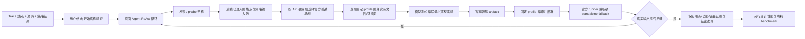

# 真机验证规范

> 版本：v2.8.0
> 适用范围：异构优化工作台的单机、单用户真机实验阶段。
> 核心原则：Kimi Agent 作为后端执行主体，可以直接使用宿主源码、文件、Shell、编译器和本机 HDC；MCP 负责网页与 Windows HDC 跨边界操作。固定 Harness 是可选的可复现实验面，不把任意热点压缩为固定 Adapter 模板。
> 运行时映射：本文中的“页面 Agent”表示用户看到的页面助手角色。当前实现可以运行在浏览器并调用同机 HDC；目标部署由 [platform_agent_runtime_build_device_bridge_spec.md](platform_agent_runtime_build_device_bridge_spec.md) 定义，Agent 循环和编译位于后端，HDC 位于设备所在 Windows Bridge。该迁移不改变本文的实验和证据语义。

## 1. 目标与非目标

静态 Trace、源码、AST、优化知识库、硬件 API 知识库和策略推理只能说明“值得继续验证”。真机验证为某台具体手机补齐独立的、可审计的功能与运行时事实。

本阶段的目标是让页面 Agent 在用户配置的轮次预算内，根据真实编译、上传和设备输出，自主决定是否继续读源码、改变实验、切换 profile、执行手机命令、补充诊断或停止。

不可突破的边界：

- 平台会话禁用 `WebSearch` 与 `FetchURL`，不得通过其他路径把源码或分析内容发送给搜索/抓取服务；
- Windows Device Bridge 只接收类型化 HDC job，不提供 Windows 通用远程 Shell、任意文件访问或长期浏览器凭证；
- 不读取或输出 provider key、Kimi service token、MCP/Bridge token 等秘密；
- 把 `device_probe`、上传成功、零退出码或一次功能比较写成目标热点已集成、硬件一定卸载或端到端性能/功耗收益；
- 用 RGBA 亮度、MatMul 等固定字段合同阻断其他可验证的代码语义。

| 证据层 | 可以证明 | 不可以证明 |
| --- | --- | --- |
| `device_probe` | 固定只读 HDC 白名单在该时刻观察到的设备属性和运行时线索 | API 对业务可调用、热点已卸载或有收益 |
| `agent_device_experiment_source` | 一份完整实验源码、固定 profile 和不可变源码哈希 | 编译、功能正确、设备支持或硬件加速 |
| `agent_device_experiment_run` | 固定 profile 的真实编译/链接/上传结果和远端二进制路径 | 该二进制已执行、目标热点已迁移或收益 |
| `device_remote_shell_run` | 已绑定手机上的远端命令、返回码、stdout/stderr、超时 | 手机命令的业务正确性、热点收益 |
| 独立 benchmark | 固定输入、版本、设备与统计方法下的对比 | 泛化到其他输入、设备或版本 |

## 2. 自主实验流程



这里没有固定的“判断 -> Adapter -> 运行”轮次。用户设置单次最大轮次，例如 10 轮；预算耗尽后保留所有 artifact、stdout/stderr 和会话事实，用户可以继续让 Agent 推理更多轮。

## 3. 后端执行面、可复现 Harness 与远程设备边界

### 3.1 Kimi 原生后端执行面

Kimi Server workspace 以 `permission_mode=yolo` 运行，并只禁用 `WebSearch` 与 `FetchURL`。Kimi 可以直接使用 `Bash`、`Read`、`Edit`、`Glob`、`Grep` 等原生 Coding Agent 工具完成：

- 读取和搜索已登记源码仓、SDK、构建描述与测试框架；
- 创建或修改实验源码、构建脚本和局部 Harness；
- 选择并运行后端已有编译器、构建工具、测试 runner 和诊断命令；
- 当手机连接在后端时，直接发现并调用本机 HDC；
- 根据真实 stderr/stdout、返回码和产物继续迭代。

Agent 仍应保留用户无关改动、避免破坏性命令，并把“模型推断”和“真实命令观察”分开。上述工程纪律由 Kimi Agent 自身权限/安全机制和项目 Skill 共同约束，不由平台把 Coding 工具整体禁用。

### 3.2 可选固定 Harness / Build Worker

需要内容寻址、跨 Run 复现、固定工具链或正式证据工件时，Agent 可以选择平台 Harness：

- 源码写入 `.local-artifacts/agent-device-experiments/`，以 SHA-256 命名；
- profile、目标三元组、LLVM、OpenHarmony NDK musl/领域 SDK include root、库文件和链接参数由后端决定；编译使用 `-nostdinc`，只注入这些固定根；
- profile 不维护精确头文件名白名单。固定 LLVM、OpenHarmony NDK musl 与领域 SDK 根目录内真实存在的字面量 include 均可使用；绝对 include、路径穿越、宏 include、`include_next`、`embed`、`line`、`pragma` 和 `__has_include` 仍被拒绝；
- HDC 由服务端解析，设备 serial 必须来自已有 `device_probe`，本机调用始终 `shell=False`；
- 编译、HDC、远端输出均有超时和输出上限，并写入不可变 artifact。

固定 SDK 由 `heteroctl install --source-root ...` 或 `heteroctl sdk --source-root ...` 从 OpenHarmony checkout 提取。预检必须验证完整 musl 模板和领域 header 清单；缺失时这是环境阻塞，不是代码生成失败，Agent 不应通过移除 `stdio.h`、`stdlib.h`、`string.h`、`unistd.h` 或手写声明继续试错。

目标 AArch64 运行库可集中在一个管理员只读目录，并用
`heteroctl runtime-libs --library-root ...` 一次登记。profile 只复用物理目录，不共享
逻辑白名单：每个 profile 仍只能链接其声明的库名。Build Worker 在链接前创建哈希校验
快照，因此目录复用不能降低构建证据的内容可追溯性。

这些约束只适用于进入 Build Worker 的那一次构建，不限制普通后端 Coding 任务。直接宿主构建与 Harness 构建都必须保留命令和结果；只有 Harness 工件具备其声明的固定 profile 可复现属性。

### 3.3 手机侧执行与 Windows Bridge

手机连接在 Linux 后端时，Kimi 可直接调用本机 HDC。手机连接在 Windows 客户端时，Kimi 通过 Device Bridge/MCP 自主选择 HDC 命令，例如 `chmod`、运行参数、日志读取、环境诊断、重复执行与临时目录清理。

该命令作为一个单独参数传给：

```text
<server-resolved-hdc> -t <serial-from-probe> shell <agent-command>
```

Windows Bridge 固定 HDC executable、已租约设备、超时和输出上限，但不规定 Agent 在手机侧只能执行某几条命令。每条远程命令仍保留完整审计 artifact。

构建产物不经浏览器或人工复制。Linux 生成短期、绑定 job 与 Bridge 的下载授权；Windows Bridge 分块下载到自己的 spool，校验 SHA-256 后执行本机 `hdc file send`，并在手机端再次校验。下载、下发和校验进度进入同一 Agent Run，失败必须明确停在 Linux->Windows 网络、Windows spool、HDC 传输或手机落盘中的哪一层。

## 4. 固定实验 Profile

| Profile | 适用方向 | 固定构建面 | Agent 必须关注 |
| --- | --- | --- | --- |
| `native_c` | 纯 C 计算、最小设备诊断 | AArch64 freestanding C；源码自带 `_start` | 最小输入、输出标记、CPU 参考与退出语义 |
| `native_cpp` | 纯 C++ 计算 | AArch64 freestanding C++；禁用异常/RTTI，源码自带 `_start` | 不依赖未登记的 C++ 运行时 |
| `gpu_gles3` | 图像、像素、纹理或 shader 核心 | OpenHarmony NDK musl C、EGL/GLES3 头文件及固定链接面；源码写 `main`，Build Worker 注入启动胶水 | EGL context、shader 编译、格式、同步、readback 和 CPU 比较 |
| `gpu_vulkan` | 无窗口 GPU compute | Vulkan 头文件、libc/Vulkan 链接面、固定 glslang；源码写 `main`，Build Worker 注入启动胶水 | loader、physical device、queue、pipeline、dispatch、readback 和 CPU 比较 |
| `npu_nnrt` | 可表达为 NNRT 图的张量子图 | OpenHarmony NDK musl C、NNRT 头文件与固定 NNRT runtime 链接面；源码写 `main` | 设备枚举、`Finish`、可用操作、指定 device 编译、shape/dtype/layout、CPU 比较 |
| `media_avcodec` | 视频编解码的 capability、配置和 buffer 生命周期 | OpenHarmony NDK musl C、AVCodec 头文件与固定 media runtime 链接面；源码写 `main` | codec capability、格式、buffer/callback、software fallback；不能把运行库存在写成硬解事实 |

动态 E0 Profile 的源码入口统一为 `int main(void)`，二进制入口仍为 `_start`。`_start` 由 Build Worker 的版本化启动胶水提供，Agent 不再手写 `__libc_start_main` 或 AArch64 启动汇编。旧源码自带强 `_start` 时仍可兼容，但不作为新实验推荐方式。

DSP 没有通用公开直调 profile。对 DSP 方向，Agent 可以先用 probe、源码检索或手机侧诊断收集 Audio Effect provider/HDI、PCM 格式和 AP fallback 的事实；没有真实接口合同时不得伪造 DSP 卸载程序。

### 4.1 官方测试承载选择

官方测试框架是首选承载，不是阻止局部核心验证的绝对门禁：

| API 暴露层 | 首选承载 | 典型方向 |
| --- | --- | --- |
| 应用、Ability、Surface 或公开 NDK 生命周期 | HAP + Hypium/OHJSUnitTest，按 ACTS 结构组织 | NNRT NDK、AVCodec、需要 Surface 的 GPU |
| 原生 shell 可调用接口 | Developer Test/gtest + xDevice `CppTest` | Vulkan compute、无窗口 GLES、CPU 并行 |
| 系统、HDI、provider | 对应子系统 Developer Test/HATS + xDevice `CppTest` | NNRT HDI、Audio Effect DSP、HCodec/Image Codec HDI |
| 驱动/API 一致性 | Vulkan/OpenGL CTS、XTS/ACTS/HATS | capability 与 conformance 辅助，不替代热点实验 |

只有真实命令/runner 返回及其报告才能证明 xDevice、Hypium、HATS 或 CTS 已运行。Kimi 可以通过原生后端 Shell 启动已安装的官方 runner，也可以调用平台 runner action；两者都必须保存命令、版本、返回码和报告位置。没有官方 runner 时可执行 `standalone_fallback`，但必须保留 runner/report 缺口。

测试辅助组件至少包括确定性输入、CPU/software oracle、数值/字节比较器、设备/API identity、结构化阶段输出和可收集 metrics。性能实验再加入预热、重复、median/p95，并拆分初始化、搬运、执行、同步和 readback。

### 4.2 受审查硬件 API 模板

生产 Agent 应复用受审查模板，避免反复重写 loader、context、图/codec 生命周期、错误处理和清理代码。模板目录为 `agent-resources/hardware-api-templates/`；每个条目包含 `asset_class`、独立版本和逐文件 SHA-256。运行时完成完整性校验后，只向 Agent 工作区复制 catalog 登记文件，不挂载旧 Run、研究归档或目录中的未登记文件。

| 模板 | 当前验证等级 | 可复用内容 | 必须替换或重验 |
| --- | --- | --- | --- |
| Vulkan compute buffer | `device_function_verified` | `dlopen/dlsym` loader、pipeline、SSBO、dispatch、同步和清理 | 当前 kernel、buffer 合同、CPU oracle、比较和端到端 benchmark |
| EGL/GLES3 fragment image | `device_function_verified` | pbuffer/context、shader、texture/FBO、readback 和清理 | fragment 语义、format/尺寸、输入、oracle 和业务 Surface 集成 |
| NNRT graph lifecycle | `device_negative_observation` | device 枚举、Finish、AvailableOperations、指定设备编译/执行和清理 | 真实子图、shape/dtype/layout、CPU oracle；历史 MatMul `NOT_SUPPORTED` 不得称为成功 |
| AVCodec hardware capability | `source_contract_verified` | hardware-category capability 查询和结果边界 | codec 生命周期、bitstream、buffer/callback、software fallback 和输出比较 |
| Audio Effect provider | `integration_recipe` | HDI/provider 验证步骤与 PCM oracle 要求 | 目标版本接口、provider、权限、格式、frameCount 和实时 benchmark |

Agent 先读 `catalog.json`，再只读一个 unit、API family、暴露层、profile 和数据语义相容且 SHA-256 匹配的模板。每轮报告 template_id/版本/文件 hash、复用部分和修改部分。模板历史 PASS 只是实现先验，不能替代当前任务的 profile、构建、设备运行和功能比较。

Demo、旧 Run、golden fixture、生成物和研究归档不是默认生产模板；其中有效实现需先评审、去除任务私有数据、标注验证等级与限制，再发布到 catalog。生产评测允许模板，`template-blind holdout` 则不挂载模板，用于独立测量无模板泛化能力。

## 5. 页面 Agent 真机实验 Skill

`agent-native-device-experimentation` v4.5.1（旧版本保留在 Skill 版本库，可按 profile 回滚）的关键策略如下：

1. 启动动作生成 `device_validation_task_input/v1`，直接注入热点源码、与目标单元相关的策略投影、目标 profile 建议和已有 probe。页面聊天只显示短摘要，完整输入只进入本次 Agent 任务，避免用户界面重复展示大段源码。
2. 输入包显式区分资源类型：`art_*`、`artifact:*`、`trace:*` 和 `source:*` 是引用，不是文件路径；`remote_binary_path` 是手机路径；只有输入包或 profile 返回的代码仓相对路径可以进入 `workspace.read_file`。用户粘贴热点或 `source.path=null` 时，Agent 不得为热点/策略执行文件读取。
3. 先提出一个最小、可证伪的实验假设，定义确定性输入、CPU/reference 对照、本轮主要未知量和不打算证明的内容；同时确定 API 暴露层、首选官方测试承载，并从 catalog 选择一个相容模板。首个实验复用 API 脚手架但改写热点语义，优先完成 API/运行时可达与功能比较，功能成立后才扩展性能、功耗或真实业务输入。
4. 写源码前调用一次 `build.describe_profile`。响应同时返回 `entrypoint`、`runtime_harness`、`libc_header_surface`、include 名称、固定链接面和可按需读取 API 声明的 `repository_header_paths`。GPU/NPU/媒体 Profile 使用普通 `main`，不得自行补 CRT；freestanding Profile 才由源码提供 `_start`。
5. 动态依赖按 DAG 推进：本机设备分支为 `device.discover -> device.probe`；Windows Bridge 分支为 `device.list_bridges -> device.discover -> device.probe`；构建分支为“模板选择 -> `build.describe_profile` -> `build.stage_source` -> `build.create`”。设备与构建互不等待，只在 `device.deploy_artifact` 前汇合，部署返回的 `remote_path` 才能用于 `device.execute_shell`。只能串行调用工具时，取得 serial 后先完成快速的构建面查询，再等待远端 probe；模型不能猜测尚未返回的 ID。
6. Device Lease 由平台自动管理。明确发现结果中的 Bridge 和逻辑设备后，远程 device action 可省略租约；显式 `device.create_lease` 仍兼容并复用同目标的有效租约。过期租约在身份一致且无未闭合任务时安全替代；部署、执行和采集结果记录 `lease_resolution`。serial/probe 与逻辑设备匹配后才获取租约，真实执行状态未知时等待对账，不能通过新租约绕过占用。已成功的构建和 probe 保留可复用事实。
7. stage 在一次错误中返回全部 `missing_headers` 与逐项建议，Agent 必须一次处理，不能“删一个、stage 一次”；编译失败只依据完整 compiler/linker 诊断做最小源码修订。运行失败先区分动态库、context/device、API、输入合同和结果比较。完全相同的失败 action 不得重复。
8. 若 action catalog 提供匹配的官方 runner，优先由 runner 产生 suite/case、XML/HTML 和原始日志；没有时上传后由 `device.execute_shell` 执行明确标注的 standalone fallback。实验程序应输出阶段状态、设备/renderer/可用算子等硬件参与线索、CPU 与加速结果比较及必要计时，输出文件由 `device.collect_artifact` 保存。
9. 最终分别报告：实验假设、template_id/版本/文件 hash 及复用/修改边界、测试承载与 runner 真实状态、降级原因、源码暂存、编译/上传、设备命令、功能等价、目标单元参与、热点集成、性能/功耗收益。前一层成功不能自动推出后一层。

Skill 与 action 的关系：

| Action | 风险级别 | 作用 | 关键返回事实 |
| --- | --- | --- | --- |
| `device.discover` | read | 发现 HDC target | 可选 serial 列表 |
| `device.probe` | read | 固定只读能力观察 | `device_probe` artifact |
| `build.describe_profile` | read | 按 profile/header query 查询固定 LLVM、OpenHarmony NDK musl、领域 SDK 根中的真实头文件和链接面 | libc header surface、header policy、匹配头文件、运行时库 |
| `build.stage_source` | write_local | 暂存完整模型源码 | `source_artifact_id`、hash、profile |
| `build.create` | resource_heavy | 使用固定 profile 编译和链接 | `build_result_artifact_id`、compiler/linker 诊断 |
| `device.deploy_artifact` | resource_heavy | 将成功构建物部署到 probe 绑定设备 | `deployment_artifact_id`、`remote_path` |
| `device.execute_shell` | resource_heavy | 在 probe 绑定手机上执行 Agent 选择的命令 | 命令、返回码、输出、超时 artifact |
| `device.collect_artifact` | read | 回收框架报告、metrics、输出文件或日志 | 内容 hash、设备来源与不可变 artifact |

正式 runner 接入后应新增独立的 `test.describe_carriers`、`test.stage_case` 与 `test.run_case` 合同：前者只返回当前部署真实支持的框架和辅助组件；后两者将 Agent 基于 curated template 适配后的测试逻辑封装为 CppTest/HAP 等承载，并返回 runner、suite/case、XML/HTML 和原始日志。

## 6. Artifact 契约与审计

所有真机实验 artifact 必须同时保存：输入 artifact ID、设备 serial 来源、profile、工作站边界、状态、摘要以及实际 stdout/stderr（受输出上限保护）。

`agent_device_experiment_run/v1` 状态至少包括：

- `uploaded`：构建并上传完成，尚未表示执行或功能通过；
- `compile_failed`：固定 profile 编译或链接失败，模型可据真实输出修订源码；
- `dependency_pull_failed`：设备侧固定运行库未能取得；
- `deployment_failed`：远端目录或上传失败。

失败必须归档为下一轮事实，不能被转换为“该手机没有此硬件”或“热点不适合异构化”。

## 7. 验收与回归

发布前至少验证：

1. Skill registry 中 `agent-native-device-experimentation` 与治理 profile 完整匹配；旧 Adapter 字段不属于新 action catalog。
2. 正常 C/C++ 源码可在工件根目录暂存并校验 SHA-256；同一固定 LLVM、OpenHarmony NDK musl 或领域 SDK 根中未预先枚举的合法头文件可直接使用，绝对 header、路径穿越、宏 include、禁用预处理器和源码篡改必须被拒绝。
3. 构建必须包含 `-nostdinc` 且只注入固定 LLVM、OpenHarmony NDK musl 与领域 SDK roots；模型不能传入本机路径、编译器/链接器参数、HDC 或设备 serial。
4. 上传 artifact 返回 `remote_binary_path`，但不会自动执行二进制；后续手机执行必须是独立的 `device.execute_shell` artifact。
5. remote shell 始终 `host_shell=false`、绑定 probe serial、限制超时和输出；非零返回与超时是审计事实。
6. 前端 TypeScript、lint、production build、后端全量测试与真机 smoke 均通过。
7. 将 `art_*`、`artifact:*`、`trace:*` 或 `source:*` 传给 `workspace.read_file` 必须返回 `WORKSPACE_FILE_IDENTIFIER_NOT_PATH`；用户粘贴热点启动真机验证时，首轮提示已含热点源码和策略投影，不应产生工件 ID 文件读取。
8. profile 查询必须返回真实 `repository_header_paths`；Agent 可以按需读取一个精确 SDK header，但不能只凭短 header 名称或 KB 记录构造路径。
9. GPU、NPU 与媒体 profile 必须能同时暂存并真实交叉编译包含 `unistd.h`、`stdio.h`、`string.h`、`stdlib.h` 的最小源码；native freestanding profile 不得伪装为已提供 libc。多个不存在头文件必须在一次错误中完整返回。
10. GPU、NPU、媒体、DSP/Audio HDI 和 CPU 并行评测必须选择匹配 API 暴露层的官方测试承载；没有 runner action 时不得声称框架已执行，但 standalone fallback 仍可产生功能证据。
11. 生产回归验证 catalog 选择、模板适配、CPU oracle 保留和验证等级校准；另设不挂载模板的 template-blind holdout，覆盖函数/变量改名、等价控制流变化和未见输入规模。
12. Build Worker 使用单线程 `ld.lld`；Linux 共享账号不设置低值 `RLIMIT_NPROC`。链接器线程创建失败必须归类为宿主资源故障，不得诱导 Agent 重写实验源码，也不得把编译通过误写成功能等价或硬件可用。

## 8. 后续演进

1. 持续把经过真机构建/运行审查的 GPU、NNRT、媒体和系统 DSP provider 实现提升为版本化模板，并补充 API 合同、测试承载 adapter、输入生成器和功能比较器。
2. 在功能等价之后建立独立 AB benchmark Skill：固定输入集、预热、重复次数、统计量、频率/温度、功耗采样与 regression 阈值。
3. 多用户版本增加认证、设备租约、设备所有权、队列、资源配额、远程工件存储和审批审计；单机全授权模型不能直接迁移为服务端多租户授权。
