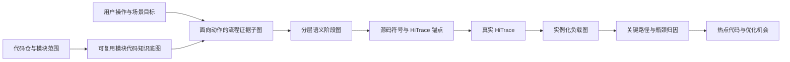
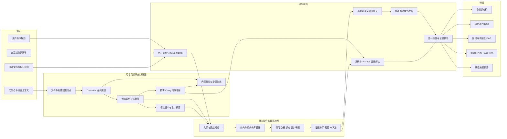
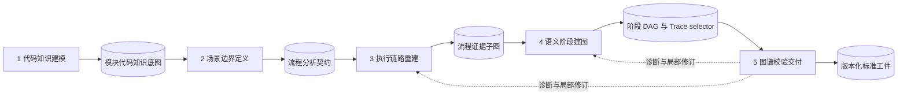
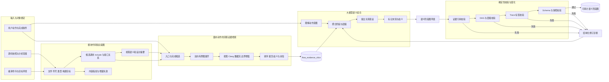
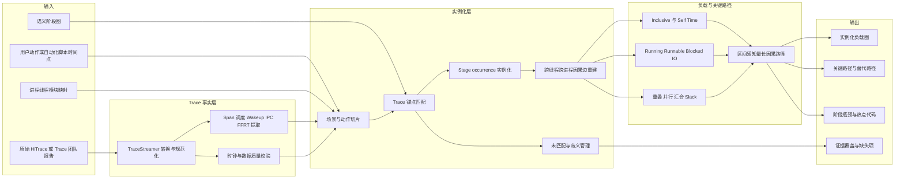
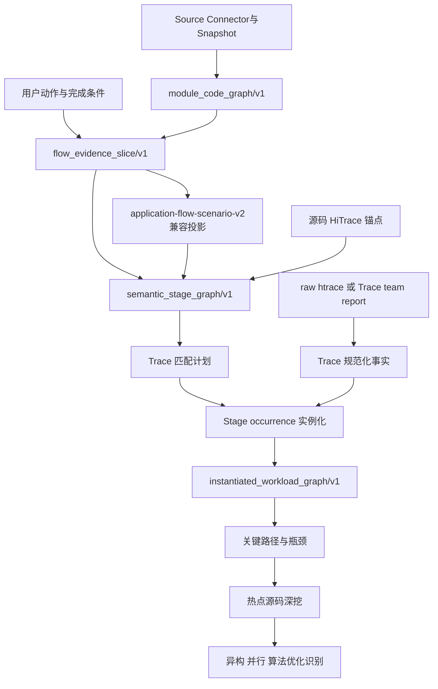
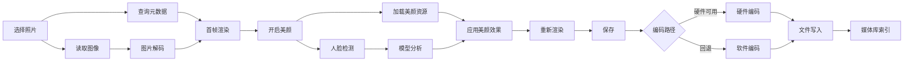

# 语义阶段图与 Trace 实例化负载图技术设计

- 状态：Design Baseline v1.2
- 适用范围：OpenHarmony 应用与系统场景、单动作与多动作交互、源码静态分析、HiTrace 动态实例化和关键路径分析
- 相关规范：`application_execution_flow_reconstruction_spec.md`、`heterogeneous_optimization_enablement_platform_technical_overview.md`、`trace_analysis_technology_spec.md`、`cross_spec_contract.md`

## 1. 文档目标

性能分析需要回答两个不同问题：

1. 从业务与代码角度看，一个用户操作会触发哪些系统阶段，它们之间是什么关系？
2. 在某次真实运行中，这些阶段实际发生了多少次、各自消耗了多少时间、哪条因果路径决定了端到端延迟？

第一个问题由**交互驱动的分层语义阶段图重建**解决，第二个问题由**Trace 驱动的实例化负载图与关键路径重建**解决。两项技术必须分开建模：静态图不能产生运行时间事实，动态 Trace 也不能单独提供稳定的业务语义。



## 2. 总体概念模型

### 2.1 为什么不能只使用线性 Stage

线性 Stage 列表适合简单、单入口、严格串行的操作。例如：

```text
点击拍照 -> 请求相机 -> 图像处理 -> 保存照片
```

真实系统通常还包含：

- 图片解码与元数据查询并行执行；
- UI 线程发起任务后由 FFRT、Binder、媒体服务或驱动异步完成；
- 硬件路径与 CPU/software fallback 条件分支；
- 多个前置任务在渲染或保存前汇合；
- 用户反复调色、撤销、重做或多次拍照；
- 一个高层阶段继续拆解为预处理、模型推理、后处理和渲染等子阶段。

因此，目标模型不是简单地把 Stage 数量增加，而是显式表达**层级、因果、并行、分支、异步和汇合**。

### 2.2 状态机、分层 DAG 与运行实例

复杂用户旅程可能存在循环，而 DAG 本身不能有环。推荐采用三层结构：

| 层级 | 建模对象 | 主要表达能力 |
|---|---|---|
| 场景状态机 | 选择照片、编辑、撤销、保存等用户状态迁移 | 重复交互、循环、条件跳转、取消 |
| 用户动作 DAG | 一次点击、滑动、保存等操作触发的系统处理 | 并行、异步、分支、汇合、跨线程/进程 |
| 阶段子 DAG | 人脸检测、模型推理、图像编码等内部步骤 | 细粒度计算、数据依赖和运行时边界 |

静态阶段图是可复用模板；每次用户操作会在 Trace 中产生一个或多个 occurrence，最终形成实例化负载图。

---

## 3. 技术一：交互驱动的分层语义阶段图重建

### 3.1 技术本质

1. 先对用户选择的代码模块建立可增量复用的代码知识底图，再围绕一次用户操作检索入口、完成边界及其关联的调用、数据、状态和异步关系，形成有界流程证据子图。
2. 大模型不直接阅读整个代码仓，而是在流程证据子图和必要源码窗口上完成业务阶段聚合、层级归纳、未决关系解释与分层 DAG 综合。
3. 图中节点表示用户动作、系统阶段和细粒度子阶段，类型化边表示顺序、并行、异步、IPC、数据依赖、fallback 与汇合关系。
4. 每个阶段绑定代码知识节点、源码证据和 HiTrace 锚点，形成不包含推测耗时、可供真实 Trace 实例化的执行模板。

### 3.2 技术架构图



### 3.3 技术价值

1. 准确表达并行、分支、异步和跨线程执行，避免线性 Stage 列表扭曲真实流程。
2. 为 Trace 提供稳定的业务语义坐标，使关键路径计算能够同时依据时间关系和因果关系。
3. 支持从用户动作逐层下钻到热点代码，为算法、并行计算和异构卸载优化提供明确入口。
4. 将模块结构和语义知识跨流程复用，减少重复源码搜索、无关上下文和模型波动，并支持源码变化后的局部重建。

### 3.4 输入

| 输入 | 内容 | 证据用途 |
|---|---|---|
| 用户操作描述 | 操作目标、起点、完成条件、可选步骤 | 确定业务范围和用户可观察结果 |
| 交互或自动化脚本 | 点击、滑动、选择、保存及步骤时间点 | 确定动作顺序和状态转换 |
| Source Connector | 代码仓、子目录、源码快照 | 绑定所有静态证据 |
| 编译上下文 | `compile_commands.json`、宏、include、目标架构 | 提高 AST、类型、条件编译和调用解析精度 |
| 模块代码知识底图 | 文件、符号、候选调用、依赖、语义摘要和内容指纹 | 避免每次流程分析从头扫描，支持有界检索与增量复用 |
| 设计材料 | 接口文档、状态机、ADR、模块说明 | 辅助理解模块边界，不替代源码事实 |

用户可以只描述一个动作，也可以描述完整旅程。输入不足时，系统先发现候选操作和完成边界，再由用户选择需要展开的流程。

### 3.5 分层节点模型

| 节点层级 | 示例 | 典型来源 |
|---|---|---|
| `scenario` | 图库照片编辑 | 用户目标、应用入口、设计文档 |
| `interaction` | 一次编辑会话 | 自动化脚本、页面状态、业务状态机 |
| `user_action` | 选择照片、开启美颜、保存 | UI 回调、命令接口、用户描述 |
| `semantic_stage` | 图片解码、人脸检测、文件写入 | 调用链、状态转换、IPC/任务边界 |
| `sub_stage` | 模型预处理、NPU 推理、结果后处理 | 函数实现、算子图、异构 API 生命周期 |

高层节点用于业务阅读，低层节点用于性能归因。节点展开是按需的：默认展示用户动作和主要系统阶段，只有热点或证据不足的阶段才继续下钻。

### 3.6 边模型

| `edge_type` | 含义 | 示例 |
|---|---|---|
| `sequence` | 明确串行先后 | 解码完成后开始渲染 |
| `control_dependency` | 条件控制依赖 | 检测到人脸后进入美颜模型 |
| `data_dependency` | 消费前序输出 | 模型后处理读取推理输出 |
| `async_dispatch` | 投递异步任务 | UI 线程向 FFRT 提交任务 |
| `ipc_request` / `ipc_reply` | 跨进程请求与返回 | 应用调用媒体服务 |
| `wakeup` | 调度唤醒关系 | Binder/FFRT 唤醒工作线程 |
| `parallel_candidate` | 静态上可能并行 | 元数据查询与图像读取 |
| `join_all` / `join_any` | 多前驱汇合 | 解码和元数据完成后首帧渲染 |
| `fallback` | 条件替代路径 | 硬件编码失败后软件编码 |

`parallel_candidate` 只表示静态依赖允许并行，不证明运行时已经并行。实际重叠必须由 Trace 实例确认。

### 3.7 分析流程

完整分析聚合为五个大阶段。它们是五个具有稳定输入、输出和质量门禁的工件边界，不等于必须执行五次模型调用。总体分工原则是：**确定性工具生产代码事实，Agent 与大模型规划检索并完成语义综合，后端校验器裁决工件能否入库**。

| 大阶段 | 要回答的问题 | 主要执行者 | 主要输入 | 核心输出 | 对应原细步骤 |
|---|---|---|---|---|---|
| 1. 代码知识建模 | 选定模块中有哪些代码实体和候选关系？ | Source Connector、Tree-sitter、构建解析器；Clang/clangd 按需增强 | 代码仓、目录、源码快照、编译上下文 | 模块代码知识底图 | 1 |
| 2. 场景边界定义 | 用户要分析哪一个动作，何时开始和完成？ | Agent/大模型主导，源码工具和用户输入提供证据 | 用户描述、公共接口、UI 回调、状态机、代码底图 | 流程分析契约与候选流程 | 2 |
| 3. 执行链路重建 | 入口与出口之间可能经过哪些真实代码和异步边界？ | Agent 规划，图检索、原生代码导航和精确静态工具取证 | 选定流程、代码底图、源码窗口 | 流程证据子图与未解析边 | 3 |
| 4. 语义阶段建图 | 如何把低层代码提升为可解释的分层阶段 DAG？ | 大模型聚合，确定性编译器与锚点工具固化 | 流程证据子图、源码证据、真实插桩声明 | 分层语义阶段图与 HiTrace selector | 4～7 |
| 5. 图谱校验交付 | 图是否满足 Schema、证据和版本要求并可稳定消费？ | 后端确定性校验器和工件存储；Agent 仅修订失败项 | 阶段图、证据引用、源码快照和知识图版本 | 可发布图工件、增量状态和线性投影 | 8～10 |



#### 3.7.1 阶段一：代码知识建模

**目标**：为后续多个流程建立可复用、可定位、可增量失效的代码事实底图，而不是让模型在每次分析时重新遍历整个代码仓。

具体执行步骤：

1. Source Connector 固定代码仓、分析子目录和源码快照，生成规范路径与内容指纹；构建文件清单时排除构建输出、二进制和用户明确忽略的目录。
2. `rg --files`、文件系统扫描器或平台仓库检查器清点源码、构建文件和接口材料，并解析 GN、CMake 等构建目标关系。
3. Tree-sitter 批量提取文件、命名空间、类型、函数、声明、include/import、语法调用点和基础控制结构，形成宽召回的结构索引。该层调用关系属于候选事实，不能直接冒充编译器已经解析的精确调用图。
4. 对入口、跨模块边界、函数指针、重载、宏展开和条件编译等高价值或歧义节点，使用 `compile_commands.json`、clangd 的定义/引用/调用层级，或 Clang AST、CFG、LibTooling 做精确增强。
5. 将节点、边、证据位置、提取器版本和内容哈希分片保存；源码变化时按文件和反向依赖传播失效，不重建无关模块。

| 能力 | 工具或执行者 | 责任边界 |
|---|---|---|
| 仓库与快照绑定 | Source Connector | 确定分析范围和源码身份 |
| 文件与文本检索 | `rg`、`Glob/Grep/Read`、文件扫描器 | 提供确定性路径和源码窗口 |
| 大规模结构提取 | Tree-sitter | 提供低成本语法事实和候选关系 |
| 精确符号与控制流 | clangd、Clang AST/CFG/LibTooling | 在有效编译上下文中升级证据等级 |
| 模块意图与接口说明 | 大模型按需读取 README、接口和少量源码 | 生成语义摘要，不改写静态事实 |

当前平台已对用户选定模块实现 `module_code_graph/v1`：Tree-sitter C/C++ 提取结构候选，SQLite 保存查询索引，Artifact Store 固化 `source_connector_id`、`source_snapshot_id`、scope、提取器版本、数据库哈希和统计摘要；Agent 通过有界查询取得符号、一跳调用与插桩候选。当前版本按模块完整重建，Clang 精确增强和文件级增量失效仍是后续能力。阶段完成条件是产生可查询且血缘闭合的底图工件，而不是模型声称“已经理解代码仓”。

#### 3.7.2 阶段二：场景边界定义

**目标**：把自然语言诉求变成可执行的流程查询，明确一次流程的触发条件、完成条件、参与模块和用户可观察结果。

具体执行步骤：

1. Agent 加载 `application-execution-flow-reconstruction` Skill，读取用户描述、代码范围和阶段一的入口线索。
2. 大模型先把用户目标归一为初始状态、1～N 个有序用户动作和用户可观察的最终结果，再从 UI callback、公共 API、命令接口、状态机和成对的 start/finish API 中识别实现边界。它负责理解“拍照完成”“首帧显示”“保存成功”等业务语义，因为这些概念通常不能从 AST 节点类型直接推出。
3. 语义含糊或入口覆盖不足时，Agent 使用原生 `rg`、`Glob/Grep/Read`、LSP 导航或 `application_flow.search_source` 做少量聚焦补证；本阶段不展开全部调用链，也不搜索全仓 HiTrace。
4. 候选是完整用户操作，不是单个函数或内部步骤。数量由入口、操作模式、完成语义或范围解释的真实差异决定；重载、别名和同一旅程的内部步骤应合并。
5. Agent 调用 `application_flow.publish_candidates` 提交动作序列、边界理由、语义轮廓及入口/出口。后端复核路径、行号和符号，生成稳定 ID、证据引用、快照绑定及 `application_flow_discovery/v1` 工件；用户反馈通过父工件和修订请求形成新版本。

本阶段由**大模型负责语义判断**，由**源码工具负责候选证据**，由**发布工具负责合同和绑定校验**。其输出至少包含：流程名称、触发语义、完成语义、参与者、入口候选、出口候选、分析范围和未知项。用户尚未给出明确流程时，系统先发布候选并等待选择，不应擅自深入其中一个流程。

#### 3.7.3 阶段三：执行链路重建

**目标**：围绕用户选中的一个流程，构造能够支持阶段划分的有界代码证据子图，而不是追求覆盖整个仓库的“完整调用图”。

具体执行步骤：

1. Agent 通过 `application_flow.read_asset` 读取精确 discovery 和 `flow_id`，把入口、出口、参与模块及用户补充描述组成检索计划。
2. 从入口候选沿调用、任务提交、IPC 请求和数据生产关系前向展开；从完成候选沿 callback、状态完成、数据消费和 IPC reply 关系反向展开，优先寻找两侧能够汇合的主干。
3. 基础探索使用 Agent 原生 `rg`、`Glob/Grep/Read/Bash`、clangd 或已有代码知识图查询；需要判断重载、虚调用、宏、函数指针、数据依赖或 CFG 可达性时，再升级到 Clang 精确分析。
4. 对 Binder、FFRT、线程池、事件循环、future/promise、监听器和硬件 callback 等异步边界，分别记录“提交端、运行端、完成端”和用于关联的对象、request ID、状态或数据。不能因两个函数名称相似就建立因果边。
5. 每条关系标记 `observed`、`derived` 或 `hypothesis` 等事实等级，并保存文件、行号、符号和工具来源；预算内无法闭合的动态派发、插件调用和外部组件关系必须保留为 `unresolved_edge`。
6. 当主入口到完成边界已经闭合，且继续扩展只产生低价值旁支时停止。热点阶段可在后续按需继续展开，不要求首轮穷举所有工具函数。

大模型在本阶段负责制定下一步检索、识别参与者角色、解释未决关系和控制探索预算；调用、声明、类型、宏、状态访问和异步 API 等事实必须来自工具结果。输出 `flow_evidence_subgraph`，其中包含代码节点、类型化低层边、证据引用、源码窗口和未解析边。

#### 3.7.4 阶段四：语义阶段建图

**目标**：把流程证据子图聚合成面向业务和性能分析的分层 DAG，并为每个可观测阶段绑定真实源码 HiTrace selector。

具体执行步骤：

1. 大模型依据业务意图、线程/进程/设备切换、状态转换、数据所有权和异步边界，把低层函数聚合为 `semantic_stage` 与 `sub_stage`；阶段名称表达业务工作，不简单复制函数名。
2. 将证据子图中的调用、控制、数据、IPC、任务、callback 和 fallback 关系提升为阶段级类型化边。`parallel_candidate` 只有在静态依赖允许时才能生成，仍需真实 Trace 证明是否并行发生。
3. 大模型生成一份带 `%% @action`、`%% @phase`、`%% @stage_hierarchy`、`%% @implementation` 及现有 stage 元数据的 Mermaid；需要继续拆解子阶段时，可增加 `%% @activity`、`%% @activity_relation` 和 `%% @implementation.activity_id`。当前平台把“用户动作 → 业务大阶段 → 可锚定子阶段 → 细粒度活动关系 → 函数实现”保存为 `application_flow_stage_hierarchy/v1`，再由 `application_flow.compile_mermaid` 将可锚定子阶段确定性投影为既有场景 v2 JSON、`stage_evidence` 和 `unknowns`，避免模型维护两份近似工件。
4. 首份阶段图不因缺少 HiTrace 而阻塞：没有源码证据的阶段先写 `matcher: unavailable`。随后 Agent 只围绕已有阶段的实现符号和主调用链，使用 `rg`、源码读取、宏定义追踪及必要的预处理器证据搜索真实插桩。
5. 字符串字面量提交真实 label；格式化事件提交可证明的静态前缀；`__func__` 或 `__PRETTY_FUNCTION__` 提交稳定函数 selector 并标记 `function_derived`。普通函数声明不得标记成精确 event label。
6. Agent 一次调用 `application_flow.enrich_trace_anchors` 提交逐阶段锚点。后端逐行校验路径、行号、宏、所在函数和 selector 类型，保存增强 discovery 并重新编译 Mermaid/JSON。

本阶段的语义聚合主要由**大模型**完成，Mermaid 到分层工件和既有 JSON 的转换、函数位置复核、Trace 锚点逐行核验及稳定排序由**确定性工具**完成。当前生产工件在分层侧车中保存子阶段内部的串行、依赖、异步、并行候选、并行、汇合与回退关系，同时保留有序 Stage 投影供既有页面和场景 v2 JSON 使用。源码中存在桩点只证明“可被观测”，不证明该事件在某次运行中真实发生，也不产生耗时事实。

#### 3.7.5 阶段五：图谱校验交付

**目标**：把模型生成的候选图转化为可审计、可回归、可增量维护且能被 Trace 分析稳定消费的正式工件。

确定性后端执行以下门禁：

1. **Schema 校验**：检查字段、枚举、必填项、属性类型和兼容版本，拒绝模型自造字段或遗漏合同。
2. **图结构校验**：检查节点 ID 唯一、边端点存在、动作内无环、层级引用有效、汇合关系合理，并生成稳定拓扑排序。
3. **证据校验**：检查每个源码引用、函数符号、行号、HiTrace selector 和证据 ID 确实属于绑定快照；推测边不能自动升级为观察事实。
4. **血缘与版本校验**：记录 Source Connector、源码快照、代码知识图版本、Skill 版本、Agent Run、输入工件和内容 SHA-256。
5. **固化与增量失效**：保存流程证据子图和语义阶段图；函数体、接口、依赖、编译上下文或 selector 变化时，只失效受影响子图及派生摘要。
6. **兼容投影**：对 DAG 做稳定拓扑排序，生成现有线性 Stage 页面与场景 v2 JSON 所需的只读投影；投影不改变原 DAG 的并行、分支和汇合语义。

JSON Schema 校验器、DAG 校验器、源码快照绑定、`application_flow.compile_mermaid`、`application_flow.enrich_trace_anchors` 和工件存储是本阶段的主要执行工具。大模型不能绕过门禁；它只接收结构化诊断并修订失败节点、边或锚点，随后重新提交校验。最终输出沿用平台现有 `executable_status`：`ready` 表示 required stage 的源码 start/end 已闭合，可进入 Trace 实例化；`draft_needs_trace_evidence` 可展示和评审，但必须保留缺失证据；未通过 Schema、源码或图结构校验的候选直接拒绝，不保存成伪正式状态。

#### 3.7.6 当前平台操作与五阶段映射

| 页面或 Agent 操作 | 覆盖的大阶段 | Agent 工作 | 平台工具工作 |
|---|---|---|---|
| 分析并生成阶段图 | 1～4 | 根据用户目标自主判断完整操作边界、主调用链、阶段粒度与源码探索方法，直接生成分层 Mermaid | Source Connector 绑定输入；`publish_candidates` 仅登记选定操作的内部血缘；`compile_mermaid` 生成稳定 JSON 投影；插桩检查器按需使用 |
| 同轮源码/真实 Trace 校准 | 4～5 | 沿已理解的实现链确认 HiTrace，并用真实事件修订阶段边界 | `enrich_trace_anchors` 校验源码证据，`apply_runtime_trace_alignment` 固化运行时匹配 |
| 保存、展示和后续加载 | 5 | 根据诊断局部修订 | Schema/DAG/快照/血缘门禁、工件存储、增量失效和线性投影 |

这五阶段描述技术责任，不是要求 Agent 按五轮固定顺序执行。当前页面只提供分析输入和阶段图/证据结果两个交互步骤：Agent 在一次任务中自主组合源码导航、调用链追踪、语义聚合和证据校准；页面不再用独立的候选预检打断分析。事实生产、语义综合和确定性校验仍保持各自的责任边界。

### 3.8 大模型与静态工具的分工

| 能力 | 主要责任方 | 原因 |
|---|---|---|
| 业务动作和阶段命名 | 大模型 + 用户描述 | 需要跨模块语义理解 |
| 模块文件、符号和候选依赖底图 | Tree-sitter/索引工具 | 低成本、可复用、同一输入可重复构建 |
| AST、CFG、声明与类型精确增强 | Clang/静态分析工具 | 对高价值或歧义节点提供编译上下文一致的证据 |
| 流程证据子图检索 | 图检索与 Agent 协同 | 确定性裁剪控制上下文，Agent 负责规划未决关系补证 |
| 调用图和数据依赖 | 静态工具为主，大模型解释未决关系 | 降低名称类比造成的误判 |
| 阶段聚合与层级归纳 | 大模型 | 函数到业务阶段不是纯语法映射 |
| HiTrace label 提取 | 确定性源码解析 | event 名与函数名不能混同 |
| 图 Schema 与一致性校验 | 后端确定性工具 | 保证工件可消费和可回归 |

这不是简单地让静态工具“提取代码”、再让大模型“写一段总结”，而是一条有事实所有权和否决机制的协作链：

1. **静态工具负责事实生产**：从确定源码快照、低成本结构索引和可用编译上下文中分级提取声明、类型、控制流、调用、状态访问、并发边界和真实 HiTrace 标签，并为每条事实附带可定位证据。
2. **大模型负责语义综合**：理解用户动作和业务完成条件，把跨文件、跨线程、跨进程的低层事实聚合成可读的阶段、层级和候选关系，但不得改写静态事实。
3. **确定性校验器负责最终裁决**：检查模型输出引用的证据是否存在、图结构是否有效、Trace selector 是否来自真实桩点，以及所有字段是否符合 Schema；不合格结果只能修订，不能直接入库。
4. **Trace 负责运行时证明**：静态工具和大模型可以重建“可能如何执行”的语义模板，但只有真实 Trace 才能证明某次运行发生过、发生了多少次、耗时多少和哪条路径是关键路径。

#### 3.8.1 协同架构与事实流



这里有两个不同生命周期的关键中间对象：**模块代码知识底图**绑定代码仓、快照和模块范围，可被多个业务流程重复消费；**流程证据子图**绑定一次用户动作与检索计划，只包含构建该动作语义图所需的有限节点、边和源码事实。大模型看到的不是未经约束的整个 30 GB 代码仓，也不是只有函数名的检索结果，而是与本次动作相关、可回溯到源码的证据子图。模型输出也不是最终事实，而是引用该子图形成的语义图草案。

#### 3.8.2 代码知识底图：结构图方法与平台边界

模块代码知识底图采用“确定性结构事实先行、模型负责语义、图谱持久化、按依赖分批和增量更新”的方法。Source Connector、源码快照、证据等级、页面 Agent Session、HiTrace、语义阶段图和 Trace 实例化合同由平台统一维护。

| 借鉴思想 | 在本平台中的改造 | 不直接照搬的部分 |
|---|---|---|
| Tree-sitter 确定性结构抽取 | 建立文件、函数、类、include/import 和语法可见调用候选 | 不把语法 callee 文本当成编译器已解析的精确调用边 |
| LLM 生成摘要、标签和模块语义 | 仅对进入检索子图的高价值节点惰性增强，并绑定源码引用 | 不对完整 OpenHarmony 仓库做无差别全量语义总结 |
| 按依赖关系形成分析批次 | 按模块、构建目标和邻接关系组织结构构建及摘要失效传播 | 不引入第二套页面 Agent Runtime 或强制多 Agent 编排 |
| JSON/SQLite 图持久化 | 转换为平台 Artifact，绑定 connector、snapshot、scope、producer 和内容 hash | 用户代码仓保持只读，产品入口统一由代码知识页面提供 |
| 文件指纹与增量更新 | 文件、函数体、接口、构建上下文分别计算指纹并有界传播失效 | 不把“函数签名未变但函数体已变”视为与流程语义无关的 cosmetic 修改 |
| 图合并和完整性检查 | 校验节点引用、源码存在性、边证据、快照一致性和派生工件血缘 | 不用图结构完整性替代调用精度、业务正确性或运行时发生证明 |

模块代码知识底图建议采用 `module_code_graph/v1` 工件。初期不要求图数据库，使用版本化 JSON/JSONL 和派生索引即可。节点与边至少覆盖：

| 对象 | 建议类型 | 说明 |
|---|---|---|
| 节点 | `module`、`build_target`、`file`、`function`、`type`、`data_object`、`api_contract`、`tracepoint`、`design_concept` | 低层事实与语义摘要分字段保存，避免摘要覆盖事实 |
| 结构边 | `contains`、`declares`、`imports`、`build_depends_on` | 可由目录、构建文件或 parser 重复提取 |
| 行为边 | `calls_candidate`、`dispatches`、`registers_callback`、`ipc_contract`、`fallback_to` | 必须保存解析方法与 `resolution_status` |
| 数据边 | `reads`、`writes`、`mutates`、`transfers_ownership` | Tree-sitter 不足时按需由 Clang/CFG 增强 |
| 观测边 | `traced_by`、`logs_with` | `traced_by` 只能引用真实桩点或可证明 wrapper |

知识底图中的 Tree-sitter 调用点、include 启发式解析和模型摘要默认只承担**召回与导航**，不能直接提升为 `source_observed`。当它们进入阶段边、跨进程边、关键数据依赖或 HiTrace 边界时，系统根据价值和歧义按需读取源码，必要时恢复编译上下文并使用 Clang/索引执行精确增强。这样既避免对全仓先做昂贵编译级分析，也不会让低成本候选污染高等级证据。

#### 3.8.3 流程证据子图与双向检索

代码知识底图回答“模块里有哪些对象和可能关系”，流程证据子图回答“哪些对象足以解释这一次用户操作”。每次流程识别都必须产生独立的 `flow_evidence_slice/v1`，不能把整个代码知识图或未经裁剪的源码直接发送给模型。

建议采用以下检索过程：

1. **动作意图归一化**：从用户描述提取触发动作、输入对象、参与者、用户可观察结果、完成谓词和明确排除范围。
2. **入口候选召回**：综合 UI 回调、公开 API、命令、事件处理器、服务入口、测试步骤和用户提供符号，生成多个带理由的入口 seed。
3. **完成候选召回**：从结果 callback、状态提交、首帧可见、文件落盘、响应返回或资源可用等信号生成完成 seed；不能默认把入口函数返回当成业务完成。
4. **双向有界展开**：从入口沿调用、dispatch、IPC、状态和数据边前向展开，同时从完成 seed 沿 caller、producer、注册和依赖边反向展开，优先保留能够连接两侧的子图。
5. **边界增强**：遇到虚调用、函数指针、callback、Binder/HDI、FFRT 或动态 provider 时，Agent 使用原生源码工具定向补证；高价值歧义再升级到 Clang/索引，未闭合关系保持多候选或 `unresolved`。
6. **任务相关排序**：综合动作语义、入口到完成的连通性、状态/数据对象连续性、执行域切换、证据等级和源码多样性排序；名称相似只能用于召回，不能独立建立关系。
7. **预算裁剪**：限制展开深度、超高 fan-out、通用日志/工具节点和重复 wrapper；保留被裁剪数量、原因、搜索边界和可继续展开 token，而不是静默丢弃。

检索不是一次固定 Top-N 查询。入口、完成边界或跨模块关系仍不闭合时，Agent 可以基于当前诊断继续扩大某一方向、读取局部源码或增加 seed；已经闭合的无关分支不应重复分析。子图至少记录：

```json
{
  "schema_version": "flow_evidence_slice/v1",
  "code_graph_artifact_id": "art_code_graph_xxx",
  "source_connector_id": "connector_oh",
  "source_snapshot_id": "source_snapshot_xxx",
  "scope": "foundation/multimedia/camera_framework",
  "intent": {
    "action": "拍照",
    "completion_predicate": "照片结果对调用方可用"
  },
  "entry_seed_ids": ["function:camera_capture"],
  "completion_seed_ids": ["callback:capture_completed"],
  "node_ids": ["function:camera_capture", "function:submit_request"],
  "edge_ids": ["edge:dispatch_request"],
  "source_evidence_ids": ["source:camera_capture:120"],
  "unresolved_relations": ["callback target selected at runtime"],
  "retrieval": {
    "method": "bidirectional_bounded_graph_search/v1",
    "truncated": false
  }
}
```

这个工件既是语义阶段聚合的模型上下文，也是结果可复现性的检索记录。后续 Skill 调整或模型更换时，可以在相同证据子图上重跑阶段聚合，区分“检索变化”和“模型归纳变化”。

#### 3.8.4 流程证据包如何工作

每条流程证据事实至少包含以下信息：

| 字段 | 含义 | 作用 |
|---|---|---|
| `evidence_id` | 稳定、唯一的证据 ID | 让节点和边精确引用事实，而不是引用自然语言摘要 |
| `fact_type` | 声明、调用、状态访问、任务提交、IPC、桩点等事实类型 | 支持模型按语义检索，也支持校验器按类型设门禁 |
| `subject` | 事实对应的函数、对象、状态或 Trace 标签 | 明确事实主体 |
| `code_graph_refs` | 对应的代码知识节点和边 ID | 支持从流程结论返回可复用知识底图，并继续展开邻接关系 |
| `source` | 文件、行范围、源码 hash 和源码快照 | 支持人工复核、缓存失效和版本追踪 |
| `method` | 提取器名称、版本和编译上下文指纹 | 区分 Clang 精准证据、词法降级结果和模型假设 |
| `resolution_status` | `observed`、`derived`、`candidate` 或 `unresolved` | 防止候选调用边被写成已证明调用 |
| `payload` | 类型化的事实内容 | 保存 callee、条件、线程边界、label 等机器可消费信息 |

示例：源码解析器发现一个真实 HiTrace 字符串后，不只返回字符串，而是返回完整证据：

```json
{
  "evidence_id": "source:trace_anchor:8d4f2c",
  "fact_type": "trace_label_literal",
  "subject": "HCameraService::CreateCaptureSession",
  "code_graph_refs": ["function:hcamera_service_create_capture_session", "tracepoint:create_capture_session"],
  "source": {
    "path": "foundation/multimedia/camera_framework/service/camera_service.cpp",
    "line_start": 418,
    "line_end": 418,
    "sha256": "source-file-sha256"
  },
  "method": {
    "name": "clang_trace_anchor_extractor",
    "version": "1.0"
  },
  "resolution_status": "observed",
  "payload": {
    "label": "CreateCaptureSession",
    "match": "exact"
  }
}
```

大模型可以据此把该锚点选为某个阶段的开始候选，但不能把 `subject` 中的函数名自动改写为另一个 event name。校验器会检查 `trace_binding` 引用的 `evidence_id`、label 和源码快照是否一致。

#### 3.8.5 用户动作与场景语义理解

**工作原理**：用户给出的“启动相机”“选择照片后美颜并保存”等描述定义了分析目标，但通常没有给出准确入口、完成条件和跨模块边界。大模型先从描述中提取动作、参与者、输入对象、用户可观察结果和结束条件，再结合 UI 回调、服务接口、状态机、测试脚本和模块说明，形成待验证的动作候选。

静态工具负责定位候选入口和出口，例如按钮回调、公开 API、状态变更、结果回调或文件落盘调用。大模型负责判断这些低层事件分别对应“用户触发”“系统受理”“核心处理”和“结果可见”中的哪一种语义。入口或完成条件存在多个解释时，模型必须输出歧义项和选择理由，不能任选一个后静默固化。

该能力的产物是动作边界、完成谓词和候选参与模块。它回答“我们要解释哪一个业务过程”，但不证明该过程在某次 Trace 中发生，也不生成耗时。

#### 3.8.6 AST、CFG、声明与类型提取

**工作原理**：代码知识底图首先使用 Tree-sitter、构建文件和词法索引形成低成本结构事实，保证即使暂时缺少完整编译环境，也能为检索提供函数范围、类型文本、include 和语法调用候选。只有进入流程证据子图且影响入口、完成边界、跨模块关系、数据依赖或阶段拆分的高价值节点，才恢复 `compile_commands.json` 或构建系统中的真实编译命令，包括宏、include path、generated header、target triple、sysroot 和语言选项，再使用与 OpenHarmony 构建环境匹配的 Clang 精确增强。

Clang AST 提供函数与类型声明、调用表达式、模板实例、lambda、字段访问、宏展开位置和源码范围；CFG 将分支、循环回边、早退、异常和不可达路径组织成基本块与边。二者结合后可以回答：

- 哪个调用实际位于哪个函数和条件分支中；
- 某个状态在何处读取、写入或移交所有权；
- 哪些返回、错误处理和 fallback 会改变流程；
- 某个 Trace 宏位于 dispatch 前、核心执行区内还是 completion 后。

AST/CFG 只产生编译器可见事实。它不能仅凭函数可达就断言运行时一定执行，也不能仅凭一个函数包含循环就断言该循环是性能热点。大模型可以解释这些结构的业务含义，但不能生成不存在的 AST 节点、类型或源码行。

这种“宽召回、窄增强”模式不能把 Tree-sitter 与 Clang 的输出混成同一等级：语法调用点保持 `candidate` 或 `derived`，成功绑定编译上下文并解析符号的直接调用才可以升级；Clang 失败不阻断流程发现，但必须保留失败诊断和降级范围。

#### 3.8.7 调用图、数据流与跨模块关系

**工作原理**：代码知识底图先从 Tree-sitter、符号索引和构建关系建立高召回函数级候选图；流程证据检索再对相关边读取调用点源码并按需使用 AST/索引复核。绑定编译上下文的直接调用可记录为 `observed`；仅由语法 callee 文本得到的边保持 `candidate`；虚函数、函数指针和动态 provider 只能依据类型、赋值点和注册关系生成候选 callee 集；无法解析的动态调用保持 `unresolved`。对于 Proxy/Stub、HDI、Binder 和服务注册，分析器应识别 transaction code、接口合同及两端实现，把单纯的 C++ 调用图扩展为跨进程服务关系。

数据流分析沿 CFG 和有界跨过程调用传播关键对象、状态和结果：例如请求对象从 UI 进入服务、图像 buffer 交给处理任务、异步结果通过 callback 返回。状态的定义、使用、转移和 completion 信号用于建立 `data_dependency`、`state_dependency` 和 `completion_dependency`，而不是只按照源码行顺序连边。

大模型在这一层的职责是解释候选关系的业务意义，并对静态工具无法唯一解析的边提出带证据的假设。例如，模型可以指出某个 callback 很可能是“拍照完成”，但若注册点和触发点无法静态闭合，该边只能标为 `model_hypothesis` 或 `unresolved`。模型不能用函数名相似度把两个没有调用、数据或合同证据的模块直接连成确定边。

#### 3.8.8 异步、并发、IPC 与同步边界识别

**工作原理**：复杂应用流程常在任务提交处离开当前调用栈，再从另一个线程、进程或设备回调继续。分析器需要识别 FFRT/线程池提交、消息队列、事件循环、Binder/HDI 调用、锁与条件变量、future/promise、I/O completion、设备 command submit 和 callback 注册等运行时边界。

每个边界应拆分为至少三个语义点：

1. `dispatch`：生产者创建请求或提交任务；
2. `execute`：消费者线程、服务进程或硬件开始处理；
3. `complete/join`：结果返回、状态提交或等待方继续执行。

这种拆分避免把“提交任务的 wrapper”误认为真正负载，也使并行支路、等待关系和汇合点能够进入 DAG。静态工具记录具体 API、对象和源码位置；大模型根据动作目标判断它属于前台关键流程、后台旁路还是错误/fallback 路径；真实并发和等待时长仍由第二项技术中的 Trace 实例化证明。

#### 3.8.9 函数到阶段的语义聚合与层级归纳

**工作原理**：静态分析得到的通常是成百上千个函数和边，不能直接作为人可理解的性能阶段。大模型执行受证据约束的语义聚合，综合以下信号把低层节点归并为阶段：

- 是否服务于同一个用户目标或可观察结果；
- 是否围绕同一个状态转换、请求对象或数据对象；
- 是否处于同一个线程、进程、服务或硬件执行域；
- 是否共享明确的开始条件和完成条件；
- 是否存在可以独立分析的并行支路、重试、fallback 或子流程。

阶段粒度遵循“**一个阶段表达一次有意义的系统进展**”。一个函数不必对应一个阶段；单个大函数内部的独立任务也可以拆成多个阶段。顶层节点表达用户动作，子图表达系统阶段，更深层节点才落到代码模块、任务和函数。

聚合不是按函数名聚类，也不使用固定阶段数量。应同时应用以下通用规则：

| 判断维度 | 倾向合并为同一阶段 | 倾向拆分为不同阶段 |
|---|---|---|
| 用户结果 | 共同完成一个不可再分的可观察进展 | 分别产生独立可观察结果或完成信号 |
| 状态与数据 | 围绕同一请求、状态转换或数据对象连续处理 | 数据所有权转移、格式边界或结果发布发生变化 |
| 执行域 | 同一线程、进程、服务或设备域内连续工作 | 跨线程、进程、服务、设备或异步队列边界 |
| 控制关系 | 紧密串行且独立分析没有额外价值 | 并行支路、条件分支、重试、fallback 或显式 join |
| 性能含义 | 都是同一核心工作的准备或收尾 | 一侧是提交/等待，另一侧是真正计算、I/O 或设备执行 |
| 证据闭合 | 共享可说明的入口、完成条件与支持子图 | 入口、完成条件或依赖证据分别闭合 |

对 wrapper 和深层 callee 采用以下处理：

- 只做参数封装、日志或薄转发的 wrapper 默认折叠为阶段证据，不单独成为业务阶段；
- wrapper 若承担 IPC、任务提交、锁等待、数据所有权移交或 fallback 选择，应保留为边界节点或 dispatch 子阶段；
- tracepoint 所在函数只是定位锚点时，必须沿候选调用和数据关系继续寻找真正执行计算、I/O、模型、编码或设备工作的 callee；
- 无法静态确认哪个 callee 承担主要负载时，应保留多个候选及其调用路径，等待 Trace、采样或进一步源码证据校准，不能由模型任选一个写成热点；
- 大函数内部若包含可独立定位的循环、异步提交、状态提交或多个计算核心，可以使用源码范围节点拆分子阶段，而不是强制整函数归为一个阶段。

大模型负责阶段名称、摘要、父子关系和候选边，静态工具保留每个阶段覆盖的函数、状态、桩点和源码证据。若一个阶段无法给出开始条件、完成条件或至少一条源码证据，应标为待补证，而不是用宽泛名称掩盖未知实现。

#### 3.8.10 DAG 关系综合

**工作原理**：图边首先来自流程证据子图中的低层关系，包括直接调用、数据 def-use、状态转换、任务提交、IPC 合同和 callback 注册。大模型再把这些低层关系归纳为阶段级 `control_dependency`、`data_dependency`、`async_dispatch`、`completion_dependency`、`fallback` 和 `join` 等边，并显式引用支持它的代码图边和源码证据。

对并行分支，图中不强行规定一个虚假的线性顺序；对汇合点，应写明 `join_all`、`join_any` 或条件汇合；对错误和 fallback，应保留条件而不是混入主路径。单次动作的语义执行图必须无环；重复点击、重试和持续事件循环应建模为新的 action occurrence 或状态迁移，而不是在单次动作 DAG 中制造回边。

多条低层边可以共同支持一条阶段边，但阶段边的证据等级不得高于其关键支持关系中最低且不可替代的等级。例如，入口到 dispatch 是精确调用，而 callback 目标只有名称和注册类型候选，则跨阶段 completion 边不能标为 `source_observed`。确定性校验器检查边端点、父子层级、动作归属、环、不可达节点、非法汇合、支持边引用和稳定拓扑序。没有静态依据的边可以保留为模型假设，但不能被提升为 `source_observed`。

#### 3.8.11 HiTrace 锚点提取与阶段绑定

**工作原理**：源码解析器识别 `OHOS_HITRACE`、`HITRACE_METER`、封装宏和 begin/end API，解析字符串字面量、格式串、静态前缀、模块标签、条件编译和所在函数。对于动态拼接的 label，解析器输出可验证的 selector，例如静态前缀、正则模式和参数来源，而不是伪造一个完整字符串。

大模型只负责从真实桩点候选中选择哪个更适合作为阶段 start、end、milestone 或内部观测点，并说明该选择与阶段边界的关系。最终绑定由工具验证：

- label 必须来自真实字符串、格式串或可证明的 wrapper 规则；
- start/end 必须满足作用域、顺序和条件分支约束；
- build guard 和模块条件必须写入可用性信息；
- 找不到合法桩点时保持未绑定，不能用 C++ 函数签名代替 trace name。

因此，`int32_t HCameraService::CreateCaptureSession(...)` 可以是源码函数证据，却不能自动成为 HiTrace event name；只有桩点写入 Trace 的 label 才能用于运行时匹配。

#### 3.8.12 Schema、一致性和证据门禁

**工作原理**：大模型完成的是图草案，后端使用确定性代码完成规范化和验收。校验至少包括：

| 校验类别 | 核心检查 |
|---|---|
| 源码绑定 | connector、snapshot、文件 hash、行范围和符号是否仍有效 |
| 知识血缘 | code graph、flow evidence slice、提取器版本和失效状态是否仍一致 |
| 证据引用 | 每个 `evidence_id` 是否存在，类型是否允许支撑当前结论 |
| 图结构 | ID 唯一、边端点存在、动作内无环、父子关系有效、join 条件完整 |
| Trace 绑定 | selector 是否来自真实桩点，函数名是否被错误当作 label |
| 事实等级 | 候选边和模型假设是否被错误提升为已观察事实 |
| Schema | 必填字段、枚举、版本和兼容投影是否符合合同 |

校验失败时，系统返回机器可读诊断，例如“节点缺少源码证据”“边形成环”“event label 无桩点来源”，让大模型只修订对应部分。通过校验后，后端生成稳定 ID、内容 hash 和不可变工件；模型不能绕过校验器直接修改已固化结果。

#### 3.8.13 一次完整协作循环

| 步骤 | 执行者 | 产物 | 失败处理 |
|---|---|---|---|
| 1. 对象绑定 | 后端工具 | 源码快照、动作范围、编译上下文 | 缺失项显式标为降级或未知 |
| 2. 底图构建或复用 | Tree-sitter/索引/构建解析 | `module_code_graph/v1` | 缺编译上下文时保留候选边，不阻断宽召回 |
| 3. 动作边界识别 | 大模型 + 检索工具 | 入口、完成谓词和 seed 候选 | 多解释并存，禁止静默任选 |
| 4. 证据子图检索 | 图算法 + Agent 定向补证 | `flow_evidence_slice/v1` | 扩大特定方向或保留 unresolved，不全仓重跑 |
| 5. 精确增强 | Clang/索引/源码解析器 | 高价值 AST、CFG、调用、状态、边界和桩点事实 | 失败时保留诊断和原候选等级 |
| 6. 语义综合 | 大模型 | 动作、阶段、层级、边和未知项草案 | 所有结论必须引用子图证据或声明假设 |
| 7. 确定性校验 | 后端校验器 | 通过结果或结构化诊断 | 只返回有定位信息的修订任务 |
| 8. 定向修订 | 大模型 + 静态工具 | 修订后的局部图 | 不重跑无关模块，限制无效长推理 |
| 9. 工件固化 | 后端工具 | 带版本、hash 和 provenance 的语义阶段图 | 源码、底图或编译上下文变化后有界失效 |

这条循环允许大模型自主探索，但不让探索过程污染事实层。新增静态证据时可以增量修订相关子图，不需要每次把整个代码仓和完整历史对话重新发送给模型。

#### 3.8.14 事实所有权与能力边界

| 结论 | 可以由谁产出 | 最低证据 | 禁止做法 |
|---|---|---|---|
| 用户动作、业务阶段名称 | 大模型，用户可修订 | 用户描述 + 相关源码证据 | 仅凭函数名生成完整业务流程 |
| 文件、函数范围和语法调用候选 | Tree-sitter/索引工具 | 代码知识底图 + 源码快照 | 把语法 callee 文本冒充精确符号解析 |
| 声明、类型、源码范围、直接调用 | 静态工具 | AST/索引和源码快照 | 由模型补写不存在的符号或行号 |
| 虚调用或 callback 目标 | 静态工具给候选，大模型解释 | 类型/注册/赋值证据 | 把名称最相似目标写成唯一事实 |
| 阶段层级和语义边 | 大模型草拟，校验器验收 | 被引用的调用、数据、状态或合同证据 | 无引用地连接跨模块节点 |
| HiTrace event label | 源码解析器 | 真实桩点、wrapper 或格式串证据 | 使用函数签名代替 label |
| 某次运行是否执行 | Trace 分析器 | 真实 event occurrence | 由静态可达性推断已执行 |
| 阶段耗时和关键路径 | Trace 实例化与因果分析 | 时间戳、调度和因果边 | 由源码复杂度或模型直觉估算 |

#### 3.8.15 为什么不能只依赖一方

| 方案 | 主要问题 | 典型后果 |
|---|---|---|
| 只使用大模型 | 缺少确定编译上下文、符号解析和证据门禁 | 函数名类比、虚构调用边、把函数签名当 Trace label、结果不可复现 |
| 只使用静态工具 | 能看到低层结构，但缺少用户意图和跨模块业务抽象 | 一函数一节点、图规模爆炸、无法判断哪些调用共同构成“启动”或“保存”阶段 |
| 大模型直接阅读全仓 | 上下文巨大且检索噪声高 | 成本和延迟高，关键文件容易被无关代码淹没 |
| 代码底图 + 流程证据子图 + 语义综合 + 确定性门禁 | 各层只处理自己擅长的对象 | 在可审计前提下获得跨模块语义、稳定结构、上下文复用和可增量修订能力 |

这一分工的核心不是限制大模型，而是把它用于静态工具难以完成的语义压缩、跨模块解释和未知项规划；同时把源码事实、图合法性和运行时结论交给可以重复执行和自动回归的工具链。

### 3.9 语义阶段图工件

当前 `application-flow-scenario-v2` 明确禁止增加字段，并要求 `id`、`name`、`order` 等既有属性保持不变。因此，分层 DAG 不直接修改场景 v2，而是新增派生工件 `semantic_stage_graph/v1`：

```json
{
  "schema_version": "semantic_stage_graph/v1",
  "graph_id": "ssg_photo_edit",
  "scenario_artifact_id": "art_scenario_xxx",
  "code_graph_artifact_id": "art_code_graph_xxx",
  "flow_evidence_slice_artifact_id": "art_flow_slice_xxx",
  "source_connector_id": "connector_oh",
  "source_snapshot_id": "source_snapshot_xxx",
  "nodes": [
    {
      "id": "beauty_face_detection",
      "name": "人脸检测",
      "order": 4,
      "level": "semantic_stage",
      "parent_id": "action_enable_beauty",
      "action_id": "action_enable_beauty",
      "process_role": "application",
      "code_node_ids": ["function:detect_face", "function:prepare_face_input"],
      "source_evidence_ids": ["source:xxx"],
      "trace_binding_ids": ["anchor:xxx"]
    }
  ],
  "edges": [
    {
      "from": "beauty_face_detection",
      "to": "beauty_model_inference",
      "edge_type": "data_dependency",
      "supporting_code_edge_ids": ["edge:face_tensor_write"],
      "evidence_level": "source_observed"
    }
  ]
}
```

场景 v2 继续作为线性定位合同，DAG 工件负责层级和依赖；二者通过 `scenario_artifact_id` 与稳定 Stage ID 对齐。`code_graph_artifact_id` 固定可复用知识底图版本，`flow_evidence_slice_artifact_id` 固定本次阶段归纳实际使用的证据范围，避免只保存模型结论而丢失检索过程。

### 3.10 证据边界

语义阶段图中的事实分为：

| 等级 | 含义 |
|---|---|
| `user_declared` | 用户或测试脚本明确声明动作和顺序 |
| `source_observed` | 源码声明、调用、状态写入或桩点可逐行复核 |
| `static_inferred` | 基于静态调用或数据依赖推断，运行时未确认 |
| `model_hypothesis` | 大模型语义归纳，缺少确定性静态证据 |
| `unresolved` | 目标在外部服务、动态加载模块、模型或驱动中不可见 |

静态图不得生成阶段耗时、运行次数、关键路径或“实际并行”结论。源码中的 HiTrace 只证明插桩声明存在，不证明某次运行发生。

### 3.11 增量更新与失效传播

代码知识底图是可复用缓存，不是永久事实。每个派生工件必须记录其输入节点、边、文件内容 hash、编译上下文指纹、提取器版本、Skill 版本和模型配置引用。失效遵循“能局部就不全局、不能证明新鲜就标记陈旧”的原则：

| 变化 | 必须失效或重建 | 可以继续复用 |
|---|---|---|
| 函数体变化、签名不变 | 该函数语义摘要、AST/CFG 画像、引用它的流程证据子图和阶段聚合；按调用邻域有界传播 | 无关文件和不引用该函数的流程 |
| 函数签名、类型或导出接口变化 | 符号节点、相关调用边、caller/callee 摘要和所有引用子图 | 不受依赖影响的其他模块 |
| include、GN/BUILD、宏或编译参数变化 | 受影响翻译单元的解析结果、条件边和 Clang 精确证据 | 其他构建目标的独立节点 |
| 仅用户动作描述变化 | 入口/完成 seed、流程证据子图和语义阶段图 | 同一快照下的模块代码知识底图 |
| Skill、聚合规则或模型版本变化 | 语义摘要或语义阶段图按需重算，并生成新 artifact | 原始结构事实、源码证据和旧版本结果 |
| 新 Trace 导入 | 新建实例化负载图和关键路径 | 语义阶段图与代码知识底图 |

本地开发工作树不要求先提交 Git。平台使用 Source Connector snapshot、文件内容 hash 和工作树指纹判断新鲜度；Git commit 只是一种 provenance，不能替代 dirty worktree 的实际内容身份。任何失效都应保留原因、影响节点和重建范围，页面与 Agent 不得静默消费 stale 子图。

---

## 4. 技术二：Trace 驱动的实例化负载图与关键路径重建

### 4.1 技术本质

1. 将分层语义阶段图作为业务模板，把真实 HiTrace 中的事件、调度、IPC 和异步任务映射为本次运行的阶段 occurrence。
2. 基于显式 flow、事件嵌套、Binder、FFRT、wakeup 和时间约束建立运行时因果图，并分别计算执行、等待、调度和重叠时间。
3. 在可审计因果边上计算实例化关键路径，输出决定端到端延迟的阶段、代码和缺失证据，而不是把最长 span 或所有 Stage 时间简单相加。

### 4.2 技术架构图



### 4.3 技术价值

1. 把静态“可能执行”转化为本次运行的真实阶段、次数和时间，避免用代码结构猜测动态负载。
2. 通过跨线程、跨进程和异步因果边识别真正决定端到端延迟的路径，避免把并行时间重复累计。
3. 将瓶颈精确归因到计算、等待、锁、IPC、I/O、调度或硬件提交，为优化方向和收益验证提供量化依据。

### 4.4 输入

| 输入 | 要求 | 用途 |
|---|---|---|
| `semantic_stage_graph/v1` | 绑定源码快照、Stage 和锚点 | 提供业务语义与预期依赖 |
| 原始 `.htrace` | 保存原始 hash、转换器和 schema provenance | 提供基础动态事实 |
| Trace 团队报告 | 保留上游 critical path 与质量声明 | 消费已验证的高级分析，不重复推断 |
| 用户动作时间点 | 来自自动化脚本、输入事件或用户标记 | 切分多动作交互和重复 occurrence |
| 进程线程目录 | PID/TID、模块、线程角色和时钟域 | 约束锚点匹配和跨进程关联 |

原始 `.htrace` 与 Trace 团队报告可以独立使用。只有当前 Trace 数据确实包含构建因果图所需的事件时，才能升级到关键路径；否则输出 partial 实例图和缺失证据。

### 4.5 实例化流程

1. **Trace 规范化**：验证容器、hash、TraceStreamer、SQLite schema、时钟和丢事件情况。
2. **场景切片**：按用户动作标记、入口/完成 anchor 或已知场景窗口切分多次交互。
3. **锚点匹配**：按 exact literal、static prefix、function-derived selector、进程和 occurrence 规则匹配事件。
4. **阶段实例化**：一个静态 Stage 可以产生零个、一个或多个 occurrence；每个 occurrence 保留原始事件 ID 和时间范围。
5. **因果边重建**：优先使用显式 flow/task/transaction ID，其次使用可验证的嵌套、wakeup 和请求返回关系。
6. **状态分解**：区分 CPU running、runnable、blocked、sleep、I/O、GPU/NPU/媒体异步执行和未知时间。
7. **重叠计算**：计算阶段之间的并行重叠、等待汇合和资源串行化，避免重复计时。
8. **关键路径计算**：在合法因果 DAG 上执行区间感知的最长路径计算，并回溯关键节点与边。
9. **证据校准**：给出锚点覆盖、因果边覆盖、时间质量和关键路径置信度。

### 4.6 运行时因果边优先级

| 优先级 | 因果来源 | 证据等级 |
|---|---|---|
| 1 | 显式 async flow ID、FFRT task ID、Binder transaction ID | `trace_observed_explicit` |
| 2 | 同线程严格嵌套与调用栈 parent link | `trace_observed_structural` |
| 3 | sched_wakeup 到目标线程运行 slice | `trace_observed_scheduler` |
| 4 | 请求、回调、reply 的协议关联 | `trace_observed_protocol` |
| 5 | 语义图边与时间/进程约束共同满足 | `semantic_temporal_inferred` |
| 6 | 仅名称相似或时间邻近 | 不足以建立因果边 |

推断边必须与显式 Trace 边分开显示。名称相似、相邻时间或同一模块只能用于候选召回，不能独立支撑关键路径。

### 4.7 时间语义

| 指标 | 含义 | 不可替代的指标 |
|---|---|---|
| `inclusive_duration` | Stage 从开始到结束的包络时间 | 不能视为 CPU 计算时间 |
| `self_duration` | 排除已知嵌套子事件后的本层时间 | 仍可能包含等待或未观测子任务 |
| `cpu_running` | 线程实际在 CPU 上运行的时间 | 不含 runnable 和 blocked |
| `runnable_wait` | 已可运行但等待调度的时间 | 不等同于锁或 I/O |
| `blocked_wait` | 锁、futex、Binder reply 等阻塞时间 | 不等同于 CPU 热点 |
| `io_wait` | 文件、网络、设备 I/O 等待 | 需要可追溯 I/O 证据 |
| `accelerator_async` | GPU/NPU/codec/effect 等异步工作区间 | 提交 API 时间不能替代硬件执行时间 |
| `overlap_duration` | 与其他 Stage 并行重叠的时间 | 不能重复计入端到端路径 |
| `critical_path_contribution` | 该 occurrence 对端到端延迟的非重叠贡献 | 不等于 inclusive duration |

### 4.8 关键路径算法

直接对高层 Stage 的 `inclusive_duration` 求和会同时计算父子 span 和并行时间，必须避免。建议采用以下方法：

1. 以所有事件边界把时间轴切成原子区间；
2. 将原子区间归属到执行、等待或异构工作节点；
3. 用显式或校准后的因果边连接原子节点；
4. 对图执行拓扑排序；
5. 使用动态规划计算起点到终点的最长非重叠因果路径；
6. 回溯关键节点，并把原子贡献聚合回语义 Stage；
7. 计算非关键节点 slack，识别优化后可能发生的关键路径漂移。

若图中存在无法解释的环，应先检查错误关联、重复 occurrence 或状态机循环。用户多次操作产生的循环必须拆成多个 action occurrence，不能强行放进单次关键路径 DAG。

### 4.9 实例化负载图工件

当前平台先交付一个可直接消费的中间层 `application_flow_stage_analysis/v1`。它在真实 Trace event 与 Stage 边界校准后确定性生成，保持与现有阶段分析报告相近的 `summary + stages[]` 形状；每个阶段包含 `start_ns/end_ns/duration_ms`、边界事件、事件计数、累计事件时长和 Top-N 事件。页面以相对时间轴展示该侧车，并保留原始 JSON 下载。

该侧车回答“各阶段何时开始、墙钟跨度多大、阶段窗口中有哪些主要事件”，是应用流程能力向负载分析能力延伸的第一层结果。它还没有构建 occurrence 级因果 DAG，也没有计算 CPU running、等待分解或关键路径：阶段跨度仍是包络时间，事件时长可能重叠，“父跨度减直接子跨度”仅是排序估算。后续完整 `instantiated_workload_graph/v1` 应以这个已校准侧车及其 Trace 血缘为输入继续实例化，而不是把预览指标直接升级为关键路径结论。

建议新增 `instantiated_workload_graph/v1`：

```json
{
  "schema_version": "instantiated_workload_graph/v1",
  "workload_graph_id": "iwg_photo_edit_run_001",
  "semantic_graph_artifact_id": "art_semantic_graph_xxx",
  "trace_artifact_id": "art_trace_xxx",
  "scenario_instance_id": "photo_edit_001",
  "occurrences": [
    {
      "occurrence_id": "occ_face_detection_01",
      "semantic_stage_id": "beauty_face_detection",
      "start_ns": 1000000,
      "end_ns": 5500000,
      "inclusive_duration_ns": 4500000,
      "cpu_running_ns": 2100000,
      "blocked_wait_ns": 900000,
      "critical_path_contribution_ns": 3000000,
      "trace_evidence_ids": ["trace:event_xxx"]
    }
  ],
  "runtime_edges": [
    {
      "from": "occ_face_detection_01",
      "to": "occ_model_inference_01",
      "edge_type": "data_dependency",
      "evidence_level": "trace_observed_explicit"
    }
  ],
  "critical_path": {
    "status": "partial",
    "occurrence_ids": ["occ_face_detection_01", "occ_model_inference_01"],
    "duration_ns": 8300000,
    "causal_edge_coverage": 0.82
  }
}
```

所有时间必须能回溯到 Trace artifact、event/slice ID 和时间区间。模型可以解释图和提出候选，但不能填写没有 Trace 证据的时间数值。

### 4.10 匹配歧义与降级

| 情况 | 处理方式 |
|---|---|
| Stage 没有源码锚点 | 使用调用链、线程角色或用户动作窗口生成候选，状态保持 unresolved |
| 一个 label 匹配多个模块 | 增加 process/thread/build condition 约束；无法唯一匹配则保留多候选 |
| 同一 Stage 多次出现 | 创建多个 occurrence，不合并原始时间区间 |
| start 存在而 end 丢失 | 标记 open span，不猜测结束时间 |
| 缺 sched/wakeup/flow 数据 | 不生成对应因果边，关键路径状态降级为 partial 或 unavailable |
| 仅有 Stage 包络 span | 可展示 duration，但不能声称 CPU self time 或完整关键路径 |
| Trace 与源码快照不一致 | 标记 revision mismatch，禁止 exact source attribution |

### 4.11 关键路径证据状态

| 状态 | 条件 |
|---|---|
| `unavailable` | 缺少场景终点、时间质量或基本因果边，无法计算 |
| `candidate` | 可形成候选最长路径，但主要边来自语义/时间推断 |
| `partial` | 主路径有较高覆盖，仍存在未观测异步区间或关键缺边 |
| `validated` | 关键节点和边由可追溯 Trace 事实闭合，并通过场景/时钟/覆盖门禁 |

状态是证据成熟度，不是路径是否“看起来合理”的评分。

---

## 5. 两项技术的接口关系



接口约束如下：

- 代码知识底图必须绑定 `source_connector_id`、`source_snapshot_id`、模块 scope 和提取器版本；
- 流程证据子图必须引用代码知识底图、动作意图、seed、检索预算、裁剪状态和未决关系；
- 语义图必须同时绑定 `source_connector_id`、`source_snapshot_id`、代码知识底图和流程证据子图；
- 实例图必须同时引用语义图 artifact 和 Trace artifact；
- 静态节点 ID 与动态 occurrence ID 分开，禁止一对一假设；
- 每条动态时间和因果边必须引用 Trace evidence；
- 每条静态节点和边必须声明源码、用户或模型证据等级；
- Trace 无法闭合时保留 partial graph，不让大模型补齐虚构路径；
- 机会识别消费实例图中的热点和关键路径证据，也可读取语义图中的代码边界。

## 6. 示例：图库照片编辑

### 6.1 语义图



### 6.2 Trace 实例化后的可能结论

一次真实运行可能观察到：元数据查询与图片解码确实重叠；首帧渲染等待图片解码；美颜资源已缓存，实际没有加载；人脸检测和模型分析位于关键路径；保存阶段走硬件编码，但主要延迟来自文件同步写入。

这些结论分别回答：

- 哪些静态候选在本次运行实际发生；
- 哪些并行关系被运行时实现；
- 哪些可选或 fallback 节点没有发生；
- 哪个阶段的 elapsed time 来自计算、等待或 I/O；
- 优化人脸检测、模型分析或文件写入分别能减少多少关键路径贡献。

## 7. 与当前平台能力的关系

| 能力 | 当前状态 | 本设计中的位置 |
|---|---|---|
| 完整操作直接重建 | 已实现 | 用户目标直接进入语义图构建，discovery 仅作内部血缘 |
| 线性 Stage Mermaid/JSON | 已实现 | DAG 的兼容投影与定位合同 |
| 源码 HiTrace start/end 锚点 | 已实现 | 静态 Trace binding |
| 模块代码知识底图 | 已实现 v1：Tree-sitter C/C++、SQLite 有界查询、快照/scope/哈希血缘；当前按模块完整重建 | `module_code_graph/v1` 宽召回导航层 |
| 面向动作的流程证据子图 | 规划中，当前依赖 Agent 临时搜索 | `flow_evidence_slice/v1` 与双向有界检索 |
| Tree-sitter 宽召回与 Clang 按需增强 | Tree-sitter 底图已实现；Clang 图节点精确升级待实现 | 低成本导航与高价值证据升级 |
| 分层节点与类型化 DAG 边 | 待实现 | `semantic_stage_graph/v1` |
| 用户动作状态机 | 待实现 | 多动作与重复交互外层模型 |
| Trace Stage occurrence 实例化 | 待实现 | `instantiated_workload_graph/v1` |
| 跨线程/进程因果边重建 | 部分基础数据已存在 | 实例负载图核心 |
| 区间感知关键路径 | 待实现 | 动态瓶颈归因核心 |
| 热点代码与优化机会衔接 | 已有局部能力 | 消费关键路径节点与源码边界 |

现有 `application-flow-scenario-v2` 和页面线性视图继续工作。新能力以派生 artifact 和可切换图视图增量落地，不要求一次性迁移全部历史流程。

## 8. 分阶段实施建议

| 里程碑 | 目标 | 主要产物 |
|---|---|---|
| M0 | 固化现有线性 Stage 到链式 DAG 的兼容基线 | `semantic_stage_graph/v1` Schema、转换器、校验器 |
| M1（已完成 v1） | 为用户选定模块建立可复用结构底图 | `module_code_graph/v1`、Tree-sitter C/C++、SQLite 查询、内容指纹和 Artifact 血缘 |
| M2 | 从用户动作检索入口到完成边界的有界证据子图 | `flow_evidence_slice/v1`、双向检索、未决关系和增量失效 |
| M3 | 支持层级、并行、异步、分支和汇合的阶段聚合 | 语义聚合 Skill、边证据、页面 DAG 视图和 Clang 按需增强 |
| M4 | 将 Trace event 匹配为 Stage occurrence | 场景切片、锚点匹配、`instantiated_workload_graph/v1` |
| M5 | 重建 Binder/FFRT/wakeup/flow 因果边 | 运行时边适配器、覆盖率与歧义报告 |
| M6 | 计算区间感知关键路径和 slack | 关键路径、替代路径、关键路径漂移分析 |
| M7 | 对接热点源码与优化识别 | 关键节点下钻、异构/并行候选、前后 benchmark 对照 |

## 9. 验收标准

### 9.1 代码知识底图与流程证据检索

- 同一 connector、snapshot、scope、提取器版本和配置产生内容等价的结构底图；
- Tree-sitter 调用候选、Clang 精确调用和模型假设使用不同 method 与 resolution status，不得混淆；
- 流程证据子图保存入口、完成 seed、检索方向、预算、裁剪原因、未决关系和输入底图；
- 候选数量由真实入口和完成边界决定，不固定为某个 Top-N，超预算时必须显式分页或分域；
- 函数体、构建上下文和接口变化能够准确失效相关摘要、子图和阶段，不要求全模块重建；
- Agent 可以从子图任一节点回到代码仓中的快照、文件和行范围，并可按需继续展开；
- 在已校准流程集合上，相比直接全仓搜索，统计候选流程召回、源码读取次数、Token、延迟和重复运行稳定性。

### 9.2 语义阶段图

- 简单线性流程可以无损转换为链式 DAG；
- 至少覆盖并行汇合、异步回调、IPC、fallback 和子阶段五类结构；
- 用户重复操作由状态机或多个 occurrence 表达，不在动作 DAG 内制造环；
- 所有节点与边具有证据等级，源码事实可回溯到快照、路径和行号；
- 每个阶段可回溯到流程证据子图中的代码节点和支持边，聚合规则变化可在同一子图上重放；
- trace wrapper、任务提交和真正执行 callee 能够分级表达，无法确认核心 callee 时保留候选而非强行唯一化；
- Trace event label 不得由普通函数声明冒充；
- Mermaid、线性场景和 DAG 的稳定 Stage ID 可相互映射；
- 大模型输出必须经过 Schema、无环、端点和证据校验。

### 9.3 实例化负载图

- 一个静态 Stage 可以正确对应零个、一个或多个 occurrence；
- 时间指标可回溯到 Trace 事件或调度 slice；
- 父子 span、并行 Stage 和异步硬件区间不会被重复累计；
- 显式因果边与推断边分层保存和展示；
- 缺事件、缺边、时钟异常和源码 revision mismatch 均产生稳定降级状态；
- 关键路径结果包含节点、边、非重叠贡献、覆盖率和状态；
- 同一语义图在多次 Trace 上可复用并支持前后对比；
- 没有足够因果证据时不得输出 validated critical path。

## 10. 核心结论

模块代码知识底图是可跨流程复用的**代码事实与导航层**，流程证据子图是面向一次用户动作的**有界证据投影**，语义阶段图是面向业务和源码的**执行模板**，实例化负载图是面向某次 Trace 的**运行事实**。平台先积累可增量维护的代码知识，再让 Agent 在相关子图上做语义聚合，同时用确定性工具约束事实和工件合同；它既不直接照搬通用代码知识图产品，也不让每次流程分析重新从 30 GB 代码仓开始。只有把这四层分开建模并通过稳定 artifact 血缘连接，平台才能从“看懂代码流程”进一步升级为“自动重建负载、计算关键路径并定位可验证优化机会”。
