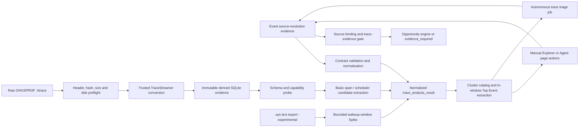

# Trace 分析技术 Spec

> 状态：`Aligned Draft - raw .htrace Phase A`  
> 职责：把 Trace 团队的分析结果或原始 OpenHarmony `.htrace` 转为可解释、可追溯的 `trace_analysis_result`。  
> 下游：异构机会识别引擎只消费该统一结果，不直接解析原始 trace。  
> 共同契约：artifact、源码绑定、状态机、错误码与质量门禁遵循 `cross_spec_contract.md`。

## 1. 范围与输入分层

本模块有两个**正式主输入**，它们解决不同层次的问题，不能要求用户同时提供。

| 输入 | 提供方 | 产出能力 | 证据等级与限制 |
|---|---|---|---|
| `trace_analysis_result` / Trace 团队 JSON report | Trace 专项团队 | 规范化已识别的热点、调用链、critical path、场景 profile 和可能的源码位置 | 上游字段原样保留；本模块不重新推断其关键路径。源码和 revision 仍须通过 source binding 校验。 |
| 原始 `.htrace` | 用户、设备采集流程 | 通过可信 TraceStreamer 转换后提取基础 callstack span、调度 slice、wakeup 候选、事件覆盖与时间窗口 | 仅为 `partial` 的基础事实分析；不自动声称 critical path、源码行号、GPU 时间或 DMA 因果。 |

`.sys` 文本调度 trace 仍保留为开发期 `experimental` Spike：它不是主输入，不能替代 `.htrace` 或 Trace 团队报告。

本模块不负责设备采集、`hdc` 管理、任意第三方 trace 格式、源码 AST 分析、KB 检索或异构单元推荐。对 `.htrace` 的解析依赖 OpenHarmony TraceStreamer，不在业务代码中手写 protobuf 逆向解析器。

## 2. 数据流与职责边界



`raw_htrace` 路径与外部报告在 `trace_analysis_result` 汇合，但不会抹平信息来源：结果必须保留 `input_kind`、adapter/profile 版本、原始 hash、转换器 provenance、capability probe 和所有降级原因。机会引擎可以据此区分“上游已确认关键路径”与“本地基础候选”。

## 3. 原始 `.htrace` 适配器

### 3.1 输入、转换与缓存

1. 先验证 `OHOSPROF` container magic，流式保存原始文件并计算 SHA-256；失败也要写入 `raw_trace_input` artifact。
2. 通过参数数组调用受信任的 TraceStreamer，禁止 shell 拼接。部署环境通过 `HETERO_TRACE_STREAMER` 指定二进制；当前工作区的本地 archive 仅是明确的开发 bootstrap，不能作为生产下载机制。
3. 转换前检查派生空间 `max(512 MiB, 3 x input_bytes)`；默认单文件上传上限为 `HETERO_MAX_TRACE_UPLOAD_BYTES=2 GiB`，可由部署配置调整，且受 artifact 总配额约束。
4. 以 `htrace_sha256 + trace_streamer_binary_sha256` 作为转换缓存 identity，对同一 cache entry 加锁；DB、stdout/stderr 日志和 converter hash 都作为证据保留。
5. 转换运行上限为 300 秒。超时、非零退出、不可读 DB、空间不足分别产生稳定错误码和 `htrace_analysis_failure` artifact，绝不伪造空结果。

转换 artifact 至少包含：输入 hash、TraceStreamer 名称/二进制 hash/解析来源、缓存 key、派生 DB hash/大小/受管相对路径、日志引用、SQLite schema hash、表数量和允许公开的 converter metadata。派生 DB 只读打开；原始 trace 和 DB 不被后续分析原地修改。

### 3.2 能力探测与基础提取

适配器先探测表和列，而非假定所有设备输出相同 schema。首版可使用的事实包括：

| 证据 | 可提取内容 | 允许的结论 |
|---|---|---|
| `callstack` | span 的开始、持续时间、父子关系（若存在）、线程/进程映射（若存在） | 单次/分组 span 候选、调用次数、峰值 span、时间窗口。 |
| `sched_slice`、`thread_state` | 调度和线程状态覆盖 | 仅作为调度可用性与后续增强的证据。 |
| `raw:sched_wakeup` + `instant` + `thread` + `process` | 20 ms wakeup-window、唤醒方/被唤醒方 endpoint、线程/进程 trace 标签和模块摘要 | 与 span 候选并列的 scheduler window 候选；不是 CPU active time、源码归属或因果关键路径。缺表时降级到 task/itid 标签。 |
| `frame_slice`、`gpu_slice`、`dma_fence` | 相关表是否存在及记录数 | 有记录时仅保留覆盖事实；无记录只能说明此输入不支持相应结论，不能推断设备未使用 GPU/DMA。 |

存在 `parent_id` 时，适配器可以给出 `direct_child_duration_subtraction` 的 `exclusive_estimate`；它只是对直接子 span 求和后的估算，不是 CPU self-time，也不能在重叠或不完整 span 下被当作精确执行时间。缺少 parent/thread/process 表时必须继续输出可用的最小候选，并把不可用能力标为 `false`。

当 `raw.sched_wakeup` 与 `instant(ts, ref, wakeup_from)` 可关联时，适配器按 `raw.itid` 识别被唤醒端点，并按 `wakeup_from` 识别唤醒端点；二者再可选关联 `thread` / `process`。每个 20 ms window 输出 `module_summary`：`module_names`、各模块的 trace-label 命中数、`top_function_name` 回退显示、`system_module_only` 和 `classification=trace_label_heuristic_v1`。它只使用 FFRT、Binder/IPC、kernel scheduler、system service、Render/Rosen、Graphics/GPU、ArkUI/UI、Media/Codec、Network/I-O 等低基数类别，绝不替代 ELF/source module resolution。

为避免长 trace 让浏览器和 Agent 失去交互性，raw 路径最多处理 `500,000` 个 wakeup 事件，并最多输出 `2,000` 个 window cluster；`quality.scheduler_catalog` 必须报告输入事件数、已处理事件数、可用/已输出 window 数、各上限、截断状态和 endpoint mapping 能力。当前有 callstack 时也必须保留 scheduler catalog，不能因 span 候选存在而丢弃 wakeup 证据。

### 3.3 Cluster 内 Top Event 与代码证据

`trace_cluster` 的作用是把大规模调度现象缩小为一个可审计时间窗；它本身不是“需要优化的函数”。对每个已选或被自动分诊选中的 cluster，适配器必须从不可变转换 DB 中提取与 `[start_ns, end_ns)` 有时间重叠的 `callstack` event，并输出有界的 `trace_event_catalog`。首版最多保留 24 个 event，排序必须以该 cluster **窗口内**的 `overlap_total_ns` 降序为主，随后以 `max_span_duration_ns`、`occurrence_count` 和稳定 event name 打破平局；不得把整个 trace 的累计时间拿来替代窗口贡献。

每个 event 至少包含稳定 `event_id`、原始 `event_name`、`event_kind`、窗口重叠总时长、出现次数、最大 span、首末时间和原始 event evidence。没有可用 callstack 表时，catalog 必须返回可机读的 `unavailable`/`partial` quality 与原因，不能把 wakeup 标签伪造成函数事件。

当 event 符合文本 HiTrace 编码 `H:<instrumentation_name>|<level><tag_bits>` 时，catalog 还应附加 `hitrace_marker`。`level` 是输出级别，`tag_bits` 是每两位十进制编码的 tag bit：例如 `I38` 表示 Info 级别和 bit 38，`M0538` 表示 Commercial 级别、选项 bit 05（`HITRACE_TAG_COMMERCIAL`）以及模块 bit 38（`HITRACE_TAG_GRAPHIC_AGP`），不能把整个 `M0538` 误解为一个模块号。tag 目录必须由当前 connector 中的 `hitrace_meter.h` 提取；当 connector 是局部源码仓时可使用受控 workspace reference header，但必须在 `hitrace_marker.catalog` 记录 header SHA、mapping SHA、相对路径和 `origin=workspace_reference`。该 reference 只能解释 tag，不扩大源码检索范围。

为避免对 30 GB connector 做无边界全仓扫描，`data/hitrace_tag_source_scope_hints.json` 是版本化的**检索范围知识**：把已知 `HITRACE_TAG_*` 映射到候选 OpenHarmony 相对源码子树。source resolver 必须先在这些子树中搜索，并在 artifact 中记录该 JSON 的 SHA、实际 roots、缺失的候选 roots、tag 和 fallback 策略。若 connector 是工作区包装目录且源码位于其 `openharmony/` 子目录，resolver 可在该 connector 内将相同逻辑 scope 映射到 `openharmony/<relative_root>`；这不是跨 connector 查询。它只优化检索范围，既不证明模块 ownership，也不构成 source binding；未命中布局的自定义 connector 才可在受限预算内退回 connector root。resolver 不得跨越用户选择的 connector 到另一份 workspace 源码；若 `HITRACE_TAG_ACE` 指向的 `foundation/arkui/napi` 不在 connector 中，结果必须说明缺失 scope，而不是伪造源码位置。

选择 event 后可产生一个不可变 `trace_event_source_resolution` artifact，用于展示对应代码块或未解析原因。它的 `resolution.state` 必须严格区分：

| 状态 | 含义 | 是否可进入 AST / KB |
|---|---|---|
| `declared_source` | 上游报告或独立 source binding map 显式给出 file/line；仍须记录 binding match level。 | 仅 `exact` source binding 时可以。 |
| `symbol_text_candidate` | 在当前 workspace 的受限文本搜索中找到可能定义/声明位置；raw trace 没有证明该位置就是 event 对应调用点。 | 否。仅供浏览和补充映射。 |
| `symbol_text_reference` | 仅找到调用/引用文本，例如某个 caller 中出现该函数名。 | 否。绝不能当作函数实现或 trace 映射。 |
| `instrumentation_point_exact` | HiTrace 插桩 label 与源码宏字面量完全相同，且序列化 tag 与直接宏参数或已解析 wrapper 宏一致；代码块定位在插桩行，并附带文本化外层函数。 | 否。它证明的是插桩协议匹配，不是 trace-source binding，也不能排除重复 label。 |
| `instrumentation_point_function_derived` | 源码宏使用 `__func__` / `__PRETTY_FUNCTION__` 派生 label；event 中的函数标识与同一函数体内的宏及 tag 一致。 | 否。编译器格式、重载和重复函数名仍可能造成歧义。 |
| `instrumentation_point_pattern` | 动态 format string 或静态前缀与 event 匹配，且 tag 一致。 | 否。只用于浏览、去重和请求更强 source map。 |
| `instrumentation_point_candidate` | 找到疑似插桩宏，但 tag 验证或 label 等价性不完整。 | 否。只用于补充证据。 |
| `unresolved` | event 是调度标签、IPC 标签、无可搜索符号或无候选文件。 | 否。 |

文本搜索必须有受控文件类型、候选数量、文件大小与总超时上限。普通符号检索的搜索词只能来自可归一化的函数/方法标识符；HiTrace 检索可以使用经 decoder 拆出的插桩 label，但只能在含 trace 宏或受控 `StartTrace` API 的局部上下文中验证字面量/格式串，并以 tag 宏或 wrapper 宏证据约束，不能把任意 trace label 当作全仓函数查询。动态 label 的运行时字段（例如 `name:fs.access#...`、`traceid:...`）必须剥离为静态前缀后匹配源码字面量；匹配等级仍是 `instrumentation_point_pattern`，不是函数名或精确 source binding。展示的代码块必须标明上述状态、方法、source binding match level、插桩宏、tag match 和行号来源。它是诊断证据，不是 raw trace 的 source-location 声明。

### 3.3.1 Trace-Wide Event Self-Time Discovery

cluster 是调度/时间窗观察路径，不是唯一的热点发现器。平台必须定义可扩展的 `trace_hotspot_discovery` registry；每个 discovery 都声明 `discovery_id`、profile version、适用输入、作用域、排序指标、资源上限、质量/降级原因和 event evidence。discovery event 复用 `trace_event_catalog` 与 `trace_event_source_resolution`，但 catalog scope 必须明确是 `trace_hotspot_discovery`，不得伪装成 cluster。

首个 trace-wide discovery 为 `event_self_time`。仅当转换 DB 的 `callstack` 同时具有 `id`、`ts`、`dur`、`name`、`parent_id` 时可用；它对每一个正时长、非空 name 的 span 计算：

```text
self_time_estimate(span) = max(0, span.duration - sum(duration of direct positive-duration children))
event_context_key = (event_name, callid, process_name, thread_name)
event_self_time_estimate = sum(self_time_estimate(span) for spans with the same event_context_key)
```

`event_self_time` 的 profile 为 `htrace-event-self-time-v2`。它必须同时输出低基数 `module_catalog` 和每行的 `trace_module` / `trace_context`。模块判据按以下顺序：header-derived HiTrace module tag（例如 `I39 -> HITRACE_TAG_ACE -> ArkUI / UI`）优先；其次是 event 名；再其次是 process/thread identity；无法归类时显式输出 `Unclassified`。tag bit 到 macro 的解释必须来自带 SHA 的 `hitrace_meter.h` catalog，macro 到平台分类的映射是版本化规则，不能硬编码 bit 数字。模块字段是 trace 分诊标签，不是 source-module ownership 或 trace-to-source binding。

模块汇总必须在全量已扫描的 event-context group 上计算，模块过滤在每模块 Top-N 截断**之前**发生。实现可对大 trace 设置有质量字段的 group 扫描上限；一旦可能截断，返回 `event_group_scan_may_be_truncated`、扫描数和上限。这样全局 Top 100 被 Binder/FFRT 占据时，选择 `ArkUI / UI` 仍可看到该模块自己的 Top 100，而不是得到空表。Explorer 的第一层必须按模块 self-time 总量排序；展开一个模块时才请求该模块自己的 Top-N event，避免将全局截断结果误显示为模块明细。结果按 `self_time_estimate_total_duration`、最大单次 self-time estimate、inclusive total、调用次数和稳定 context key 降序排列，默认最多返回 100 个 event。每行至少保留 `event_id`、原始 event name、模块分类证据、process/thread context、self/inclusive 总时长、最大 self-time estimate、调用次数、首末时间和最多 8 个按单次 self-time estimate 排序的 `callstack:<id>` evidence refs。点击 event 后使用与 cluster Top Event 完全相同的 source-resolution path，HiTrace tag 解码、插桩宏反查和 source-binding 门禁不得因 discovery 类型而放宽。

该值是 `direct_child_duration_subtraction` 的 **instrumentation-span exclusive estimate**，不是 sampled CPU self time、CPU active time、critical path 或 source binding。`inclusive duration` 是 event span 包含的整段时间；`self-time estimate` 从中扣除直接子 span；页面可并列展示 `child covered = inclusive - self estimate` 以解释嵌套 call stack，但该差值不是严格 CPU 子调用时间，直接子 span 重叠、缺失或不完整时可能低估或失真。`parent_id` 缺失、无正值或 DB 不可读时必须返回 machine-readable `unavailable`/`partial` quality 和原因，不能退化为以 inclusive duration 冒充 self-time。它用于扩大“待复核热点 event”覆盖面，后续 CPU sampling、Trace 团队 critical path、GPU timeline、业务 frame 规则等 discovery 应以新 `discovery_id` 并列接入。

### 3.4 热点、时间局部性与关键路径边界

原始 trace 基础候选至少展示：`inclusive_total_duration_ms`、`avg_duration_ms`、`max_duration_ms`、`call_count`、`trace_window_ms` 和可回溯的 peak event。排序和 `temporal_pressure` 必须以单次/短窗口压力为主，不能把长 trace 内的累计时间直接当作热点结论。

因此 `10 ms / 10 s` 的低均值、低峰值累积与一次或短窗口内的 `10 ms` span 必须得到不同标记。基础 `.htrace` 结果仍不等价于用户场景的 frame critical path：它的 `critical_path_metrics.available` 固定为 `false`，除非后续由具备因果图和场景 profile 的 Trace 团队结果显式补充。

Trace symbol 只能作为 `raw_htrace_symbol_only` 证据。不得由函数名猜测文件、行号或 Git revision；`symbol_text_candidate` 和 `symbol_text_reference` 也不改变这一事实。没有独立 `source_binding_map` / 精确 source snapshot 时，AST 和自动 KB 匹配保持阻断。

## 4. Cluster、Event 与机会输入门禁

`trace_cluster` 是可选择的观察单元，不是关键路径的同义词。每个 cluster 必须有根事件、时间范围、线程引用、边摘要、时钟/数据质量、profile、选择状态和原始 artifact 引用。对于 raw-htrace span cluster，`analysis_scope` 必须明确为 `basic_span_candidate_not_critical_path`；scheduler window 则为 `scheduler_wakeup_window_not_critical_path`。

Cluster Explorer 可将 `system_module_only=true` 的 FFRT、Binder/IPC、kernel scheduler 和 system service 链默认折叠，但必须允许恢复显示，且不能折叠同时命中 Render/GPU/Media/ArkUI 等非系统类别的混合链。页面的模块筛选是仅影响展示的 read action，不改写原始 artifact、排序证据或机会结论。

```text
selected cluster
  + ranked in-window event
  + source-resolution evidence
  + temporal-pressure candidate
  + exact source binding
  + sufficient trace evidence for the requested decision
  => opportunity-engine input
```

手动 Explorer 与 Agent 的统一操作对象是 **selected event**，不是 cluster：

```text
event_self_time event OR cluster Top Event
  -> trace_event_source_resolution
  -> exact snapshot binding + declared_source gate
  -> AST feature extraction
  -> deterministic KB matching
  -> opportunity_report OR auditable partial gate
```

因此 UI 可以把 `热点 Event` 和 `Wakeup Cluster` 作为并列 Tab，但二者必须在 event 层收敛。source-resolution 为 `instrumentation_point_*`、`symbol_text_*` 或 `unresolved` 时只能展示代码/搜索证据，机会识别必须输出 `source_location_required`，不能调用 AST/KB；`declared_source` 但 AST 不可用或 KB 无命中时分别输出 `ast_features_required` 或 `no_kb_match`。该行为使人工路径与未来自动分诊共享同一证据门禁而不共享“必须先选 cluster”的限制。

上述是用于排障和解释的**人工浏览路径**：`cluster -> Top Event -> code block -> evidence gate`。它不是未来生产流程中必须由人逐次点击的状态机。自动化运行应以同一不可变输入执行 `trace-auto-triage`：遍历 cluster catalog，按时间局部性、模块类别、系统链折叠规则和 event 窗口贡献进行确定性排序；对入围 event 执行 source resolution、binding 校验和后续 AST/KB 门禁；每一次选择都写入带排名、规则版本和反向证据的 selection artifact。

自动化不允许为了“无人参与”而降低证据要求。缺少 critical path、exact source binding、权威 source map 或足够时间压力时，run 必须在 `evidence_required`、`unresolved` 或 `not_heterogeneous_candidate` 终态完成，并报告下一类可自动接入的证据（例如 source map、debug info 或 Trace 团队 report）；不得停在“等待用户选择 cluster”，也不得猜测源码后继续 AST/KB。

`blocking_dominant`、`io_dominant`、`driver_wait_dominant` 是异构卸载负向标签。它们可以引导 pipeline、同步或 overlap 调优，不得仅凭名称直接推荐 GPU/NPU 卸载。基础 raw-htrace 输入若缺少关键路径/场景证据，机会报告必须保留 `temporal_evidence_required` 或 `source_location_required`，而不是升级为 production 结论。

## 5. 输出、失败与验收

所有路径输出共同契约中的 `trace_analysis_result`，其中每个 `hotspot_candidate` 包含函数引用或 unresolved 原因、时间指标、pressure、critical-path 状态、dominance、evidence refs。原始 `.htrace` 成功路径还必须产生：

```text
raw_trace_input
  -> htrace_conversion
  -> trace_analysis_result(input_kind=raw_htrace, status=partial)
  -> trace_event_catalog (on selected/auto-triaged cluster or trace-hotspot discovery)
  -> trace_event_source_resolution (when a source lookup is requested)
  -> code_feature_inspection + kb_match_result (only exact + declared_source selected event)
  -> opportunity_report + analysis_run(run_kind=manual_trace_event or policy-driven automation)
```

失败路径保留 `raw_trace_input -> htrace_analysis_failure`。稳定错误码至少包括 `HTRACE_HEADER_INVALID`、`HTRACE_READ_FAILED`、`TRACE_STREAMER_UNAVAILABLE`、`TRACE_STREAMER_TIMEOUT`、`TRACE_STREAMER_FAILED`、`TRACE_DB_INVALID` 和 `TRACE_DISK_SPACE_INSUFFICIENT`。

| 编号 | 验收标准 |
|---|---|
| T1 | 外部 report 与 raw `.htrace` 都可独立导入，且都收敛到版本化 `trace_analysis_result`。 |
| T2 | raw `.htrace` 的每个候选可回溯到输入 hash、converter hash、DB hash 和 trace event ID。 |
| T3 | 相同输入、converter binary 和 profile 得到稳定语义输出；并发同 key 不交错写日志或 DB。 |
| T4 | 缺少可选 SQLite 表/列时降级而非崩溃；声明的能力缺失必须出现在 quality diagnostics。 |
| T5 | `.htrace` 基础路径不生成 critical path、源码行号、GPU 时间或 DMA 因果的虚假结论。 |
| T6 | total time、单次延迟、短窗口压力与关键路径贡献可独立展示；`10 ms / 10 s` 与短窗口 `10 ms` 不能等价处理。 |
| T7 | `unknown`/`compatible` source binding 不得触发自动 AST 和 KB 匹配。 |
| T8 | `.sys` Spike 持续标为 experimental，只有提供可重复 fixture、事件覆盖和人工可解释样本后才可升级。 |
| T9 | wakeup catalog 的每个 cluster 显示模块摘要或 top task/function 回退；纯系统模块簇可默认折叠，混合链与模块筛选不丢失原始证据。 |
| T10 | 已选 scheduler window 的 Top Event 只按窗口内 callstack overlap 排名，并保留 event ID、排序指标、提取上限和原始 DB evidence。 |
| T11 | `symbol_text_candidate` / `symbol_text_reference` 的代码块始终标注为文本证据；它们不能触发 AST、KB 或 production opportunity。 |
| T12 | 自动分诊不依赖人工逐级选择：它对每个入围 cluster/event 写出确定性 selection artifact，并以 `completed`、`evidence_required`、`unresolved` 或 `not_heterogeneous_candidate` 终态结束。 |
| T13 | 自动分诊与手动 Explorer 使用同一 event 排序、source-resolution 和 evidence-gate 实现；两者对相同 artifact 输入不得得到互相矛盾的证据状态。 |
| T14 | `Ixx`/`Mxx` HiTrace event 必须从有 SHA 的 header-derived tag catalog 解码；静态 label、`__func__`/`__PRETTY_FUNCTION__`、wrapper 宏和格式串命中须分别保留证据等级，且任何插桩点状态均不得绕过 source binding 进入 AST/KB。 |
| T15 | 已知 tag 的大 connector 必须优先使用有 SHA 的 source-scope JSON 搜索对应子树；artifact 必须保留 scopes/fallback，scope hint 不得被解释为 ownership 或 source binding。 |
| T16 | `event_self_time` 在具备 `parent_id` 的 raw `.htrace` 上按 direct-child subtraction 生成稳定的 trace-wide event 排名、保留 callstack evidence，并可进入同一 source-resolution UI；缺少 parent links 时必须明确不可用，不能输出 inclusive duration 伪 self-time。 |
| T17 | self-time discovery 必须先按 `event_name + execution context` 做 HiTrace-tag/identity 模块分类，再按模块过滤并截断 Top-N；`I39/HITRACE_TAG_ACE` 等已解码标签不得因全局 FFRT/Binder 排名而消失。模块汇总与扫描上限必须可审计，且不得被解释成源码 ownership。 |

## 6. 与其他 Spec 的边界

- Web 入口、Agent action、缓存展示与仓库管理见 `heterogeneous_enablement_web_platform_spec.md`。
- KB schema、AST 特征与机会匹配见 `heterogeneous_optimization_opportunity_platform_spec.md`。
- 算法签名、Tree-sitter 函数 profile 与按需 Clang 语义复核见 `algorithm_signature_based_heterogeneous_opportunity_detection.md`；其中 trace 章节以本 spec 为准。
